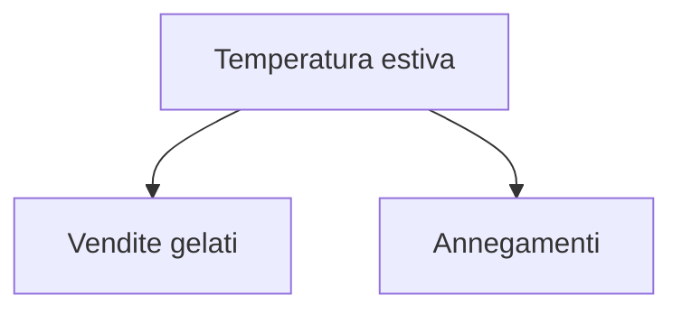

# Judea Pearl, DAG e rivoluzione causale

Binario di questa lezione: **ml-tabellare**.

Per decidere sotto incertezza non basta osservare correlazioni: serve un metodo per distinguere associazione e causalità. Il lavoro di Judea Pearl, con i DAG e quella che lui chiama la rivoluzione causale, dà gli strumenti per rendere esplicite le assunzioni, riconoscere i confondenti e ragionare sugli interventi.

## I tre livelli della causalità di Pearl

| Livello | Nome | Domanda | Strumento |
|---------|------|---------|-----------|
| **L1** | Associazione | Cosa vedo | Probabilità condizionale, correlazione, regressione |
| **L2** | Intervento | Cosa succede se faccio X | DAG con do-calculus, esperimenti randomizzati |
| **L3** | Controfattuale | Cosa sarebbe successo se avessi fatto Y invece di X | Modelli strutturali causali |

Non puoi rispondere a domande di L2 o L3 usando solo strumenti di L1. Un modello di regressione descrive associazioni. Per passare a cosa succede se fai X devi avere un modello causale esplicito.

Verdetto: se la domanda parla di interventi, modella il grafo e progetta l'esperimento, perché nessuna regressione su dati osservati risponde da sola a cosa succede se fai X.

## I DAG: Directed Acyclic Graphs

Un DAG è un grafo diretto aciclico che rappresenta relazioni causali tra variabili. Una freccia indica causalità diretta; l'assenza di freccia è un'assunzione altrettanto importante di non causalità.

**Esempio: gelati e annegamenti**

La temperatura estiva causa sia le vendite di gelati sia gli annegamenti. Non c'è freccia tra gelati e annegamenti: assumiamo che non ci sia causalità diretta. Controllando per la temperatura, la correlazione sparisce.

**Esempio: onboarding di un'app**

Due percorsi causali dall'onboarding alla retention: uno mediato dall'attivazione, uno diretto. Il DAG mostra quali variabili controllare per isolare l'effetto.

## Il do-operator: distinguere vedere da fare

P(Y | X) è la probabilità di Y dato che ho osservato X, ed è una domanda di livello L1. P(Y | do(X)) è la probabilità di Y se forzo X, ed è una domanda di livello L2.

Esempio: chi usa la feature search ha retention più alta. La probabilità condizionata è alta, ma cosa succede se forzi un utente a usare la search potrebbe essere tutt'altra cosa. Forzare è esattamente ciò che fa un A/B test. Senza esperimenti puoi approssimare l'intervento aggiustando per i confondenti, ma ti serve conoscere il DAG.

## Come applicare Pearl oggi

Disegna il DAG prima di modellare, anche solo con carta e penna, e chiediti quali variabili causano quali e cosa confonde cosa. Poi individua il livello della tua analisi: se la domanda è di tipo L2 ma stai usando strumenti L1, stai rispondendo male alla domanda sbagliata. Infine applica il criterio della backdoor: per stimare l'effetto causale di X su Y, controlla tutte le variabili che causano sia X sia Y.

## Esercizio su tre livelli

Al livello base scrivi in cinque righe obiettivo, metrica primaria, baseline, rischio principale e azione prevista per una decisione reale legata a questa lezione.

Al livello intermedio costruisci una tabella con almeno tre segmenti o scenari. Per ciascuno indica segnale, possibile spiegazione alternativa e controllo necessario prima di decidere.

Al livello research-grade disegna un piano di validazione: ipotesi, dati necessari, criterio di esclusione, soglia decisionale e controllo post-decisione. Specifica cosa ti farebbe cambiare idea, lavorando su un dataset con almeno 200 righe.

## Errore tipico da evitare

Questa lezione non è una definizione da ricordare, è un protocollo decisionale. Evita di presentare metriche senza baseline, grafici senza ipotesi o raccomandazioni senza stimare il costo dell'errore. Chiediti sempre: se questo risultato fosse falso, quale decisione sbaglieresti. Se non sai rispondere, devi approfondire prima di decidere.

*Riferimenti:* Pearl, J. (2000). Causality: Models, Reasoning, and Inference. Cambridge University Press. Pearl, J. e Mackenzie, D. (2018). The Book of Why. Basic Books. Pearl, J., Glymour, M. e Jewell, N. P. (2016). Causal Inference in Statistics: A Primer. Wiley.

## Cosa significa

La rivoluzione causale di Pearl separa tre domande diverse, vedere, fare e immaginare alternative, e assegna a ciascuna i suoi strumenti invece di chiedere tutto alla correlazione.

## Come si calcola

1. Scrivi la domanda causale e classificala: osservazione, intervento o controfattuale.
2. Disegna il grafo delle variabili con le frecce che credi vere e quelle che escludi.
3. Individua i confondenti, cioè le variabili che causano sia l'esposizione sia l'esito.
4. Se puoi, randomizza l'intervento e misura l'effetto sul gruppo trattato.
5. Se non puoi, aggiusta solo per i confondenti e dichiara le assunzioni non verificabili.

## Esempio verificato

Durante l'epidemia di colera del 1854 a Soho, Londra, John Snow segnò ogni caso su una mappa e trovò una concentrazione anomala intorno alla pompa di Broad Street. Invece di fermarsi alla correlazione, convinse le autorità a rimuovere la maniglia della pompa, forzando la variabile sospetta come in un intervento pianificato. La distribuzione dei casi reggeva solo leggendo la pompa come causa comune, non come coincidenza. È la lezione di Pearl con 150 anni di anticipo: il grafo va disegnato prima e l'intervento decide cosa è causa.

## Verifica

1. La tua domanda chiede cosa vedi, cosa succede se intervieni o cosa sarebbe successo?
2. Quale freccia del tuo grafo è un'assunzione e non un fatto?
3. Quale confondente causa sia l'esposizione sia l'esito nel tuo caso?
4. Cosa ti impedisce di randomizzare e come lo compensi?
