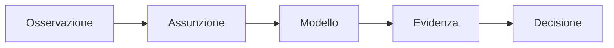

# Karl Popper: falsificabilità e sperimentazione

Nel 1919, un giovane Karl Popper notò qualcosa di strano. I marxisti trovavano conferme al marxismo ovunque guardassero. Gli psicoanalisti freudiani trovavano conferme alla psicoanalisi in ogni paziente. Gli astrologi trovavano conferme all'astrologia in ogni oroscopo. Tre teorie completamente diverse, eppure tutte e tre sembravano "vere" perché trovavano continuamente *conferme*. Popper capì che il problema non era nelle teorie ma nel *metodo*: cercare conferme non prova nulla. L'unico test che conta è quello che può *smentire* la tua teoria. Questa idea, pubblicata nella *Logica della scoperta scientifica* (1934), è il fondamento di tutta la scienza moderna ed è la bussola più affidabile per un analyst che non vuole innamorarsi delle proprie ipotesi.

## Falsificazione vs verificazione

La scienza pre-Popper funzionava per *induzione* (Bacon: raccogli dati, trova pattern, generalizza). Popper disse: no. L'induzione non ha giustificazione logica (Hume docet). Il metodo scientifico vero è:

1. Formula un'ipotesi *falsificabile* (che può essere smentita dai dati)
2. Cerca attivamente dati che la smentiscano
3. Se resiste alla falsificazione, la accetti *provvisoriamente*

La differenza è radicale. L'approccio verificazionista si chiede: "I dati supportano la mia ipotesi?" Cerca conferme, e le trova sempre — perché il confirmation bias te le fa vedere. L'approccio falsificazionista si chiede: "Quali dati *dovrei* vedere se la mia ipotesi fosse sbagliata? Li vedo?"

**Esempio concreto: A/B test**

- Approccio verificazionista (errato): guardi il test dopo 2 giorni. La variante B sta andando meglio di A. Concludi: "B è migliore." Fermo il test.
- Approccio falsificazionista (corretto): definisci a priori l'ipotesi nulla ("B NON è migliore di A"). Decidi la dimensione del campione e la durata minima PRIMA di guardare i dati. Se dopo il periodo stabilito il p-value è sotto la soglia, hai *falsificato* l'ipotesi nulla. Solo allora accetti provvisoriamente B.

## Cosa significa per l'analisi dati

### 1. Peeking = barare

Ogni volta che guardi i risultati di un test prima del tempo stabilito, stai facendo verificazionismo. "Ah, sta funzionando, fermiamoci qui!" È il peccato originale dell'A/B testing. Popper ti ricorda: devi decidere il criterio di falsificazione PRIMA e rispettarlo.

### 2. Ipotesi non falsificabili = pseudoscienza

Se non riesci a immaginare dati che smentirebbero la tua ipotesi, la tua ipotesi non è scientifica. "La nostra cultura aziendale sta migliorando" — come lo misuri? Quali dati ti farebbero dire "no, non sta migliorando"? Se non sai rispondere, stai facendo astrologia aziendale.

### 3. Il test migliore è quello che rischi di perdere

Un analyst che presenta un'analisi che conferma ciò che il CEO già pensava non sta facendo scienza: sta facendo servilismo. Il valore di un analyst si misura dalla sua capacità di dire: "Ho cercato di smentire la mia ipotesi, e non ci sono riuscito. Ecco perché penso sia robusta."

## Caso reale: Einstein vs l'eclissi del 1919

Popper usava Einstein come esempio perfetto di scienza falsificabile. La relatività generale faceva una predizione precisa: durante un'eclissi solare, la luce delle stelle sarebbe stata deviata dalla gravità del sole di un angolo specifico. Eddington organizzò una spedizione per misurare l'eclissi del 1919. Se la deviazione fosse stata diversa da quella predetta, la relatività sarebbe stata *falsificata*.

La deviazione misurata corrispondeva alla predizione. La relatività sopravvisse al test. Ma — crucialmente — sopravvisse a un test che *avrebbe potuto fallire*. Era falsificabile, ed è per questo che era scienza.

**Contrasto con l'astrologia:** "Mercurio in Sagittario porta opportunità finanziarie." Se questa settimana ricevi un aumento: "Visto? Astrologia vera!" Se non ricevi nulla: "Mercurio era in aspetto dissonante con Giove." Non esiste dato che possa smentire l'astrologia. Non è falsificabile. Non è scienza.

Quante metriche aziendali funzionano come l'astrologia? "Employee engagement alto = performance alta." Se performance sale: engagement funziona. Se performance scende: "ci sono fattori esterni." La metrica non è falsificabile, quindi non significa nulla.

## Checklist popperiana per le tue analisi

1. **Prima di analizzare:** Qual è l'ipotesi che voglio testare? Quali dati la *smentirebbero*?
2. **Durante l'analisi:** Sto cercando attivamente dati che contraddicono la mia ipotesi? O solo conferme?
3. **Prima di presentare:** Se qualcuno volesse dimostrare che ho torto, cosa dovrebbe trovare? L'ho reso possibile? O la mia analisi è infalsificabile?

---

*Riferimenti:*
- Popper, K. (1934). *Logik der Forschung* (The Logic of Scientific Discovery). Springer.
- Popper, K. (1963). *Conjectures and Refutations: The Growth of Scientific Knowledge.* Routledge.
- Thornton, S. (2023). "Karl Popper." *Stanford Encyclopedia of Philosophy.*

## Controllo di qualità

Prima di usare \"karl popper: falsificabilità e sperimentazione\ in una decisione, controlla sempre completezza, duplicati, timezone, definizioni cambiate e segmenti esclusi. Molte analisi apparentemente sofisticate falliscono perché il dato di partenza misura un comportamento diverso da quello che il team crede di osservare.

## Interpretazione per segmenti

La media aggregata è solo il punto di partenza. Segmenta per canale, coorte, piano, paese, device e maturità dell'utente. Se due segmenti si muovono in direzioni opposte, la media non rappresenta nessuno dei due e può portare a una decisione sbagliata.

## Decisione operativa

Ogni analisi deve terminare con una scelta possibile: continuare, fermare, iterare, investire, rimuovere o approfondire. Se \"karl popper: falsificabilità e sperimentazione\ non cambia una decisione, probabilmente manca ancora il collegamento tra metrica e azione.

## Problema reale

Nel lavoro su fondamenti filosofici dell'analisi dati, **Karl Popper: falsificabilità e sperimentazione** serve a risolvere un problema concreto: capire quando un dato sostiene davvero una decisione e quando invece nasconde assunzioni, bias, causalita fragile o una domanda formulata male. La domanda non e se il concetto sia interessante in astratto, ma quale decisione migliora quando lo applichi con dati affidabili e con una soglia di errore esplicita.

Questa lezione va studiata come uno strumento operativo: entro la fine devi saper Comprendere il problema analitico e il contesto decisionale; Applicare esempi, metriche e controlli a casi reali. Se non riesci a collegare il concetto a una scelta reale, la conoscenza resta decorativa e non diventa competenza.

## Modello concettuale

Il modello mentale e sequenziale: prima si formula la domanda, poi si traduce in unita osservabili, quindi si valuta la qualita del dato e solo alla fine si decide. Saltare un passaggio produce analisi eleganti ma fragili.

| Passaggio | Domanda guida | Output atteso |
|---|---|---|
| Framing | Quale decisione deve cambiare? | Una scelta concreta, non una curiosita |
| Misura | Quale segnale rappresenta il fenomeno? | Metrica, fonte e granularita |
| Confronto | Rispetto a quale baseline interpreto il risultato? | Benchmark o controfattuale plausibile |
| Azione | Che cosa faccio se il segnale supera la soglia? | Decisione, owner e prossimo controllo |

## Formalizzazione rigorosa

Formalizza **Karl Popper: falsificabilità e sperimentazione** come una relazione tra quattro elementi: unita di analisi, segnale, baseline e decisione. Nel contesto di questa lezione l'unita principale e **osservazione, ipotesi, variabile, meccanismo causale o criterio di evidenza**. Il segnale da osservare deve essere collegato a **forza dell evidenza, coerenza causale, robustezza delle assunzioni e costo dell errore decisionale**, mentre la baseline deve essere scelta tra **spiegazione alternativa, controfattuale, gruppo comparabile o scenario senza intervento**.

Una formulazione robusta segue questa logica:

| Elemento | Definizione operativa per questa lezione |
|---|---|
| Unita | osservazione, ipotesi, variabile, meccanismo causale o criterio di evidenza |
| Segnale | forza dell evidenza, coerenza causale, robustezza delle assunzioni e costo dell errore decisionale |
| Baseline | spiegazione alternativa, controfattuale, gruppo comparabile o scenario senza intervento |
| Decisione | accettare, rifiutare o riformulare una spiegazione prima di usarla in un contesto aziendale |
| Rischio | Confondere correlazione, qualita del dato e causalita decisionale |

La regola pratica e semplice: una misura e utile solo se riduce l'incertezza su una decisione specifica. Se non cambia una scelta, e documentazione; se cambia una scelta senza controlli, e rischio.

## Esempio o caso studio

Un comitato interpreta una crescita di retention come prova che una nuova iniziativa abbia funzionato. La lezione costringe a distinguere osservazione, spiegazione, assunzione e decisione prima di trasformare il dato in azione.

Applicando **Karl Popper: falsificabilità e sperimentazione**, il team costruisce una lettura in tre colonne: cosa sappiamo, cosa assumiamo e quale decisione prendiamo. Questo formato impedisce di presentare un numero come se fosse una conclusione autosufficiente.

| Evidenza | Interpretazione prudente | Decisione conseguente |
|---|---|---|
| Segnale positivo ma non isolato | Il fenomeno esiste, ma la causa e ancora incerta | Cercare baseline o holdout |
| Segmento con risposta diversa | L'effetto medio nasconde eterogeneita | Analizzare coorti o sottogruppi |
| Costo operativo crescente | Il risultato va valutato sul margine | Applicare soglie economiche |

## Lab / esercizio

### Livello base

Prendi una decisione reale collegata a **Karl Popper: falsificabilità e sperimentazione** e scrivi in cinque righe: obiettivo, metrica primaria, baseline, rischio principale e azione prevista. Non usare piu di una metrica primaria.

### Livello intermedio

Costruisci una tabella con almeno tre segmenti o scenari. Per ciascuno indica segnale, possibile spiegazione alternativa e controllo necessario prima di decidere.

### Livello research-grade

Disegna un piano di validazione: ipotesi, dati necessari, criterio di esclusione, soglia decisionale e controllo post-decisione. Specifica anche che cosa ti farebbe cambiare idea.

### Dataset e materiali consigliati

Usa case study decisionali, metriche prodotto, risultati di esperimenti, DAG semplici, report analitici e serie storiche simulate. Se non hai dati reali, crea un dataset sintetico con 200-500 righe e almeno una colonna temporale, una colonna segmento, una metrica di outcome e una variabile di esposizione.

## Errore tipico da evitare

L'errore piu frequente e trattare **Karl Popper: falsificabilità e sperimentazione** come una definizione da ricordare invece che come un protocollo decisionale. In pratica succede quando si presenta una metrica senza baseline, un grafico senza ipotesi, o una raccomandazione senza costo dell'errore.

Un controllo utile e chiedersi: "se questo risultato fosse falso o instabile, quale decisione sbaglierei?". Se la risposta non e chiara, la lezione non e ancora stata applicata davvero.

## Quiz o checkpoint

1. Qual e la decisione concreta che questa lezione dovrebbe migliorare?
2. Quale baseline rende interpretabile il risultato?
3. Quale assunzione, se sbagliata, cambierebbe la conclusione?
4. Quale controllo minimo useresti prima di presentare la raccomandazione?

## Riepilogo operativo

**Karl Popper: falsificabilità e sperimentazione** e una competenza utile quando collega concetto, dato e decisione. Studiala partendo da un problema reale, formalizza il segnale, cerca una baseline credibile, costruisci un esempio e chiudi con un controllo pratico. Categoria: Fondamenti. Difficolta: advanced. Tempo stimato: 18 min.
