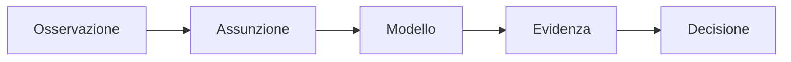

# Karl Popper: falsificabilità e sperimentazione

Popper porta nel corso una disciplina semplice: una tesi analitica vale solo se accetta il rischio di essere smentita. In una decisione sotto incertezza, questo significa progettare test che possano cambiare davvero la scelta operativa.

## Problema reale

Nel contesto dell'analisi dati, spesso ci si trova davanti a risultati che sembrano confermare una tesi senza però metterla davvero alla prova. Questo genera decisioni basate su assunzioni fragili, bias e causalità mal definite. Karl Popper ci insegna a distinguere quando un dato sostiene davvero una scelta e quando invece stiamo semplicemente cercando conferme, senza rischiare nulla. La domanda centrale è: come trasformare un'ipotesi in uno strumento operativo per decisioni sotto incertezza?

## Modello concettuale

Questo schema rappresenta il percorso logico: formulare una domanda, tradurla in dati osservabili, valutare la qualità dell'evidenza e infine decidere. Saltare uno di questi passaggi produce analisi che sembrano solide ma sono fragili e poco affidabili.

| Passaggio | Domanda guida | Output atteso |
|---|---|---|
| Framing | Quale decisione deve cambiare? | Una scelta concreta, non una curiosità |
| Misura | Quale segnale rappresenta il fenomeno? | Metrica, fonte e granularità |
| Confronto | Rispetto a quale baseline interpreto il risultato? | Benchmark o controfattuale plausibile |
| Azione | Che cosa faccio se il segnale supera la soglia? | Decisione, owner e prossimo controllo |

## Formalizzazione rigorosa

Per applicare Popper in azienda, formalizziamo quattro elementi chiave:

| Elemento | Definizione operativa |
|---|---|
| Unità | osservazione, ipotesi, variabile, meccanismo causale o criterio di evidenza |
| Segnale | forza dell'evidenza, coerenza causale, robustezza delle assunzioni, costo dell'errore decisionale |
| Baseline | spiegazione alternativa, controfattuale, gruppo comparabile o scenario senza intervento |
| Decisione | accettare, rifiutare o riformulare una spiegazione prima di agire |

Una misura è utile solo se riduce l'incertezza su una decisione specifica. Se non cambia una scelta, è solo documentazione; se cambia una scelta senza controlli, è rischio.

## Esempio o caso studio

Un team interpreta un aumento della retention come prova di successo di una nuova iniziativa. Applicando Popper, distingue chiaramente:

| Evidenza | Interpretazione prudente | Decisione conseguente |
|---|---|---|
| Segnale positivo ma non isolato | Il fenomeno esiste, ma la causa è incerta | Cercare baseline o gruppo di controllo |
| Segmento con risposta diversa | L'effetto medio nasconde eterogeneità | Analizzare coorti o sottogruppi |
| Costo operativo crescente | Valutare il risultato sul margine | Applicare soglie economiche |

Questo formato evita di presentare un numero come conclusione definitiva, favorendo decisioni informate.

## Lab / esercizio

### Livello base

Scrivi in cinque righe una decisione reale legata a Popper: obiettivo, metrica primaria, baseline, rischio principale e azione prevista. Usa una sola metrica primaria.

### Livello intermedio

Costruisci una tabella con almeno tre segmenti o scenari. Per ciascuno indica segnale, possibile spiegazione alternativa e controllo necessario prima di decidere.

### Livello research-grade

Progetta un piano di validazione: ipotesi, dati necessari, criteri di esclusione, soglia decisionale e controllo post-decisione. Specifica cosa ti farebbe cambiare idea.

### Dataset e materiali consigliati

Usa case study decisionali, metriche prodotto, risultati di esperimenti, DAG semplici, report analitici e serie storiche simulate. Se non hai dati reali, crea un dataset sintetico con 200-500 righe, includendo almeno una colonna temporale, una di segmento, una metrica di outcome e una variabile di esposizione.

## Errore tipico da evitare

Il più comune è trattare Popper come una definizione da ricordare anziché un protocollo decisionale. Succede quando si presentano metriche senza baseline, grafici senza ipotesi o raccomandazioni senza considerare il costo dell'errore. Un buon controllo è chiedersi: "Se questo risultato fosse falso o instabile, quale decisione sbaglierei?" Se non c'è risposta chiara, la lezione non è stata applicata.

## Quiz o checkpoint

1. Qual è la decisione concreta che questa lezione dovrebbe migliorare?
2. Quale baseline rende interpretabile il risultato?
3. Quale assunzione, se sbagliata, cambierebbe la conclusione?
4. Quale controllo minimo useresti prima di presentare la raccomandazione?

## Riepilogo operativo

Karl Popper ci insegna che la scienza, e quindi l'analisi dati, è una disciplina di decisioni sotto incertezza che richiede ipotesi falsificabili e test rigorosi. Applicare questa filosofia significa formulare ipotesi che rischiano di essere smentite, definire criteri di falsificazione prima di raccogliere dati, evitare il bias da conferma e collegare sempre il risultato a una decisione concreta. Solo così l'analisi dati diventa uno strumento affidabile per guidare scelte strategiche e operative.

---

## Approfondimento: Falsificazione vs Verificazione

Prima di Popper, la scienza si basava sull'induzione: raccogliere dati, trovare pattern e generalizzare. Popper rivoluzionò questo approccio sostenendo che l'induzione non ha fondamento logico. Il vero metodo scientifico è:

1. Formulare un'ipotesi falsificabile, cioè che può essere smentita dai dati
2. Cercare attivamente dati che la contraddicono
3. Accettare provvisoriamente l'ipotesi solo se resiste a questi tentativi

Questo cambia il modo di interpretare gli esperimenti, come un A/B test: non si cerca conferma, ma si prova a falsificare l'ipotesi nulla con criteri e tempi stabiliti a priori.

## Caso reale: Einstein e l'eclissi del 1919

La relatività generale di Einstein prevedeva che la luce delle stelle fosse deviata dalla gravità del sole durante un'eclissi. Eddington organizzò una spedizione per misurare questo effetto. Se la deviazione fosse stata diversa dalla predizione, la teoria sarebbe stata falsificata. La misura confermò la previsione, ma soprattutto la teoria era falsificabile, quindi scientifica. Questo contrasta con pseudoscienze come l'astrologia, che non prevedono dati che possano smentirle.

## Implicazioni pratiche per l'analisi dati

- Mai guardare i risultati di un test prima del tempo stabilito (peeking)
- Formulare ipotesi che rischiano di essere smentite
- Collegare sempre i risultati a decisioni concrete e possibili azioni
- Segmentare i dati per evitare medie fuorvianti

Questa disciplina rende l'analisi dati una vera scienza decisionale, riducendo rischi e bias.
