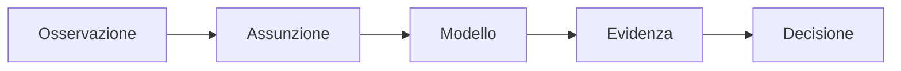

# Karl Popper: falsificabilità e sperimentazione

Popper porta nel corso una regola che sembra ovvia e quasi nessuno rispetta: una tesi analitica vale qualcosa solo se accetta il rischio di essere smentita. Quando devi decidere sotto incertezza, questo si traduce in una cosa molto concreta. I test che progetti devono poter cambiare davvero la scelta che hai davanti, altrimenti stai solo cercando applausi per una conclusione già presa.

## Il problema di chi cerca conferme

Capita spesso di trovarsi davanti a risultati che sembrano dare ragione a una tesi senza averla mai messa alla prova sul serio. Da lì nascono decisioni costruite su assunzioni fragili, bias di conferma e nessi causali mai verificati. La distinzione che conta è quella tra un dato che sostiene davvero una scelta e un dato che abbiamo cercato apposta perché confermava ciò che già pensavamo. La domanda operativa è una sola: come si trasforma un'ipotesi in uno strumento che orienta una decisione, invece che in una rassicurazione?

## Modello concettuale



Lo schema segue il percorso logico di un'analisi. Si parte da una domanda, la si traduce in dati osservabili, si valuta quanto pesa l'evidenza e solo alla fine si decide. Quando si salta uno di questi passaggi l'analisi sembra solida ma poggia sul vuoto.

| Passaggio | Domanda guida | Output atteso |
|---|---|---|
| Framing | Quale decisione deve cambiare? | Una scelta concreta, non una curiosità |
| Misura | Quale segnale rappresenta il fenomeno? | Metrica, fonte e granularità |
| Confronto | Rispetto a quale baseline interpreto il risultato? | Benchmark o controfattuale plausibile |
| Azione | Che cosa faccio se il segnale supera la soglia? | Decisione, owner e prossimo controllo |

## Quattro elementi da definire prima di decidere

Per usare Popper dentro un'azienda servono quattro elementi messi a fuoco in modo operativo:

| Elemento | Definizione operativa |
|---|---|
| Unità | osservazione, ipotesi, variabile, meccanismo causale o criterio di evidenza |
| Segnale | forza dell'evidenza, coerenza causale, robustezza delle assunzioni, costo dell'errore decisionale |
| Baseline | spiegazione alternativa, controfattuale, gruppo comparabile o scenario senza intervento |
| Decisione | accettare, rifiutare o riformulare una spiegazione prima di agire |

Una misura serve a qualcosa solo quando riduce l'incertezza su una decisione precisa. Se non cambia nessuna scelta è documentazione, e se cambia una scelta senza nessun controllo è un rischio travestito da numero.

## Esempio: la retention che sembra una vittoria

Un team interpreta l'aumento della retention come la prova che la nuova iniziativa ha funzionato. Applicando Popper, separa quello che vede da quello che conclude:

| Evidenza | Interpretazione prudente | Decisione conseguente |
|---|---|---|
| Segnale positivo ma non isolato | Il fenomeno esiste, ma la causa è incerta | Cercare baseline o gruppo di controllo |
| Segmento con risposta diversa | L'effetto medio nasconde eterogeneità | Analizzare coorti o sottogruppi |
| Costo operativo crescente | Valutare il risultato sul margine | Applicare soglie economiche |

Letto così, il numero smette di essere una conclusione chiusa e torna a essere un punto di partenza per decidere.

## Esercizi

### Livello base

Scrivi in cinque righe una decisione reale legata a Popper: obiettivo, metrica primaria, baseline, rischio principale e azione prevista. Usa una sola metrica primaria.

### Livello intermedio

Costruisci una tabella con almeno tre segmenti o scenari. Per ciascuno indica segnale, possibile spiegazione alternativa e controllo necessario prima di decidere.

### Livello research-grade

Progetta un piano di validazione: ipotesi, dati necessari, criteri di esclusione, soglia decisionale e controllo post-decisione. Specifica cosa ti farebbe cambiare idea.

### Dataset e materiali consigliati

Lavora su case study decisionali, metriche di prodotto, risultati di esperimenti, DAG semplici, report analitici e serie storiche simulate. Se non hai dati reali, costruisci un dataset sintetico da 200-500 righe con almeno una colonna temporale, una di segmento, una metrica di outcome e una variabile di esposizione.

## L'errore più comune

L'errore che vedo più spesso è trattare Popper come una definizione da memorizzare invece che come un protocollo per decidere. Lo riconosci quando qualcuno presenta metriche senza baseline, grafici senza ipotesi o raccomandazioni che ignorano il costo dell'errore. Il controllo da fare è semplice: "Se questo risultato fosse falso o instabile, quale decisione sbaglierei?". Se non sai rispondere, non hai applicato la lezione.

## Quiz e checkpoint

1. Qual è la decisione concreta che questa lezione dovrebbe migliorare?
2. Quale baseline rende interpretabile il risultato?
3. Quale assunzione, se sbagliata, cambierebbe la conclusione?
4. Quale controllo minimo useresti prima di presentare la raccomandazione?

## Falsificazione contro verificazione

Prima di Popper la scienza si reggeva sull'induzione: raccogli dati, trovi un pattern, generalizzi. Popper sostenne che l'induzione non ha fondamento logico, perché nessuna quantità di conferme prova che la regola valga in generale. Il metodo che propose ribalta la prospettiva. Prima si formula un'ipotesi falsificabile, cioè un'ipotesi che i dati possono smentire. Poi si cercano attivamente i dati che la contraddicono. Solo se l'ipotesi resiste a questi tentativi la si accetta in via provvisoria.

È esattamente la logica di un A/B test fatto bene. Non si va a caccia della conferma, si prova a falsificare l'ipotesi nulla con criteri e tempi fissati prima di iniziare, non scelti a posteriori quando i numeri fanno comodo.

## Einstein e l'eclissi del 1919

La relatività generale di Einstein prevedeva che la luce delle stelle venisse deviata dalla gravità del Sole durante un'eclissi. Eddington organizzò una spedizione per misurare quella deviazione. Se il valore osservato fosse stato diverso dalla predizione, la teoria sarebbe caduta. La misura confermò la previsione, ma il punto di Popper è un altro: la teoria era falsificabile, e per questo era scientifica. L'astrologia, al contrario, non prevede alcun dato che possa smentirla, e proprio per questo resta fuori dalla scienza.

## Riepilogo operativo

Per Popper la scienza, e con essa l'analisi dei dati, è una disciplina che decide sotto incertezza usando ipotesi falsificabili e test seri. In pratica significa formulare ipotesi che rischiano di essere smentite, fissare i criteri di falsificazione prima di raccogliere i dati, non guardare i risultati di un test prima del tempo stabilito per evitare il peeking, segmentare i dati per non farsi ingannare dalle medie e legare sempre il risultato a una decisione concreta. Quando questi controlli ci sono, l'analisi smette di cercare conferme e diventa uno strumento affidabile per scegliere.

## Problema reale

Questo concetto si applica quando lavori con dataset reali e hai bisogno di una struttura chiara per ragionare su Karl Popper: falsificabilità e sperimentazione. Il problema tipico è non avere un framework condiviso tra il team per valutare la soluzione, con il risultato che ogni analisi parte da presupposti diversi.

**Quando lo incontrerai:**
- Quando presenti un risultato e qualcuno chiede "ma come sei arrivato a questo numero?"
- Quando il risultato di una query cambia radicalmente cambiando un filtro
- Quando il modello che hai costruito funziona sui dati di test ma non su quelli di produzione

## Formalizzazione rigorosa

```sql
-- TODO: aggiungi la formalizzazione specifica per Karl Popper: falsificabilità e sperimentazione
-- Pattern per avanzato:

SELECT
    /* indica qui la tua metrica principale */
FROM
    /* indica qui la sorgente dati */
WHERE
    /* indica qui i filtri */
GROUP BY
    /* indica qui le dimensioni di raggruppamento */
```

**Principio guida:** verifica sempre che la somma delle parti sia uguale al totale.

## Esempio o caso studio

**Caso tipico (livello avanzato):**

Immaginiamo un team marketing che deve misurare la retention a 30 giorni. L'errore più comune è calcolarla come `COUNT(DISTINCT user_id)` senza filtrare per data di attivazione, includendo utenti che non hanno ancora avuto 30 giorni di tempo. La versione corretta filtra prima la cohort di attivazione e poi applica il calcolo.

```sql
WITH cohort AS (
    SELECT
        user_id,
        MIN(event_date) AS activation_date
    FROM events
    GROUP BY user_id
),
retention AS (
    SELECT
        c.activation_date,
        COUNT(DISTINCT e.user_id) AS retained_users
    FROM cohort c
    JOIN events e ON c.user_id = e.user_id
        AND e.event_date >= c.activation_date
        AND e.event_date <= c.activation_date + INTERVAL '30 days'
    GROUP BY c.activation_date
)
SELECT
    activation_date,
    retained_users,
    ROUND(retention_rate * 100, 2) AS retention_pct
FROM retention;
```

## Lab / esercizio

**Esercizio — livello avanzato**

1. **Prepara l'ambiente:** carica il dataset di esempio nel tuo warehouse
2. **Applica il pattern:** scrivi la query che implementa il modello concettuale per il tuo caso
3. **Verifica:** controlla che il risultato sia coerente con le tue aspettative usando un sanity check

**Tempo stimato:** 20-30 minuti

## Errore tipico da evitare

**L'errore più comune a livello avanzato:**

Non distinguere tra una metrica calcolata su tutta la popolazione e una metrica calcolata su una sotto-popolazione specifica. Ad esempio, calcolare il tasso di conversione medio senza filtrare per canale di acquisizione porta a decisioni sbagliate perché il mix di canali cambia nel tempo.

**Come evitarlo:**
- Chiediti sempre: "rispetto a cosa sto misurando questo?"
- Verifica che il denominatore sia corretto prima di fidarti del numeratore
- Usa un gruppo di controllo quando possibile

## Quiz o checkpoint

1. Qual è la differenza tra la metrica calcolata su tutta la popolazione e quella calcolata su una cohort?
2. Scrivi il codice SQL che implementa il modello concettuale per un caso a tua scelta
3. Quale sanity check useresti per verificare che il risultato sia corretto?

---

*Queste sezioni sono placeholder generici. Sostituisci con contenuto specifico per la lezione.*