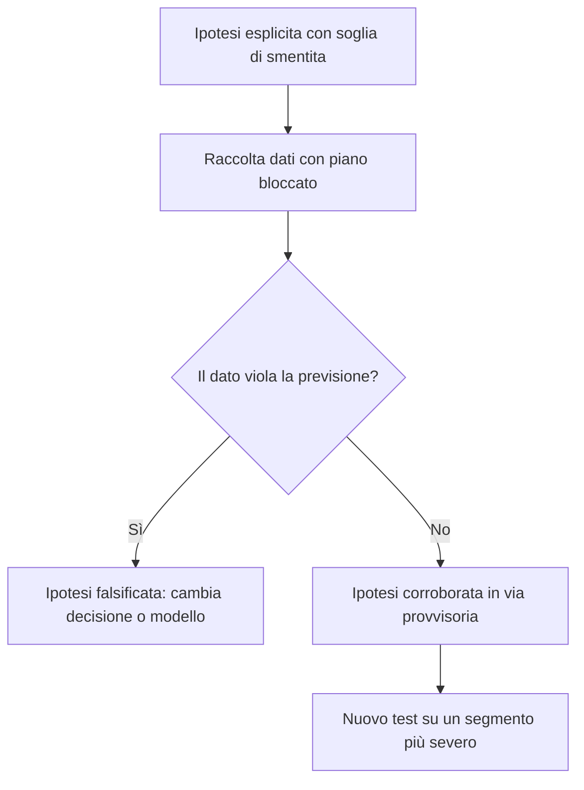

Ogni team di prodotto ama celebrare i test che confermano l'intuizione iniziale, eppure il valore scientifico di un esperimento si misura esattamente dal contrario: quanto era disposto a darti torto. La filosofia della scienza di Karl Popper trasforma questa intuizione in un criterio rigoroso per separare le analisi che producono conoscenza affidabile dalle storie ben confezionate a posteriori.

## Un esperimento che poteva soltanto vincere

Considera questo caso ricostruito in un e-commerce di medie dimensioni. Il responsabile marketing è convinto che spostare il badge della spedizione gratuita sopra il pulsante di acquisto aumenti le vendite. Viene lanciato un A/B test senza definire prima né la durata minima né la metrica unica di successo. Al quarto giorno la conversione globale risulta invariata, ma l'analista apre la dashboard per segmento e nota che sugli utenti mobile di ritorno dal Nord Italia le vendite sono salite leggermente. Al settimo giorno quel segmento rientra nella media, ma sale invece lo scontrino medio dei nuovi visitatori da desktop. Il report finale dichiara il test riuscito citando quest'ultimo risultato, mentre il team ignora le quattro metriche rimaste piatte o calate.

Quella che sembra una normale flessibilità operativa è in realtà la negazione stessa del metodo sperimentale. Quando un test può cambiare bersaglio lungo la corsa finché trova un numero favorevole, l'ipotesi di partenza non corre alcun rischio reale di fallire. E un'ipotesi che non può mai perdere nei fatti non ti ha insegnato nulla sul comportamento dei clienti.

> **Idea chiave:** Un'ipotesi analitica merita fiducia solo se dichiara prima dell'osservazione quale risultato empirico la smentirebbe senza appello; cercare conferme dopo aver visto i numeri trasforma l'analisi in apologia.

Capire questo principio significa ribaltare la domanda con cui ti siedi davanti a un dataset. Invece di chiedere quali numeri dimostrano che la tua idea funziona, impari a chiedere quale prova concreta ti costringerebbe ad abbandonarla domattina.

## Asimmetria tra verificazione e falsificazione

Prima di Karl Popper, gran parte dell'epistemologia novecentesca legata al Circolo di Vienna cercava di fondare la scienza sul principio di verificazione e sull'induzione: osservi molti casi particolari in cui A è seguito da B, accumuli conferme empiriche e da lì deduci una legge universale. Popper individua in questo schema una falla logica insormontabile, già intuita da Hume ma mai risolta sul piano metodologico. Nessuna quantità finita di cigni bianchi osservati fino a oggi garantisce logicamente che il prossimo cigno sarà bianco, mentre basta incontrare un solo cigno nero per demolire per sempre l'enunciato "tutti i cigni sono bianchi".

Questa asimmetria logica tra verificare e falsificare diventa nel 1934, con la pubblicazione di *Logik der Forschung* (tradotto poi in italiano come *Logica della scoperta scientifica*), il criterio di demarcazione tra scienza e pseudo-scienza. Una teoria è empirica non perché accumula molti casi a favore, ma perché vieta qualcosa che potrebbe accadere nel mondo reale: quanto più è precisa e rischiosa nelle sue previsioni, tanto più espone il fianco a una possibile confutazione. Al contrario, le teorie che riescono a spiegare qualunque esito possibile — sia che il mercato salga sia che il mercato scenda — non possiedono alcun contenuto informativo utile a chi deve decidere.

Quando un test supera un tentativo serio di confutazione, Popper non dice che l'ipotesi sia stata dimostrata vera in senso definitivo. Dice che è stata *corroborata*, cioè ha superato una prova severa ed è accettata in via provvisoria fino al prossimo controllo più esigente. Questo atteggiamento cambia radicalmente il modo di progettare dashboard ed esperimenti in azienda, come emerge dal confronto diretto tra i due approcci.

| Fase del test | Logica della verificazione | Logica popperiana della falsificazione |
|---|---|---|
| Formulazione iniziale | "Il nuovo checkout migliorerà l'esperienza d'acquisto" | "Il nuovo checkout alza il tasso di completamento di almeno 0,8 punti percentuali; sotto tale soglia è smentito" |
| Scelta delle metriche | Si guarda un paniere ampio e si sceglie la metrica cresciuta di più | Una sola metrica primaria e vincoli di guardrail dichiarati prima dell'avvio |
| Durata e campione | Si chiude il test appena il cruscotto mostra un p-value favorevole | Campione e durata fissati a priori tramite analisi di potenza |
| Analisi per segmenti | Si estraggono i sottogruppi positivi per raccontare un successo | Si testano prima i sottogruppi più sfavorevoli per cercare dove l'effetto crolla |
| Esito negativo | Si spiega il calo con fattori stagionali salvando l'idea | Si registra la falsificazione e si modifica il prodotto o la strategia |

## Aritmetica della falsificazione e moltiplicazione dei falsi positivi

Il costo nascosto della ricerca di conferme non è soltanto filosofico: è misurabile con l'aritmetica elementare delle probabilità. Immaginiamo un esperimento con numeri di esempio realistici per una piattaforma di commercio elettronico che registra 40.000 sessioni per la variante di controllo e 40.000 sessioni per la nuova variante, con un tasso di conversione di base del 4,0% (`1.600` ordini attesi nel gruppo di controllo).

Supponiamo che la modifica al design non abbia in realtà alcun effetto positivo sul comportamento d'acquisto: la differenza vera tra le due varianti è esattamente zero. Se il team fissa una sola metrica primaria con soglia di significatività standard al 5%, accetta per contratto un rischio del 5% di ottenere un falso positivo per puro caso. Tuttavia, se al termine del test l'analista controlla in sequenza 6 metriche distinte — conversione totale, conversione mobile, conversione desktop, valore medio del carrello, tasso di aggiunta al carrello e tasso di ritorno a 7 giorni — e dichiara successo appena almeno una di esse supera la soglia, la probabilità che almeno una metrica risulti falsamente positiva anche quando la modifica è completamente inutile esplode secondo il calcolo dei complementi.

La probabilità che una singola metrica indipendente non generi un falso positivo è pari al `95%` (`1 - 0,05 = 0,95`). La probabilità che nessuna delle 6 metriche generi un falso positivo è `0,95` elevato alla sesta potenza, cioè circa `0,735`, ovvero il `73,5%`. Sottraendo questo valore dal totale otteniamo il tasso reale di falso errore dell'intero processo: `1 - 0,735 = 0,265`, cioè il `26,5%`. In pratica, più di un test completamente inefficace su quattro viene promosso come una scoperta riuscita.

Se traduciamo questo errore in impatto economico usando un margine medio di 30 euro per ordine e supponendo un costo operativo di manutenzione della nuova interfaccia pari a 18.000 euro all'anno tra sviluppo e debito tecnico, promuovere una falsa vittoria costa 18.000 euro certi in cambio di zero ordini incrementali reali, oltre al costo opportunità di aver bloccato il team di ingegneria per 3 settimane su una pista sterile. Aggiungi inoltre che ogni controllo quotidiano sul cruscotto durante la raccolta dei dati — pratica nota come *peeking* — moltiplica ulteriormente la probabilità di fermarsi sul picco casuale di una serie rumorosa, portando il tasso effettivo di falsi allarmi ben oltre il 30% su finestre di due settimane.

## L'eclissi del 1919 e le strategie per immunizzarsi dai fatti

Popper raccontava spesso di aver compreso la differenza tra scienza autentica e narrazione illusoria osservando due eventi intellettuali della Vienna del primo Novecento. Da una parte vedeva certe scuole psicologiche e storiche capaci di spiegare qualsiasi comportamento umano o svolta politica reinterpretando retroattivamente i propri concetti: qualunque dato arrivasse, la teoria trovava sempre un modo per assorbirlo senza mai rischiare una smentita.

Dall'altra parte c'era la predizione formulata da Albert Einstein nel 1915 con la teoria della relatività generale. Einstein aveva calcolato che la massa del Sole doveva curvare i raggi luminosi provenienti dalle stelle vicine di un angolo pari a circa 1,75 secondi d'arco, esattamente il doppio rispetto al valore di circa 0,87 secondi d'arco previsto dalla fisica classica newtoniana. Nel maggio del 1919 l'astrofisico inglese Arthur Eddington guidò due spedizioni, una sull'isola di Príncipe nell'Atlantico e l'altra a Sobral in Brasile, per fotografare le stelle visibili attorno al disco solare durante un'eclissi totale e confrontarne la posizione con le lastre scattate di notte.

Ciò che colpì profondamente Popper non fu l'applauso dei giornali quando le lastre confermarono la deviazione prevista da Einstein, ma il coraggio epistemologico della previsione. Se le stelle fossero apparse nella posizione calcolata da Newton o in un punto incompatibile con 1,75 secondi d'arco, l'intera relatività generale avrebbe subito una confutazione diretta davanti alla comunità scientifica internazionale. Nessuna aggiustatina post-hoc avrebbe potuto salvare la previsione quantitativa dichiarata prima dell'eclissi.

Nel linguaggio di Popper, ogni tentativo di inserire scuse postume per salvare un modello sconfitto dai dati si chiama *stratagemma immunizzante*. Nei comitati di business questo stratagemma prende forme familiari: "il test è andato male perché c'era il ponte festivo", "il modello ha sbagliato le previsioni ma solo per colpa di un cliente anomalo", oppure "l'effetto non si vede subito ma si vedrà nel lungo termine". La risposta popperiana non vieta di formulare nuove ipotesi esplicative dopo un fallimento, ma esige che la nuova spiegazione accetti a sua volta un nuovo test rigoroso indipendente anziché servire da alibi per non cambiare la decisione già presa.

## Disegnare un contratto di smentita prima dell'analisi

Applicare Popper in un'organizzazione orientata ai dati significa istituzionalizzare la smentita prima che l'emozione del risultato inquini il giudizio. Nei laboratori clinici e nei team di sperimentazione digitale questo principio si traduce nella pre-registrazione degli esperimenti: un breve documento scritto prima di aprire i dati sperimentali, in cui il team si impegna pubblicamente sulle regole di lettura.

> **Contratto di smentita pre-esperimento:**
> Ipotesi nulla da confutare: la nuova pagina prodotto non migliora la conversione di almeno +0,5 punti percentuali rispetto al controllo.
> Metrica primaria bloccata: tasso di ordini completati per utente unico su finestra di 14 giorni, con un campione prefissato di almeno 35.000 utenti per braccio.
> Criterio di sconfitta vincolante: se la stima al giorno 14 non raggiunge la soglia stabilita o il tasso di reso sale oltre +1,2 punti percentuali, la variante viene scartata senza analisi esplorative giustificative.

Questo contratto non uccide la creatività esplorativa. Puoi sempre esaminare i dati a fine esperimento per generare nuove idee su ciò che ha funzionato in un sottogruppo inatteso, ma devi tracciare una linea netta tra due fasi che non vanno mai mescolate: la fase *esplorativa*, dove i dati suggeriscono nuove congetture, e la fase *confermativa* (o meglio, falsificatoria), dove quelle congetture vengono messe alla prova su dati nuovi e indipendenti. Usare lo stesso campione per inventare una spiegazione e per dichiararla dimostrata equivale a disegnare il bersaglio attorno al punto in cui la freccia è già caduta.

## Tre modi eleganti per rendere un'ipotesi infalsificabile

Anche chi conosce a parole il principio di falsificabilità ricade spesso in pratiche operative che proteggono le proprie convinzioni da qualsiasi smentita. Riconoscerle nei report e nelle riunioni settimanali ti permette di correggerle prima che orientino investimenti sbagliati.

### HARKing: trasformare una sorpresa esplorativa in ipotesi prevista

Il termine indica la pratica di presentare un'ipotesi costruita dopo aver visto i risultati come se fosse stata formulata prima dell'esperimento (*Hypothesizing After the Results are Known*). Sembra ragionevole razionalizzare un pattern emerso nei dati perché dona coerenza narrativa alla presentazione per la dirigenza. Tuttavia, mascherando una scoperta esplorativa da previsione confermata, azzeri la severità del test e nascondi il fatto che la soglia statistica scelta era tarata per una sola ipotesi, non per venti tentativi successivi. Eviti l'errore separando esplicitamente nei report i risultati pre-registrati dalle piste esplorative, trattando queste ultime esclusivamente come candidate per il ciclo sperimentale successivo.

### Peeking continuo sul cruscotto durante la raccolta

Il sintomo si riconosce quando il responsabile di prodotto controlla ogni mattina l'andamento del test e propone di fermarlo al quinto giorno "perché il risultato è già chiarissimo e non ha senso perdere altro traffico". Sembra una scelta pragmatica per risparmiare tempo e fatturato, ma sotto oscillazioni casuali anche due varianti identiche attraversano spesso brevi fasi in cui sembrano divergere significativamente prima di riallinearsi. Per evitare di falsare il tasso d'errore, congela la lettura decisionale fino al raggiungimento della dimensione campionaria pianificata oppure adotta test sequenziali formalmente corretti con soglie di arresto molto più severe rispetto al classico 5%.

### Ipotesi ausiliarie ad hoc per salvare il modello sconfitto

Accade quando un modello predittivo o una campagna falliscono la prova sul campo e il gruppo di lavoro introduce eccezioni retroattive non misurabili per giustificare l'esito negativo senza modificare il modello di fondo. Sembra una difesa legittima del contesto aziendale, dato che il mondo reale contiene sempre imprevisti operativi, ma se ogni sconfitta viene attribuita a perturbazioni esterne mentre ogni successo viene attribuito al modello, il sistema diventa logicamente immune all'errore. Correggi questo riflesso fissando in anticipo le condizioni ambientali che invalidano tecnicamente la misura — ad esempio un guasto ai server di pagamento — e accettando qualsiasi altro risultato negativo come un verdetto reale che impone di rivedere l'ipotesi.

## Controllo di falsificabilità prima del lancio

Usa queste quattro domande per verificare se il tuo prossimo test o modello è costruito per cercare la verità invece che una comoda conferma.

1. Un direttore marketing sostiene che una campagna di brand awareness abbia funzionato anche se vendite dirette e traffico organico non sono cresciuti, affermando che "ha lavorato a livello subconscio sul lungo periodo": perché questa tesi viola il criterio di Popper?

Mostra risposta

La tesi viola il criterio di falsificabilità perché non specifica alcuna soglia temporale né alcun indicatore osservabile capace di smentirla. Se ogni assenza di effetto misurabile viene spiegata invocando un impatto invisibile nel futuro indeterminato, nessun dato empirico potrà mai contraddire la frase, rendendola indistinguibile da un atto di fede anziché da un'ipotesi decisionale.

2. Se monitori un test ogni giorno per 10 giorni consecutivi fermandolo appena la metrica primaria supera la soglia di significatività standard, cosa accade alla severità reale della prova?

Mostra risposta

La severità crolla perché stai concedendo al rumore casuale dieci opportunità distinte di superare una soglia calibrata per una sola lettura finale. Di conseguenza il tasso reale di falsi positivi sale ben oltre il 5% dichiarato e il test perde la capacità di falsificare efficacemente un'idea inefficace.

3. Dopo aver analizzato 8 segmenti di clientela a test concluso, scopri che gli utenti iOS tra i 25 e i 34 anni convertono di più nella variante B; quale passo popperiano devi compiere prima di rilasciare la modifica a quel segmento?

Mostra risposta

Devi trattare il risultato emerso sugli utenti iOS 25-34 come un'ipotesi esplorativa appena nata e lanciare un nuovo test pre-registrato dedicato esclusivamente a quel segmento su dati freschi. Solo se la variante regge a una seconda prova indipendente mirata a smentirla potrai considerare corroborato l'effetto di segmento.

4. Qual è la differenza pratica tra dichiarare "la nostra ipotesi è stata verificata dal test" e dichiarare "la nostra ipotesi è stata corroborata dal test"?

Mostra risposta

Dichiararla verificata induce a credere che la tesi sia vera per sempre, abbassando la guardia su futuri cambiamenti del contesto o limiti del campione. Dichiararla corroborata riconosce che l'ipotesi ha superato un tentativo severo di smentita nelle condizioni attuali, ma resta provvisoria e dovrà essere rimessa alla prova se cambiano il mercato, la base utenti o i costi operativi.

