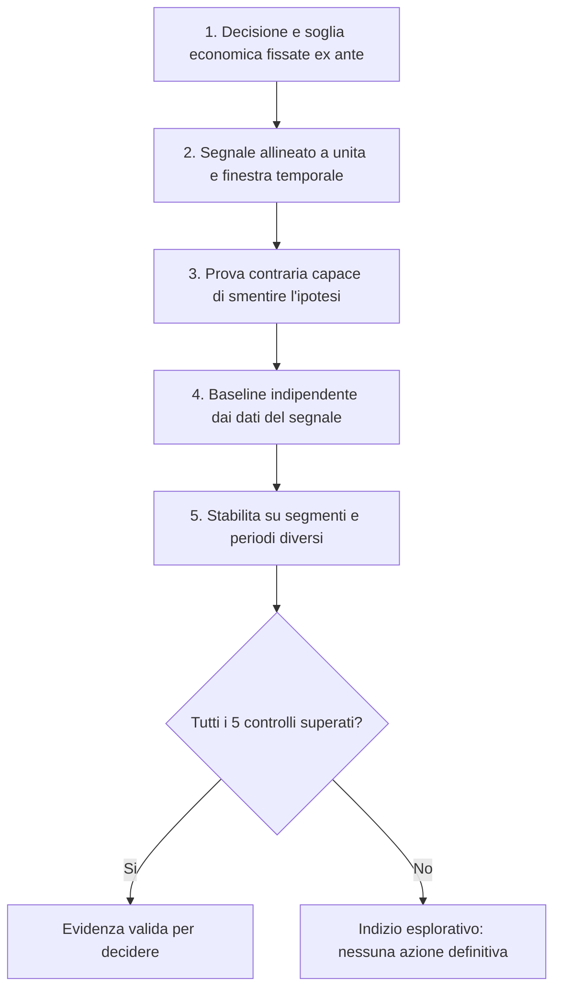

Esaminiamo un caso ricostruito ma tipico di qualsiasi comitato di prodotto: una piattaforma B2B con 24.000 account attivi discute se rifinanziare una campagna di customer success dopo un trimestre turbolento. Sul tavolo arrivano quattro fonti tra loro discordanti: i log di utilizzo segnalano un calo degli accessi settimanali dell'8%, i sondaggi NPS mostrano un miglioramento di sei punti, il supporto tecnico registra meno ticket urgenti e la contabilità segnala un lieve aumento degli upgrade annuali. Ognuno dei quattro numeri è tecnicamente corretto nella propria tabella di origine, eppure la discussione degenera in uno scontro tra reparti perché nessuno ha definito prima cosa conti come evidenza per quella scelta specifica.

Il lavoro sui dati ruota attorno a una domanda spesso rimandata: quando un numero sostiene davvero una decisione e quando invece riflette soltanto rumore, selezione del campione o conferme costruite a posteriori. Avere molte righe e grafici puliti non risolve il problema, perché la forza probatoria di una cifra non sta nel file CSV ma nelle condizioni stabilite prima di aprirlo.

## Il criterio dell'evidenza prima di guardare i numeri

Un'analisi seria inizia fissando l'asticella prima che la partita cominci. Se guardi prima i risultati e poi inventi la soglia che li rende interessanti, trasformi i dati in un esercizio di retorica: troverai sempre un intervallo di date, un sottogruppo o una metrica secondaria capace di giustificare la tesi preferita. Dichiarare il criterio di evidenza prima dell'estrazione significa vincolarsi a regole trasparenti su tre elementi: quale azione operativa cambia, quale variazione minima giustifica il costo del cambiamento e quale risultato ti costringerebbe ad abbandonare l'ipotesi di partenza.

> **Idea chiave:** Conta come evidenza soltanto il dato che riduce l'incertezza su una decisione precisa, confrontato con una baseline indipendente e accompagnato da una soglia di errore e da una prova contraria dichiarate prima di esaminare i numeri.

Un numero che non modifica alcuna scelta concreta resta cronaca descrittiva, utile forse per l'archivio storico ma irrilevante sul piano operativo. Al contrario, un numero capace di far cambiare rotta a un team diventa pericoloso se non ha superato il controllo sulla propria origine e sulla propria stabilità. Per questo il criterio dell'evidenza non riguarda soltanto la statistica inferenziale: appartiene all'epistemologia pratica, cioè al modo in cui giustifichi una credenza prima di scommetterci risorse reali.

## I cinque requisiti che trasformano una cifra in prova

Per passare da una semplice osservazione tabellare a una prova utilizzabile in sede decisionale, occorre sottoporre il segnale a cinque controlli sequenziali. Se anche un solo passaggio fallisce, il dato non va scartato come inutile, ma declassato da prova a semplice indizio esplorativo che richiede ulteriori verifiche.

La differenza tra un dato puramente descrittivo e un'evidenza decisionale emerge chiaramente quando si confrontano le proprietà richieste prima e durante l'analisi. La tabella seguente sintetizza il salto di qualità tra i due livelli.

| Dimensione di controllo | Dato descrittivo grezzo | Evidenza decisionale valida | Domanda di verifica immediata |
| --- | --- | --- | --- |
| Decisione collegata | Nessuna scelta legata a un'azione specifica | Scelta binaria o graduata definita in anticipo | Se il valore raddoppia o dimezza, cosa fai domani mattina? |
| Soglia di rilevanza | Giudicata a occhio dopo aver visto il grafico | Calcolata prima su costi, margini e rischi di errore | Quanto deve muoversi il numero per superare il costo d'intervento? |
| Criterio di smentita | Assente: ogni risultato viene razionalizzato ex post | Esplicito: definisce quale esito confuta la tesi | Quale risultato scritto nero su bianco ti farebbe cambiare idea? |
| Riferimento di confronto | Media della stessa serie recente o sensazione | Baseline esterna, storica pulita o gruppo di controllo | Rispetto a quale stato controfattuale misuri la variazione? |
| Tenuta strutturale | Aggregato globale unico su tutto il dataset | Coerente su sottogruppi, canali e finestre diverse | Il segno dell'effetto resta uguale separando i segmenti principali? |

L'ordine dei cinque passaggi protegge da due eccessi opposti: da un lato l'impulsività di chi lancia campagne su una singola variazione settimanale, dall'altro la paralisi di chi accumula decine di tabelle senza mai collegarle a una soglia di azione.

## Dalla ricerca su Google alle visite mediche: la lezione di Google Flu Trends

Uno degli esempi storici più istruttivi su cosa non sia evidenza riguarda Google Flu Trends, lanciato nel 2008 e presentato su *Nature* da Jeremy Ginsberg e colleghi nel 2009 come modello capace di stimare l'andamento dell'influenza negli Stati Uniti in tempo reale analizzando 50 milioni di query di ricerca e selezionando 45 termini aggregati fortemente correlati ai dati storici dei Centers for Disease Control and Prevention (CDC). Nei primi test l'adattamento statistico appariva quasi impeccabile, con coefficienti di correlazione superiori a 0,90 sui dati passati, tanto da alimentare la convinzione che la scala massiccia dei dati rendesse secondari i controlli metodologici tradizionali.

Come ricostruito da David Lazer, Ryan Kennedy, Gary King e Alessandro Vespignani su *Science* nel 2014 nell'articolo *The Parable of Google Flu: Traps in Big Data Analysis*, nella stagione influenzale 2012-2013 il sistema sovrastimò in modo clamoroso il picco delle visite mediche per sindrome influenzale, arrivando a più del doppio rispetto alle rilevazioni reali del CDC e sbagliando per 100 settimane su 108 rispetto alle stime aggiornate. Il fallimento non derivò da un bug aritmetico, ma da due fragilità epistemologiche ignorate: l'overfitting su pattern stagionali che mimavano qualsiasi fenomeno invernale e l'instabilità dello strumento di misura, poiché le modifiche continue dell'algoritmo di ricerca e del completamento automatico di Google alteravano i volumi delle query indipendentemente dalla diffusione biologica del virus. Inoltre, l'attenzione mediatica sull'influenza spingeva anche persone sane a cercare sintomi online, contaminando il segnale con l'eco delle notizie.

Il caso Google Flu Trends consegna una regola ferrea a chi analizza tabelle aziendali: una correlazione molto alta su milioni di righe non prova nulla se il segnale non è ancorato a una baseline indipendente aggiornata e se il processo che genera i dati cambia sotto i piedi del modello. Combinare le stime storiche del CDC con le ricerche online avrebbe prodotto un risultato solido; sostituire la misura clinica con il proxy digitale ha prodotto invece un abbaglio su larga scala.

## Calcolare la soglia di riattivazione con una baseline indipendente

Per vedere come il criterio dell'evidenza operi sui numeri reali, consideriamo uno scenario con numeri di esempio relativi a una campagna di riattivazione via email e notifica su 10.000 utenti dormienti da almeno 30 giorni. Prima di spedire qualsiasi messaggio, il team divide il campione in 5.000 utenti trattati e 5.000 utenti nel gruppo di controllo non contattato, e dichiara in anticipo i parametri economici: ogni utente riattivato genera un margine lordo atteso di 60 €, mentre la campagna costa 1,50 € per ciascun utente contattato, pari a un investimento totale di 5.000 × 1,50 € = 7.500 €.

Dal calcolo preventivo emerge subito la soglia minima di pareggio: servono almeno 7.500 € / 60 € = 125 utenti incrementali rispetto al controllo, cioè un guadagno netto minimo di 125 / 5.000 = +2,5 punti percentuali per non perdere denaro. Considerando il rischio operativo, il comitato fissa la soglia di adozione definitiva a +3,5 punti percentuali sul gruppo di controllo, corrispondente a un profitto netto minimo atteso di (175 × 60 €) - 7.500 € = +3.000 €. La baseline storica indipendente degli ultimi sei mesi indica inoltre che la riattivazione spontanea senza stimoli oscilla attorno al 3,0%.

A trenta giorni dal lancio, i dati grezzi registrano 340 utenti riattivati tra i 5.000 trattati (6,8%) e 155 utenti riattivati nel controllo (3,1%, perfettamente allineato alla baseline storica del 3,0%). Calcolando la differenza netta: 340 - 155 = 185 utenti incrementali, pari a +3,7 punti percentuali (6,8% - 3,1%). Moltiplicando 185 × 60 € otteniamo 11.100 € di margine incrementale lordo; sottraendo i 7.500 € di costo resta un profitto netto di +3.600 €, equivalente a un ritorno sull'investimento del +48%. A livello aggregato la soglia di +3,5 punti percentuali è superata.

Tuttavia, applicando il quinto controllo sulla stabilità per segmenti, il quadro cambia in modo netto. Suddividendo gli utenti per piattaforma emergono due sottoinsiemi ben distinti:
1. Nel segmento mobile (3.000 trattati e 3.000 controllo) si osservano 240 riattivazioni tra i trattati (8,0%) contro 96 nel controllo (3,2%), quindi un guadagno di 144 utenti incrementali (+4,8 punti percentuali), che a 60 € per utente generano 8.640 € contro 4.500 € di spesa, con un profitto netto di +4.140 €.
2. Nel segmento desktop (2.000 trattati e 2.000 controllo) si contano invece 100 riattivazioni nei trattati (5,0%) contro 59 nel controllo (2,95%), pari a soli 41 utenti incrementali (+2,05 punti percentuali). Qui il margine incrementale è 41 × 60 € = 2.460 €, inferiore ai 3.000 € di spesa sostenuti su quel segmento, con una perdita netta di -540 €.

Senza il quinto controllo e senza la soglia calcolata prima dell'analisi, il team avrebbe esteso la campagna a tutta la piattaforma, bruciando cassa sul traffico desktop. L'evidenza valida porta invece a una decisione chirurgica: scalare il flusso su mobile e sospenderlo su desktop finché non viene rivisto il messaggio.

## Protocollo operativo per validare un segnale prima della riunione

Quando prepari un'analisi destinata a orientare una scelta di prodotto, marketing o rischio, il modo più diretto per imporre disciplina è allegare al documento un protocollo sintetico compilato prima dell'estrazione dei dati. Questo documento blocca sul nascere le discussioni circolari perché separa l'accordo sul metodo dall'emozione davanti ai risultati.

> **Contratto di evidenza pre-analisi:**
> - Decisione operativa: indicare esattamente quale azione viene approvata o respinta in base al risultato.
> - Soglia di azione e pareggio: specificare in anticipo il numero minimo netto e l'intervallo di errore oltre i quali la scelta è economicamente positiva.
> - Prova contraria e finestra di falsificazione: dichiarare quale esito smentisce l'ipotesi e quale periodo o segmento alternativo funge da test di tenuta.
> - Baseline indipendente: documentare l'origine del riferimento di confronto, verificando che non condivida le stesse distorsioni del segnale analizzato.

Compilare queste quattro righe richiede dieci minuti prima di scrivere la prima query, ma risparmia giorni di analisi difensive dopo la presentazione. Se uno stakeholder non riesce a dichiarare quale risultato gli farebbe cambiare idea, non sta chiedendo un'analisi: sta cercando una legittimazione numerica per una decisione già presa.

## Tre derive che svuotano il criterio di evidenza

### Spostare la soglia dopo aver visto il risultato

Il sintomo si riconosce facilmente: la soglia iniziale era un miglioramento del 5%, il test restituisce un +2,8% e qualcuno propone di accettarlo comunque ridefinendo la vittoria come "segnale direzionalmente incoraggiante". Ciò inganna perché trasforma una verifica di ipotesi in un bersaglio mobile, azzerando la probabilità che la tesi iniziale possa mai essere respinta. Per evitarlo, registra soglia economica e criteri di arresto in un documento datato prima dell'analisi e tratta qualsiasi risultato inferiore alla soglia come un verdetto negativo, salvo avviare un nuovo esperimento indipendente.

### Costruire la baseline sugli stessi dati del segnale

Il sintomo compare quando si confronta una campagna o una funzionalità rispetto alla media del periodo in cui il fenomeno stesso è già alterato, oppure quando si seleziona la finestra di baseline escludendo i giorni peggiori perché "anomali". L'errore nasce dalla circolarità: se la misura di confronto condivide lo stesso bias temporale, stagionale o algoritmico del segnale, la differenza osservata riflette il rumore condiviso invece dell'effetto reale. Difenditi fissando una baseline esterna, un gruppo di controllo randomizzato o una serie storica bloccata prima dell'intervento.

### Scambiare il volume del campione per assenza di bias

Il sintomo tipico è citare milioni di eventi o decine di migliaia di utenti per liquidare dubbi sulla qualità del campionamento o sulla definizione delle metriche. Come dimostra Google Flu Trends, moltiplicare la dimensione dei dati riduce soltanto l'errore casuale di campionamento, mentre lascia intatto — e spesso amplifica in apparente certezza — qualsiasi bias sistematico di selezione, di piattaforma o di definizione. Controlla sempre come i record entrano nella tabella prima di lasciarti rassicurare dal numero di righe.

## Verifica sul tuo protocollo di evidenza

1. Quali tre elementi devono essere fissati prima di estrarre i dati affinché una cifra possa contare come evidenza decisionale?

Mostra risposta

Occorre dichiarare prima dell'analisi: la decisione operativa concreta che dipende dal risultato, la soglia numerica minima (economica e di tolleranza all'errore) che giustifica l'azione, e la prova contraria — cioè il risultato esplicito e il confronto con una baseline indipendente che confuterebbero l'ipotesi di partenza.

2. Nel caso di Google Flu Trends documentato su *Science* nel 2014, perché oltre 50 milioni di ricerche aggregate su Google non hanno impedito una sovrastima superiore al doppio rispetto ai dati del CDC nella stagione 2012-2013?

Mostra risposta

Perché la dimensione del dataset riduce l'errore casuale ma non elimina l'overfitting stagionale né l'instabilità dello strumento di misura. L'algoritmo di ricerca di Google veniva modificato continuamente e la copertura mediatica spingeva anche persone sane a cercare sintomi online, alterando il legame storico con le visite mediche senza un riancoraggio continuo ai dati clinici indipendenti del CDC.

3. Nell'esempio della riattivazione su 10.000 utenti (margine 60 €, costo 1,50 € per contatto), per quale motivo l'analisi per segmento capovolge la decisione aggregata pur avendo un saldo totale positivo di +3.600 €?

Mostra risposta

Perché l'aggregato positivo (+3,7 punti percentuali, +3.600 € netti) nasce dalla somma di due dinamiche opposte: su mobile il guadagno netto è +4,8 punti percentuali con un profitto di +4.140 €, mentre su desktop l'incremento è solo +2,05 punti percentuali, inferiore alla soglia di pareggio economico (+2,5 punti percentuali), generando una perdita netta di -540 €. Segmentare evita di sprecare budget sul canale in perdita.

4. Se un responsabile commerciale afferma che "non importa quale numero esca, il progetto va lanciato comunque per ragioni di immagine", come va classificata l'analisi richiesta?

Mostra risposta

Non è un'analisi volta a produrre evidenza decisionale, perché non esiste alcuna soglia o prova contraria capace di cambiare la scelta. In quel caso conviene esplicitare che la decisione è già presa per ragioni strategiche e orientare eventualmente i dati solo al monitoraggio post-lancio dei rischi, senza spacciare l'analisi per una validazione ex ante.

