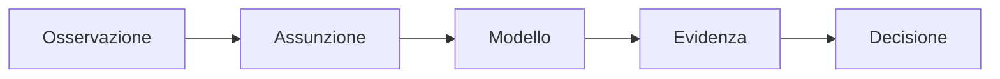

# Che cosa conta come evidenza

Un esperimento, un'intervista, un log di prodotto e una metrica finanziaria raccontano pezzi diversi dello stesso problema. Prima di scegliere quale ascoltare devi stabilire che cosa conta come evidenza per la decisione che hai davanti. Da qui parte ogni analisi seria, perché è la soglia che separa i dati che pesano dal rumore che distrae.

## Quando un dato sostiene davvero una decisione

Il lavoro con i dati ruota attorno a una domanda scomoda: quando un numero sostiene davvero una scelta e quando invece nasconde assunzioni implicite, bias o nessi causali fragili. Avere numeri non basta. Bisogna sapere se quei numeri significano qualcosa per la decisione che devi prendere. Non importa quanto un concetto sia affascinante in astratto, importa quale decisione migliora quando lo applichi con dati affidabili e con una soglia di errore dichiarata in anticipo.

## Modello concettuale



Il ragionamento è sequenziale. Prima si formula la domanda, poi la si traduce in unità osservabili, si valuta la qualità del dato e solo alla fine si decide. Quando si salta un passaggio l'analisi resta elegante in superficie e fragile sotto.

| Passaggio | Domanda guida | Output atteso |
|---|---|---|
| Framing | Quale decisione deve cambiare? | Una scelta concreta, non una curiosità |
| Misura | Quale segnale rappresenta il fenomeno? | Metrica, fonte e granularità |
| Confronto | Rispetto a quale baseline interpreto il risultato? | Benchmark o controfattuale plausibile |
| Azione | Che cosa faccio se il segnale supera la soglia? | Decisione, owner e prossimo controllo |

## Quattro elementi da mettere a fuoco

Conviene formalizzare che cosa conta come evidenza come una relazione tra quattro elementi:

| Elemento | Definizione operativa |
|---|---|
| Unità | osservazione, ipotesi, variabile, meccanismo causale o criterio di evidenza |
| Segnale | forza dell'evidenza, coerenza causale, robustezza delle assunzioni e costo dell'errore decisionale |
| Baseline | spiegazione alternativa, controfattuale, gruppo comparabile o scenario senza intervento |
| Decisione | accettare, rifiutare o riformulare una spiegazione prima di usarla in un contesto aziendale |

La regola pratica è semplice. Una misura serve solo se riduce l'incertezza su una decisione precisa. Se non cambia nessuna scelta è documentazione, e se cambia una scelta senza controlli è rischio.

## Esempio: Google Flu Trends

Nel 2008 Google lanciò Flu Trends, un sistema che prevedeva la diffusione dell'influenza in tempo reale a partire dalle query di ricerca. Funzionò bene per un paio d'anni, poi nel 2013 sovrastimò l'epidemia perché confondeva associazione e causalità. Le ricerche crescevano non solo per i contagi reali ma anche per l'ansia alimentata dai media, così Flu Trends finiva per misurare la percezione invece della malattia. È il caso che spiega perché i dati non parlano da soli e perché serve un criterio chiaro per separare l'evidenza dal rumore.

## Esercizi

### Livello base

Scrivi in cinque righe una decisione reale legata a che cosa conta come evidenza: obiettivo, metrica primaria, baseline, rischio principale e azione prevista.

### Livello intermedio

Costruisci una tabella con almeno tre segmenti o scenari. Per ciascuno indica segnale, possibile spiegazione alternativa e controllo necessario prima di decidere.

### Livello research-grade

Disegna un piano di validazione: ipotesi, dati necessari, criterio di esclusione, soglia decisionale e controllo post-decisione. Specifica anche cosa ti farebbe cambiare idea.

### Dataset e materiali consigliati

Lavora su case study decisionali, metriche di prodotto, risultati di esperimenti, DAG semplici, report analitici e serie storiche simulate. Se non hai dati reali, costruisci un dataset sintetico da 200-500 righe con almeno una colonna temporale, una di segmento, una metrica di outcome e una variabile di esposizione.

## L'errore più comune

L'errore tipico è trattare il criterio di evidenza come una definizione da ricordare invece che come un protocollo per decidere. Lo riconosci quando vedi una metrica senza baseline, un grafico senza ipotesi o una raccomandazione che ignora il costo dell'errore. Il controllo da fare è chiedersi: "Se questo risultato fosse falso o instabile, quale decisione sbaglierei?". Se non hai una risposta chiara, la lezione è rimasta sulla carta.

## Quiz e checkpoint

1. Qual è la decisione concreta che questa lezione dovrebbe migliorare?
2. Quale baseline rende interpretabile il risultato?
3. Quale assunzione, se sbagliata, cambierebbe la conclusione?
4. Quale controllo minimo useresti prima di presentare la raccomandazione?

## Riepilogo operativo

Decidere che cosa conta come evidenza è la competenza che tiene insieme concetto, dato e decisione. La impari partendo da un problema reale, mettendo a fuoco il segnale, cercando una baseline credibile, costruendo un esempio concreto e chiudendo con un controllo pratico. È questo passaggio dalla definizione al protocollo che trasforma la conoscenza in qualcosa di usabile davanti a una scelta.

## Problema reale

Questo concetto si applica quando lavori con dataset reali e hai bisogno di una struttura chiara per ragionare su Che cosa conta come evidenza. Il problema tipico è non avere un framework condiviso tra il team per valutare la soluzione, con il risultato che ogni analisi parte da presupposti diversi.

**Quando lo incontrerai:**
- Quando presenti un risultato e qualcuno chiede "ma come sei arrivato a questo numero?"
- Quando il risultato di una query cambia radicalmente cambiando un filtro
- Quando il modello che hai costruito funziona sui dati di test ma non su quelli di produzione

## Formalizzazione rigorosa

```sql
-- TODO: aggiungi la formalizzazione specifica per Che cosa conta come evidenza
-- Pattern per avanzato:

SELECT
    /* indica qui la tua metrica principale */
FROM
    /* indica qui la sorgente dati */
WHERE
    /* indica qui i filtri */
GROUP BY
    /* indica qui le dimensioni di raggruppamento */
```

**Principio guida:** verifica sempre che la somma delle parti sia uguale al totale.

## Esempio o caso studio

**Caso tipico (livello avanzato):**

Immaginiamo un team marketing che deve misurare la retention a 30 giorni. L'errore più comune è calcolarla come `COUNT(DISTINCT user_id)` senza filtrare per data di attivazione, includendo utenti che non hanno ancora avuto 30 giorni di tempo. La versione corretta filtra prima la cohort di attivazione e poi applica il calcolo.

```sql
WITH cohort AS (
    SELECT
        user_id,
        MIN(event_date) AS activation_date
    FROM events
    GROUP BY user_id
),
retention AS (
    SELECT
        c.activation_date,
        COUNT(DISTINCT e.user_id) AS retained_users
    FROM cohort c
    JOIN events e ON c.user_id = e.user_id
        AND e.event_date >= c.activation_date
        AND e.event_date <= c.activation_date + INTERVAL '30 days'
    GROUP BY c.activation_date
)
SELECT
    activation_date,
    retained_users,
    ROUND(retention_rate * 100, 2) AS retention_pct
FROM retention;
```

## Lab / esercizio

**Esercizio — livello avanzato**

1. **Prepara l'ambiente:** carica il dataset di esempio nel tuo warehouse
2. **Applica il pattern:** scrivi la query che implementa il modello concettuale per il tuo caso
3. **Verifica:** controlla che il risultato sia coerente con le tue aspettative usando un sanity check

**Tempo stimato:** 20-30 minuti

## Errore tipico da evitare

**L'errore più comune a livello avanzato:**

Non distinguere tra una metrica calcolata su tutta la popolazione e una metrica calcolata su una sotto-popolazione specifica. Ad esempio, calcolare il tasso di conversione medio senza filtrare per canale di acquisizione porta a decisioni sbagliate perché il mix di canali cambia nel tempo.

**Come evitarlo:**
- Chiediti sempre: "rispetto a cosa sto misurando questo?"
- Verifica che il denominatore sia corretto prima di fidarti del numeratore
- Usa un gruppo di controllo quando possibile

## Quiz o checkpoint

1. Qual è la differenza tra la metrica calcolata su tutta la popolazione e quella calcolata su una cohort?
2. Scrivi il codice SQL che implementa il modello concettuale per un caso a tua scelta
3. Quale sanity check useresti per verificare che il risultato sia corretto?

---

*Queste sezioni sono placeholder generici. Sostituisci con contenuto specifico per la lezione.*