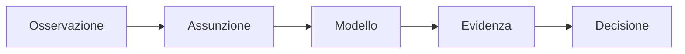

# Simpson's paradox e confounding: decidere quando i dati si contraddicono

Il paradosso di Simpson e il confounding mettono in guardia da chi legge i dati aggregati senza guardare la composizione delle popolazioni che ci stanno dentro. Quando un tasso di conversione migliora nel complesso ma peggiora in ogni singolo segmento importante, non sei davanti a un errore di calcolo né a una stranezza statistica. Stai vedendo la composizione e i fattori confondenti che distorcono la lettura del fenomeno.

## Quando un dato regge davvero una decisione

Il problema centrale è capire quando un dato sostiene davvero una decisione e quando nasconde assunzioni sbagliate, bias o nessi causali fragili. La domanda che conta non è "il numero è salito o sceso?", ma "quale decisione cambia grazie a questo numero?". Simpson e il confounding servono proprio a frenare le conclusioni affrettate che portano a scelte sbagliate.

## Modello concettuale

Il modello è sequenziale. L'analisi parte da una domanda chiara, si traduce in dati osservabili, valuta la qualità delle informazioni e infine guida una decisione. Quando si salta un passaggio i risultati restano fragili.

| Passaggio | Domanda guida | Output atteso |
|---|---|---|
| Framing | Quale decisione deve cambiare? | Una scelta concreta, non una curiosità |
| Misura | Quale segnale rappresenta il fenomeno? | Metrica, fonte e granularità |
| Confronto | Rispetto a quale baseline interpreto il risultato? | Benchmark o controfattuale plausibile |
| Azione | Che cosa faccio se il segnale supera la soglia? | Decisione, responsabile e prossimo controllo |

## Quattro elementi da mettere a fuoco

Simpson e il confounding si possono formalizzare come una relazione tra quattro elementi:

| Elemento | Definizione operativa |
|---|---|
| Unità | Osservazione, ipotesi, variabile, meccanismo causale o criterio di evidenza |
| Segnale | Forza dell'evidenza, coerenza causale, robustezza delle assunzioni, costo dell'errore decisionale |
| Baseline | Spiegazione alternativa, controfattuale, gruppo comparabile o scenario senza intervento |
| Decisione | Accettare, rifiutare o riformulare una spiegazione prima di usarla in azienda |

La regola pratica è semplice. Una misura serve solo se riduce l'incertezza su una decisione precisa. Se non cambia nessuna scelta è documentazione, e se cambia una scelta senza controlli è rischio.

## Esempio: la retention che inganna

Un comitato legge la crescita della retention come prova che la nuova iniziativa ha funzionato. Tenendo a mente Simpson e il confounding, il team separa quello che vede dall'interpretazione prudente e dalla decisione:

| Evidenza | Interpretazione prudente | Decisione |
|---|---|---|
| Segnale positivo ma non isolato | Il fenomeno esiste, ma la causa è incerta | Cercare baseline o holdout |
| Segmento con risposta diversa | L'effetto medio nasconde eterogeneità | Analizzare coorti o sottogruppi |
| Costo operativo crescente | Valutare il risultato sul margine | Applicare soglie economiche |

Letto così, il numero smette di essere una conclusione chiusa e torna a guidare una decisione.

## Esercizi

### Livello base

Scrivi in cinque righe una decisione reale collegata a Simpson's paradox e confounding: obiettivo, metrica primaria, baseline, rischio principale e azione prevista.

### Livello intermedio

Costruisci una tabella con almeno tre segmenti o scenari. Per ciascuno indica segnale, possibile spiegazione alternativa e controllo necessario prima di decidere.

### Livello research-grade

Disegna un piano di validazione: ipotesi, dati necessari, criterio di esclusione, soglia decisionale e controllo post-decisione. Specifica cosa ti farebbe cambiare idea.

### Dataset e materiali consigliati

Lavora su case study decisionali, metriche di prodotto, risultati di esperimenti, DAG semplici, report analitici e serie storiche simulate. Se non hai dati reali, costruisci un dataset sintetico con almeno 200 righe e colonne temporali, segmenti, metriche di outcome e variabili di esposizione.

## L'errore più comune

L'errore tipico è trattare Simpson e il confounding come una definizione da memorizzare invece che come un protocollo per decidere. Presentare metriche senza baseline, grafici senza ipotesi o raccomandazioni che ignorano il costo dell'errore porta dritti a conclusioni fragili. Il controllo da fare è chiedersi: "Se questo risultato fosse falso, quale decisione sbaglierei?". Se non hai una risposta chiara, l'analisi non è finita.

## Quiz e checkpoint

1. Qual è la decisione concreta che questa lezione dovrebbe migliorare?
2. Quale baseline rende interpretabile il risultato?
3. Quale assunzione, se sbagliata, cambierebbe la conclusione?
4. Quale controllo minimo useresti prima di presentare la raccomandazione?

## Riepilogo operativo

Capire Simpson e il confounding è ciò che tiene insieme concetto, dato e decisione quando i dati aggregati e quelli disaggregati raccontano storie opposte. Si parte da un problema reale, si mette a fuoco il segnale, si cerca una baseline credibile, si costruisce un esempio e si chiude con un controllo pratico. È questo passaggio che trasforma l'analisi in una disciplina capace di decidere sotto incertezza invece di farsi ingannare dalla media.
