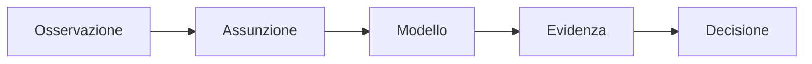

# Simpson's paradox e confounding

Immagina un analista che non vuole scambiare correlazione, misura e causalita per verita assolute quando un dato sembra evidente, ma la domanda vera e cosa possiamo legittimamente concludere. Sul tavolo non c'è un esercizio astratto: c'è la pressione concreta di rendere esplicite assunzioni, limiti e responsabilita. **Simpson's paradox e confounding** entra qui, nel punto in cui una scelta deve diventare più chiara, più misurabile e più difendibile.

## Una scena da cui partire

La lezione va letta con questo atteggiamento: non collezionare frasi da ricordare, ma cercare il passaggio che trasforma un pensiero critico che rende l'analisi più onesta in lavoro reale. Trattala come una lente mentale: il valore sta nel cambiare il modo in cui osservi un problema prima ancora di aprire un tool. Il livello è avanzato: non cercare una ricetta unica, cerca i vincoli che cambiano la risposta.

- **Contesto:** Quale intuizione deve restare dopo la lettura?
- **Metodo:** Quale esempio rende concreto il concetto?
- **Applicazione:** Quale errore diventa più facile evitare?

## Il meccanismo matematico

Simpson's paradox si verifica quando una variabile confondente (es. dipartimento) influenza sia la variabile indipendente (genere) che quella dipendente (ammissione). Nell'aggregato, il confondente non è visibile e distorce la relazione apparente.

**Esempio aziendale:**

| Canale | Visitatori | Ordini | Tasso |
|--------|-----------|--------|-------|
| A | 10.000 | 100 | 1.0% |
| B | 1.000 | 50 | 5.0% |
| **Totale** | **11.000** | **150** | **1.36%** |

Il mese dopo sposti budget su B:

| Canale | Visitatori | Ordini | Tasso |
|--------|-----------|--------|-------|
| A | 5.000 | 50 | 1.0% |
| B | 6.000 | 300 | 5.0% |
| **Totale** | **11.000** | **350** | **3.18%** |

Il tasso aggregato è più che raddoppiato senza che nessun canale sia migliorato. È cambiato solo il mix. Un manager che guarda solo l'aggregato pensa "stiamo ottimizzando!" e distribuisce bonus. Ma l'ottimizzazione è un'illusione statistica.

## Dove ti frega in azienda

- **Retention**: ogni coorte ha retention stabile, ma l'aggregato cala perché le coorti nuove (più grandi) hanno retention più bassa.
- **Soddisfazione**: ogni segmento migliora, ma l'aggregato cala perché cresce il segmento più esigente.
- **A/B test**: B sembra migliore nell'aggregato ma è peggiore in ogni paese — è stato testato di più dove la metrica è naturalmente più alta.

## Come difendersi

1. **Disaggrega sempre** per canale, paese, coorte, dispositivo.
2. **Controlla il mix** nel tempo — se cambia, l'aggregato mente.
3. **Usa pesi fissi** per neutralizzare l'effetto mix nei confronti temporali.

La difesa minima e calcolare un tasso aggiustato per mix: **tasso mix-adjusted = somma(tasso segmento x popolazione base segmento) / somma(popolazione base segmento)**.

Questo non risolve ogni problema causale, ma impedisce alla composizione dei segmenti di travestirsi da miglioramento o peggioramento reale.

---

*Riferimenti:*
- Bickel, P.J., Hammel, E.A. & O'Connell, J.W. (1975). "Sex Bias in Graduate Admissions." *Science*, 187(4175).
- Pearl, J. (2014). "Understanding Simpson's Paradox." *The American Statistician*, 68(1).

## Approfondimento operativo: leggere simpson's paradox e confounding come sistema

In un progetto reale, simpson's paradox e confounding non vive mai isolato. È parte di un sistema più ampio fatto di decisioni, dati disponibili, vincoli tecnici, incentivi organizzativi e qualità dell'esecuzione. Il rischio dell'analista principiante è trattare il tema come una definizione: imparare il nome, ricordare due formule, applicare un template. Il lavoro professionale è diverso: bisogna capire quale problema risolve, quali assunzioni contiene e cosa succede quando quelle assunzioni non sono vere.

Nel contesto di **filosofia analisi dati**, la prima domanda da fare non è "quale metrica calcolo?" ma: quale decisione dovrà essere presa grazie a questa analisi? Una dashboard, una query o un modello statistico hanno valore solo se riducono incertezza decisionale. Se non cambiano una scelta, sono documentazione o teatro analitico.

Un buon modo per impostare il lavoro è usare questa sequenza:

1. definire il problema in linguaggio business;
2. identificare l'unità di analisi corretta: utente, account, evento, sessione, ordine, campagna;
3. controllare se i dati misurano davvero il fenomeno o solo una sua ombra;
4. costruire una metrica interpretabile;
5. segmentare per evitare che la media nasconda pattern opposti;
6. trasformare il risultato in una raccomandazione verificabile.

## Caso reale: Netflix e la disciplina delle metriche

Netflix è un esempio utile perché ha costruito molte decisioni di prodotto intorno a segnali comportamentali osservabili: completamento degli episodi, tempo di ricerca prima della riproduzione, abbandono dopo pochi minuti, ritorno nella settimana successiva, efficacia delle raccomandazioni. Il punto non è che ogni azienda debba copiare Netflix. Il punto è metodologico: il dato non viene trattato come ornamento, ma come infrastruttura decisionale.

Quando Netflix valuta una modifica all'esperienza — una nuova riga di raccomandazioni, una diversa immagine di copertina, un algoritmo di ranking — non misura solo il click immediato. Misura anche segnali di qualità: l'utente guarda davvero il contenuto? torna nei giorni successivi? riduce il tempo speso a cercare? aumenta la soddisfazione implicita? Questa disciplina impedisce di ottimizzare vanity metric che sembrano positive nel breve ma danneggiano valore nel lungo periodo.

Lo stesso principio vale qui: simpson's paradox e confounding deve essere collegato a un outcome. Se il risultato non aiuta a scegliere tra due azioni alternative, l'analisi è incompleta.

## Esempio SQL: costruire una vista di controllo

Il pattern seguente è volutamente generico ma eseguibile nella maggior parte dei warehouse moderni. L'obiettivo è creare una base analitica con metrica, segmento e finestra temporale, così da poter confrontare periodi e gruppi senza riscrivere la logica ogni volta.

| Elemento della vista di controllo | Perché serve |
|---|---|
| Utente, account e settimana | Mantengono una granularita adatta a segmentare senza perdere storia |
| Sorgente e device | Permettono di separare effetto reale da composizione del traffico |
| Eventi totali e giorni attivi | Distinguono volume da continuità di comportamento |
| Diversita degli eventi | Aiuta a vedere se l'utente esplora davvero il prodotto |
| Outcome chiave raggiunto | Collega comportamento e risultato decisionale |

Prima di concludere che una metrica e migliorata, controlla se sono cambiati i pesi dei segmenti che la compongono.

Questa query non pretende di essere la risposta finale. Serve a creare una superficie di osservazione: trend, segmenti, differenze tra canali, variazioni nel tempo. Da qui l'analista può formulare ipotesi più precise.

## Esempio Python: controllare stabilità e anomalie

Una metrica utile deve essere stabile abbastanza da orientare decisioni e sensibile abbastanza da segnalare cambiamenti reali. In Python possiamo controllare variazioni anomale settimana su settimana.

| Controllo di stabilita | Lettura pratica |
|---|---|
| Variazione settimana su settimana | Mostra se il segnale cambia bruscamente |
| Media mobile a 4 settimane | Distingue trend da oscillazione breve |
| Deviazione standard mobile | Stima quanto rumore e normale nel segmento |
| Z-score | Evidenzia anomalie rispetto alla storia recente |
| Lista anomalie | Porta in review solo i casi che meritano spiegazione |

Nel paradosso di Simpson, il controllo tecnico serve soprattutto a fermare la narrativa troppo veloce: prima segmenti, poi interpreti.

Il valore di questo controllo è pratico: evita di reagire a ogni oscillazione casuale, ma segnala quando una variazione merita investigazione. In un contesto aziendale, questo tipo di analisi può alimentare alert, review settimanali e retrospettive di prodotto.

## Errori comuni da evitare

Il primo errore è lavorare su dati aggregati troppo presto. Una media globale può nascondere due segmenti che si muovono in direzioni opposte. Il secondo errore è non controllare la qualità del dato: eventi duplicati, tracking incompleto, timezone incoerenti e cambi di definizione possono produrre conclusioni false. Il terzo errore è confondere correlazione e causalità: se gli utenti che usano una feature convertono di più, non significa automaticamente che la feature causi conversione. Potrebbero usarla perché sono già più motivati.

Per ridurre questi rischi, ogni analisi dovrebbe includere almeno tre controlli: definizione esplicita della metrica, confronto per segmento e verifica contro un periodo precedente o gruppo di controllo.

## Riepilogo

Simpson's paradox e confounding va trattato come uno strumento decisionale, non come un argomento da manuale. Il valore nasce quando colleghi problema, dati, metrica, segmentazione e azione. Una buona analisi non termina con "il numero è salito" o "il numero è sceso". Termina con una frase operativa: quale decisione prendiamo, con quale livello di confidenza, e quale metrica useremo per sapere se avevamo ragione.

## Problema reale

Nel lavoro su fondamenti filosofici dell'analisi dati, **Simpson's paradox e confounding** serve a risolvere un problema concreto: capire quando un dato sostiene davvero una decisione e quando invece nasconde assunzioni, bias, causalità fragile o una domanda formulata male. La domanda non e se il concetto sia interessante in astratto, ma quale decisione migliora quando lo applichi con dati affidabili e con una soglia di errore esplicita.

Questa lezione va studiata come uno strumento operativo: entro la fine devi saper Comprendere il problema analitico e il contesto decisionale; Applicare esempi, metriche e controlli a casi reali. Se non riesci a collegare il concetto a una scelta reale, la conoscenza resta decorativa e non diventa competenza.

## Modello concettuale

Il modello mentale e sequenziale: prima si formula la domanda, poi si traduce in unità osservabili, quindi si valuta la qualità del dato e solo alla fine si decide. Saltare un passaggio produce analisi eleganti ma fragili.

| Passaggio | Domanda guida | Output atteso |
|---|---|---|
| Framing | Quale decisione deve cambiare? | Una scelta concreta, non una curiosita |
| Misura | Quale segnale rappresenta il fenomeno? | Metrica, fonte e granularita |
| Confronto | Rispetto a quale baseline interpreto il risultato? | Benchmark o controfattuale plausibile |
| Azione | Che cosa faccio se il segnale supera la soglia? | Decisione, owner e prossimo controllo |

## Formalizzazione rigorosa

Formalizza **Simpson's paradox e confounding** come una relazione tra quattro elementi: unità di analisi, segnale, baseline e decisione. Nel contesto di questa lezione l'unità principale e **osservazione, ipotesi, variabile, meccanismo causale o criterio di evidenza**. Il segnale da osservare deve essere collegato a **forza dell evidenza, coerenza causale, robustezza delle assunzioni e costo dell errore decisionale**, mentre la baseline deve essere scelta tra **spiegazione alternativa, controfattuale, gruppo comparabile o scenario senza intervento**.

Una formulazione robusta segue questa logica:

| Elemento | Definizione operativa per questa lezione |
|---|---|
| Unità | osservazione, ipotesi, variabile, meccanismo causale o criterio di evidenza |
| Segnale | forza dell evidenza, coerenza causale, robustezza delle assunzioni e costo dell errore decisionale |
| Baseline | spiegazione alternativa, controfattuale, gruppo comparabile o scenario senza intervento |
| Decisione | accettare, rifiutare o riformulare una spiegazione prima di usarla in un contesto aziendale |
| Rischio | Confondere correlazione, qualità del dato e causalità decisionale |

La regola pratica e semplice: una misura e utile solo se riduce l'incertezza su una decisione specifica. Se non cambia una scelta, e documentazione; se cambia una scelta senza controlli, e rischio.

## Esempio o caso studio

Un comitato interpreta una crescita di retention come prova che una nuova iniziativa abbia funzionato. La lezione costringe a distinguere osservazione, spiegazione, assunzione e decisione prima di trasformare il dato in azione.

Applicando **Simpson's paradox e confounding**, il team costruisce una lettura in tre colonne: cosa sappiamo, cosa assumiamo e quale decisione prendiamo. Questo formato impedisce di presentare un numero come se fosse una conclusione autosufficiente.

| Evidenza | Interpretazione prudente | Decisione conseguente |
|---|---|---|
| Segnale positivo ma non isolato | Il fenomeno esiste, ma la causa e ancora incerta | Cercare baseline o holdout |
| Segmento con risposta diversa | L'effetto medio nasconde eterogeneita | Analizzare coorti o sottogruppi |
| Costo operativo crescente | Il risultato va valutato sul margine | Applicare soglie economiche |

## Lab / esercizio

### Livello base

Prendi una decisione reale collegata a **Simpson's paradox e confounding** e scrivi in cinque righe: obiettivo, metrica primaria, baseline, rischio principale e azione prevista. Non usare più di una metrica primaria.

### Livello intermedio

Costruisci una tabella con almeno tre segmenti o scenari. Per ciascuno indica segnale, possibile spiegazione alternativa e controllo necessario prima di decidere.

### Livello research-grade

Disegna un piano di validazione: ipotesi, dati necessari, criterio di esclusione, soglia decisionale e controllo post-decisione. Specifica anche che cosa ti farebbe cambiare idea.

### Dataset e materiali consigliati

Usa case study decisionali, metriche prodotto, risultati di esperimenti, DAG semplici, report analitici e serie storiche simulate. Se non hai dati reali, crea un dataset sintetico con 200-500 righe e almeno una colonna temporale, una colonna segmento, una metrica di outcome e una variabile di esposizione.

## Errore tipico da evitare

L'errore più frequente e trattare **Simpson's paradox e confounding** come una definizione da ricordare invece che come un protocollo decisionale. In pratica succede quando si presenta una metrica senza baseline, un grafico senza ipotesi, o una raccomandazione senza costo dell'errore.

Un controllo utile e chiedersi: "se questo risultato fosse falso o instabile, quale decisione sbaglierei?". Se la risposta non e chiara, la lezione non e ancora stata applicata davvero.

## Quiz o checkpoint

1. Qual e la decisione concreta che questa lezione dovrebbe migliorare?
2. Quale baseline rende interpretabile il risultato?
3. Quale assunzione, se sbagliata, cambierebbe la conclusione?
4. Quale controllo minimo useresti prima di presentare la raccomandazione?

## Riepilogo operativo

**Simpson's paradox e confounding** e una competenza utile quando collega concetto, dato e decisione. Studiala partendo da un problema reale, formalizza il segnale, cerca una baseline credibile, costruisci un esempio e chiudi con un controllo pratico. Categoria: Fondamenti. Difficoltà: advanced. Tempo stimato: 18 min.
