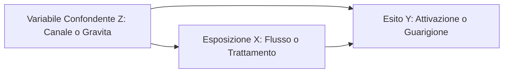

Immagina di presentare al comitato di prodotto il bilancio trimestrale di un nuovo percorso di onboarding per una piattaforma SaaS, in uno scenario costruito con numeri di esempio per isolare il meccanismo logico. Rispetto al trimestre precedente, il tasso di attivazione complessivo dei nuovi account è salito dal 28,0% al 33,2%, un guadagno di 5,2 punti percentuali che spingerebbe chiunque a dichiarare vittoria e promuovere il nuovo flusso su tutta la base utenti. Quando però il team di analisi divide i dati per canale di acquisizione tra traffico organico e traffico a pagamento, emerge un fatto spiazzante: nel segmento organico l'attivazione è scesa dal 48,0% al 45,0%, e nel segmento a pagamento è scesa dal 20,0% al 18,0%.

Nessuna formula è sbagliata e nessuno ha manipolato la query di estrazione. Entrambi i segmenti peggiorano, eppure il totale sale. Questa apparente contraddizione prende il nome di paradosso di Simpson e rappresenta uno degli inciampi epistemici più insidiosi dell'analisi quantitativa, perché mostra come la stessa tabella di numeri possa giustificare due decisioni aziendali opposte a seconda di come la leggi.

## Perché la media aggregata ribalta la storia dei segmenti

> **Idea chiave:** Il paradosso di Simpson si verifica quando una variabile nascosta (il confondente) influenza sia l'assegnazione dei casi ai gruppi sia la probabilità dell'esito finale, facendo sì che il cambiamento nella composizione dei volumi ribalti nell'aggregato la direzione osservata dentro ciascun segmento omogeneo.

Per comprendere il fenomeno dal punto di vista filosofico e metodologico, bisogna abbandonare l'idea ingenua che il tasso totale sia una fotografia neutra della realtà. Un tasso aggregato non è la media aritmetica semplice dei tassi dei diversi gruppi, bensì una media ponderata per la quota di volume che ciascun gruppo apporta al totale. Quando i pesi cambiano tra un periodo e l'altro, o tra un gruppo di trattamento e un gruppo di controllo, la media aggregata mescola due componenti eterogenee: l'effetto reale del fenomeno che vuoi misurare e lo spostamento strutturale nella composizione della popolazione.

Se il gruppo con il tasso di base più alto cresce rapidamente in proporzione rispetto al gruppo con il tasso di base più basso, il totale può salire anche se le prestazioni peggiorano ovunque. La matematica non sta mentendo; sta semplicemente rispondendo a una domanda diversa da quella che hai in testa. Il totale risponde alla domanda descrittiva su cosa sia successo alla massa complessiva degli utenti arrivati in un certo periodo, mentre i segmenti rispondono alla domanda comparativa su come abbia performato il nuovo flusso a parità di provenienza dell'utente.

Sul piano filosofico, questo fenomeno smaschera l'illusione empirista secondo cui "i dati parlano da soli". I dati tabellari non contengono alcuna indicazione autonoma su quale livello di aggregazione rappresenti la realtà causale del sistema. Prima ancora di eseguire un calcolo, l'analista introduce implicitamente un'ipotesi su quali variabili siano cause comuni e quali siano semplici conseguenze, e quell'ipotesi invisibile decide se il numero corretto da portare in consiglio di amministrazione sia il +5,2% aggregato oppure il calo registrato dentro ogni singolo canale.

Come mostra il diagramma causale, la variabile confondente `Z` apre una porta posteriore tra l'esposizione `X` e l'esito `Y`. Chi guarda soltanto alla correlazione aggregata tra `X` e `Y` somma l'effetto diretto della freccia `X -> Y` all'associazione spuria che viaggia lungo il percorso `X <- Z -> Y`. Quando questa associazione spuria ha segno opposto ed entità superiore all'effetto diretto, l'aggregato capovolge il verdetto dei segmenti.

## La prova aritmetica del ribaltamento su uno scenario costruito

Riprendiamo i numeri dello scenario costruito in apertura per seguire passo dopo passo la derivazione aritmetica che genera l'inversione. Supponiamo di osservare 1.000 utenti nel vecchio flusso di onboarding e 1.000 utenti nel nuovo flusso. Nel vecchio flusso, la campagna di acquisizione portava molti più utenti da annunci a pagamento (meno qualificati) rispetto al canale organico; nel nuovo trimestre, il taglio di budget pubblicitario ha cambiato drasticamente il mix in ingresso.

Nel periodo del **vecchio flusso** abbiamo 1.000 utenti così distribuiti: 286 utenti arrivano dal canale organico e 714 arrivano da campagne a pagamento. Dal canale organico si attivano 137 utenti (137 / 286 = 47,9%, approssimato a 48,0% nel report di sintesi, o più esattamente usiamo numeri interi netti: 250 utenti organici con 120 attivazioni pari esattamente al 48,0%, e 750 utenti a pagamento con 150 attivazioni pari esattamente al 20,0%). Verifichiamo subito il totale del vecchio flusso: sommiamo 120 + 150 = 270 attivazioni complessive su 250 + 750 = 1.000 utenti, ottenendo un tasso aggregato pari a 270 / 1.000 = **27,0%**.

Nel periodo del **nuovo flusso** il volume totale resta di 1.000 utenti, ma la composizione si ribalta: 750 utenti arrivano ora dal canale organico ad alta intenzione e solo 250 utenti arrivano dalle campagne a pagamento. In entrambi i segmenti le prestazioni del nuovo onboarding peggiorano rispetto al passato. Nel segmento organico si attivano 330 utenti su 750 (330 / 750 = **44,0%**, quindi un calo da 48,0% a 44,0%, cioè -4,0 punti percentuali). Nel segmento a pagamento si attivano 45 utenti su 250 (45 / 250 = **18,0%**, un calo da 20,0% a 18,0%, cioè -2,0 punti percentuali).

Eppure calcoliamo il nuovo tasso aggregato: sommiamo 330 + 45 = 375 attivazioni totali su 750 + 250 = 1.000 utenti, ottenendo 375 / 1.000 = **37,5%**. Passando dal vecchio flusso al nuovo flusso, il tasso aggregato balza da 27,0% a 37,5% → un incremento apparente di **+10,5 punti percentuali**, equivalente a un miglioramento relativo di +38,9%, mentre la differenza reale dentro ogni segmento è negativa in entrambi i casi (-4,0 pp nell'organico e -2,0 pp nel traffico a pagamento).

| Segmento o livello | Vecchio flusso (attivati / utenti) | Tasso vecchio | Nuovo flusso (attivati / utenti) | Tasso nuovo | Variazione netta |
|---|---|---:|---:|---:|---:|
| Canale organico | 120 / 250 | 48,0% | 330 / 750 | 44,0% | -4,0 pp |
| Traffico a pagamento | 150 / 750 | 20,0% | 45 / 250 | 18,0% | -2,0 pp |
| Totale aggregato | 270 / 1.000 | 27,0% | 375 / 1.000 | 37,5% | +10,5 pp |

Questa derivazione rende trasparente il meccanismo dell'inganno. Il nuovo onboarding è oggettivamente peggiore per qualunque tipo di utente entri nel prodotto, ma il fatto di aver triplicato la quota di utenti organici (passata dal 25% al 75% del totale) ha trascinato verso l'alto la media pesata complessiva, mascherando il deterioramento reale dell'esperienza di attivazione.

## Berkeley 1973 e i calcoli renali del 1986: due prove storiche

Il paradosso non è un artificio didattico confinato alle simulazioni di prodotto. Nella storia della scienza e della statistica pubblica esistono due episodi reali documentati che mostrano con forza quanto possa costare una lettura superficiale dell'aggregato.

Il primo caso esplose nel 1973 all'Università della California a Berkeley. Esaminando i dati complessivi sulle ammissioni ai corsi di dottorato, l'ateneo si trovò davanti a una discrepanza netta: su 8.442 candidati uomini risultava ammesso circa il **44%**, contro appena il **35%** delle 4.321 candidate donne. Il dato aggregato alimentò il sospetto immediato di una discriminazione sistematica contro le donne nelle commissioni di ammissione. Nel 1975 Peter Bickel, Eugene Hammel e J. William O'Connell pubblicarono su *Science* una scomposizione dei dati per singolo dipartimento che ribaltò completamente la diagnosi iniziale.

Analizzando i sei dipartimenti più grandi separatamente, i ricercatori scoprirono che in quattro dipartimenti le donne avevano un tasso di ammissione significativamente superiore a quello degli uomini (nel dipartimento A erano ammesse all'82% contro il 62% degli uomini; nel dipartimento B al 68% contro il 63%; persino nel dipartimento F, il più duro in assoluto, al 7% contro il 6%), mentre negli altri due i tassi erano quasi identici. Il paradosso nasceva dalla distribuzione delle domande: le candidate tendevano a fare domanda in proporzione molto più alta nei dipartimenti umanistici e sociali con tassi di ammissione complessivamente bassissimi (come C, E e F), mentre molti candidati uomini convergevano verso dipartimenti scientifici e ingegneristici con tassi di ammissione superiori al 60%. Il confondente era la selettività strutturale del dipartimento scelto, non un pregiudizio sistematico delle singole commissioni esaminatrici.

Il secondo episodio classico viene dalla medicina clinica ed è al centro di un celebre studio pubblicato da Charig e colleghi sul *British Medical Journal* nel 1986, poi analizzato a fondo da Steven Julious e Mark Mullee sullo stesso *BMJ* nel 1994. Il confronto riguardava 700 pazienti affetti da calcoli renali, equamente divisi in due gruppi da 350 pazienti ciascuno: al primo gruppo veniva applicata una chirurgia aperta tradizionale (trattamento A) e al secondo una nuova tecnica percutanea chiusa (trattamento B).

Guardando soltanto al totale, il trattamento B vinceva con l'83% di successi (289 casi su 350) contro il 78% del trattamento A (273 casi su 350). Tuttavia, stratificando i pazienti in base alla dimensione del calcolo, il verdetto si invertiva su tutta la linea: per i calcoli piccoli il trattamento A raggiungeva il 93% di successo (81 su 87) contro l'87% del trattamento B (234 su 270); per i calcoli grandi il trattamento A toccava il 73% (192 su 263) contro il 69% del trattamento B (55 su 80). La spiegazione stava nella prassi clinica: i chirurghi tendevano ad assegnare i casi gravi e difficili (calcoli grandi) alla chirurgia aperta A (263 casi su 350), mentre dirottavano in massa i casi lievi (calcoli piccoli) alla procedura chiusa B (270 casi su 350). La gravità del caso era la variabile confondente che sporcava il confronto aggregato.

## Quando vince il segmento e quando ha ragione l'aggregato

Qui scatta l'equivoco più sottile che separa chi conosce la definizione scolastica del paradosso di Simpson da chi padroneggia l'inferenza causale. Molti analisti, dopo aver visto Berkeley e i calcoli renali, ricavano la regola automatica: "non fidarti mai dell'aggregato, disaggrega sempre". Questa regola meccanica è falsa e altrettanto pericolosa del suo opposto, perché l'aritmetica da sola non sa distinguere un **confondente** da un **mediatore** o da un **collider**.

Come ha dimostrato Judea Pearl nella sua opera *Causality* (2000) e divulgato in *The Book of Why* (2018), i numeri della tabella congiunta possono essere identici in due mondi fisicamente opposti. Nel caso dei calcoli renali, la gravità precede e causa la scelta del trattamento (`Gravità -> Trattamento -> Guarigione`, più `Gravità -> Guarigione`): per stimare l'effetto di un intervento clinico devi bloccare la porta posteriore stratificando sulla gravità, quindi ha ragione il livello disaggregato.

Immagina però un caso medico diverso, con la stessa identica tabella numerica, in cui somministri un nuovo farmaco (`X`) per prevenire l'infarto (`Y`), e registri la pressione arteriosa misurata **dopo** la somministrazione (`Z`). Supponiamo che il farmaco funzioni proprio perché abbassa la pressione arteriosa, ma possieda un lieve effetto collaterale negativo diretto per chi resta con la pressione alta. Qui la struttura causale non è un triangolo confondente, bensì una catena di mediazione (`Farmaco X -> Pressione Z -> Infarto Y`, con un eventuale ramo secondario `X -> Y`).

Se in questo secondo scenario disaggreghi i pazienti per livello di pressione post-trattamento, stai bloccando il meccanismo stesso attraverso cui il farmaco salva la vita. A parità di pressione finale, il gruppo trattato appare addirittura svantaggiato a causa dell'effetto secondario, mentre nel totale il farmaco riduce gli infarti proprio grazie al suo effetto benefico sulla pressione. In presenza di un mediatore, **ha ragione l'aggregato**, e stratificare per la variabile intermedia introduce una distorsione artificiale. La scelta tra aggregato e segmenti non è quindi statistica, ma causale e filosofica: dipende dall'orientamento delle frecce nel tempo e nel meccanismo generativo dei dati.

## Protocollo operativo prima di presentare un report con tassi aggregati

Prima di portare davanti a un decisore aziendale una variazione di KPI aggregato o il risultato di un confronto tra coorti, conviene applicare un protocollo di audit strutturato che metta sotto pressione i numeri prima che lo facciano gli eventi reali.

> **Checklist causale pre-decisionale:**
> 1. **Verifica della composizione:** la distribuzione dei volumi tra segmenti chiave (canale, paese, gravità, fascia di prezzo, dispositivo) è cambiata tra il gruppo A e il gruppo B o tra i due periodi confrontati?
> 2. **Orientamento temporale delle variabili:** la terza variabile sospetta esisteva già prima dell'esposizione o dell'intervento (possibile confondente), oppure è stata generata dopo l'intervento come effetto intermedio (possibile mediatore o collider)?
> 3. **Coerenza dei segni:** confronta il segno della variazione aggregata con il segno di ciascun segmento omogeneo; se almeno un segmento rilevante inverte il segno o azzera la differenza, sospendi la raccomandazione finché non disegni il grafo delle cause.
> 4. **Presentazione duale:** riporta sempre sia il totale sia la scomposizione pesata per i segmenti causalmente pertinenti, dichiarando esplicitamente quale domanda risponde a quale livello.

Questo approccio protegge l'organizzazione dal doppio rischio dell'illusione di controllo e della paralisi analitica. Dichiarare insieme l'aggregato e i segmenti costringe gli stakeholder a esplicitare le proprie ipotesi sul funzionamento del business: se il miglioramento aggregato deriva solo da un cambio di mix di mercato verso clienti più facili, l'azione da intraprendere non è potenziare il flusso di prodotto (che in realtà è peggiorato), ma capire perché sia cambiata la composizione degli ingressi e correggere il flusso prima che il mix torni a sbilanciarsi.

## Errori frequenti nell'analisi dei confondenti

### Disaggregare alla cieca trasformando un mediatore in un falso confondente

Il sintomo si manifesta quando un analista, spaventato dal paradosso di Simpson, aggiunge al modello o alla tabella di pivot ogni colonna disponibile nel data warehouse e celebra la scomparsa o l'inversione dell'effetto iniziale. Sembra ragionevole perché aumentare la granularità dà l'impressione di essere più scrupolosi e oggettivi. In realtà, se la colonna aggiunta rappresenta una variabile post-trattamento influenzata dall'intervento stesso (come il numero di click dopo l'esposizione a una campagna, o il valore del carrello dopo l'applicazione di uno sconto), stratificare su di essa distrugge la stima dell'effetto totale e può generare correlazioni spurie tramite effetto collider. Si evita imponendo una regola temporale rigorosa: nel diagramma di stratificazione entrano esclusivamente covariate misurate **prima** dell'esposizione o indipendenti da essa.

### Scegliere il livello di lettura dopo aver visto i numeri (opportunismo interpretativo)

Il sintomo emerge nelle riunioni di revisione dei risultati, quando il team che difende una nuova funzionalità sceglie di proiettare il tasso aggregato perché positivo, mentre un team scettico estrae l'unico segmento negativo per bloccare il rilascio. Sembra una sana dialettica tra punti di vista diversi, ma trasforma l'analisi dei dati in avvocatura di parte, dove la teoria viene fabbricata per giustificare la conclusione preferita. Lo si evita scrivendo il grafo causale e dichiarando quale sia il livello di lettura decisionale (aggregato per effetto totale di sistema oppure stratificato su specifici confondenti noti) **prima** di estrarre la query finale sui dati di produzione.

### Confrontare tassi stratificati su celle con numerosità insufficiente

Il sintomo consiste nel frammentare un campione già modesto in decine di micro-segmenti fino a trovare inversioni spettacolari basate su 4 o 8 osservazioni per cella. Sembra prudente perché mostra attenzione alle differenze locali, ma in realtà confonde il rumore campionario casuale con una struttura di confounding sistematica, esponendo le decisioni a oscillazioni casuali da un mese all'altro. Si previene verificando sempre i denominatori assoluti accanto alle percentuali, accorpando i segmenti in macro-strati causalmente omogenei con sufficiente potenza statistica e calcolando intervalli di incertezza espliciti su ogni singolo strato prima di interpretare qualunque inversione di segno.

## Verifica operativa prima di decidere su un dato aggregato

1. In una campagna email di riattivazione, il tasso di apertura aggregato sale dal 21% al 26% dopo un cambio di oggetto, ma dentro il segmento dei clienti attivi negli ultimi 30 giorni scende dal 42% al 39% e dentro il segmento dei clienti inattivi scende dal 10% al 9%. Perché è accaduto e quale decisione conviene prendere sull'oggetto della mail?

Mostra risposta

Il rialzo aggregato è un effetto di composizione (paradosso di Simpson): la campagna nuova è stata inviata in proporzione molto maggiore a clienti attivi di recente rispetto alla campagna precedente, alzando la media pesata anche se il nuovo oggetto ha performato peggio in entrambe le fasce di recency. Conviene scartare il nuovo oggetto di mail e verificare con il team marketing perché è cambiato il criterio di estrazione della lista destinatari.

2. Stai valutando l'impatto di un nuovo tutorial interattivo sulla probabilità che un utente sottoscriva un abbonamento entro 14 giorni. Un collega propone di stratificare i risultati in base al numero di schermate completate dall'utente dopo l'iscrizione, sostenendo di voler evitare il paradosso di Simpson. Accetti la proposta?

Mostra risposta

No, la proposta va rifiutata perché il numero di schermate completate avviene dopo l'esposizione al tutorial ed è molto probabilmente un mediatore (oppure un proxy dell'impegno stesso attivato dal tutorial). Stratificare su un mediatore blocca il meccanismo causale attraverso cui il tutorial produce l'effetto e può distorcere artificialmente la stima reale; occorre stratificare solo su variabili misurate prima dell'esposizione, come il piano di provenienza, la lingua o il dispositivo iniziale.

3. Nel caso storico delle ammissioni a Berkeley del 1973, perché la sola conoscenza dei tassi aggregati (44% uomini contro 35% donne) era insufficiente a formulare un giudizio causale sulla condotta delle commissioni dipartimentali?

Mostra risposta

Perché il tasso aggregato mescolava la probabilità di ammissione di ciascuna commissione con la scelta del dipartimento effettuata dai candidati. Poiché le candidate si orientavano in proporzione molto più alta verso dipartimenti con tassi di selezione strutturalmente bassi per tutti, la selettività del dipartimento fungeva da confondente nella lettura aggregata; solo l'analisi stratificata per dipartimento separava il comportamento delle commissioni dall'effetto della distribuzione delle domande.

4. Qual è la differenza strutturale tra il ruolo della gravità del calcolo nello studio di Charig e colleghi (1986) e il ruolo di una variabile di canale misurata prima di un esperimento non randomizzato?

Mostra risposta

Non c'è alcuna differenza strutturale sul piano causale: in entrambi i casi la terza variabile (gravità clinica prima dell'intervento oppure canale di acquisizione prima dell'onboarding) precede l'assegnazione al trattamento e influenza direttamente anche l'esito finale. Entrambe agiscono come veri confondenti che aprono una porta posteriore tra trattamento ed esito, rendendo obbligatoria la stratificazione o l'aggiustamento su quella variabile per isolare l'effetto causale corretto.

