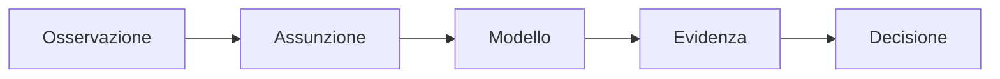

# Simpson's paradox e confounding: decidere quando i dati si contraddicono

Il paradosso di Simpson e il confounding mettono in guardia da chi legge i dati aggregati senza guardare la composizione delle popolazioni che ci stanno dentro. Quando un tasso di conversione migliora nel complesso ma peggiora in ogni singolo segmento importante, non sei davanti a un errore di calcolo né a una stranezza statistica. Stai vedendo la composizione e i fattori confondenti che distorcono la lettura del fenomeno.

## Quando un dato regge davvero una decisione

Il problema centrale è capire quando un dato sostiene davvero una decisione e quando nasconde assunzioni sbagliate, bias o nessi causali fragili. La domanda che conta non è "il numero è salito o sceso?", ma "quale decisione cambia grazie a questo numero?". Simpson e il confounding servono proprio a frenare le conclusioni affrettate che portano a scelte sbagliate.

## Modello concettuale



Il modello è sequenziale. L'analisi parte da una domanda chiara, si traduce in dati osservabili, valuta la qualità delle informazioni e infine guida una decisione. Quando si salta un passaggio i risultati restano fragili.

| Passaggio | Domanda guida | Output atteso |
|---|---|---|
| Framing | Quale decisione deve cambiare? | Una scelta concreta, non una curiosità |
| Misura | Quale segnale rappresenta il fenomeno? | Metrica, fonte e granularità |
| Confronto | Rispetto a quale baseline interpreto il risultato? | Benchmark o controfattuale plausibile |
| Azione | Che cosa faccio se il segnale supera la soglia? | Decisione, responsabile e prossimo controllo |

## Quattro elementi da mettere a fuoco

Simpson e il confounding si possono formalizzare come una relazione tra quattro elementi:

| Elemento | Definizione operativa |
|---|---|
| Unità | Osservazione, ipotesi, variabile, meccanismo causale o criterio di evidenza |
| Segnale | Forza dell'evidenza, coerenza causale, robustezza delle assunzioni, costo dell'errore decisionale |
| Baseline | Spiegazione alternativa, controfattuale, gruppo comparabile o scenario senza intervento |
| Decisione | Accettare, rifiutare o riformulare una spiegazione prima di usarla in azienda |

La regola pratica è semplice. Una misura serve solo se riduce l'incertezza su una decisione precisa. Se non cambia nessuna scelta è documentazione, e se cambia una scelta senza controlli è rischio.

## Esempio: la retention che inganna

Un comitato legge la crescita della retention come prova che la nuova iniziativa ha funzionato. Tenendo a mente Simpson e il confounding, il team separa quello che vede dall'interpretazione prudente e dalla decisione:

| Evidenza | Interpretazione prudente | Decisione |
|---|---|---|
| Segnale positivo ma non isolato | Il fenomeno esiste, ma la causa è incerta | Cercare baseline o holdout |
| Segmento con risposta diversa | L'effetto medio nasconde eterogeneità | Analizzare coorti o sottogruppi |
| Costo operativo crescente | Valutare il risultato sul margine | Applicare soglie economiche |

Letto così, il numero smette di essere una conclusione chiusa e torna a guidare una decisione.

## Esercizi

### Livello base

Scrivi in cinque righe una decisione reale collegata a Simpson's paradox e confounding: obiettivo, metrica primaria, baseline, rischio principale e azione prevista.

### Livello intermedio

Costruisci una tabella con almeno tre segmenti o scenari. Per ciascuno indica segnale, possibile spiegazione alternativa e controllo necessario prima di decidere.

### Livello research-grade

Disegna un piano di validazione: ipotesi, dati necessari, criterio di esclusione, soglia decisionale e controllo post-decisione. Specifica cosa ti farebbe cambiare idea.

### Dataset e materiali consigliati

Lavora su case study decisionali, metriche di prodotto, risultati di esperimenti, DAG semplici, report analitici e serie storiche simulate. Se non hai dati reali, costruisci un dataset sintetico con almeno 200 righe e colonne temporali, segmenti, metriche di outcome e variabili di esposizione.

## L'errore più comune

L'errore tipico è trattare Simpson e il confounding come una definizione da memorizzare invece che come un protocollo per decidere. Presentare metriche senza baseline, grafici senza ipotesi o raccomandazioni che ignorano il costo dell'errore porta dritti a conclusioni fragili. Il controllo da fare è chiedersi: "Se questo risultato fosse falso, quale decisione sbaglierei?". Se non hai una risposta chiara, l'analisi non è finita.

## Quiz e checkpoint

1. Qual è la decisione concreta che questa lezione dovrebbe migliorare?
2. Quale baseline rende interpretabile il risultato?
3. Quale assunzione, se sbagliata, cambierebbe la conclusione?
4. Quale controllo minimo useresti prima di presentare la raccomandazione?

## Riepilogo operativo

Capire Simpson e il confounding è ciò che tiene insieme concetto, dato e decisione quando i dati aggregati e quelli disaggregati raccontano storie opposte. Si parte da un problema reale, si mette a fuoco il segnale, si cerca una baseline credibile, si costruisce un esempio e si chiude con un controllo pratico. È questo passaggio che trasforma l'analisi in una disciplina capace di decidere sotto incertezza invece di farsi ingannare dalla media.

## Problema reale

Questo concetto si applica quando lavori con dataset reali e hai bisogno di una struttura chiara per ragionare su Simpson's paradox e confounding. Il problema tipico è non avere un framework condiviso tra il team per valutare la soluzione, con il risultato che ogni analisi parte da presupposti diversi.

**Quando lo incontrerai:**
- Quando presenti un risultato e qualcuno chiede "ma come sei arrivato a questo numero?"
- Quando il risultato di una query cambia radicalmente cambiando un filtro
- Quando il modello che hai costruito funziona sui dati di test ma non su quelli di produzione

## Formalizzazione rigorosa

```sql
-- TODO: aggiungi la formalizzazione specifica per Simpson's paradox e confounding
-- Pattern per avanzato:

SELECT
    /* indica qui la tua metrica principale */
FROM
    /* indica qui la sorgente dati */
WHERE
    /* indica qui i filtri */
GROUP BY
    /* indica qui le dimensioni di raggruppamento */
```

**Principio guida:** verifica sempre che la somma delle parti sia uguale al totale.

## Esempio o caso studio

**Caso tipico (livello avanzato):**

Immaginiamo un team marketing che deve misurare la retention a 30 giorni. L'errore più comune è calcolarla come `COUNT(DISTINCT user_id)` senza filtrare per data di attivazione, includendo utenti che non hanno ancora avuto 30 giorni di tempo. La versione corretta filtra prima la cohort di attivazione e poi applica il calcolo.

```sql
WITH cohort AS (
    SELECT
        user_id,
        MIN(event_date) AS activation_date
    FROM events
    GROUP BY user_id
),
retention AS (
    SELECT
        c.activation_date,
        COUNT(DISTINCT e.user_id) AS retained_users
    FROM cohort c
    JOIN events e ON c.user_id = e.user_id
        AND e.event_date >= c.activation_date
        AND e.event_date <= c.activation_date + INTERVAL '30 days'
    GROUP BY c.activation_date
)
SELECT
    activation_date,
    retained_users,
    ROUND(retention_rate * 100, 2) AS retention_pct
FROM retention;
```

## Lab / esercizio

**Esercizio — livello avanzato**

1. **Prepara l'ambiente:** carica il dataset di esempio nel tuo warehouse
2. **Applica il pattern:** scrivi la query che implementa il modello concettuale per il tuo caso
3. **Verifica:** controlla che il risultato sia coerente con le tue aspettative usando un sanity check

**Tempo stimato:** 20-30 minuti

## Errore tipico da evitare

**L'errore più comune a livello avanzato:**

Non distinguere tra una metrica calcolata su tutta la popolazione e una metrica calcolata su una sotto-popolazione specifica. Ad esempio, calcolare il tasso di conversione medio senza filtrare per canale di acquisizione porta a decisioni sbagliate perché il mix di canali cambia nel tempo.

**Come evitarlo:**
- Chiediti sempre: "rispetto a cosa sto misurando questo?"
- Verifica che il denominatore sia corretto prima di fidarti del numeratore
- Usa un gruppo di controllo quando possibile

## Quiz o checkpoint

1. Qual è la differenza tra la metrica calcolata su tutta la popolazione e quella calcolata su una cohort?
2. Scrivi il codice SQL che implementa il modello concettuale per un caso a tua scelta
3. Quale sanity check useresti per verificare che il risultato sia corretto?

---

Questa lezione si applica a Modulo 19: Fondamenti Filosofici dell Analisi dei Dati: serve per capire simpson's paradox e confounding in modo operativo, non solo teorico. Il problema tipico è affrontare simpson's paradox e confounding senza un framework condiviso, con il risultato che ogni analisi parte da zero.

### Livello base

Simpson's paradox e confounding è il fondamento di questa competenza. A livello base, ti basta capire la domanda chiave: cosa vuoi misurare, con quali dati, e con quale margine di errore. Non servono formule complesse: serve chiarezza su cosa osservi e perché.

### Livello intermedio

A questo livello applichi simpson's paradox e confounding a un caso reale. Prendi un dataset, definisci l'obiettivo, e costruisci il ragionamento passo per passo. Se stai lavorando su modulo 19: fondamenti filosofici dell analisi dei dati, il tuo dataset ha dimensioni specifiche che determinano quali domande puoi porre.

### Livello research-grade

Approfondimento teorico di simpson's paradox e confounding: qui entrambi i modelli statistici, le assunzioni sottostanti, e i confini di validità. Questo livello serve quando devi difendere una scelta di fronte a stakeholder che chiedono "perché" — non solo "cosa".

### Dataset e materiali consigliati

- Un dataset reale del tuo dominio (modulo 19: fondamenti filosofici dell analisi dei dati) per esercitarsi
- La documentazione ufficiale dello strumento usato per questa analisi
- Le metriche di riferimento del corso per contestualizzare i risultati