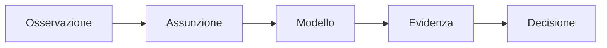

# Thomas Kuhn: paradigmi scientifici e cultura del dato

Immagina un analista che non vuole scambiare correlazione, misura e causalita per verita assolute quando un dato sembra evidente, ma la domanda vera e cosa possiamo legittimamente concludere. Sul tavolo non c'è un esercizio astratto: c'è la pressione concreta di rendere esplicite assunzioni, limiti e responsabilita. **Thomas Kuhn: paradigmi scientifici e cultura del dato** entra qui, nel punto in cui una scelta deve diventare più chiara, più misurabile e più difendibile.

## Una scena da cui partire

La lezione va letta con questo atteggiamento: non collezionare frasi da ricordare, ma cercare il passaggio che trasforma un pensiero critico che rende l'analisi più onesta in lavoro reale. Trattala come una lente mentale: il valore sta nel cambiare il modo in cui osservi un problema prima ancora di aprire un tool. Il livello è avanzato: non cercare una ricetta unica, cerca i vincoli che cambiano la risposta.

- **Contesto:** Quale intuizione deve restare dopo la lettura?
- **Metodo:** Quale esempio rende concreto il concetto?
- **Applicazione:** Quale errore diventa più facile evitare?

## Che cos'è un paradigma

Un paradigma è un insieme condiviso di assunzioni, metodi e standard che definiscono cosa è "normale" in un campo. Include:

- Quali domande vale la pena fare
- Quali metodi sono accettabili per rispondere
- Quali dati contano come evidenza
- Quali risultati sono "ovvi" e quali "sorprendenti"

Il paradigma non è vero o falso: è il frame dentro cui verità e falsità vengono stabilite.

**Nel mondo dei dati aziendali**, un paradigma potrebbe essere:
- "Il revenue è la metrica più importante" (paradigma finance-first)
- "Tutto si misura con gli A/B test" (paradigma sperimentalista)
- "I dati del CRM sono la fonte di verità" (paradigma sales-centric)
- "Se non è in Google Analytics, non esiste" (paradigma marketing-centrico)

Nessuno di questi paradigmi è "giusto". Ma ognuno determina cosa l'organizzazione *vede* e cosa *ignora*.

## Scienza normale vs scienza rivoluzionaria

Kuhn distingue due fasi:

**Scienza normale**: il paradigma è stabile. Tutti lavorano dentro il frame condiviso. I problemi che il paradigma non può risolvere vengono considerati "anomalie" — errori di misurazione, rumore, eccezioni che confermano la regola. Non minacciano il paradigma.

**Scienza rivoluzionaria**: le anomalie si accumulano fino a diventare insostenibili. Qualcuno propone un nuovo paradigma che spiega sia i vecchi dati che le anomalie. C'è resistenza feroce (i guardiani del vecchio paradigma hanno carriere e reputazioni costruite su di esso). Poi il nuovo paradigma vince. Esempi: Copernico, Darwin, Einstein.

Nel mondo aziendale:
- **Scienza normale**: i report mensili confermano che tutto va bene. Le anomalie (un calo di retention, un canale in declino) vengono spiegate come "fluttuazioni stagionali" o "problemi di tracking". Non si cambia nulla.
- **Rivoluzione**: un analyst dimostra che la metrica che l'azienda ha usato per 5 anni è fuorviante. C'è resistenza. Poi (forse) il nuovo paradigma viene adottato.

## Caso reale: il paradigma "più traffico = più revenue"

Per anni, molte aziende digitali hanno operato sotto il paradigma: più traffico → più conversioni → più revenue. L'intera funzione di growth marketing era costruita su questa catena causale.

Poi alcune aziende (Booking.com, Shopify) iniziarono a notare un'anomalia: il traffico cresceva ma il revenue per visitatore calava. Il traffico "di qualità" (utenti con intento d'acquisto) era annegato nel traffico "di quantità" (curiosi, clic accidentali, bot). Il paradigma iniziò a incrinarsi. Oggi il nuovo paradigma è "traffico qualificato > traffico totale", e le metriche di growth si sono spostate da "visitatori unici" a "tasso di conversione per segmento".

Chi ha cambiato paradigma prima ha guadagnato vantaggio competitivo. Chi è rimasto ancorato al vecchio paradigma ha speso budget su traffico che non convertiva.

## Perché i dati non bastano a cambiare un paradigma

Kuhn dimostrò che i dati da soli non cambiano i paradigmi. Ci sono tre barriere:

1. **Incommensurabilità**: il vecchio e il nuovo paradigma usano linguaggi diversi. "Revenue" nel vecchio paradigma include i resi; nel nuovo no. Non si può decidere quale dei due è "giusto" guardando i dati, perché i dati stessi sono definiti diversamente.

2. **Interessi costituiti**: chi ha costruito la propria carriera sul vecchio paradigma lo difenderà anche di fronte a evidenze contrarie. Non è malafede: è sopravvivenza professionale.

3. **Costo di transizione**: cambiare paradigma richiede nuovi tool, nuovi processi, nuova formazione. L'inerzia organizzativa è massiccia.

## Come navigare i paradigmi da analyst

1. **Identifica il paradigma prima di presentare insight controcorrente.** Chiediti: sto sfidando un assunto fondamentale o un dettaglio operativo? Se è un assunto fondamentale, aspettati resistenza.

2. **Traduci nel linguaggio del vecchio paradigma.** Non dire "dobbiamo smettere di usare il revenue come metrica principale." Di': "Possiamo aumentare il revenue del 5% aggiungendo questa metrica complementare." La seconda versione non minaccia il paradigma, lo estende.

3. **Accumula anomalie.** Un'anomalia è un caso sfortunato. Dieci anomalie sono un pattern. Non cercare di rovesciare il paradigma con un'analisi sola: costruisci un dossier di evidenze nel tempo.

---

*Riferimenti:*
- Kuhn, T.S. (1962). *The Structure of Scientific Revolutions.* University of Chicago Press.
- Bird, A. (2018). "Thomas Kuhn." *Stanford Encyclopedia of Philosophy.*

## Controllo di qualità

Prima di usare \"thomas kuhn: paradigmi scientifici e cultura del dato\ in una decisione, controlla sempre completezza, duplicati, timezone, definizioni cambiate e segmenti esclusi. Molte analisi apparentemente sofisticate falliscono perché il dato di partenza misura un comportamento diverso da quello che il team crede di osservare.

## Interpretazione per segmenti

La media aggregata è solo il punto di partenza. Segmenta per canale, coorte, piano, paese, device e maturità dell'utente. Se due segmenti si muovono in direzioni opposte, la media non rappresenta nessuno dei due e può portare a una decisione sbagliata.

## Problema reale

Nel lavoro su fondamenti filosofici dell'analisi dati, **Thomas Kuhn: paradigmi scientifici e cultura del dato** serve a risolvere un problema concreto: capire quando un dato sostiene davvero una decisione e quando invece nasconde assunzioni, bias, causalità fragile o una domanda formulata male. La domanda non e se il concetto sia interessante in astratto, ma quale decisione migliora quando lo applichi con dati affidabili e con una soglia di errore esplicita.

Questa lezione va studiata come uno strumento operativo: entro la fine devi saper Comprendere il problema analitico e il contesto decisionale; Applicare esempi, metriche e controlli a casi reali. Se non riesci a collegare il concetto a una scelta reale, la conoscenza resta decorativa e non diventa competenza.

## Modello concettuale

Il modello mentale e sequenziale: prima si formula la domanda, poi si traduce in unità osservabili, quindi si valuta la qualità del dato e solo alla fine si decide. Saltare un passaggio produce analisi eleganti ma fragili.

| Passaggio | Domanda guida | Output atteso |
|---|---|---|
| Framing | Quale decisione deve cambiare? | Una scelta concreta, non una curiosita |
| Misura | Quale segnale rappresenta il fenomeno? | Metrica, fonte e granularita |
| Confronto | Rispetto a quale baseline interpreto il risultato? | Benchmark o controfattuale plausibile |
| Azione | Che cosa faccio se il segnale supera la soglia? | Decisione, owner e prossimo controllo |

## Formalizzazione rigorosa

Formalizza **Thomas Kuhn: paradigmi scientifici e cultura del dato** come una relazione tra quattro elementi: unità di analisi, segnale, baseline e decisione. Nel contesto di questa lezione l'unità principale e **osservazione, ipotesi, variabile, meccanismo causale o criterio di evidenza**. Il segnale da osservare deve essere collegato a **forza dell evidenza, coerenza causale, robustezza delle assunzioni e costo dell errore decisionale**, mentre la baseline deve essere scelta tra **spiegazione alternativa, controfattuale, gruppo comparabile o scenario senza intervento**.

Una formulazione robusta segue questa logica:

| Elemento | Definizione operativa per questa lezione |
|---|---|
| Unità | osservazione, ipotesi, variabile, meccanismo causale o criterio di evidenza |
| Segnale | forza dell evidenza, coerenza causale, robustezza delle assunzioni e costo dell errore decisionale |
| Baseline | spiegazione alternativa, controfattuale, gruppo comparabile o scenario senza intervento |
| Decisione | accettare, rifiutare o riformulare una spiegazione prima di usarla in un contesto aziendale |
| Rischio | Confondere correlazione, qualità del dato e causalità decisionale |

La regola pratica e semplice: una misura e utile solo se riduce l'incertezza su una decisione specifica. Se non cambia una scelta, e documentazione; se cambia una scelta senza controlli, e rischio.

## Esempio o caso studio

Un comitato interpreta una crescita di retention come prova che una nuova iniziativa abbia funzionato. La lezione costringe a distinguere osservazione, spiegazione, assunzione e decisione prima di trasformare il dato in azione.

Applicando **Thomas Kuhn: paradigmi scientifici e cultura del dato**, il team costruisce una lettura in tre colonne: cosa sappiamo, cosa assumiamo e quale decisione prendiamo. Questo formato impedisce di presentare un numero come se fosse una conclusione autosufficiente.

| Evidenza | Interpretazione prudente | Decisione conseguente |
|---|---|---|
| Segnale positivo ma non isolato | Il fenomeno esiste, ma la causa e ancora incerta | Cercare baseline o holdout |
| Segmento con risposta diversa | L'effetto medio nasconde eterogeneita | Analizzare coorti o sottogruppi |
| Costo operativo crescente | Il risultato va valutato sul margine | Applicare soglie economiche |

## Lab / esercizio

### Livello base

Prendi una decisione reale collegata a **Thomas Kuhn: paradigmi scientifici e cultura del dato** e scrivi in cinque righe: obiettivo, metrica primaria, baseline, rischio principale e azione prevista. Non usare più di una metrica primaria.

### Livello intermedio

Costruisci una tabella con almeno tre segmenti o scenari. Per ciascuno indica segnale, possibile spiegazione alternativa e controllo necessario prima di decidere.

### Livello research-grade

Disegna un piano di validazione: ipotesi, dati necessari, criterio di esclusione, soglia decisionale e controllo post-decisione. Specifica anche che cosa ti farebbe cambiare idea.

### Dataset e materiali consigliati

Usa case study decisionali, metriche prodotto, risultati di esperimenti, DAG semplici, report analitici e serie storiche simulate. Se non hai dati reali, crea un dataset sintetico con 200-500 righe e almeno una colonna temporale, una colonna segmento, una metrica di outcome e una variabile di esposizione.

## Errore tipico da evitare

L'errore più frequente e trattare **Thomas Kuhn: paradigmi scientifici e cultura del dato** come una definizione da ricordare invece che come un protocollo decisionale. In pratica succede quando si presenta una metrica senza baseline, un grafico senza ipotesi, o una raccomandazione senza costo dell'errore.

Un controllo utile e chiedersi: "se questo risultato fosse falso o instabile, quale decisione sbaglierei?". Se la risposta non e chiara, la lezione non e ancora stata applicata davvero.

## Quiz o checkpoint

1. Qual e la decisione concreta che questa lezione dovrebbe migliorare?
2. Quale baseline rende interpretabile il risultato?
3. Quale assunzione, se sbagliata, cambierebbe la conclusione?
4. Quale controllo minimo useresti prima di presentare la raccomandazione?

## Riepilogo operativo

**Thomas Kuhn: paradigmi scientifici e cultura del dato** e una competenza utile quando collega concetto, dato e decisione. Studiala partendo da un problema reale, formalizza il segnale, cerca una baseline credibile, costruisci un esempio e chiudi con un controllo pratico. Categoria: Fondamenti. Difficoltà: advanced. Tempo stimato: 18 min.
