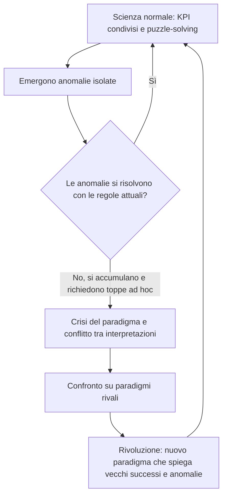

Nelle organizzazioni mature i conflitti più duri sui numeri non riguardano quasi mai un errore di sintassi SQL o una formula statistica sbagliata. Nascono quando la realtà di mercato cambia sotto i piedi del team mentre tutti continuano a leggere il business attraverso il vecchio dizionario di indicatori, aggiungendo postille e giustificazioni ogni mese più lunghe. La storia della scienza raccontata da Thomas Kuhn spiega perché questo riflesso difensivo sia così tenace e come riconoscere il momento esatto in cui smettere di rattoppare il cruscotto per cambiare architettura concettuale.

## Le note a piè di dashboard che crescono più dei grafici

Considera questo scenario costruito che si ripete regolarmente nelle aziende digitali in fase di transizione multicanale. Un gruppo retail misura da cinque anni l'efficacia degli investimenti pubblicitari attraverso un modello di attribuzione basato esclusivamente sull'ultimo clic tracciato dal browser. Per molto tempo questo impianto ha guidato con precisione i tagli e gli aumenti di spesa. Negli ultimi tre trimestri, tuttavia, qualcosa scricchiola: gli ordini con origine diretta o senza tracciamento aumentano di continuo, le campagne video su televisione connessa mostrano zero ritorno sul pannello storico mentre le vendite nei negozi fisici della stessa regione salgono, e il team analitico è costretto a inserire sei note esplicative sotto il report mensile per giustificare perché il ritorno dichiarato non corrisponde più al flusso di cassa.

Chi guarda queste riunioni da fuori nota subito il paradosso: nessuno mette in discussione la regola dell'ultimo clic, perché attorno a essa sono costruiti i bonus dei manager, le integrazioni automatiche e le abitudini decisionali del consiglio di amministrazione. Tutti trattano i numeri che non tornano come fastidiose eccezioni locali, anziché come il segnale che il modello stesso con cui l'azienda definisce la realtà commerciale è entrato in crisi.

> **Idea chiave:** Un paradigma non è soltanto un modello matematico, ma l'accordo implicito di una comunità su quali domande abbiano senso, quali dati contino come prova e quali discrepanze possano essere archiviate come rumore.

Mentre Popper descriveva come dovrebbe comportarsi il singolo scienziato ideale davanti a una smentita, Thomas Kuhn osserva come funzionano davvero le comunità umane che producono e interpretano dati. E la sua risposta illumina gran parte delle resistenze culturali che bloccano la crescita analitica di un'azienda.

## Scienza normale, anomalie e rivoluzioni secondo Kuhn

Nel 1962 Thomas Kuhn pubblicò *The Structure of Scientific Revolutions*, un testo destinato a trasformare la filosofia e la sociologia della conoscenza. Analizzando la storia della fisica, della chimica e dell'astronomia, Kuhn scoprì che il progresso scientifico non procede per accumulo lineare e pacifico di piccoli mattoni di verità, né per abbandono immediato di una teoria appena compare una singola osservazione contraria come immaginava il falsificazionismo ingenuo.

La maggior parte del tempo, secondo Kuhn, gli scienziati operano dentro la *scienza normale*: una fase produttiva in cui la comunità condivide un *paradigma* saldo, composto da concetti fondamentali, strumenti di misura legittimi e casi esemplari risolti. In questa fase il ricercatore non cerca di confutare il paradigma, bensì risolve enigmi (*puzzle-solving*) applicando le regole condivise a problemi nuovi. Proprio la stabilità del paradigma permette di spingere l'approfondimento tecnico a livelli altissimi senza dover ridiscutere ogni mattina i fondamenti.

Tuttavia, nessuna lente concettuale copre ogni angolo della realtà. Lungo il cammino compaiono *anomalie*, cioè risultati osservabili che resistono alle spiegazioni offerte dal paradigma dominante. Finché restano isolate, la comunità le accantona come errori di strumento, rumore statistico o questioni minori da risolvere più avanti. Quando però le anomalie si accumulano, si ripetono in contesti chiave e costringono gli specialisti a introdurre correzioni via via più contorte per salvare l'impianto originale, il sistema entra in *crisi*. Solo allora emergono paradigmi rivali che competono per conquistare l'adesione della comunità, fino a una *rivoluzione scientifica* che sposta le regole stesse del gioco.

Per chi guida o costruisce un'architettura analitica, il parallelo è immediato. Un paradigma aziendale corrisponde all'albero delle metriche condiviso, alle definizioni certificate di cliente attivo o ricavo ricorrente e ai modelli consolidati con cui si assegnano budget e responsabilità.

| Concetto di Kuhn | Manifestazione nella cultura del dato | Segnale diagnostico da osservare |
|---|---|---|
| Paradigma | Albero dei KPI, modello di attribuzione e definizioni semantiche condivise | Nessuno ricorda più quali assunzioni storiche abbiano generato la formula attuale |
| Scienza normale | Ottimizzazione quotidiana, A/B test locali e reporting ricorrente | Le nuove domande del business vengono riformulate per entrare nei cruscotti esistenti |
| Anomalia | Scarto ricorrente tra la metrica ufficiale e l'evidenza empirica esterna | La stessa deviazione riappare in trimestri diversi o in segmenti ad alta priorità |
| Crisi | Proliferazione di correzioni manuali, eccezioni e cruscotti paralleli | Le note esplicative occupano più tempo della lettura dei numeri in riunione |
| Rivoluzione | Adozione di un nuovo modello causale, nuova metrica guida o nuova ontologia dati | Il nuovo impianto spiega sia gli andamenti passati sia gli scarti inspiegabili |

## Misurare quando il paradigma distorce le decisioni

La fedeltà cieca a un paradigma obsoleto non produce solo discussioni accademiche: altera l'allocazione reale del capitale. Esaminiamo un caso con numeri di esempio riferito a un'azienda che investe 120.000 euro al mese in acquisizione digitale operando sotto il paradigma tradizionale dell'ultimo clic tracciato.

Supponiamo che l'azienda registri 25.000 ordini mensili totali con un margine lordo unitario di 24 euro prima dei costi pubblicitari. Sotto il modello vecchio, la direzione divide il budget tra due canali principali: 70.000 euro sulle campagne di ricerca sul marchio e retargeting ad alta intenzione, a cui il tracciamento ultimo clic assegna 12.250 ordini, e 50.000 euro su campagne video di scoperta ad ampia copertura, a cui il modello assegna soltanto 2.500 ordini. Calcolando il ritorno sul margine apparente per il primo blocco otteniamo un ricavo di margine lordo di `12.250 * 24 = 294.000 euro` su `70.000 euro` di spesa, pari a un ritorno lordo di `4,2x` (`294.000 / 70.000 = 4,2`). Per le campagne video di scoperta otteniamo `2.500 * 24 = 60.000 euro` su `50.000 euro`, cioè `1,2x`, un risultato che appare appena sufficiente a coprire la spesa e suggerisce di tagliare subito i video per spostare tutto sulla ricerca di marchio.

Intanto però si accumulano due anomalie strutturali che il cruscotto non integra: ben 3.200 ordini mensili risultano privi di referrer tracciabile per via dei blocchi privacy sui dispositivi mobili, e un test geografico controllato dimostra che nelle città dove le campagne video vengono spente, gli ordini attribuiti al marchio crollano di 1.800 unità nel mese stesso. Ricostruendo il conto economico incrementale reale sotto un paradigma causale orientato all'incrementalità, scopriamo che ben 4.650 degli ordini attribuiti al retargeting e al marchio sarebbero comunque avvenuti in assenza dell'annuncio, lasciando un contributo incrementale netto di 7.600 ordini. Il margine incrementale vero di quel primo blocco scende così a `7.600 * 24 = 182.400 euro` su `70.000 euro`, cioè `2,6x` anziché `4,2x` (`182.400 / 70.000 = 2,605`). Al contrario, sommando i 1.800 ordini generati indirettamente tramite ricerca di marchio e circa 1.200 ordini tra quelli senza referrer dimostrati dal test geografico, le campagne video generano in realtà `2.500 + 1.800 + 1.200 = 5.500` ordini incrementali, pari a `5.500 * 24 = 132.000 euro` di margine su `50.000 euro`, ovvero un ritorno reale di `2,64x`.

Il paradigma obsoleto aveva creato un miraggio contabile di `4,2x` contro `1,2x`, spingendo il management a tagliare proprio il canale di crescita più sano per sovrainvestire in annunci che catturavano domanda già acquisita.

## Da Tolomeo a Helicobacter pylori: perché i paradigmi resistono

Kuhn mostra con chiarezza che una comunità non abbandona un paradigma solo perché un indicatore risulta scomodo, finché non dispone di un'alternativa capace di raccogliere il testimone. Un esempio classico nella storia della scienza riguarda l'astronomia tolemaica: prima della rivoluzione copernicana, gli astronomi spiegavano ogni anomalia nel moto dei pianeti aggiungendo nuovi epicicli, cioè cerchi che ruotavano sopra altri cerchi. Il sistema continuava a fornire previsioni utilizzabili per la navigazione, ma diventava ogni decennio più barocco e fragile, esattamente come una reportistica aziendale tenuta in piedi da decine di eccezioni manuali su fogli di calcolo esterni.

Un caso medico moderno documentato con precisione mostra invece quanto a lungo un paradigma condiviso possa respingere evidenze solide prima di crollare. Per gran parte del Novecento la gastroenterologia spiegava l'ulcera peptica attraverso il paradigma dell'eccesso di acidità gastrica e dello stress psicologico: la terapia standard si limitava a tamponare l'acidità senza mai risolvere le recidive croniche. Nel 1984 i medici australiani Barry Marshall e Robin Warren pubblicarono sulla rivista scientifica *The Lancet* la dimostrazione che un batterio a forma di spirale, in seguito chiamato *Helicobacter pylori*, era presente nella quasi totalità dei pazienti affetti da gastrite attiva e ulcera duodenale.

La comunità medica accolse i dati con profondo scetticismo, ritenendo impossibile che un batterio sopravvivesse nell'ambiente acido dello stomaco. Per forzare la crisi del vecchio modello, Marshall bevve personalmente una coltura pura del batterio, sviluppò una gastrite acuta documentata tramite biopsia nel giro di pochi giorni e la guarì poi con un ciclo antibiotico. Solo dopo anni di repliche cliniche che riducevano drasticamente le ricadute dei pazienti il nuovo paradigma infettivo sostituì quello puramente acido-stress, portando Marshall e Warren al Premio Nobel per la medicina nel 2005. La dinamica è identica nei team dati: l'evidenza da sola fatica a vincere finché il nuovo schema non dimostra sul campo di risolvere sia i problemi già gestiti dal vecchio modello sia le anomalie lasciate aperte.

## Governare una transizione di paradigma nei dati aziendali

Quando un team riconosce che le proprie metriche stanno generando più eccezioni che chiarezza, tentare un colpo di stato improvviso dall'oggi al domani fallisce quasi sempre. Kuhn osserva che paradigmi rivali soffrono di una parziale *incommensurabilità*: usano le stesse parole — come "cliente", "conversione" o "ritorno" — attribuendo però loro significati e confini operativi diversi, cosicché i sostenitori dei due modelli sembrano parlare lingue incompatibili durante la stessa riunione.

Per superare questa frattura linguistica senza paralizzare l'azienda, conviene gestire il passaggio attraverso un periodo di coesistenza esplicita e un registro condiviso delle anomalie. Anziché nascondere gli scarti nelle appendici delle presentazioni mensili, il team dati istituisce un documento vivo in cui ogni anomalia ricorrente viene tracciata e misurata rispetto al vecchio paradigma.

> **Registro delle anomalie di metrica:**
> Definizione corrente messa in discussione: attribuzione last-click a 7 giorni su sessioni browser.
> Anomalia ricorrente osservata: crescita del 28% negli ordini privi di tracciamento e discrepanza sistematica tra ROAS di piattaforma e incremento reale di fatturato nei test geografici.
> Criterio di uscita dalla fase di scienza normale: attivazione in parallelo di un modello basato su test di incrementalità per almeno due trimestri, confrontando le decisioni di budget prodotte dai due paradigmi sullo stesso storico di vendite.

Questa doppia contabilità temporanea svolge una funzione pedagogica decisiva verso la dirigenza. Mostra con i numeri come il nuovo paradigma sappia spiegare non soltanto i fenomeni nuovi finora invisibili, ma anche il motivo per cui il vecchio cruscotto funzionava bene cinque anni prima, quando la tracciabilità dei browser era elevata e i canali erano meno interconnessi.

## Tre patologie culturali che bloccano la transizione

Nel passaggio tra una vecchia cultura del dato e una più matura, le organizzazioni commettono tre errori tipici che trasformano una sana crisi conoscitiva in paralisi operativa.

### Difendere la dashboard con eccezioni infinite invece di aggiornare il modello

Il sintomo emerge quando ogni revisione trimestrale aggiunge nuove colonne correttive o filtri manuali per "far tornare i numeri con l'anno scorso". Sembra una soluzione responsabile per proteggere la continuità storica dei report, ma replica esattamente gli epicicli tolemaici: spende crescente energia dei data engineer per conservare un'illusione di coerenza mentre la capacità predittiva del sistema si degrada. Previeni questa deriva imponendo un limite esplicito alle eccezioni: quando una metrica richiede più di tre aggiustamenti manuali ricorrenti per essere spiegata al board, apri formalmente una revisione architetturale della sua definizione.

### Scambiare ogni oscillazione casuale per una crisi di paradigma

All'estremo opposto ci sono i team affetti da irrequietezza perpetua, che buttano via l'albero dei KPI ogni sei mesi alla prima settimana negativa di un canale o al primo outlier stagionale. Sembra un approccio agile e aperto all'innovazione, ma distrugge la scienza normale impedendo di accumulare serie storiche confrontabili e di distinguere gli effetti reali delle scelte di prodotto dal rumore del cambiamento continuo. Eviti il caos separando il rumore episodico dalle anomalie strutturali: un paradigma va messo in crisi solo quando la discrepanza persiste su più cicli, resiste alle verifiche di qualità del dato e riguarda decisioni ad alto impatto economico.

### Imporre un nuovo vocabolario senza tradurre i successi del vecchio modello

Capita spesso che un team di data science introduca un modello causale o bayesiano avanzato dichiarando obsoleto tutto il reporting precedente, senza spiegare ai manager di linea come leggere la transizione rispetto ai vecchi obiettivi. Sembra rigoroso tagliare i ponti con un metodo impreciso, ma l'incommensurabilità linguistica genera rigetto organizzativo e porta i reparti commerciali a costruirsi fogli di calcolo paralleli con i vecchi numeri. Correggi il tiro costruendo sempre una mappa di traduzione: mostra agli stakeholder dove il nuovo paradigma coincide con le vecchie certezze e in quali specifici casi rivela opportunità o sprechi che prima restavano invisibili.

## Diagnosi del paradigma nel tuo team

Verifica la tua capacità di leggere la salute di una cultura analitica rispondendo a questi quattro quesiti prima di consultarne la risposta.

1. Un direttore commerciale insiste che il modello attuale di punteggio dei lead funziona benissimo purché si escludano manualmente tutte le aziende sopra i 500 dipendenti e le richieste arrivate da eventi fieristici: quale fase kuhniana sta attraversando quel team?

Mostra risposta

Il team non è più in una fase sana di scienza normale, ma sta entrando in una crisi nascosta del paradigma. Il fatto che occorrano esclusioni manuali progressive e più ampie per preservare la credibilità del punteggio segnala che il modello originale non cattura più i meccanismi reali di acquisto dei segmenti più importanti e sta sopravvivendo grazie a correzioni ad hoc.

2. Perché, secondo l'analisi storica di Kuhn, mostrare semplicemente una singola incongruenza nei dati raramente basta a far cambiare paradigma a un comitato direttivo?

Mostra risposta

Perché le comunità non abbandonano uno schema consolidato nel vuoto: una singola incongruenza viene archiviata come errore di misura o rumore, e il paradigma resta in piedi finché non emerge un modello rivale già praticabile capace di conservare la spiegazione dei successi precedenti risolvendo al tempo stesso le anomalie accumulate.

3. Cosa intende Kuhn con il termine "incommensurabilità" e come si manifesta durante il passaggio da una metrica di attribuzione all'ultimo clic a un modello incrementale?

Mostra risposta

L'incommensurabilità indica il fatto che due paradigmi diversi utilizzano gli stessi termini con definizioni operative e criteri di validità differenti, rendendo difficile il confronto diretto. Nel passaggio tra ultimo clic e incrementalità, la parola "ritorno pubblicitario" indica nel primo caso un valore contabile di traffico intercettato e nel secondo una variazione causale netta di ordini: senza tradurre esplicitamente i due concetti, i team si accusano a vicenda di manipolare i numeri.

4. Quale criterio pratico ti permette di decidere se una nuova metrica o un nuovo modello dati è davvero pronto a sostituire il paradigma precedente?

Mostra risposta

Il nuovo paradigma è pronto quando soddisfa due condizioni simultanee: spiega in modo coerente perché il vecchio indicatore funzionava nel passato e dimostra attraverso test indipendenti sul campo di ridurre gli errori decisionali sulle anomalie che il vecchio modello non riusciva più a gestire.

