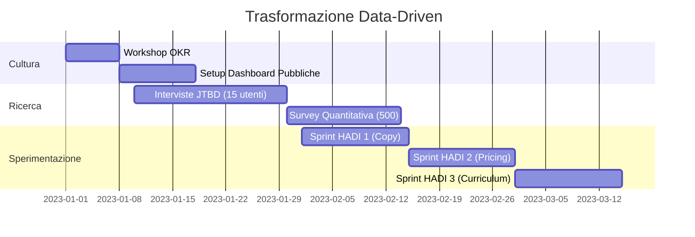
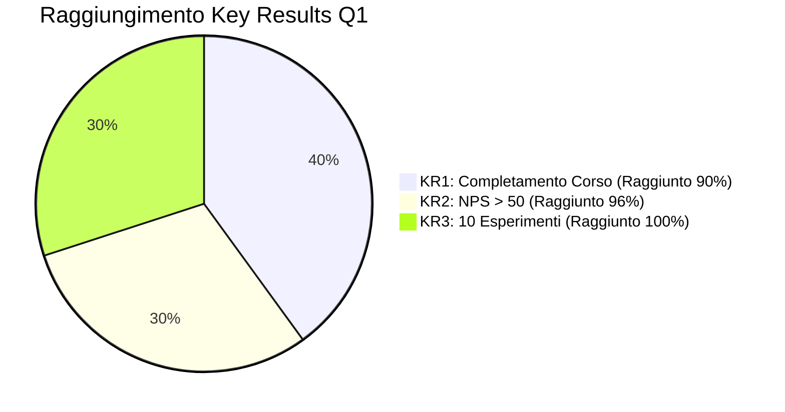

## Contesto Aziendale

**Azienda:** *EduTech Solutions* (nome fittizio)
**Settore:** EdTech B2C (Corsi di programmazione online)
**Team:** 15 persone (Fondatori, Marketing, Prodotto)
**Situazione:** Post-Seed, fatturato stazionario da 6 mesi.

EduTech è bloccata. Il CEO vuole lanciare nuovi corsi su Blockchain, il CMO vuole rifare il sito web, e il CTO vuole riscrivere il backend. Le riunioni sono battaglie di opinioni basate su "secondo me".
Non c'è un allineamento sugli obiettivi e nessuno sa veramente *perché* i clienti comprano (o non comprano).

### Dati Iniziali

| Metrica | Situazione Attuale | Obiettivo | Note |
| :--- | :--- | :--- | :--- |
| **Processo Decisionale** | HiPPO (Opinione del Capo) | Data-Driven | Decisioni lente e politiche |
| **Allineamento** | Silos | OKR Condivisi | Team lavorano contro |
| **Conoscenza Cliente** | Demografica (Età, Sesso) | Psicografica (JTBD) | Ignorano le motivazioni reali |
| **Ciclo Rilascio** | 1 mese | 1 settimana (HADI) | Lentezza nell'imparare |
| **Fatturato Mensile** | €50k (Piatto) | €80k (+60%) | Stagnazione |

**Problema Principale:** Mancanza di una **Cultura Data-Driven**. I dati vengono usati per giustificare decisioni già prese, non per prenderle. Manca un metodo scientifico di sperimentazione.

## Obiettivi del Progetto

Il progetto "Culture Shift" si pone i seguenti obiettivi:

1.  **Implementare il framework OKR** per allineare tutti i dipartimenti su un unico obiettivo trimestrale.
2.  **Scoprire il vero "Job to be Done"** dei clienti tramite ricerca qualitativa e quantitativa.
3.  **Adottare il ciclo HADI** (Hypothesis, Action, Data, Insight) per validare almeno 4 esperimenti al mese.
4.  **Aumentare il Conversion Rate (CR) del 30%** agendo sulle leve psicologiche scoperte.

## Analisi e Strategia

### 1. Alignment: OKR e KPI
Il primo passo è definire la "North Star Metric". Non il fatturato, ma il "Numero di studenti che trovano lavoro entro 6 mesi".
*   **Objective:** Diventare la scelta #1 per il career switch.
*   **Key Result 1:** Aumentare il tasso di completamento corso al 60%.
*   **Key Result 2:** Aumentare NPS da 30 a 50.

### 2. Discovery: Framework JTBD
Smetteremo di vendere "Corsi Python" e inizieremo a vendere il progresso che l'utente cerca. Condurremo **Interviste in Profondità** focalizzate sulle "Switch Interviews" (chi ha appena comprato e chi ha appena abbandonato).
*   *Ipotesi:* La gente compra per imparare a programmare.
*   *Realtà (scoperta):* La gente compra per paura di perdere il lavoro o per frustrazione verso il capo attuale ("Fire your boss").

### 3. Execution: Ciclo HADI
Ogni idea diventa un'ipotesi da validare, non un compito da eseguire.
*   **Hypothesis:** Se cambiamo il titolo della Landing Page da "Impara Python" a "Cambia Carriera in 3 mesi", aumenteremo le iscrizioni.
*   **Action:** A/B Test sulla Hero Section.
*   **Data:** Misurazione conversioni.
*   **Insight:** La variante "Carriera" converte il 40% in più.

### Diagramma del Ciclo HADI Adottato

```mermaid
flowchart TD
    H[Ipotesi: "Se facciamo X, succederà Y"] --> A[Azione: MVP / Test Rapido]
    A --> D[Dati: Raccolta Metriche]
    D --> I{Insight: Validata o Confutata?}
    I -- Validata --> S[Scale / Implementa]
    I -- Confutata --> L[Learning & Pivot]
    S --> H
    L --> H
```

**Decisioni Chiave:**
*   **Stop alle roadmap annuali:** Si pianifica per trimestre (OKR), si esegue per sprint bisettimanali.
*   **Democrazia del Dato:** Tutti, dal customer support al CEO, hanno accesso a Metabase per vedere i KPI in tempo reale.

## Implementazione

### Timeline (Trimestre Q1)



### Dati Intermedi: Risultati Ricerca JTBD

Le interviste hanno rivelato le 4 forze che agiscono sul cliente:

| Forza | Descrizione | Impatto | Azione Presa |
| :--- | :--- | :--- | :--- |
| **Push (Spinta)** | "Odio il mio attuale lavoro noioso" | Molto Alta | Copy focalizzato sul "cambiamento" |
| **Pull (Attrazione)** | "Voglio guadagnare come un dev" | Media | Mostrare dati stipendi medi |
| **Anxiety (Ansia)** | "E se non sono capace?" | Alta (Bloccante) | Introdotta garanzia "Soddisfatto o Rimborsato" |
| **Inertia (Inerzia)** | "Non ho tempo ora" | Media | Creato piano di studio flessibile |

**Problema Incontrato:** Resistenza del team creativo al cambiamento dei testi basato sui dati.
**Soluzione:** Abbiamo lasciato decidere ai dati tramite A/B test. Quando il "brutto" copy performante ha battuto il "bel" copy creativo, la discussione è finita.

## Risultati

Alla fine del trimestre, EduTech ha cambiato volto.

### KPI Prima vs Dopo

| KPI | Prima (T0) | Dopo (Q1) | Variazione |
| :--- | :--- | :--- | :--- |
| **Conversion Rate LP** | 1.2% | 1.9% | +58% |
| **NPS** | 32 | 48 | +50% |
| **Esperimenti/Mese** | 0 | 5 | Velocità Apprendimento |
| **Fatturato** | €50k | €75k | +50% |

### Analisi ROI

Il costo della "trasformazione" è stato zero in termini monetari (cambio di processo), ma alto in termini di sforzo cognitivo.
Il risultato economico (+€25k/mese) è ricorrente.
Il vero ROI è la **velocità decisionale**: le riunioni sono passate da 2 ore a 30 minuti.

### Grafico Risultati OKR



## Lezioni Apprese

1.  **L'ego è il nemico dei dati:** Per essere data-driven, devi essere disposto ad ammettere di avere torto.
2.  **Il cliente non compra il prodotto:** Compra una versione migliore di se stesso. Il JTBD è la lente giusta per vederlo.
3.  **OKR non sono una to-do list:** Devono esprimere il *risultato*, non l'attività. "Lanciare il nuovo sito" è sbagliato. "Aumentare conversioni del 20%" è giusto.
4.  **Qualitativo + Quantitativo:** I dati numerici ti dicono *cosa* succede, le interviste ti dicono *perché*. Servono entrambi.
5.  **Fallire velocemente:** Il ciclo HADI serve a scartare le idee cattive in una settimana, non in sei mesi.

## Domande di Discussione

1.  Come gestiresti un Key Result (KR) che a metà trimestre appare chiaramente irraggiungibile? Lo cambi o persisti?
2.  Qual è la differenza tra un "Job to be Done" e un semplice bisogno o desiderio?
3.  In che modo la cultura della "blameless post-mortem" favorisce l'innovazione e l'assunzione di rischi?
4.  Come si concilia la visione a lungo termine del fondatore con l'iterazione rapida a breve termine del ciclo HADI?
5.  Se i dati quantitativi (Survey) contraddicono i dati qualitativi (Interviste), a chi dai priorità e come indaghi ulteriormente?

**Cosa faresti diversamente?**
*   *Se il team fosse più grande:* Avrei creato delle "Squad" cross-funzionali autonome, ognuna con un proprio set di OKR allineati a quelli aziendali.
*   *Se il prodotto fosse B2B:* Le interviste JTBD avrebbero coinvolto non solo l'utente finale ma anche il buyer economico (il capo che paga il corso), che ha Job diversi.
