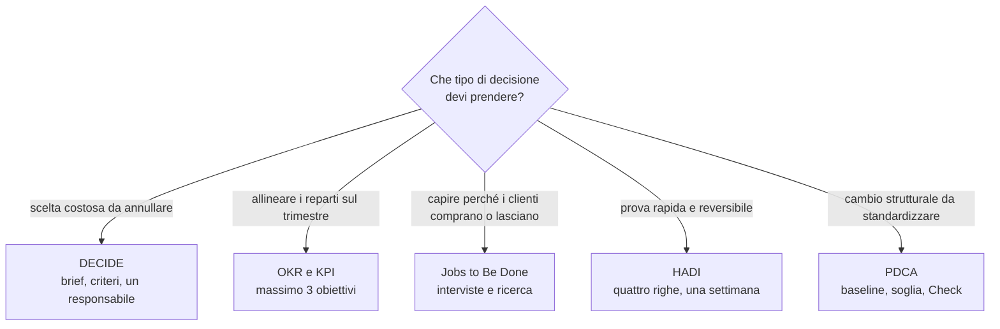

Ogni lunedì il comitato di gestione di un'azienda B2B di servizi digitali esamina venticinque indicatori per due ore e chiude la riunione senza aver assegnato un responsabile, una scadenza o una soglia di successo a nessuna iniziativa. È uno scenario costruito, con numeri di esempio: il problema non è la mancanza di grafici, è l'assenza di una regola condivisa per trasformare un numero in una scelta.

> **Idea chiave:** nessuna decisione rilevante dovrebbe uscire da una riunione senza un responsabile unico, una baseline numerica verificata e una data fissa di controllo.

## Come usare questa scheda

La scheda condensa il modulo in un riferimento da aprire prima di una riunione, non dopo. Ogni riga rimanda a un framework del modulo e indica a quale domanda risponde: perché decidiamo questa cosa, che cosa misuriamo, come sperimentiamo, che cosa vogliono davvero i clienti. Se non riesci a dire quale di queste domande ti blocca, il framework da usare non è ancora chiaro, e il primo lavoro è chiarirla.

Il percorso del modulo segue un ordine di fiducia crescente. La cultura dati (primo capitolo) crea le condizioni perché un numero possa battere un'opinione. Il framework DECIDE trasforma un'analisi in una scelta con criteri scritti prima. Gli OKR e i KPI collegano le attività al risultato trimestrale. Le ricerche quantitative e qualitative e le interviste raccolgono il perché dietro i numeri, il framework Jobs to Be Done dà una struttura a ciò che i clienti cercano, e i cicli PDCA e HADI consolidano o esplorano ciò che si è deciso. Il progetto finale mette tutto alla prova su un'azienda reale.

## Mappa dei framework e soglie minime

Ogni situazione richiede lo strumento giusto al momento giusto. Usare gli OKR per gestire l'operatività quotidiana crea burocrazia, mentre usare un ciclo HADI senza un obiettivo strategico porta a ottimizzare dettagli irrilevanti. La tabella riassume quando applicare ciascun framework e quale verifica minima pretendere prima di approvare una spesa.

| Framework | Quando usarlo | Output obbligatorio | Soglia di qualità minima |
| :--- | :--- | :--- | :--- |
| DECIDE | Scelte ad alto impatto o irreversibili | Opzioni confrontate con criteri e rischi | Almeno 2 alternative reali valutate |
| OKR e KPI | Allineamento trimestrale tra reparti | Massimo 3 obiettivi con 3 risultati chiave | Distinzione netta tra KPI di salute e OKR |
| Ciclo HADI | Sperimentazione rapida su prodotto e marketing | Ipotesi, azione, dato atteso, apprendimento | Durata fissa e metrica primaria unica |
| Ciclo PDCA | Cambi strutturali di processo o modello dati | Scheda con baseline, soglia e data del Check | Soglia scritta prima del Do |
| Jobs to Be Done | Capire perché i clienti comprano o lasciano | Interviste su acquisto recente e attriti | Almeno 5-8 interviste per segmento |
| Albero dei KPI | Collegare attività operative al margine | Scomposizione aritmetica di ricavi e costi | Ogni nodo ha un solo owner |

Le soglie della colonna finale sono minimi di igiene, non garanzie di qualità. Un OKR con 3 obiettivi e 3 risultati chiave può comunque misurare lo sforzo invece dell'impatto: la soglia dice solo che non si è partiti con venti obiettivi.

## La checklist in cinque passi

Prima di approvare un nuovo progetto, una campagna o una modifica di processo, applica questa sequenza in cinque minuti. Primo: definisci l'esito atteso in termini numerici, con numeratore, denominatore e finestra temporale espliciti. Secondo: verifica la baseline delle ultime quattro o otto settimane, escludendo anomalie evidenti o dati di prova. Terzo: dichiara l'alternativa più semplice, compresa l'opzione di non fare nulla, e stima il costo opportunità del tempo investito. Quarto: fissa una soglia minima di successo sotto la quale l'iniziativa viene fermata o corretta. Quinto: nomina un solo responsabile operativo e scrivi in calendario la data della revisione.

Questa disciplina riduce i progetti zombi, quelli che continuano a consumare budget per mesi perché nessuno ha il coraggio di dichiararne il fallimento. Quando tutti sanno in anticipo quali numeri determinano la prosecuzione o lo stop, il confronto tra reparti diventa oggettivo.

La checklist trova posto nel modello dei verbali o nelle schede di approvazione su Notion, Jira o Google Docs: quando la struttura dello strumento chiede baseline, alternativa scartata, soglia e data di controllo, la disciplina smette di dipendere dalla memoria di chi partecipa.

## Un calcolo svolto: la quota di decisioni governate

Applichiamo la checklist al trimestre dell'azienda B2B. Nel trimestre il comitato prende 40 decisioni rilevanti. Per ciascuna si verificano due condizioni: esiste una baseline scritta prima dell'avvio e c'è un responsabile nominato. Il conteggio dà 12 decisioni con entrambe le condizioni, quindi la quota governata è 12 / 40 = 30%.

Il costo di portare il comitato a 36 decisioni governate su 40, cioè 36 / 40 = 90%, si calcola così. Servono 36 - 12 = 24 decisioni in più con baseline e responsabile. Se verificare la baseline richiede 20 minuti e scrivere soglia e data altri 10 minuti, ogni decisione costa 30 minuti. Il totale è 24 × 30 = 720 minuti, cioè 12 ore su un trimestre.

Si confronta il costo con la riunione attuale. Due ore per venticinque indicatori fanno 120 / 25 = 4,8 minuti per indicatore, senza alcuna decisione assegnata. Portando la riunione a 5 indicatori di salute e 3 decisioni da discutere, i 120 minuti si dividono in 5 × 6 = 30 minuti per gli indicatori e 3 × 30 = 90 minuti per le decisioni, per un totale di 30 + 90 = 120 minuti. Il tempo resta lo stesso, cambia ciò che ne esce: tre decisioni con responsabile e soglia invece di venticinque numeri letti. L'obiettivo del 90% è dichiarato e non misurato, e si verifica contando le righe a fine trimestre.

## Tre errori nell'applicare i framework

### Trasformare gli OKR in una lista di attività da spuntare

Il sintomo è un risultato chiave come «lanciare il nuovo sito» o «implementare il CRM». Succede perché le attività sono facili da scrivere e da verificare, mentre un impatto richiede una definizione. Un risultato chiave misura lo sforzo tecnico invece di un cambiamento nei clienti o nei processi. Si corregge riscrivendolo come variazione verificabile, per esempio la riduzione del tempo medio di risposta o l'aumento del tasso di rinnovo trimestrale.

### Avviare cicli HADI senza baseline

Il sintomo è un team che decide di valutare il successo solo a iniziativa completata e scopre che nessuno aveva salvato il valore di partenza, o che nel frattempo sono cambiate tre altre variabili commerciali. Senza una baseline pulita e documentata prima dell'intervento, qualsiasi lettura successiva diventa un esercizio di opinioni. Si corregge salvando il valore di partenza prima di toccare qualcosa, anche se l'esperimento sembra banale.

### Confondere la quantità di dati con la qualità della decisione

Il sintomo è un documento di quaranta slide piene di tabelle. Sembra scientifico, ma spesso nasconde l'assenza di un'ipotesi chiara. Una buona analisi decisionale sta in una pagina che dichiara il problema, l'alternativa scartata, il numero che deve muoversi e il rischio massimo accettabile. Si corregge imponendo il limite di una pagina al brief: ciò che non entra non serviva alla scelta.

## Decisioni urgenti con dati incompleti

Capita di dover decidere entro quarantotto ore senza una serie storica perfetta né un campione ampio. Il criterio è distinguere tra decisioni reversibili e irreversibili. Se la scelta è facilmente reversibile, come testare un nuovo messaggio commerciale su un piccolo segmento o modificare temporaneamente una procedura, si procede con un ciclo HADI rapido e si guardano i primi segnali dopo sette giorni. Se è costosa da annullare, come firmare un contratto pluriennale o assumere un intero reparto, si investono le quarantotto ore per raccogliere almeno la baseline minima e cinque riscontri diretti da clienti o operatori coinvolti.

Il cheat sheet aziendale non deve diventare un manuale enciclopedico: resta una scheda di una o due schermate, rivista una volta a trimestre per aggiornare soglie economiche, nomi dei responsabili di metrica ed esempi tratti dalle decisioni più recenti. La qualità di un sistema decisionale si vede nei momenti di stress, quando i ricavi rallentano o un concorrente lancia un'offerta aggressiva: un riferimento già condiviso impedisce reazioni impulsive e mantiene il team allineato su ipotesi chiare e responsabilità trasparenti.

## Controllo operativo prima di chiudere la riunione

1. L'obiettivo della decisione è espresso come risultato misurabile con formula esplicita, e non come attività da completare?

Mostra risposta

Un buon obiettivo ha numeratore, denominatore e finestra, per esempio «tasso di rinnovo trimestrale dal 82% al 85%». «Lanciare il CRM» è un'attività: dice che cosa si fa, non che cosa cambia per i clienti.

2. Hai annotato la baseline storica prima di avviare l'intervento, e su quante settimane?

Mostra risposta

La baseline va presa sulle ultime quattro o otto settimane, escludendo anomalie e dati di prova, e salvata prima del Do. Senza di essa non esiste un termine di confronto, e il risultato diventa interpretabile a piacere.

3. Su 40 decisioni di un trimestre, 12 hanno baseline e responsabile: quale quota hai e quante ore servono per portarla al 90%?

Mostra risposta

La quota è 12 / 40 = 30%. Il 90% corrisponde a 36 decisioni, quindi ne servono 24 in più. A 30 minuti ciascuna fanno 24 × 30 = 720 minuti, cioè 12 ore sul trimestre.

4. Hai stabilito la soglia minima di successo e il momento in cui valutare i risultati?

Mostra risposta

La soglia deve essere un numero scritto prima dell'avvio, con la data del controllo in calendario. Se mancano entrambe, l'iniziativa non può essere fermata senza una discussione, ed è così che nascono i progetti zombi.

5. Una scelta irreversibile con dati incompleti e 48 ore a disposizione: che cosa raccogli e che cosa eviti?

Mostra risposta

Raccogli almeno la baseline minima e cinque riscontri diretti da clienti o operatori coinvolti. Eviti di trattarla come una prova HADI rapida, perché il costo di tornare indietro è alto e un errore resta nei conti per mesi o anni.

