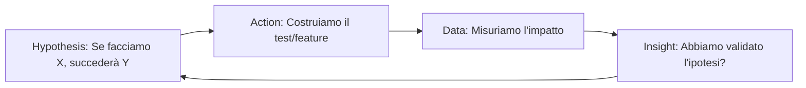
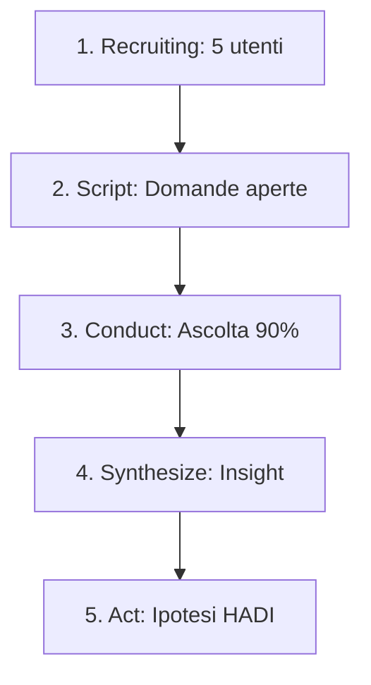

## Concetti Chiave

- **Data-Driven vs Data-Informed**: Essere guidati dai dati (l'algoritmo decide) vs essere informati dai dati (l'umano decide usando i dati come input).
- **HiPPO (Highest Paid Person's Opinion)**: Il nemico della cultura data-driven. Le decisioni basate sull'opinione del capo invece che sui fatti.
- **HADI Cycle**: Il ciclo iterativo per validare le idee: Hypothesis, Action, Data, Insight. Simile al PDCA (Plan-Do-Check-Act).
- **JTBD (Jobs To Be Done)**: Framework per capire la motivazione profonda dell'utente. "Non voglio un trapano da 6mm, voglio un buco nel muro".
- **Triangolazione**: Validare un insight usando tre fonti diverse (es. Survey + Analytics + Interviste) per eliminare i bias.
- **Survivorship Bias**: L'errore di guardare solo chi "ce l'ha fatta" (es. analizzare solo gli utenti attivi ignorando chi ha abbandonato).
- **Vanity Metrics**: Numeri che ti fanno sentire bene (Like, Download) ma non correlano col business. Opposto di *Actionable Metrics*.

## Metriche di Ricerca

| Metrica | Formula | Domanda Tipica | Quando usarla |
|---------|---------|----------------|---------------|
| **NPS** | `% Promotori - % Detrattori` | "Consiglieresti a un amico?" | Relazione a lungo termine. |
| **CSAT** | `(Risposte 4-5 / Totale) * 100` | "Quanto sei soddisfatto?" | Dopo un'interazione specifica (es. ticket supporto). |
| **CES** | Media o `% Facile` | "Quanto è stato facile?" | Dopo un task complesso. Predittore di retention. |
| **Sample Size** | Calcolatore Online | - | Prima di ogni survey o A/B test per avere significatività. |

## Framework e Modelli

### HADI Cycle
Il motore della sperimentazione rapida.

### Jobs To Be Done (JTBD)
Struttura per definire i requisiti utente.

> **When** (Situazione) ...
> **I want to** (Motivazione) ...
> **So I can** (Risultato atteso).

*Esempio:* "Quando sono in ritardo (Situation), voglio vedere subito il taxi più vicino (Motivation), così posso calmarmi sapendo quando arrivo (Outcome)."

## Processo Step-by-Step: Intervista in Profondità

1.  **Recruiting**: Seleziona 5 utenti che corrispondono alla tua Persona (non amici/parenti).
2.  **Script**: Prepara una traccia aperta. Non domande Sì/No.
3.  **Conduct**: Fai parlare l'utente per il 90% del tempo. Usa i "5 Perché" per scavare.
4.  **Synthesize**: Trascrivi e cerca pattern ricorrenti. Se 3 utenti dicono la stessa cosa, è un insight.
5.  **Act**: Trasforma l'insight in un'ipotesi HADI da testare.

## Errori da Evitare

-   ❌ **Conferma (Confirmation Bias)** → ✅ Cercare solo dati che confermano la tua idea. Cerca attivamente dati che la smentiscono.
-   ❌ **Peeking (A/B Test)** → ✅ Guardare i risultati del test ogni giorno e fermarlo appena "vince". Aspetta la significatività statistica.
-   ❌ **Interviste Guidate** → ✅ Chiedere "Ti piace questa feature?" è inutile. Chiedi "Raccontami l'ultima volta che hai avuto questo problema".
-   ❌ **Analysis Paralysis** → ✅ Cercare il dato perfetto all'infinito. Spesso "abbastanza buono" oggi è meglio di "perfetto" tra un mese.
-   ❌ **Confondere Correlazione e Causalità** → ✅ "Quando piove vendiamo più ombrelli". La pioggia causa la vendita. "Chi mangia gelato fa più incidenti in barca". No, è l'estate che causa entrambi.

## Quick Reference

| Strumento | A cosa serve | Quando usarlo |
|-----------|--------------|---------------|
| **Typeform / Google Forms** | Survey Quantitative | Raccogliere feedback strutturato su larga scala. |
| **Miro / FigJam** | Sintesi Qualitativa | Organizzare post-it e insight dalle interviste. |
| **Evan Miller Calculator** | A/B Test Sample Size | Calcolare quanti utenti servono per un test valido. |
| **Otter.ai** | Trascrizione | Registrare e trascrivere automaticamente le interviste. |
