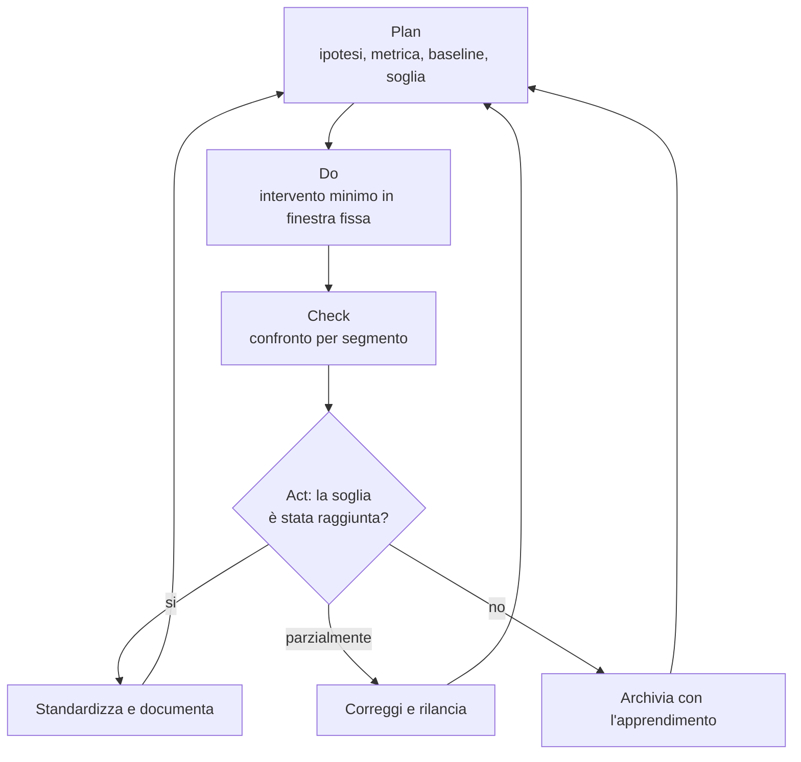

Un cambio a un modello dbt fa scendere il ricavo mensile del 6,4% da un giorno all'altro. Per tre settimane nessuno sa dire se il calo sia un errore o una correzione, e nel frattempo il direttore commerciale chiede se il negozio ha perso vendite.

> **Idea chiave:** un ciclo di miglioramento è chiuso solo se la fase di controllo confronta il risultato con una baseline e una soglia scritte prima dell'intervento.

## Un calo che nessuno sa leggere

Il caso è ricostruito, con numeri di esempio. Il team analytics di un negozio online modifica il modello `orders`: la nuova definizione di ordine valido esclude gli ordini rimborsati entro 7 giorni. I test di dbt passano, il merge avviene di venerdì e il lunedì il ricavo mensile in dashboard è sceso da 1,25 a 1,17 milioni di euro. La differenza è 1,25 - 1,17 = 0,08 milioni, e 0,08 / 1,25 = 6,4% in meno.

Nessuno può rispondere alla domanda del direttore. Non c'è un'ipotesi scritta su che cosa il cambio avrebbe dovuto produrre, non c'è una baseline con cui confrontare, non c'è una data di controllo. Per tre settimane si discute se il modello sia sbagliato. Alla fine qualcuno confronta il numero con la contabilità, che per quel mese riporta 1,17 milioni. Il cambio era giusto: il vecchio modello contava come ricavo ordini che erano stati restituiti.

La modifica non era l'errore. L'errore è stato farla senza un ciclo che la chiudesse: una modifica senza ipotesi, baseline e data di controllo non si può né difendere né annullare, e ogni lettura del risultato resta una questione di opinioni.

## Le quattro fasi del PDCA

Il ciclo PDCA ha quattro fasi: Plan, Do, Check, Act. Nel Plan si identifica il problema, si scrive un'ipotesi falsificabile e si fissano metrica, baseline e miglioramento atteso. Nel Do si implementa l'intervento minimo, in una finestra temporale fissa. Nel Check si analizzano i risultati contro la baseline, per segmento, con un gruppo di controllo o con il modello precedente. Nell'Act si decide se standardizzare, correggere o archiviare, secondo una soglia scritta prima.

La storia del ciclo aiuta a ricordare perché la fase di controllo è il perno. Il PDCA nasce con Walter Shewhart nei laboratori Bell, e Deming lo riprese in Giappone intorno al 1950-51, preferendo il termine «study» a «check»: studiare, non solo verificare ([PDCA su Wikipedia](https://en.wikipedia.org/wiki/PDCA); [Lean Enterprise Institute](https://www.lean.org/lexicon-terms/pdca/)). Le fonti discordano sull'anno esatto. Il lavoro di un ciclo sta nello studiare la differenza tra ciò che era scritto e ciò che è successo, non nel certificare che l'intervento è stato eseguito.

## HADI, la versione per i cicli brevi

HADI sta per Hypothesis, Action, Data, Insights ed è la versione pensata per cicli di pochi giorni: un'ipotesi, l'azione minima per metterla alla prova, i dati raccolti, l'apprendimento. Per HADI non esiste un autore citabile: le fonti lo collocano nella pratica delle startup e della metodologia lean, senza un'attribuzione precisa. Il suo valore sta nella velocità: più cicli rapidi significano più apprendimento, a patto che ciascuno sia chiuso con un confronto.

Un ciclo HADI scritto bene sta in quattro righe. Hypothesis: togliere un campo dal modulo di pagamento porta la conversione mobile dal 4,0% almeno al 4,2%, cioè il 5% in più in termini relativi. Action: rimuovere il campo per metà del traffico per una settimana. Data: conversione dei due gruppi alla fine della settimana. Insights: che cosa si è imparato, anche quando la differenza non c'è. È un'azione che costa un pomeriggio e si annulla in un minuto, e un'ipotesi sbagliata insegna comunque qualcosa.

Un numero di esempio rende il confronto concreto. Con 10.000 sessioni mobile per gruppo, il gruppo di controllo registra 400 conversioni, cioè 400 / 10.000 = 4,0%. Il gruppo senza il campo ne registra 440, cioè 440 / 10.000 = 4,4%. La differenza è 0,4 punti percentuali, pari a 0,4 / 4,0 = 10% in termini relativi, sopra la soglia del 5% dichiarata prima. Il calcolo della significatività statistica di questo scarto resta fuori dal perimetro di questo testo, ma la soglia scritta in anticipo permette già di dire che cosa sarebbe contato come successo.

## Il calcolo svolto: scheda di ciclo per il modello ordini

Riprendiamo il caso dbt e riscriviamo il ticket vago, «DATA-412: migliorare il modello ordini, stato: fatto», come scheda di ciclo PDCA con numeri di esempio.

| Campo | Contenuto |
| :--- | :--- |
| Ipotesi | Escludere gli ordini rimborsati entro 7 giorni porta il ricavo mensile di `orders` vicino a quello contabile |
| Baseline | Ricavo mensile di `orders`: 1,25 milioni di euro nell'ultimo mese chiuso. Riferimento contabile: 1,17 milioni |
| Soglia | Si standardizza se la differenza con la contabilità scende sotto l'1% |
| Do | Modello in sviluppo per tre giorni, confrontato giorno per giorno con quello in produzione |
| Check | Il 20 del mese: differenza con la contabilità, ricavo per canale e per paese |
| Act | Merge se la differenza è sotto l'1%, altrimenti si rivede la definizione |

Svolgiamo il Check. La differenza di partenza tra il vecchio modello e la contabilità è 1,25 - 1,17 = 0,08 milioni, cioè 80.000 euro, pari a 80.000 / 1.170.000 = 6,8% rispetto al riferimento contabile. Il nuovo modello produce 1,17 milioni: la differenza con la contabilità è 0 euro, quindi 0%, sotto la soglia dell'1% (che in euro varrebbe 11.700). La soglia è rispettata con margine, e il merge avviene con la spiegazione già scritta.

Con la scheda, il calo del 6,4% si legge in tre giorni invece di tre settimane. Il numero 6,4% e il numero 6,8% non sono in contraddizione: il primo è lo scarto rispetto al vecchio ricavo in dashboard (base 1,25 milioni), il secondo è lo scarto del vecchio modello rispetto alla contabilità (base 1,17 milioni). Scegliere la base di confronto è parte del Plan, e dichiararla in anticipo evita di discutere quale percentuale sia quella giusta. Archiviare resta un esito valido: un'ipotesi smentita con una baseline chiara costa meno di una modifica che resta in produzione senza che nessuno sappia se serve.

## Tre errori che sembrano ordine

### L'ipotesi che non si può smentire

Il sintomo è un ticket che dice «migliorare il modello ordini». Sembra ragionevole, perché è l'obiettivo di chiunque lavori sui dati. Ma nessun numero può dimostrare che il modello non è migliorato, e un'ipotesi che nessun dato può smentire non guida il lavoro, lo giustifica a posteriori. Si corregge scrivendo l'effetto atteso come numero: «la differenza con la contabilità scende sotto l'1%».

### Il ciclo senza baseline

Il sintomo è un numero che cambia e nessuno sa dire di quanto era prima. Si parte dalla modifica perché la baseline sembra un adempimento, e poi il termine di confronto non esiste: il 6,4% può essere un errore, una correzione o un effetto stagionale, e tutte e tre le letture sono difendibili. Si corregge salvando il valore di partenza, e il valore di riferimento esterno quando esiste, prima del Do.

### Il Check saltato

Il sintomo è un ciclo che passa direttamente dal Do all'Act perché i test passano. Succede perché i test di dbt controllano di solito che le chiavi siano uniche e i campi pieni, non che la definizione di ordine valido abbia prodotto il numero che serviva. Il passaggio mancante è quello in cui si confronta il risultato con ciò che si era scritto di aspettarsi. Si corregge fissando la data del Check nel calendario prima di fare la modifica.

## HADI o PDCA: come scegliere

Il caso difficile è scegliere il ciclo. HADI è nato per esplorare in fretta, PDCA per consolidare. Il criterio: HADI se l'azione costa meno di una settimana ed è reversibile, PDCA se il cambiamento è strutturale, come un modello di dati o un processo, e va standardizzato.

Cambiare la definizione di ordine valido è una decisione da PDCA: coinvolge la contabilità, tocca ogni metrica a valle e deve diventare lo standard del team. La confusione comune è usare HADI per un cambio strutturale. Ogni iterazione sembra riuscire, perché è piccola e veloce, ma nessuna arriva all'Act: il modello cambia a pezzi e non esiste mai una versione che il team abbia dichiarato standard. L'errore opposto è un PDCA lungo e rigido per un'idea ancora da esplorare, che costa settimane di carte per un test da un pomeriggio.

La correzione è reversibile in entrambi i casi: il modello resta in sviluppo e un revert costa un merge, mentre un esperimento HADI si spegne rimuovendo il flag. Restano fuori da questa lezione il calcolo della significatività e la scelta del gruppo di controllo, che sono tema del modulo sulla significatività statistica.

## Controllo prima di cambiare un modello

1. L'ipotesi che hai scritto si può smentire con un numero?

Mostra risposta

Se l'ipotesi è «migliorare il modello», no: nessun valore la contraddice. Se è «la differenza con la contabilità scende sotto l'1%», sì, perché esiste un numero che la smentirebbe. Riscrivi finché trovi il numero.

2. Baseline e soglia di decisione sono scritte prima del Do?

Mostra risposta

Devono esserlo, altrimenti la soglia segue il risultato. Nel caso del modello ordini, baseline 1,25 milioni, riferimento contabile 1,17 milioni e soglia 1% sono fissati nel Plan, e solo dopo si apre il modello in sviluppo.

3. Con 400 conversioni su 10.000 sessioni nel controllo e 440 su 10.000 nel test, quale incremento relativo misuri e supera la soglia del 5%?

Mostra risposta

Il controllo è 4,0% e il test 4,4%, quindi la differenza è 0,4 punti, pari a 0,4 / 4,0 = 10% in termini relativi. Supera la soglia del 5% scritta in anticipo. Se la soglia non fosse stata scritta, il 10% sarebbe stato interpretabile a piacere.

4. Il Check confronta per segmento, contro la baseline e contro un riferimento?

Mostra risposta

Un confronto solo sul totale può nascondere un segmento che peggiora mentre un altro migliora. Nel caso dbt il controllo per canale e per paese serve a verificare che la differenza dello 0% con la contabilità non sia il risultato di errori che si compensano.

5. Una modifica a una definizione di metrica usata da tre reparti va gestita con HADI o con PDCA, e perché?

Mostra risposta

Con PDCA, perché è un cambiamento strutturale che tocca più reparti e deve diventare standard. HADI è adatto ad azioni che costano meno di una settimana e si annullano in fretta. Usare HADI qui produrrebbe tante piccole iterazioni senza mai una versione dichiarata standard.

