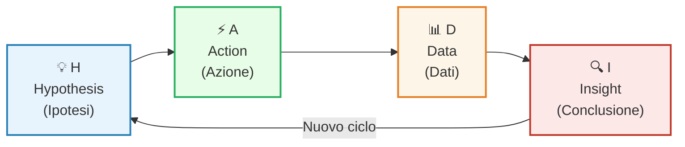
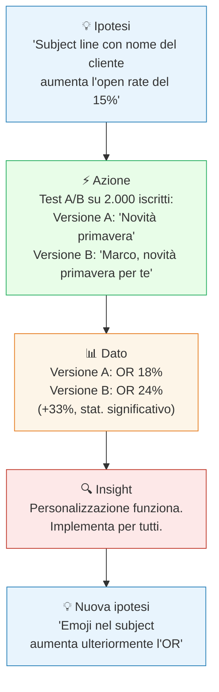

Esiste un segreto del management che i grandi manager conoscono e gli altri ignorano. Non è un software. Non è un framework complicato. È un'idea semplicissima che però richiede disciplina vera per essere applicata:

> **Non puoi sapere in anticipo cosa funziona. Ma puoi costruire un sistema per scoprirlo velocemente e applicarlo sistematicamente.**

Questo si chiama management data-driven. E il suo motore è il **ciclo HADI**.

## Le origini: Deming e il miracolo giapponese

Tutto inizia negli anni '50. W. Edwards Deming, statistico americano, viene ignorato in patria ma accolto trionfalmente in Giappone. Insegna alle aziende giapponesi un principio fondamentale: **il miglioramento continuo batte sempre la grande intuizione.**

Il suo ciclo si chiamava **PDSA**: Plan → Do → Study → Act.

Pianifica un miglioramento → implementalo su piccola scala → studia i risultati → applica o scarta. Semplice. Rivoluzionario.

Questo principio è la base del miracolo economico giapponese degli anni '60-'80. Toyota, Sony, Honda non sono diventate leader mondiali grazie a un'intuizione geniale. Ci sono arrivate con milioni di piccoli miglioramenti sistematici. Negli anni 2000, la startup culture californiana ha reinterpretato il ciclo di Deming e lo ha chiamato **HADI**.

## Il ciclo HADI

### H — Hypothesis (Ipotesi)

Un'ipotesi non è un'idea vaga. È una previsione specifica e misurabile.

**Sbagliato:** "Dobbiamo migliorare la pagina prodotto"

**Giusto:** "Aggiungendo le recensioni video nella pagina prodotto, il conversion rate aumenterà del 10% nelle prossime 2 settimane"

Un'ipotesi ben scritta ha sempre: **cosa cambi**, **cosa misuri**, **in quanto tempo**, **di quanto**. Se manca uno di questi elementi, non è un'ipotesi — è un'opinione.

### A — Action (Azione)

Implementa la modifica nel modo più veloce e a basso costo possibile. Non aspettare la perfezione. L'obiettivo è imparare, non lanciare il prodotto definitivo.

In Italia c'è una tendenza culturale alla perfezione — "prima che esca deve essere perfetto." Questo è il nemico del HADI. Meglio una versione grezza che insegna qualcosa in 2 settimane che una versione perfetta che insegna qualcosa in 6 mesi.

### D — Data (Dati)

Misura ciò che hai previsto nell'ipotesi. Non il dato più comodo, non quello che ti fa fare bella figura in presentazione. Il dato che risponde alla domanda: **"L'ipotesi era giusta?"**

### I — Insight (Conclusione)

Trai una conclusione e decidi cosa fare:
- **Scala**: l'ipotesi ha funzionato → implementa per tutti
- **Itera**: l'ipotesi era parzialmente giusta → aggiusta e riprova
- **Scarta**: l'ipotesi era sbagliata → impara il perché e passa alla prossima

## Il caso Satispay

Satispay è nata a Torino nel 2013 come app di pagamenti peer-to-peer. L'idea originale: mandare soldi agli amici senza commissioni. Come ha applicato HADI?

| Ciclo | Ipotesi | Azione | Dato | Insight |
|---|---|---|---|---|
| **1** | "Gli under-30 vogliono mandare soldi agli amici senza commissioni" | MVP solo P2P | Download alti, ma uso basso dopo il primo mese | Il P2P da solo non basta: serve usare l'app ogni giorno |
| **2** | "Aggiungendo merchant locali, l'uso quotidiano aumenta" | Partnership con bar e ristoranti a Milano | Retention aumentata del 40% in 3 mesi | Il use case quotidiano è il pagamento al bar |
| **3** | "Con il cashback sui pagamenti, accelera l'acquisizione" | Cashback 10% nei primi 30 giorni | CAC ridotto del 60%, viral coefficient >1 | Il cashback è un motore di crescita potente in Italia |

Oggi Satispay vale oltre 1 miliardo di euro. Non perché ha avuto un'intuizione geniale. Perché ha girato il ciclo HADI abbastanza velocemente da trovare il modello giusto prima di esaurire i fondi.

## Il caso contrario: la grande idea che non funziona

Nel 2018 una startup milanese ha lanciato un servizio di consegna di cibo gourmet con chef professionisti. L'idea era bellissima. Il branding impeccabile. Il fondatore era convinto — sulla base di focus group — che i milanesi volessero cenare con qualità da ristorante a casa.

Il problema: non avevano mai testato l'ipotesi vera, quella scomoda. **A che prezzo?** Quando il MVP è uscito a 45€ a persona, il mercato ha risposto con silenzio. Avevano confuso "l'idea sembra bella" con "le persone la useranno davvero a questo prezzo."

Con il ciclo HADI avrebbero scoperto il problema in 3 settimane. Invece lo hanno scoperto dopo 18 mesi e 2 milioni di euro bruciati.

## HADI applicato al marketing

Il ciclo HADI non è solo per il prodotto. Funziona benissimo nel marketing.

**Esempio: campagna email per un e-commerce di abbigliamento italiano**

## Quanti cicli HADI fare?

Un ciclo HADI non deve durare più di 2 settimane. Se ci vuole più tempo, stai testando qualcosa di troppo grande — spezzalo in ipotesi più piccole.

| Tipo di azienda | Cicli HADI/anno | Velocità di apprendimento |
|---|---|---|
| Startup agile | 50-100 | Alta |
| Scale-up | 20-50 | Media |
| PMI italiana media | 4-12 | Bassa |
| Grande corporation italiana | 1-4 | Molto bassa |

La velocità di apprendimento è il vero vantaggio competitivo. Non il budget. Non il brand storico. Chi impara più velocemente vince.

## La mentalità del "piccolo fallimento"

In Italia c'è una cultura del perfezionismo e della paura del fallimento che spesso blocca l'innovazione. Il ciclo HADI richiede un cambio di mentalità:

**Non esiste fallimento nel HADI — esiste solo apprendimento.**

Se un'ipotesi si dimostra sbagliata, non è un fallimento. È un dato. È stato scoperto che quella strada non funziona, il che è prezioso quanto scoprire che funziona. L'unico errore reale è non aver misurato nulla e quindi non aver imparato nulla.

> *"Non ho fallito 1000 volte. Ho trovato 1000 modi che non funzionano."*
> — Thomas Edison (che fondamentalmente faceva HADI)

## Problema reale

Il team cambia priorita ogni settimana senza chiudere il ciclo tra ipotesi, azione, dato osservato e apprendimento.

La domanda pratica non e "so ripetere la teoria?", ma: **quale decisione migliora se applico bene questa lezione?** In gestione data-driven, il rischio tipico e prendere un segnale parziale e trasformarlo in una scelta costosa: una feature lanciata troppo presto, un budget spostato senza causalita, un modello dati fragile o una raccomandazione piu elegante che utile.

## Modello concettuale

Usa questa griglia in tre passaggi: prima definisci il fenomeno, poi scegli l evidenza minima credibile, infine trasformi l evidenza in una decisione esplicita.

| Livello | Domanda guida | Output atteso |
|---|---|---|
| Fenomeno | Che cosa sta davvero succedendo? | Perimetro, segmenti e assunzioni |
| Evidenza | Quale dato cambierebbe la nostra opinione? | Metriche, osservazioni e guardrail |
| Decisione | Che cosa faremo se il segnale regge? | Azione, owner, timing e criterio di stop |

Questo modello evita due estremi: teoria senza applicazione e operativita senza ragionamento.

## Formalizzazione rigorosa

Formalizza la lezione come una catena decisionale:

| Elemento | Definizione operativa | Controllo di qualita |
|---|---|---|
| Input | interviste, survey, backlog ipotesi, metric review, note qualitative e risultati esperimenti | Fonte, periodo, granularita e completezza dichiarati |
| Ipotesi | Relazione attesa tra comportamento, metrica e decisione | Assunzioni scritte prima dell analisi |
| Metrica | qualita delle decisioni, velocita di apprendimento, rischio ridotto e impatto business | Denominatore, segmento e finestra temporale espliciti |
| Guardrail | Cosa non deve peggiorare mentre ottimizzi | Soglie condivise con leadership, product, marketing e analytics |
| Decisione | trasformare evidenze sparse in una decisione con owner, ritmo e criteri di escalation | Owner, scadenza e criterio di revisione |

Una lezione e formalizzata bene quando un altra persona puo ricostruire il ragionamento e contestare le assunzioni senza chiedere spiegazioni extra.

## Esempio o caso studio

Immagina una review settimanale in cui leadership, product, marketing e analytics deve decidere su "Ciclo HADI: il motore del miglioramento continuo". Il dato iniziale mostra un segnale promettente, ma il team non si ferma al numero principale. Divide il problema per segmento, controlla i guardrail, cerca spiegazioni alternative e scrive una raccomandazione con tre parti: cosa sappiamo, cosa non sappiamo, cosa faremo adesso.

| Osservazione | Interpretazione prudente | Azione |
|---|---|---|
| Segnale positivo sulla metrica primaria | Potrebbe essere effetto reale o composizione del campione | Controllare segmenti e baseline |
| Guardrail stabile | Il miglioramento non sembra creare danni immediati | Procedere con rollout limitato |
| Evidenza ancora incompleta | Serve una verifica prima di scalare | Definire un secondo ciclo di misura |

Il valore del caso non sta nel trovare una risposta perfetta, ma nel rendere la decisione piu difendibile.

## Lab / esercizio

Usa questo esercizio per trasformare la lezione in pratica verificabile.

| Livello | Attivita | Output |
|---|---|---|
| Livello base | Riassumi il problema in cinque righe e scegli una metrica primaria con un guardrail. | Mini brief decisionale |
| Livello intermedio | Applica il modello a un caso reale o simulato, includendo segmenti, baseline e rischi. | Tabella di analisi con raccomandazione |
| Livello research-grade | Scrivi un memo che confronta due spiegazioni alternative e indica quale evidenza le distinguerebbe. | Decision memo revisionabile |

**Dataset e materiali consigliati:** esportazione eventi o metriche dal tuo prodotto, una dashboard gia usata dal team, note qualitative, risultati di un esperimento o un dataset pubblico coerente con il tema.

## Errore tipico da evitare

L errore piu comune e usare "Ciclo HADI: il motore del miglioramento continuo" come etichetta autorevole invece che come metodo. Succede quando il team cita il concetto per giustificare una scelta gia presa, oppure quando ottimizza una metrica locale senza chiedersi quale comportamento sta incentivando.

Correzione pratica: prima di presentare la raccomandazione, scrivi una riga con la decisione proposta, una riga con l evidenza che la sostiene e una riga con la condizione che ti farebbe cambiare idea. Se manca una di queste tre righe, la lezione non e ancora stata applicata con rigore.

## Quiz o checkpoint

1. Quale decisione concreta dovrebbe migliorare applicando questa lezione?
2. Quale metrica useresti come segnale primario e quale come guardrail?
3. Quale spiegazione alternativa potrebbe rendere sbagliata la tua interpretazione?
4. Che cosa dovrebbe succedere nei dati per farti cambiare raccomandazione?
5. Quale output consegneresti a leadership, product, marketing e analytics: dashboard, memo, esperimento, backlog o modello dati?

Se non riesci a rispondere in modo specifico, torna al problema reale prima di continuare.

## Riepilogo

- Il ciclo **HADI** (Hypothesis → Action → Data → Insight) è il motore del management data-driven
- Ogni ipotesi deve essere **specifica e misurabile**: cosa cambi, cosa misuri, in quanto tempo, di quanto
- L'obiettivo è **imparare velocemente**, non avere ragione subito
- **Satispay** è l'esempio italiano perfetto: pivot da P2P a pagamenti merchant grazie a cicli iterativi rapidi
- La velocità di apprendimento è il vero vantaggio competitivo — più importante del budget o del brand
- Il "piccolo fallimento" non è un problema: è il meccanismo di funzionamento del sistema
