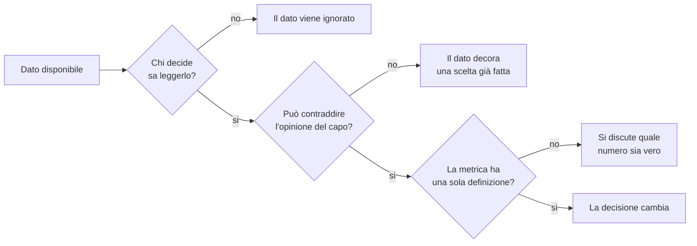

Un'azienda e-commerce ha 38 dashboard attive, un team dati che risponde alle richieste in giornata e un budget per gli strumenti che cresce a ogni anno fiscale. In un trimestre il prodotto prende 31 decisioni, tra pagine prezzi e priorità di roadmap, e solo 4 citano un numero. Nessuno ha scelto lo strumento sbagliato: manca una regola che nessuna licenza software include.

> **Idea chiave:** un'azienda è data-driven quando un numero può battere un'opinione autorevole, e lo prova un registro delle decisioni, non il conteggio delle dashboard.

## Trentotto dashboard, quattro decisioni

Questo è uno scenario costruito, con numeri di esempio, ma lo schema si riconosce in molte aziende. Delle 31 decisioni del trimestre, 4 portano scritto un numero a supporto. Le altre 27, cioè l'87%, si chiudono in riunione con la parola del responsabile, e nessuna lascia scritto che cosa l'avrebbe fatta cambiare.

La reazione abituale è chiedere uno strumento migliore o un analista in più. Non cambia la quota, perché le dashboard esistono già e nessuno le apre al momento di decidere: nessuna regola lo richiede e nessuno rischia qualcosa a non farlo. Il problema non è la disponibilità del dato ma il potere che il dato ha sulla scelta.

Per capire dove sta il guasto conviene guardare il percorso che un numero deve fare per arrivare a modificare una decisione. Il numero deve essere letto da qualcuno che lo capisce, deve poter contraddire chi ha più autorità, e deve essere lo stesso numero per tutti i presenti. Se uno solo di questi passaggi si interrompe, la dashboard resta un ornamento.

## I tre pilastri

Una cultura dati regge su tre cose, e nessuna richiede di scrivere una query. Il primo pilastro è la data literacy diffusa: ogni manager che decide deve saper leggere un risultato con sospetto, riconoscendo una media che nasconde due segmenti opposti o un campione troppo piccolo per distinguere un effetto dal caso. Non deve saper produrre il numero, deve sapere quando non fidarsene.

Il secondo pilastro è l'evidenza sopra la gerarchia. Ha una precondizione, la sicurezza psicologica: chi dimostra con un dato che l'idea del responsabile non regge non può pagarne il prezzo. Dove lo paga, i numeri scomodi smettono di arrivare e restano solo le conferme, con il risultato che la dashboard mostra un'azienda sempre in salute.

Il terzo pilastro è la metrica condivisa: una definizione scritta di cliente attivo e di churn, con un nome accanto come proprietario. Dove le definizioni sono tre, le riunioni discutono quale numero sia quello vero invece di discutere che cosa fare. I tre pilastri si tengono a vicenda: senza literacy un numero contro l'opinione del capo non viene nemmeno capito, senza sicurezza non viene detto, senza una definizione condivisa non viene creduto.

| Pilastro | Segnale di cultura immatura | Segnale di cultura matura | Domanda diagnostica |
| :--- | :--- | :--- | :--- |
| Data literacy | Il manager chiede «sale o scende?» e si ferma lì | Il manager chiede su che campione, rispetto a quale baseline | Chi sa spiegare perché una media può ingannare? |
| Evidenza sopra gerarchia | Il dato viene citato solo se conferma il responsabile | Una proposta viene ritirata dopo un numero contrario | Quando è successo l'ultima volta, e a chi? |
| Metrica condivisa | Tre reparti, tre definizioni di cliente attivo | Una definizione scritta, con proprietario e data | Dove si trova la definizione, e chi la cambia? |

## Perché gli strumenti non bastano

La tentazione di risolvere con un acquisto nasce da una confusione tra capacità e abitudine. Una dashboard aumenta la capacità di vedere, ma non cambia l'abitudine di decidere. Se la riunione del lunedì funziona con la parola del responsabile, il numero aggiuntivo viene percepito come un costo di coordinamento, una cosa in più da gestire prima di arrivare alla stessa conclusione.

La sicurezza psicologica è il punto in cui la cultura diventa osservabile. Immagina un analista che scopre che il lancio di una funzione voluta dal direttore ha ridotto la retention del 2,3% sul segmento più grande. Ha tre strade: portare il numero in riunione, portarlo in privato a chi ha deciso, oppure tacere. In un'organizzazione dove la prima strada ha un costo personale, la scelta razionale è una delle altre due, e il dato scompare dal processo decisionale senza che nessuno lo abbia mai vietato.

Per questo la misura più onesta di una cultura dati non sta nei corsi di formazione né nel numero di licenze, ma nelle storie. Chiedi quando un dato ha fermato un progetto e che cosa è successo alla persona che lo ha portato. Se nessuno ricorda un caso, la cultura è immatura anche con 38 dashboard.

## Il registro delle decisioni

Un registro delle decisioni è l'oggetto più semplice che trasforma la cultura da dichiarazione a pratica. Il verbale tipico di una riunione di prodotto mostra bene che cosa manca:

> Riunione di prodotto, 12 marzo. Presenti: prodotto, marketing, finanza.
>
> Si decide di lanciare la nuova pagina prezzi a maggio. Dati a supporto: dashboard «Funnel v3».
>
> Azioni: marketing prepara i materiali. Prossimo aggiornamento: da definire.

Lo stesso verbale, riscritto come riga di registro con numeri di esempio, diventa contestabile perché contiene tutto ciò che serve per giudicarlo dopo.

| Campo | Contenuto |
| :--- | :--- |
| Decisione | Lanciare la nuova pagina prezzi il 15 maggio |
| Responsabile | Responsabile prodotto |
| Evidenza | Conversione attuale della pagina prezzi: 3,1%. Definizione: ordine pagato entro 30 giorni dalla visita. Proprietario: finanza |
| Cambieremo idea se | Nelle prime due settimane la conversione non supera il 3,1% |
| Revisione | 14 giugno, a cura del responsabile: previsione contro risultato |

Il registro non rallenta la riunione, sposta il lavoro prima della decisione. Scrivere «cambieremo idea se» costa pochi minuti e costringe a dire quale numero conta, cioè la discussione che di solito viene rimandata a dopo, quando ormai ogni risultato si può interpretare a favore della scelta già presa.

## Quanto vale e quanto costa: un calcolo svolto

Un obiettivo dichiarato va tradotto in numeri, altrimenti resta uno slogan. Riprendiamo il trimestre dell'e-commerce e svolgiamo il calcolo passo per passo.

Primo passo, la situazione di partenza: 4 decisioni su 31 citano un numero, quindi la quota governata dall'evidenza è 4 / 31 = 12,9%. Le restanti 27 decisioni sono 27 / 31 = 87,1%, che arrotondiamo all'87% come nel verbale. Secondo passo, l'obiettivo per il trimestre successivo: 28 decisioni su 31, pari a 28 / 31 = 90,3%, cioè nove su dieci. Il salto richiesto è 90,3% - 12,9% = 77,4 punti percentuali, ossia 24 decisioni in più che passano nel registro (28 - 4 = 24).

Terzo passo, il costo. Se compilare una riga del registro richiede in media 5 minuti per scrivere «cambieremo idea se» e 10 minuti per allegare evidenza e definizione, ogni decisione costa 15 minuti. Sulle 24 decisioni aggiuntive il totale è 24 × 15 = 360 minuti, cioè 6 ore in un trimestre. Aggiungendo la revisione a 30 giorni, mezz'ora per decisione, il totale sale di 24 × 30 = 720 minuti, cioè 12 ore. In tutto 6 + 12 = 18 ore di lavoro distribuite su un trimestre, contro un budget strumenti che resta invariato.

Il confronto con il costo di una decisione sbagliata completa il ragionamento. Se anche una sola delle 24 decisioni aggiuntive evita il lancio di una pagina prezzi che porta la conversione da 3,1% a 2,7% su 500.000 visite mensili, si evitano 500.000 × 0,004 = 2.000 ordini in meno al mese (la differenza è di 0,4 punti). Con un valore medio di 40 euro a ordine sono 80.000 euro di ricavo mensile. Il confronto non è una previsione, è l'ordine di grandezza che spiega perché 18 ore di registro sono un investimento piccolo rispetto al rischio che coprono. L'obiettivo resta dichiarato e non misurato: si verifica a fine trimestre.

## Tre errori che sembrano buona prassi

### Dati a supporto di una scelta già fatta

Il sintomo è la dicitura «dati a supporto» in fondo a un verbale. Sembra ragionevole, perché allegare i numeri è un atto di trasparenza e chi lo fa vuole rendere conto. Ma la formula descrive l'ordine in cui sono andate le cose: la decisione è venuta prima, il numero dopo, e nessun numero poteva cambiarla. Un dato che non può cambiare niente non prova niente, decora. Si corregge spostando la soglia di revisione prima del dato: se la scelta non ha una condizione di smentita scritta in anticipo, non è ancora una decisione con evidenza.

### Nessun responsabile, nessuna data

Il sintomo è un «da definire» alla voce prossimo aggiornamento. Si evita di nominare qualcuno per non esporlo, e il vuoto passa per prudenza. In pratica una decisione senza nome non ha chi la difenda né chi la riveda: tra tre mesi nessuno saprà se la pagina prezzi ha funzionato, perché nessuno aveva scritto che cosa volesse dire funzionare. Il rimedio è una riga di registro con un solo responsabile e una data di revisione, anche quando la decisione sembra minore.

### Tre definizioni dello stesso numero

Il sintomo è una riunione che si apre discutendo quale cifra sia corretta. La dashboard «Funnel v3» conta come cliente attivo chi ha comprato negli ultimi 30 giorni, il prodotto conta chi ha aperto l'app negli ultimi 7, la finanza chi ha un contratto non scaduto. Ogni reparto ha una ragione valida, ed è questo che rende l'errore comodo. Quando due numeri legittimi si contraddicono, vince quello portato dalla persona più autorevole, non quello più adatto alla decisione. Si corregge scegliendo la definizione che serve alla decisione e rinominando le altre, invece di eliminarle: «attivo a 7 giorni» e «attivo a 30 giorni» possono coesistere, purché abbiano nomi diversi.

## Memo o dashboard: come portare le prove in riunione

Restano due modi di portare le prove al tavolo. Il memo narrativo è un testo di poche pagine, scritto da chi propone e letto in silenzio all'inizio della riunione. La revisione di dashboard guarda insieme i numeri di metriche già definite. Il caso pubblico più citato per il primo è Amazon: nel giugno 2004 Bezos scrisse ai dirigenti per vietare le presentazioni a slide, sostenendo che un memo ben costruito costringe a ordinare le idee e a mostrare come si collegano ([cronaca di CNBC](https://www.cnbc.com/2018/04/23/what-jeff-bezos-learned-from-requiring-6-page-memos-at-amazon.html)). Le fonti secondarie non concordano sulla lunghezza, tra quattro e sei pagine, e nessuna spiega perché proprio sei.

Il criterio pratico è questo: memo se la decisione dipende da una catena di ragionamento da discutere, revisione di dashboard se si tratta di una soglia su metriche già definite. L'errore comune è usare un solo strumento per tutto. Un memo per sorvegliare un indicatore costa venti o trenta minuti di lettura per una decisione che richiedeva un'occhiata, mentre una dashboard per decidere una strategia lascia fuori il ragionamento, che nessun grafico contiene, e riporta alla riunione in cui vince chi parla meglio. In entrambi i casi il registro serve ugualmente: cambia solo l'evidenza che ci si allega.

Restano fuori da questa lezione la formazione, cioè come si costruisce la data literacy, e l'organizzazione del team dati. Lo scenario iniziale è costruito: non dimostra che il registro basti, indica dove guardare.

## Controllo sulle ultime decisioni della tua azienda

1. Per le ultime dieci decisioni importanti esiste una riga scritta, con un responsabile e una data di revisione?

Mostra risposta

Se la risposta è meno di dieci, il registro non esiste ancora come pratica. Conta le righe complete, cioè quelle con responsabile e data: una riga senza data di revisione non permette di confrontare previsione e risultato. La quota di righe complete sulle dieci è il primo numero da registrare.

2. In quante di quelle decisioni è scritto, prima di guardare i dati, che cosa le avrebbe fatte cambiare?

Mostra risposta

Il conteggio indica quanto il dato ha potere di smentita. Se le decisioni con una condizione «cambieremo idea se» sono 2 su 10, il 20% delle scelte può essere contraddetto da un numero. Nelle altre 8 il dato può solo confermare, quindi il processo è guidato dalla gerarchia anche se i grafici sono belli.

3. Ogni metrica citata in riunione ha una sola definizione scritta e un proprietario?

Mostra risposta

Prova con cliente attivo e churn. Se trovi tre definizioni diverse, il costo è la discussione su quale numero sia vero. La correzione è scegliere la definizione adatta alla decisione, assegnare un proprietario e rinominare le altre invece di eliminarle.

4. Chi ha dimostrato con un dato, nell'ultimo trimestre, che un'idea non reggeva, e che cosa gli è successo?

Mostra risposta

È la domanda che misura la sicurezza psicologica. Se nessuno ricorda un caso, o se la persona che lo ha portato ha subito conseguenze, i numeri scomodi smettono di arrivare. Una risposta sana nomina un progetto fermato e un riconoscimento esplicito a chi ha portato il dato.

5. A 30 giorni dalla decisione, qualcuno ha confrontato la previsione con il risultato?

Mostra risposta

Senza questo confronto il registro è un archivio, non uno strumento di apprendimento. Calcola la quota di decisioni con previsione scritta prima e confronto a 30 giorni: è la metrica che separa chi ottimizza da chi tira a indovinare, e non dipende dal numero di dashboard o dalle ore di formazione.

