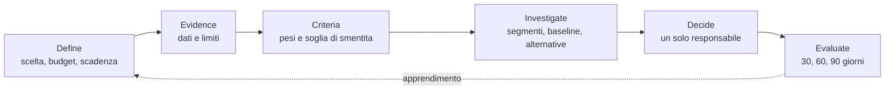

Un analista lavora 15 giorni lavorativi su un'analisi di prezzo: storici di abbandono, confronti per segmento, tre scenari di ricavo. Il rapporto arriva il lunedì, la riunione del giovedì lo discute per 20 minuti e sceglie la strada opposta, perché il responsabile aveva già parlato con due clienti grandi. Nessun dato era sbagliato, e nessuno aveva scritto quale scelta stesse per essere presa.

> **Idea chiave:** si decide prima che cosa cambierebbe la scelta, e solo dopo si guardano i dati. Un'analisi senza decisione produce un rapporto, non una scelta.

## Quindici giorni di analisi, venti minuti di riunione

Il caso è uno scenario costruito, con numeri di esempio. Un'azienda di software vuole rivedere il prezzo del piano base. Nessuno ha definito entro quando decidere, con quale budget e quale prova sarebbe bastata a cambiare idea. Il rapporto finisce così in una riunione che non ha un criterio per leggerlo.

Le due spiegazioni più comuni sono «l'analisi era debole» e «il responsabile non ascolta i dati». Nessuna regge: l'analisi era corretta e il responsabile aveva ragioni sue, perché due clienti grandi pesano in modo diverso da una media su migliaia di account. Il guasto sta a monte, nel fatto che l'analisi è partita senza una decisione definita.

La conseguenza è un costo doppio. Il primo è visibile: 15 giorni di lavoro per ottenere un documento che non cambia la scelta. Il secondo è nascosto e peggiore: l'analista capisce che il proprio lavoro serve a decorare, e la prossima volta spenderà meno energia a cercare ciò che potrebbe contraddire il capo.

## La sequenza DECIDE

DECIDE è l'ordine di lavoro che usiamo in questo corso, non il marchio di un autore: Define, Evidence, Criteria, Investigate, Decide, Evaluate. Le sei lettere indicano in che sequenza scrivere le cose, e la sequenza conta più delle etichette. In Define si scrive la decisione come scelta tra alternative, con budget e scadenza. In Evidence si dichiara quali dati esistono e quali limiti hanno. In Criteria si fissano pesi e soglie. In Investigate si segmenta, si confronta con la baseline e si verificano le alternative senza fermarsi alla prima risposta che torna. In Decide una sola persona sceglie. In Evaluate si rilegge l'esito a 30, 60 e 90 giorni.

Tre idee reggono la sequenza. La prima: la decisione viene prima dell'analisi. «Migliorare il prodotto» non è una decisione, mentre «investire 200.000 euro nella funzione X oppure nella Y entro il 30 giugno» lo è. La seconda: i criteri vengono prima dei dati, perché fissati dopo i pesi seguono il risultato che piace. La terza: una sola persona decide e la decisione si rilegge, altrimenti nessuno risponde dell'esito.

## Il brief di decisione

Il brief è il documento di una pagina in cui la sequenza diventa verificabile. La richiesta di analisi tipica, quella che produce rapporti, ha questo aspetto:

> Oggetto: analisi sul pricing.
>
> Ci serve un'analisi sul pricing del piano base. Guardate cosa dicono i dati sull'abbandono e sui concorrenti.
>
> Ne parliamo a fine mese.

Riscritta come brief, la stessa richiesta diventa una scelta con un numero che la può smentire.

| Campo | Contenuto |
| :--- | :--- |
| Decisione | Portare il piano base da 29 a 35 euro al mese dal 1 giugno, oppure lasciarlo a 29 e aggiungere un piano intermedio |
| Responsabile | Responsabile prodotto, decide entro il 15 maggio |
| Criteri | Ricavo mensile ricorrente 50%, abbandono a 90 giorni 30%, tempo di rilascio 20% |
| Cambieremo idea se | Nelle prime quattro settimane l'abbandono dei clienti esposti al nuovo prezzo supera di 2 punti quello del gruppo di controllo |
| Controlli | A 30, 60 e 90 giorni: ricavo e abbandono contro la previsione scritta |

Con la scelta in una riga, l'analista sa quali due numeri servono: il ricavo per cliente e l'abbandono per segmento. L'obiettivo, dichiarato e non misurato, è ottenere lo stesso lavoro in 3 giorni invece di 15. La correzione è reversibile e costa una pagina: se il brief non funziona, si torna alla richiesta libera.

## Un calcolo svolto: punteggio pesato e punto di pareggio

Prendiamo i numeri del brief e svolgiamo il confronto passo per passo. L'azienda ha 2.000 clienti sul piano base a 29 euro al mese, quindi un ricavo mensile ricorrente di 2.000 × 29 = 58.000 euro.

Primo passo, il punto di pareggio sull'abbandono. Con il prezzo a 35 euro, il ricavo eguaglia quello attuale quando restano 58.000 / 35 = 1.657 clienti, arrotondando per difetto. Ne vanno persi 2.000 - 1.657 = 343, cioè 343 / 2.000 = 17,1%. Il rialzo conviene sul solo ricavo finché l'abbandono aggiuntivo resta sotto il 17,1%.

Secondo passo, uno scenario più prudente. Se l'abbandono aggiuntivo fosse del 5%, resterebbero 2.000 × 0,95 = 1.900 clienti, e il ricavo mensile sarebbe 1.900 × 35 = 66.500 euro. La differenza rispetto alla base è 66.500 - 58.000 = 8.500 euro al mese, pari a 8.500 / 58.000 = 14,7% in più.

Terzo passo, il punteggio pesato, perché il solo ricavo non è il criterio unico. Assegniamo a ciascuna alternativa un voto da 1 a 5 su ogni criterio. L'alternativa A, il rialzo a 35 euro, prende 4 sul ricavo, 2 sull'abbandono e 5 sul tempo di rilascio, dato che non richiede sviluppo. Il punteggio è 0,5 × 4 + 0,3 × 2 + 0,2 × 5 = 2,0 + 0,6 + 1,0 = 3,6. L'alternativa B, il piano intermedio, prende 3 sul ricavo, 4 sull'abbandono e 2 sul tempo di rilascio, perché serve sviluppo. Il punteggio è 0,5 × 3 + 0,3 × 4 + 0,2 × 2 = 1,5 + 1,2 + 0,4 = 3,1.

Il risultato indica A con un vantaggio di 3,6 - 3,1 = 0,5 punti. Il vantaggio dipende dai pesi, ed è per questo che vanno fissati prima: se il peso dell'abbandono passasse da 30% a 50% e il ricavo da 50% a 30%, A varrebbe 0,3 × 4 + 0,5 × 2 + 0,2 × 5 = 1,2 + 1,0 + 1,0 = 3,2 e B 0,3 × 3 + 0,5 × 4 + 0,2 × 2 = 0,9 + 2,0 + 0,4 = 3,3, e la scelta si ribalta. Chi cambia i pesi dopo aver visto i numeri sta scegliendo il risultato, non misurandolo.

## Tre errori che producono rapporti, non scelte

### Un'analisi senza decisione

Il sintomo è una richiesta che chiede di guardare che cosa dicono i dati. Sembra ragionevole, perché lascia all'analista libertà di esplorare. Ma senza una scelta da fare nessuna conclusione può essere giusta o sbagliata, può solo essere lunga. L'analista indovina che cosa serve, la riunione cerca una risposta che il rapporto non contiene, e il costo sono i 15 giorni. La correzione è riscrivere la richiesta come scelta tra alternative, con budget e scadenza.

### Criteri scritti dopo aver visto i dati

Il sintomo è un manager che chiede l'analisi dopo aver già deciso e legge i numeri per conferma. È distorsione di conferma con un budget. Succede perché i pesi sembrano un dettaglio tecnico da sistemare alla fine. Il controllo è una domanda: che cosa ti farebbe cambiare idea? Se prima dell'analisi non esiste una risposta con una soglia numerica, i dati non guidano la scelta, la coprono. Si corregge scrivendo la condizione di smentita nel brief prima di aprire qualsiasi tabella.

### Un comitato al posto di un responsabile

Il sintomo è una decisione con sei nomi e nessun responsabile. Il consenso rassicura, perché tutti sono stati sentiti. Ma una decisione presa da sei persone non ha nessuno a cui chiedere conto a 30 giorni, e il consenso tende verso l'opzione a cui nessuno si oppone, non verso quella che i criteri premiano. Si corregge nominando un solo responsabile che raccoglie i pareri e decide entro una data scritta.

## Quanta procedura serve

Il processo completo costa tempo, e non ogni decisione lo merita. Si tratta di scegliere tra due modi di decidere: quello completo, con tutti i passi per iscritto, e uno leggero, con la scelta, la soglia e un solo controllo a 30 giorni. Il criterio: processo completo se la decisione è difficile da annullare, leggero se si annulla a basso costo. A decidere è il costo di tornare indietro, non l'importanza che la scelta ha per chi la prende.

Nella lettera agli azionisti del 2016 Bezos sostiene che le decisioni reversibili possono seguire un processo più leggero e che la maggior parte va presa con circa il 70% dell'informazione che si vorrebbe avere ([lettera 2016](https://www.aboutamazon.com/news/company-news/2016-letter-to-shareholders)). Una decisione costosa da annullare è il Fire Phone: Amazon lo lanciò nell'estate del 2014 e nel terzo trimestre registrò una svalutazione di 170 milioni di dollari, legata soprattutto alle scorte e agli impegni con i fornitori ([10-Q di Amazon](https://www.sec.gov/Archives/edgar/data/1018724/000101872414000055/amzn-20140930x10q.htm)). Scorte e impegni sono ciò che resta dopo la decisione di ritirarsi, ed è questo che rende una porta difficile da riattraversare. Quali dati o quale processo ci fossero dietro la scelta, le fonti pubbliche non lo dicono: l'esempio mostra il costo di uscita, non una causa.

La confusione comune è usare lo stesso processo per tutto. Se ogni scelta piccola aspetta un brief e tre controlli, il costo è la lentezza. Se una scelta difficile da annullare viene trattata come reversibile, il costo è pagare l'uscita. Restano fuori da questa lezione le decisioni di gruppo con interessi in conflitto e il calcolo del valore dell'informazione: DECIDE è una sequenza di lavoro, non un modello validato.

## Controllo prima di chiedere un'analisi

1. La decisione è scritta come scelta tra alternative, con budget e scadenza?

Mostra risposta

Una buona formulazione contiene due alternative, un importo e una data, come «piano base a 35 euro oppure piano intermedio, decisione entro il 15 maggio». Se contiene solo un tema, come «migliorare il pricing», l'analisi partirà senza sapere che cosa deve distinguere.

2. Prima di aprire un dato, è scritto che cosa ti farebbe cambiare idea e con quale soglia?

Mostra risposta

Serve una condizione numerica, per esempio un abbandono che supera di 2 punti quello del gruppo di controllo nelle prime quattro settimane. Senza soglia ogni risultato si può leggere a favore della scelta già fatta, e il dato diventa decorazione.

3. Con pesi 50%, 30% e 20% e voti 4, 2 e 5, quale punteggio ottiene l'alternativa e perché i pesi vanno fissati prima?

Mostra risposta

Il punteggio è 0,5 × 4 + 0,3 × 2 + 0,2 × 5 = 2,0 + 0,6 + 1,0 = 3,6. I pesi vanno fissati prima perché, spostandoli dopo aver visto i risultati, la classifica può ribaltarsi, come mostra il caso in cui l'abbandono passa a 50%: la scelta seguirebbe il numero desiderato.

4. Un rialzo da 29 a 35 euro con 2.000 clienti: oltre quale perdita di clienti il ricavo mensile scende sotto 58.000 euro?

Mostra risposta

Il pareggio è a 58.000 / 35 = 1.657 clienti, quindi oltre 343 clienti persi, cioè il 17,1% della base. Sotto quella soglia il rialzo aumenta il ricavo, ma può comunque danneggiare altri criteri come la reputazione o il tasso di crescita.

5. Una decisione si annulla in un pomeriggio con un revert: serve il processo completo?

Mostra risposta

No. Per una scelta reversibile a basso costo bastano la decisione, la soglia e un controllo a 30 giorni. Il processo completo si riserva alle scelte che lasciano scorte, contratti o impegni difficili da sciogliere, come nel caso del Fire Phone.

