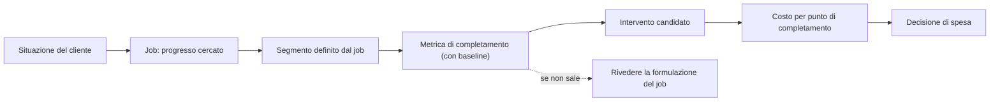

I clic sul pulsante «confronta» crescono del 30% in un mese e gli ordini restano dove erano. Il team festeggia, e festeggia la metrica sbagliata.

Il caso è ricostruito, con numeri di esempio. Un sito di elettronica sposta il pulsante «confronta» in cima alla scheda prodotto. In un mese i clic salgono da 10.000 a 13.000, il 30% in più, e il team li presenta come il successo della funzione. Gli ordini del mese, intanto, passano da 2.100 a 2.080. Guardando i percorsi di navigazione si scopre che molti di quei clic portano a una pagina di confronto da cui l'utente torna indietro dopo pochi secondi, senza aver affiancato nulla.

## Più clic, stessi ordini

Il riflesso naturale è migliorare la funzione: più colonne, più prodotti affiancati, un'interfaccia più curata. Ma la funzione non è il punto. Il problema è che la metrica contava quante volte si toccava il pulsante, e non quanti clienti riuscivano a scegliere un prodotto con meno dubbi di prima. Il pulsante spostato in alto è più visibile, quindi viene toccato di più, anche da chi non ha alcuna intenzione di confrontare. Il numero sale perché è cambiata la posizione, non perché sia cambiato il valore per il cliente.

Chi lavora sui dati incontra questo schema di continuo. Si prende una funzione, si sceglie la metrica più vicina alla funzione, si ottimizza quella. Il ciclo si chiude su se stesso: la metrica misura l'uso, l'uso sale, la funzione sembra riuscita. Quello che manca è una domanda a monte, che nessuna dashboard pone da sola: che cosa sta cercando di ottenere la persona che arriva sulla scheda prodotto, e come si riconosce dai dati che ci è riuscita?

Il framework Jobs to be done, associato al lavoro di Clayton Christensen e di altri studiosi dell'innovazione, risponde spostando il punto di osservazione. Non si parte dal prodotto o dalla funzione e nemmeno dall'anagrafica del cliente. Si parte dal progresso che il cliente cerca in una situazione precisa, e si misura quanto spesso quel progresso avviene.

## Il progresso, non il prodotto

Tre principi rendono il framework operativo per chi lavora con tabelle di eventi.

Il primo è che non si segmenta per demografia, si segmenta per job. Un cliente di 25 anni e uno di 60 che comprano lo stesso trapano sono due segmenti per l'anagrafica e uno solo per il job: entrambi vogliono fare un foro nel muro. Quando demografia e job sono in conflitto, vince il job, perché spiega il comportamento che si osserva nelle righe della tabella. L'età, al massimo, spiega perché due persone con lo stesso job lo svolgono in modi diversi.

Il secondo è che il job è stabile mentre la soluzione cambia. Ascoltare musica mentre ci si muove è un job. Il walkman, l'iPod e i servizi di streaming sono tre soluzioni successive dello stesso job. Chi definisce il proprio mercato dalla soluzione corrente rischia di vedere i concorrenti solo nella stessa categoria di prodotto, mentre il cliente confronta tutto ciò che gli permette di fare quel progresso.

Il terzo è che si misura il successo del job, non l'uso della funzione. I clic sul pulsante dicono che qualcuno ha toccato qualcosa. Un confronto che termina con una scelta dice che qualcuno ha fatto un passo concreto verso la decisione d'acquisto. Tra i due numeri c'è la differenza che separa l'attività dal risultato, la stessa che la lezione sugli OKR e i KPI chiede di distinguere nella scrittura dei Key Result.

> **Idea chiave:** Il job è il progresso che il cliente cerca in una situazione, non il prodotto che compra: si misura il completamento del progresso, non il clic sulla funzione.

Il diagramma seguente mostra il percorso completo che questa lezione propone, dal contesto in cui nasce il bisogno fino alla decisione di spesa.

La freccia tratteggiata è la parte che molti team dimenticano. Se il completamento non si muove dopo un intervento ben eseguito, la prima ipotesi da rivedere non è l'esecuzione ma la scrittura del job.

## Come si scrive un job che regge ai dati

Un job ben scritto ha una forma riconoscibile. Descrive una situazione, un progresso desiderato e il motivo per cui quel progresso conta, senza nominare nessuna soluzione. La forma più usata, in versione di lavoro, è una frase in tre parti: quando mi trovo in una certa situazione, voglio ottenere un certo progresso, così da poter raggiungere un certo risultato. Il blocco che segue mostra la differenza tra una versione che nomina la soluzione e una versione scritta come progresso.

> Versione che nomina la soluzione: voglio un filtro prezzo migliore.
>
> Versione scritta come job: quando ho davanti sei portatili simili e devo decidere entro la settimana, voglio capire quali differenze contano per il mio uso, così da scegliere senza il timore di aver sbagliato.
>
> Dimensione emotiva: sentirmi sicuro della scelta davanti a chi mi ha chiesto il consiglio.

La seconda versione contiene tre cose che la prima non ha. Contiene un vincolo di tempo, che dice quando il job diventa urgente. Contiene un criterio di successo implicito, cioè capire quali differenze contano. E contiene una dimensione emotiva, che spiega perché la persona continua a esitare anche quando le specifiche sono tutte leggibili.

La separazione tra dimensione funzionale e dimensione emotiva serve anche all'analista. Il lato funzionale si traduce quasi sempre in eventi osservabili: aperture di schede, confronti avviati, filtri applicati. Il lato emotivo lascia tracce indirette: ritorni sulla stessa scheda, richieste al supporto per una conferma, acquisti con reso entro pochi giorni. Chi scrive solo il lato funzionale tende a ottimizzare la velocità del percorso, e può scoprire che un percorso più rapido riduce la sicurezza percepita e aumenta i resi.

Un secondo segnale di job ben scritto è che non nomina chi lo svolge. «Il cliente di fascia alta» è un segmento anagrafico mascherato. «Chi ha una scadenza e non conosce la categoria» è una condizione, e una stessa persona può trovarsi in quella condizione oggi e non domani. Questo spostamento è utile perché la tabella degli eventi permette di riconoscere condizioni, per esempio una sessione che arriva da un link di regalo o una ricerca ripetuta nella stessa categoria, molto più facilmente che di stimare l'intenzione di una persona dall'età.

## Un esempio svolto: segmentare per job e scegliere l'intervento

Riprendiamo il negozio di elettronica con i numeri di esempio. Dei 13.000 clic sul pulsante, 5.200 (il 40%) corrispondono a un confronto effettivo, definito come due o più prodotti affiancati per almeno dieci secondi. Gli altri 7.800 sono tocchi che non generano alcun confronto. Il job di riferimento è scegliere un prodotto senza timore di sbagliare, e la metrica di completamento è la quota di confronti effettivi che termina con un acquisto entro 7 giorni.

Il team scopre che nei dati convivono due condizioni diverse. Nel primo gruppo ci sono i clienti che acquistano per sé e hanno tempo: 3.400 confronti. Nel secondo ci sono i clienti che acquistano un regalo con una scadenza, riconoscibili perché arrivano da una pagina regalo o aprono il sito nelle ultime due settimane prima di una ricorrenza: 1.800 confronti. La tabella seguente mostra il completamento per condizione.

| Condizione di job | Confronti avviati | Acquisti entro 7 giorni | Tasso di completamento |
| --- | --- | --- | --- |
| Acquisto per sé, senza scadenza | 3.400 | 340 | 10,0% |
| Regalo con scadenza | 1.800 | 128 | 7,1% |
| Totale | 5.200 | 468 | 9,0% |

I conti tornano: 340 + 128 = 468 acquisti, e 468 / 5.200 = 9,0%. Il tasso medio del 9% non descrive nessuno dei due gruppi, perché il primo sta sopra e il secondo sotto. L'età non aiuta, perché in entrambi i gruppi ci sono persone di tutte le fasce. Il problema del gruppo regalo è un altro: chi ha una scadenza vuole sapere se il prodotto arriva in tempo, e nella pagina di confronto questa informazione non compare.

Il team valuta due interventi candidati. L'intervento A aggiunge nella pagina di confronto una riga evidenziata con la data di consegna stimata e un riepilogo delle differenze che contano, e richiede 5 giorni di lavoro. Per l'intervento B, che aggiunge colonne con altre specifiche tecniche, servono 8 giorni di lavoro. Le stime di effetto, ricavate da test su un campione e dichiarate qui come numeri di esempio, sono un aumento di 3 punti percentuali del completamento per A (dal 9,0% al 12,0%) e di 0,5 punti per B (dal 9,0% al 9,5%).

Il costo per punto di completamento guadagnato è: per A, 5 giorni / 3 punti = 1,67 giorni per punto; per B, 8 giorni / 0,5 punti = 16 giorni per punto. A costa circa un decimo di B per ogni punto guadagnato. Il valore dell'intervento A si traduce così in acquisti: il 12,0% di 5.200 confronti è 624 acquisti, contro i 468 attuali, quindi +156 acquisti al mese. Con un ordine medio di 85 € e un margine del 20%, ogni ordine vale 17 € di margine, e il guadagno mensile è 156 × 17 € = 2.652 €. Per B l'aumento è di 26 acquisti (0,5% di 5.200), cioè 26 × 17 € = 442 € al mese.

La scelta non richiede alcuna discussione sul gusto dell'interfaccia: A costa meno e rende più di B. La correzione è reversibile, perché la tabella dei clic resta in dashboard e il pulsante può tornare dov'era, e il costo di definire il completamento e ricostruire la baseline è una settimana di lavoro dell'analista. Il confronto con i 2.080 ordini del mese chiarisce anche la scala: 624 acquisti attribuibili al confronto su 2.080 totali sono il 30%, quindi la funzione pesa, ma dà un risultato solo se il job viene portato a termine.

## Sondaggio o interviste

Una volta scritta la tabella dei job resta da decidere come verificare che il job sia quello giusto. Gli strumenti sono due: un sondaggio, che misura quanto il prodotto serva rispetto a un valore già ipotizzato, e le interviste, che scoprono quale job sia in gioco.

Il caso pubblico del primo è Superhuman. Rahul Vohra applicò il test di Sean Ellis, che chiede agli utenti quanto sarebbero delusi se non potessero più usare il prodotto. All'inizio solo il 22% rispose «molto deluso», contro una soglia del 40% che, secondo le ricostruzioni, Ellis ricavò confrontando circa cento startup. Restringere l'analisi al gruppo che amava il prodotto portò il punteggio a circa il 33%, e dividere il lavoro tra ciò che già piaceva e ciò che frenava gli altri lo portò al 58% in tre trimestri, secondo il racconto di First Round ([First Round Review](https://review.firstround.com/how-superhuman-built-an-engine-to-find-product-market-fit/)). Il metodo di Superhuman non si presenta come Jobs to be done: qui serve da esempio di sondaggio che misura un valore già ipotizzato.

Il sondaggio ha un pregio meccanico: lo stesso numero si ripete ogni trimestre e si confronta con il precedente. Le interviste hanno il pregio opposto, cioè dicono perché una persona ha scelto o lasciato il prodotto, e non danno nessun numero da ripetere.

Il criterio per scegliere: **sondaggio se si hanno utenti attivi da misurare e si conosce già il job, interviste se non si sa ancora quale job si sta servendo.**

La confusione comune è usare il sondaggio per scoprire. Una domanda chiusa conferma un'ipotesi o la smentisce, non ne genera di nuove: chi ottiene un 22% senza avere intervistato nessuno si ritrova con un numero che non sa spiegare. L'errore opposto è chiedere alle interviste una percentuale: poche interviste non danno una quota e non reggono il confronto con una soglia. Il caso del negozio mostra l'uso corretto in sequenza. Le interviste ai clienti che avevano cliccato «confronta» e poi abbandonato hanno fatto emergere il vincolo della consegna; la tabella ha poi permesso di contare quanti confronti ricadono nella condizione regalo.

Questa lezione non copre il calcolo del campione del sondaggio né il reclutamento delle interviste, trattato nella lezione dedicata. I numeri del negozio sono di esempio, e il 40% di Ellis è una regola empirica, non una legge.

## Tre errori che sembrano precisione

Questa è la tabella dei job come la scrivono molti team:

| Job | Segmento | Metrica |
| --- | --- | --- |
| Avere un filtro prezzo migliore | Utenti 25–34 | Clic sul filtro |
| Usare il confronto prodotti | Utenti 55 e oltre | Clic su «confronta» |
| Ricevere notifiche | Utenti mobile | Notifiche aperte |

Le tre righe hanno la stessa forma: una funzione, un segmento anagrafico, un conteggio di tocchi. Nessuna dice che cosa il cliente sta cercando di fare. Da qui nascono tre errori ricorrenti.

### Il job che nomina la soluzione

Il sintomo è un elenco di job che iniziano con «avere un», «usare il» o «ricevere»: sono nomi di funzioni. Sembra ragionevole perché una funzione è concreta, si può assegnare e consegnare. Ma è una soluzione travestita da job, e chiude la domanda prima di porla: nessuno chiede più quale progresso il cliente stia cercando, e le alternative che non assomigliano alla funzione non entrano nel confronto. Il rimedio è riscrivere ogni riga con la frase in tre parti e cancellare ogni sostantivo che sia anche il nome di una voce di menu.

### La demografia al posto del job

Il sintomo è una tabella in cui la colonna segmento contiene fasce di età e ruoli. Succede perché l'anagrafica è già nel database e costa una query, mentre la condizione di job va dedotta. Il risultato è che nello stesso segmento «55 e oltre» finiscono chi compra per sé, con tempo, e chi compra un regalo con una scadenza, e il tasso medio non descrive nessuno dei due, come nella tabella di completamento vista sopra. Il rimedio è cercare nei dati le tracce della condizione: provenienza da una pagina regalo, ricerche ripetute nella stessa categoria, vicinanza a una ricorrenza.

### Il clic al posto del completamento

Il sintomo è una funzione celebrata mentre i risultati a valle non si muovono, come nel caso di apertura. Il clic è facile da contare e si muove subito, ed è il motivo per cui piace. Ma premia le interazioni che non creano progresso e porta a finanziare la funzione più cliccata invece di quella che aiuta a finire il lavoro. C'è un'aggravante: il completamento si calcola da eventi, e con eventi duplicati, tracking incompleto o definizioni cambiate a metà anno compaiono completamenti che non sono mai avvenuti. Il rimedio è scrivere la definizione di completamento con unità, finestra e denominatore, e controllarla a campione su una decina di sessioni reali.

## Cinque controlli prima di finanziare una funzione

1. Il job è scritto come progresso, in una frase che non nomina nessuna soluzione e ha una situazione di partenza?

Mostra risposta

La verifica è lessicale e semantica insieme: se la frase contiene il nome di una funzione o di una voce di menu, è una soluzione. Se contiene una situazione («quando devo decidere entro la settimana») e un risultato («senza timore di sbagliare»), è un job. Nel caso del negozio, «avere un filtro prezzo migliore» fallisce il controllo, mentre «scegliere tra sei portatili simili senza paura di sbagliare» lo supera.

2. Nella tabella di completamento del negozio, perché il tasso medio del 9,0% non basta a decidere l'intervento?

Mostra risposta

Perché è la media di due condizioni diverse: 340 acquisti su 3.400 confronti (10,0%) per chi compra per sé e 128 su 1.800 (7,1%) per chi compra un regalo con scadenza. Il problema, la mancanza della data di consegna nella pagina di confronto, riguarda solo il secondo gruppo e resta invisibile nella media.

3. Un intervento costa 5 giorni e guadagna 3 punti di completamento, un altro costa 8 giorni e ne guadagna 0,5. Quale scegli e con quale calcolo?

Mostra risposta

Il primo: 5 / 3 = 1,67 giorni per punto, contro 8 / 0,5 = 16 giorni per punto del secondo. A parità di altri vincoli, il primo costa circa un decimo per ogni punto guadagnato. Il calcolo va completato con il valore in euro: +156 acquisti × 17 € di margine = 2.652 € al mese contro 442 € del secondo.

4. Non conosci ancora il job che i clienti stanno servendo con il tuo prodotto. Sondaggio o interviste, e perché?

Mostra risposta

Interviste. Una domanda chiusa conferma o smentisce un'ipotesi ma non ne genera: se il job è ignoto, il sondaggio restituisce un numero senza spiegazione, come il 22% iniziale di Superhuman prima che il lavoro qualitativo mostrasse che cosa amassero gli utenti. Il sondaggio diventa utile dopo, quando il job è scritto e va misurato ogni trimestre.

5. Dopo un intervento ben eseguito il completamento non si muove. Quale ipotesi controlli per prima?

Mostra risposta

La formulazione del job, non l'esecuzione. Se la metrica di completamento non sale, probabilmente il job scritto non coincide con quello che i clienti svolgono, oppure la tabella raggruppa condizioni diverse nello stesso segmento. È il ramo tratteggiato del diagramma: si torna alla riscrittura del job e a una nuova serie di interviste mirate.

