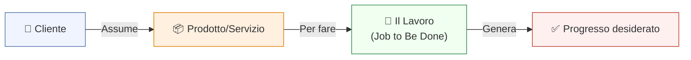
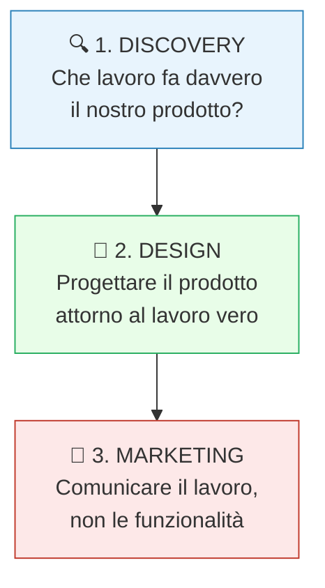

Partiamo da una domanda che sembra banale ma non lo è:

**Perché Trenitalia e Italo non sono i veri concorrenti di BlaBlaCar?**

La risposta: dal punto di vista del cliente, fare un viaggio Milano-Roma in treno e farlo in auto condivisa svolgono lo stesso **lavoro**. Il lavoro è "spostami da Milano a Roma in modo comodo ed economico." Il cliente assume il mezzo che fa questo lavoro meglio per lui, in quel momento. Questo è Jobs to Be Done — uno dei framework più potenti per capire davvero i tuoi clienti.

## Cos'è JTBD

JTBD (Jobs to Be Done) è un framework sviluppato da Clayton Christensen di Harvard Business School. L'idea di fondo è semplice:

> **Le persone non comprano prodotti o servizi. Le persone "assumono" prodotti o servizi per fare un lavoro.**

Il "lavoro" è il progresso che una persona cerca di fare in una determinata situazione. Non è una funzionalità. Non è un beneficio generico. È il risultato concreto che il cliente vuole ottenere nella sua vita.

Esempio classico: le persone non comprano un trapano. Comprano un buco nel muro. E in realtà, quello che vogliono davvero è appendere il quadro, avere una casa bella, sentirsi a casa propria.

## I tre tipi di lavoro

Ogni "lavoro" ha tre dimensioni. Ignorarne una significa capire solo parte del perché il cliente compra — o smette di comprare.

| Tipo di lavoro | Descrizione | Esempio (Vespa) |
|---|---|---|
| **Funzionale** | Il compito pratico da svolgere | Spostarsi in città velocemente |
| **Emotivo** | Come vuole sentirsi | Libero, giovane, italiano |
| **Sociale** | Come vuole apparire agli altri | Avere stile, essere riconoscibile |

Questa è la ragione per cui Piaggio vende Vespa e non solo "un mezzo di trasporto a due ruote". La Vespa risolve tutti e tre i livelli. Un monopattino elettrico risolve solo il primo — e per certi segmenti di clientela questo basta, per altri no.

## Esempio italiano: la Bocconi e il vero lavoro

Prendiamo la Bocconi. A cosa serve davvero?

La risposta ovvia: "A dare un'istruzione economica e manageriale di alto livello."

La risposta JTBD è molto più precisa. Se smontate il valore percepito pezzo per pezzo:

- **Fornisce conoscenze** — sì, ma i libri costano 30€ e i professori scrivono su Substack. Perché spendere 15.000€/anno?
- **Dà un diploma** — e chi se ne frega, a meno che il datore di lavoro non lo pretenda esplicitamente
- **Disciplina nello studio** — ci sono app per quello
- **Dà un network potentissimo** — qui comincia a farsi interessante
- **Segnala al mercato che sei capace di fare cose difficili** — bingo
- **Ti mette in contatto con i recruiter delle migliori aziende** — jackpot

Il vero lavoro che la Bocconi fa per i suoi studenti è: **"Aprimi le porte del mercato del lavoro premium e dammi un network che durerà tutta la vita."**

Conseguenza pratica: il prodotto della Bocconi non dovrebbe essere solo buona didattica. Dovrebbe essere anche un career office eccellente, eventi di networking, alumni network attivi, rapporti profondi con le aziende. Tutto il resto è corollario.

## Lo stesso mercato, lavori diversi: mobilità urbana

Guarda questa tabella. Cinque servizi di trasporto diversi che operano nelle stesse città italiane:

| | **Trenitalia** | **Italo** | **BlaBlaCar** | **Lime** | **Uber Black** |
|---|---|---|---|---|---|
| Spostamento rapido A→B | ✅ | ✅ | ✅ | ✅ (breve) | ✅ |
| Risparmio economico | ✅ | ✅ | ✅✅ | ✅✅ | ❌ |
| Status / impressionare | ❌ | ✅ | ❌ | ❌ | ✅✅ |
| Sostenibilità percepita | ❌ | ❌ | ✅ | ✅✅ | ❌ |
| Flessibilità oraria | ❌ | ❌ | ❌ | ✅✅ | ✅✅ |

Se il tuo lavoro è arrivare a un aperitivo in anticipo e fare bella figura, BlaBlaCar e Trenitalia non sono neanche opzioni. Uber Black è l'unica risposta sensata. Eppure tutti e cinque rientrano nella categoria "trasporto." Per questo analizzare la concorrenza per categoria di prodotto porta quasi sempre a conclusioni sbagliate.

## Lo stesso prodotto, quattro lavori diversi: Vespa

| Segmento cliente | Lavoro principale | Implicazione di prodotto |
|---|---|---|
| Studente universitario a Milano | Spostarsi senza abbonamento ATM | Vespa economica, facile da parcheggiare |
| Turista straniero a Roma | Vivere l'esperienza italiana autentica | Vespa vintage, noleggio fotografico |
| Manager creativo 45enne | Esprimere personalità, rifiutare la normalità | Vespa personalizzata, edizione limitata |
| Rider di delivery | Strumento di lavoro affidabile | Vespa elettrica, garanzia, assistenza rapida |

Quattro clienti, quattro lavori, quattro prodotti quasi completamente diversi — anche se la scocca è la stessa. Se Piaggio vuole capire perché certi clienti smettono di comprare, non basta guardare le vendite aggregate. Bisogna capire quale lavoro stanno cercando di fare e se un'alternativa lo fa meglio.

## Come si usa JTBD nella pratica

Il framework JTBD si applica in tre momenti distinti:

**Discovery:** Parla con i tuoi clienti. Non chiedere "cosa vorresti migliorare nel prodotto?" Chiedi: "Raccontami l'ultima volta che hai usato X. Cosa stavi cercando di fare?" Cerca il contesto, non la funzionalità.

**Design:** Una volta che sai il vero lavoro, progetta per farlo meglio di qualsiasi alternativa. Barilla non vende solo pasta — vende la cena in famiglia del mercoledì sera, veloce, buona, rassicurante. Per questo i formati "Pronto in 2 minuti" hanno senso.

**Marketing:** Non comunicare le caratteristiche tecniche. Comunica il progresso che il cliente otterrà. illycaffè non vende "arabica 100% a tostatura media." Vende l'esperienza di un espresso perfetto a casa, ogni mattina.

## Come trovare i "lavori" dei tuoi clienti

Non inventarli a tavolino. Tre tecniche che funzionano davvero:

**1. Interviste sulla timeline d'acquisto** — chiedi al cliente di raccontare tutto il processo che lo ha portato ad acquistare: dal momento in cui ha capito di avere il problema, fino alla decisione finale. I dettagli rivelano il vero lavoro.

**2. Osservazione diretta** — guarda come le persone usano il tuo prodotto. Spesso lo usano per lavori che non avevi previsto. Questo è un segnale: o stai perdendo un segmento, o stai trovando una nuova opportunità.

**3. Analisi dei sostituti** — cosa facevano i clienti *prima* di trovare il tuo prodotto? Quello era il concorrente vero. Per Satispay all'inizio non era un'altra fintech: era il bonifico bancario e il contante tra amici.

## Problema reale

Il team descrive feature e segmenti demografici, ma non vede il lavoro che la persona sta cercando di completare.

La domanda pratica non e "so ripetere la teoria?", ma: **quale decisione migliora se applico bene questa lezione?** In gestione data-driven, il rischio tipico e prendere un segnale parziale e trasformarlo in una scelta costosa: una feature lanciata troppo presto, un budget spostato senza causalita, un modello dati fragile o una raccomandazione piu elegante che utile.

## Modello concettuale

Usa questa griglia in tre passaggi: prima definisci il fenomeno, poi scegli l evidenza minima credibile, infine trasformi l evidenza in una decisione esplicita.

| Livello | Domanda guida | Output atteso |
|---|---|---|
| Fenomeno | Che cosa sta davvero succedendo? | Perimetro, segmenti e assunzioni |
| Evidenza | Quale dato cambierebbe la nostra opinione? | Metriche, osservazioni e guardrail |
| Decisione | Che cosa faremo se il segnale regge? | Azione, owner, timing e criterio di stop |

Questo modello evita due estremi: teoria senza applicazione e operativita senza ragionamento.

## Formalizzazione rigorosa

Formalizza la lezione come una catena decisionale:

| Elemento | Definizione operativa | Controllo di qualita |
|---|---|---|
| Input | interviste, survey, backlog ipotesi, metric review, note qualitative e risultati esperimenti | Fonte, periodo, granularita e completezza dichiarati |
| Ipotesi | Relazione attesa tra comportamento, metrica e decisione | Assunzioni scritte prima dell analisi |
| Metrica | qualita delle decisioni, velocita di apprendimento, rischio ridotto e impatto business | Denominatore, segmento e finestra temporale espliciti |
| Guardrail | Cosa non deve peggiorare mentre ottimizzi | Soglie condivise con leadership, product, marketing e analytics |
| Decisione | trasformare evidenze sparse in una decisione con owner, ritmo e criteri di escalation | Owner, scadenza e criterio di revisione |

Una lezione e formalizzata bene quando un altra persona puo ricostruire il ragionamento e contestare le assunzioni senza chiedere spiegazioni extra.

## Esempio o caso studio

Immagina una review settimanale in cui leadership, product, marketing e analytics deve decidere su "Framework JTBD: capire davvero perché i clienti comprano". Il dato iniziale mostra un segnale promettente, ma il team non si ferma al numero principale. Divide il problema per segmento, controlla i guardrail, cerca spiegazioni alternative e scrive una raccomandazione con tre parti: cosa sappiamo, cosa non sappiamo, cosa faremo adesso.

| Osservazione | Interpretazione prudente | Azione |
|---|---|---|
| Segnale positivo sulla metrica primaria | Potrebbe essere effetto reale o composizione del campione | Controllare segmenti e baseline |
| Guardrail stabile | Il miglioramento non sembra creare danni immediati | Procedere con rollout limitato |
| Evidenza ancora incompleta | Serve una verifica prima di scalare | Definire un secondo ciclo di misura |

Il valore del caso non sta nel trovare una risposta perfetta, ma nel rendere la decisione piu difendibile.

## Lab / esercizio

Usa questo esercizio per trasformare la lezione in pratica verificabile.

| Livello | Attivita | Output |
|---|---|---|
| Livello base | Riassumi il problema in cinque righe e scegli una metrica primaria con un guardrail. | Mini brief decisionale |
| Livello intermedio | Applica il modello a un caso reale o simulato, includendo segmenti, baseline e rischi. | Tabella di analisi con raccomandazione |
| Livello research-grade | Scrivi un memo che confronta due spiegazioni alternative e indica quale evidenza le distinguerebbe. | Decision memo revisionabile |

**Dataset e materiali consigliati:** esportazione eventi o metriche dal tuo prodotto, una dashboard gia usata dal team, note qualitative, risultati di un esperimento o un dataset pubblico coerente con il tema.

## Errore tipico da evitare

L errore piu comune e usare "Framework JTBD: capire davvero perché i clienti comprano" come etichetta autorevole invece che come metodo. Succede quando il team cita il concetto per giustificare una scelta gia presa, oppure quando ottimizza una metrica locale senza chiedersi quale comportamento sta incentivando.

Correzione pratica: prima di presentare la raccomandazione, scrivi una riga con la decisione proposta, una riga con l evidenza che la sostiene e una riga con la condizione che ti farebbe cambiare idea. Se manca una di queste tre righe, la lezione non e ancora stata applicata con rigore.

## Quiz o checkpoint

1. Quale decisione concreta dovrebbe migliorare applicando questa lezione?
2. Quale metrica useresti come segnale primario e quale come guardrail?
3. Quale spiegazione alternativa potrebbe rendere sbagliata la tua interpretazione?
4. Che cosa dovrebbe succedere nei dati per farti cambiare raccomandazione?
5. Quale output consegneresti a leadership, product, marketing e analytics: dashboard, memo, esperimento, backlog o modello dati?

Se non riesci a rispondere in modo specifico, torna al problema reale prima di continuare.

## Riepilogo

- **JTBD** significa che le persone assumono prodotti per fare un lavoro, non perché amano il prodotto in sé
- Ogni lavoro ha **tre dimensioni**: funzionale (cosa fa), emotiva (come si sente), sociale (come appare)
- Il tuo vero concorrente non è chi ha un prodotto simile, ma **chi fa lo stesso lavoro** in modo diverso
- Usare JTBD cambia come si fa ricerca, design e marketing — è uno strumento operativo, non teoria astratta
- In Italia: Trenitalia vs BlaBlaCar, Bocconi vs corsi online, Vespa vs monopattino — sono tutti esempi dello stesso fenomeno

Nella prossima lezione vedremo come scoprire il vero lavoro dei tuoi clienti attraverso le interviste in profondità.
