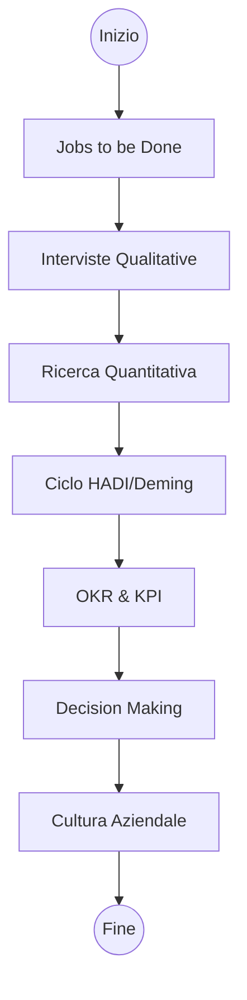

## Panoramica del Modulo

Essere "Data-Driven" non significa solo avere dashboard colorate. Significa instaurare processi decisionali rigorosi che partono dalla comprensione profonda del cliente e arrivano all'esecuzione misurabile.
In questo modulo strategico, esploreremo come impostare gli obiettivi aziendali (OKR), come condurre ricerche di mercato sia qualitative (interviste) che quantitative, e come iterare velocemente verso il successo usando cicli di feedback scientifici (HADI, PDCA).

## Obiettivi di Apprendimento

Al termine di questo modulo sarai in grado di:

- **Applicare** il framework "Jobs to be Done" (JTBD) per capire le vere motivazioni d'acquisto dei clienti.
- **Condurre** interviste qualitative imparziali per scoprire insight non visibili nei dati numerici.
- **Strutturare** ricerche quantitative (sondaggi) statisticamente rilevanti.
- **Implementare** cicli di sperimentazione rapida (HADI, Deming/PDCA) per validare le ipotesi di business.
- **Definire** OKR (Objectives and Key Results) chiari e misurabili per allineare tutto il team.
- **Costruire** una cultura aziendale in cui i dati battono le opinioni (HiPPO).

## Prerequisiti

- Nessun prerequisito tecnico.
- Esperienza di gestione progetti o team è utile ma non necessaria.
- Mindset aperto alla messa in discussione delle proprie convinzioni.

## Percorso delle Lezioni

| N° | Lezione | Argomento Principale | Durata | Difficoltà |
| :-- | :--- | :--- | :--- | :--- |
| 1 | **Framework JTBD** | Capire il "lavoro" per cui il cliente assume il prodotto | 45 min | ⭐⭐ |
| 2 | **Interviste in Profondità** | Ricerca qualitativa e scoperta dei bisogni | 50 min | ⭐⭐ |
| 3 | **Ricerca Quantitativa** | Sondaggi e validazione numerica | 40 min | ⭐⭐ |
| 4 | **Ciclo Deming & HADI** | Processi di miglioramento continuo e sperimentazione | 45 min | ⭐⭐ |
| 5 | **OKR e KPI** | Definire e misurare il successo aziendale | 50 min | ⭐⭐⭐ |
| 6 | **Decision Making con i Dati** | Framework per prendere decisioni complesse | 40 min | ⭐⭐⭐ |
| 7 | **Cultura Data Driven** | Costruire un'organizzazione basata sui fatti | 35 min | ⭐ |

## Competenze Acquisite

**Competenze Manageriali:**
- Gestione per obiettivi tramite OKR.
- Conduzione di customer interview efficaci (evitando i bias).
- Prioritizzazione basata su evidenze e non su opinioni.
- Creazione di un ambiente psicologicamente sicuro per la sperimentazione e il fallimento.

**Competenze Analitiche:**
- Design di questionari di ricerca di mercato.
- Interpretazione dei risultati qualitativi vs quantitativi.

## Tempo Stimato

- **Durata Totale:** Circa 5-6 ore.
- **Tempo Consigliato:** 2 settimane.

## Come Usare Questo Modulo

Questo è il modulo più "umano" del corso. Non sottovalutarlo. Molte aziende falliscono non perché non sanno usare SQL, ma perché ottimizzano il prodotto sbagliato per il cliente sbagliato.
Presta particolare attenzione alla lezione sui **JTBD** e agli **OKR**: sono i due strumenti che, se usati bene, cambiano radicalmente la traiettoria di un'azienda.
