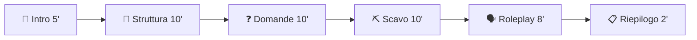

## Interviste in Profondità — Lezione Completa

I dati quantitativi ti dicono *cosa* sta succedendo (es. "Il 70% degli utenti abbandona il carrello"), ma raramente ti dicono *perché*. Per scoprire le motivazioni profonde, le frustrazioni nascoste e i bisogni non articolati, non c'è strumento più potente di una conversazione ben strutturata. L'intervista in profondità è l'arte di ascoltare ciò che non viene detto.

### Obiettivi di Apprendimento

Al termine di questa lezione, lo studente sarà in grado di:
1.  Progettare una guida per l'intervista (script) che eviti i bias di conferma.
2.  Condurre un'intervista semi-strutturata di 45-60 minuti con un cliente o utente.
3.  Applicare la tecnica dei "5 Perché" per arrivare alla radice del problema.
4.  Distinguere tra fatti (comportamenti passati) e opinioni (intenzioni future).
5.  Sintetizzare i risultati in insight azionabili per il team di prodotto.

### Timeline della Lezione

| Fase | Argomento | Durata |
|------|-----------|--------|
| 1 | Introduzione: Qualitativo vs Quantitativo | 5 min |
| 2 | Teoria: La Struttura dell'Intervista | 10 min |
| 3 | Teoria: L'Arte di Fare Domande (The Mom Test) | 10 min |
| 4 | Tecnica: Scavare a fondo (Laddering & 5 Whys) | 10 min |
| 5 | Esercizi: Simulazione di Intervista | 8 min |
| 6 | Riepilogo e Domande | 2 min |
| **Totale** | | **45 min** |

### Fase 1 — Introduzione: Qualitativo vs Quantitativo (5 min)

Immagina di essere un detective. I dati quantitativi (analytics, survey a risposta chiusa) sono le "impronte digitali": ti dicono chi è stato lì, quando, e cosa ha toccato. Ma non ti dicono il *movente*. Le interviste qualitative sono l'interrogatorio: ti permettono di capire le intenzioni.

L'errore più comune nelle aziende "data-driven" è pensare che i numeri siano l'unica verità.
*   **Big Data:** Ottimi per correlazioni e trend su larga scala.
*   **Thick Data:** (Dati "spessi", qualitativi) Ottimi per capire il contesto umano, le emozioni e le storie.

Non servono 1.000 interviste. Studi di Jakob Nielsen dimostrano che con **5 interviste** ben fatte si scopre l'85% dei problemi di usabilità o dei bisogni principali di un segmento.

### Fase 2 — Teoria: La Struttura dell'Intervista (10 min)

Un'intervista non è una chiacchierata da bar. Deve seguire un arco narrativo preciso per mettere l'utente a proprio agio e poi portarlo in profondità.

**1. Introduzione (5 min)**
*   Obiettivo: Creare rapport e fiducia.
*   Cosa dire: "Non ci sono risposte giuste o sbagliate", "Stiamo testando il prodotto, non te", "Ti assicuro l'anonimato".

**2. Riscaldamento (Context Questions) (10 min)**
*   Obiettivo: Capire chi è la persona e il suo contesto generale.
*   Domande: "Raccontami del tuo lavoro...", "Come gestisci attualmente [problema X]?", "Quali strumenti usi oggi?".

**3. Cuore (Deep Dive) (25 min)**
*   Obiettivo: Esplorare episodi specifici e comportamenti passati.
*   Domande: "Raccontami l'ultima volta che...", "Cosa è successo esattamente?", "Come ti sei sentito in quel momento?".

**4. Chiusura (Wrap-up) (5 min)**
*   Obiettivo: Lasciare una porta aperta e catturare spunti extra.
*   Domande: "C'è qualcos'altro che non ti ho chiesto?", "Con chi altro dovrei parlare?".

```mermaid
gantt
    title Struttura Temporale Intervista (45 min)
    dateFormat  m
    axisFormat %M
    section Fasi
    Introduzione      :a1, 0, 5m
    Riscaldamento     :a2, 5, 10m
    Deep Dive (Cuore) :a3, 15, 25m
    Chiusura          :a4, 40, 5m
```

### Fase 3 — Teoria: L'Arte di Fare Domande (The Mom Test) (10 min)

La regola d'oro della ricerca qualitativa è: **Le persone mentono**. Non per cattiveria, ma per gentilezza. Se chiedi "Ti piace la mia idea?", ti diranno "Sì, bellissima!" anche se fa schifo. Questo è il "falso positivo" che uccide le startup.

Rob Fitzpatrick, autore di *The Mom Test*, suggerisce tre regole per evitare questo bias:

1.  **Parla della loro vita, non della tua idea.**
    *   *Sbagliato:* "Pensi che useresti un'app per la dieta?" (Opinione futura = Bugia).
    *   *Giusto:* "Quante volte hai provato a metterti a dieta negli ultimi 6 mesi?" (Comportamento passato = Fatto).

2.  **Chiedi fatti specifici sul passato.**
    *   *Sbagliato:* "Quanto pagheresti per questo?"
    *   *Giusto:* "Qual è l'ultima soluzione a pagamento che hai provato per risolvere questo problema? Quanto costava?"

3.  **Ascolta di più, parla di meno.**
    *   Il tuo obiettivo è estrarre informazioni, non vendere. Se parli per più del 20% del tempo, stai sbagliando.

### Fase 4 — Tecnica: Scavare a fondo (Laddering & 5 Whys) (10 min)

Spesso la prima risposta è superficiale. "Voglio un'auto più veloce".
Perché? Per arrivare prima? Per divertimento? Per status sociale?

**Tecnica dei 5 Perché (5 Whys)**
Originata in Toyota, consiste nel chiedere "Perché?" cinque volte (o finché necessario) per trovare la causa radice.

*   *Utente:* "Voglio un trapano."
*   *Tu:* "Perché?"
*   *Utente:* "Per fare un buco nel muro."
*   *Tu:* "Perché ti serve il buco?"
*   *Utente:* "Per appendere una mensola."
*   *Tu:* "Perché vuoi la mensola?"
*   *Utente:* "Per metterci i libri che ho per terra."
*   *Insight:* L'utente non vuole un trapano, vuole *ordine* o *spazio*. Forse la soluzione non è un trapano migliore, ma un e-book reader o una libreria autoportante.

**Laddering**
Si parte dalle caratteristiche del prodotto (attributi) per risalire ai benefici funzionali, poi ai benefici emotivi, e infine ai valori personali.
*   *Attributo:* Auto veloce.
*   *Beneficio:* Arrivo prima.
*   *Emozione:* Mi sento potente/libero.
*   *Valore:* Libertà individuale.

### Fase 5 — Esercizi: Simulazione di Intervista (8 min)

In coppia (o simulando mentalmente), provate a intervistare un "utente" su un argomento semplice: **L'acquisto di scarpe.**

**Obiettivo:** Scoprire i criteri decisionali reali (non quelli dichiarati).

1.  **Domanda Sbagliata:** "Che scarpe ti piacciono?" -> Risposta vaga.
2.  **Domanda Corretta:** "Raccontami dell'ultima volta che hai comprato un paio di scarpe. Dove eri? Cosa cercavi? Perché hai scartato le altre opzioni?"

*Analisi:*
*   Ha comprato per moda o per necessità?
*   Ha chiesto consiglio a qualcuno? (Social proof)
*   Quanto tempo ha impiegato? (Frizione)

### Fase 6 — Riepilogo e Domande (2 min)

1.  **Passato > Futuro.** Chiedi cosa hanno fatto, non cosa faranno.
2.  **Fatti > Opinioni.** Le opinioni sono gratis, i fatti costano fatica.
3.  **Silenzio.** Dopo una domanda, aspetta. Il silenzio imbarazzante spinge l'intervistato a dire la verità.
4.  **Registra.** Non prendere solo appunti, registra (con permesso) per riascoltare il tono di voce.

### Domande di Verifica

1.  Perché chiedere "Compreresti questo prodotto?" è considerata una "domanda trappola" (Bad Question)?
2.  Qual è la differenza tra un "fatto" e un "insight" in un'intervista qualitativa?
3.  Spiega come la tecnica dei "5 Perché" aiuta a spostarsi dal problema superficiale alla causa radice.
4.  Quante interviste sono tipicamente necessarie per raggiungere la "saturazione" dei temi principali in uno studio di usabilità?
5.  In che fase dell'intervista dovresti presentare la tua soluzione/prodotto, e perché?

### Riferimenti Bibliografici

-   Rob Fitzpatrick, "The Mom Test: How to talk to customers & learn if your business is a good idea when everyone is lying to you", 2013.
-   Steve Portigal, "Interviewing Users: How to Uncover Compelling Insights", Rosenfeld Media, 2013.
-   Erika Hall, "Just Enough Research", A Book Apart, 2013.
