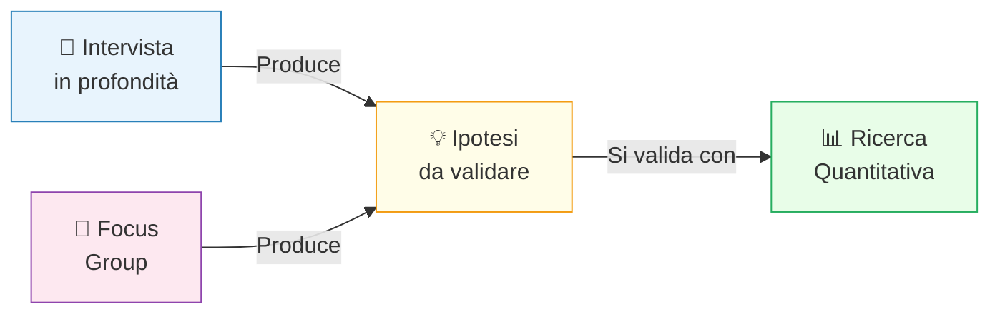
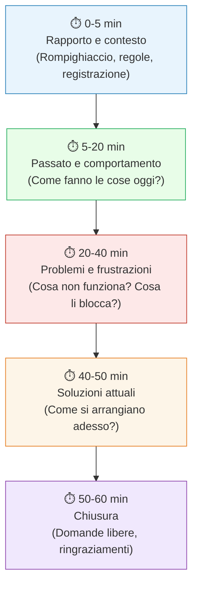

Sai qual è il modo più veloce per buttare via soldi nello sviluppo di un prodotto?

Costruire qualcosa senza aver mai parlato con le persone che dovrebbero usarlo.

In Italia accade continuamente. Un'azienda decide di lanciare un nuovo servizio basandosi sull'intuizione del fondatore, su dati di mercato aggregati, e su qualche riunione interna in cui tutti dicono "ottima idea." Poi arriva il lancio. E il mercato risponde con un silenzio assordante. Le interviste in profondità esistono per evitare esattamente questo.

## Cos'è un'intervista in profondità

Un'**intervista in profondità** è una conversazione strutturata uno-a-uno con un rappresentante del tuo pubblico target. Non è un sondaggio. Non è un focus group. È una vera conversazione in cui tu — il ricercatore — fai domande aperte e stai zitto il più possibile.

L'obiettivo non è raccogliere opinioni su un'idea. L'obiettivo è **capire la realtà del cliente**: i suoi problemi, le sue routine, le sue frustrazioni, le soluzioni che usa già.

### Interviste vs Focus Group: quale scegliere?

| Criterio | Interviste 1:1 | Focus Group |
|---|---|---|
| Profondità di analisi | ✅ Alta | ❌ Media |
| Temi sensibili (soldi, fallimenti, salute) | ✅ Adatta | ❌ Non adatta |
| Velocità di raccolta idee | ❌ Lenta | ✅ Veloce |
| Costo | ✅ Basso (fai tu) | ❌ Alto (serve moderatore) |
| Rischio di conformismo di gruppo | ✅ Nessuno | ❌ Alto |

**Regola pratica:** inizia sempre con le interviste 1:1. I focus group sono utili solo se hai già ipotesi ben formate da testare in gruppo, e se hai un moderatore esperto. In caso contrario, il partecipante più estroverso dominerà la discussione e tutti gli altri annuiranno.

## Quante interviste fare?

**Tra 4 e 8 interviste sono spesso sufficienti.**

Dopo 5-6 interviste, i pattern cominciano a ripetersi. Senti le stesse frustrazioni, gli stessi workaround, gli stessi desideri. Questo si chiama **saturazione tematica**: il momento in cui aggiungere un'intervista non aggiunge nuove informazioni.

> ⚠️ **Attenzione:** questo vale per le ricerche qualitative. Non cercare di fare calcoli statistici su 6 interviste. "Quattro intervistati su sei hanno detto X" non significa che il 67% del mercato pensa X. Le interviste producono **ipotesi**, non statistiche.

Se pensi che il tuo pubblico sia segmentato (es. giovani sotto 30 vs professionisti 40+), fai almeno 3-4 interviste per segmento.

## Come trovare i rispondenti

In Italia, trovare persone disposte a parlare è più facile di quanto sembri, se si chiede nel modo giusto:

**1. Dalla tua base clienti esistente** — perfetto per capire chi già compra, meno utile se vuoi capire chi *non* compra.

**2. Tra i clienti persi (churned)** — i più preziosi. Quelli che ti hanno lasciato ti diranno la verità senza pietà. Contattali via email con un tono umile: "Ci farebbe molto piacere capire perché hai smesso di usare il nostro servizio, senza alcun obiettivo di venderti nulla."

**3. Utenti dei competitor** — cerca nelle community online, forum di settore, gruppi Facebook italiani di categoria. Se fai un'app di gestione aziendale, vai nel gruppo Facebook "PMI Digitale Italia."

**4. Snowball (palla di neve)** — chiedi a ogni intervistato di presentarti qualcun altro con il profilo simile. Funziona bene per nicchie difficili da raggiungere.

**5. Panel online** — Toluna, Dynata, Nielsen Online hanno panel di consumatori italiani selezionabili per demografica. Costano ma risparmiano tempo.

## La struttura dell'intervista

Un'intervista efficace dura 45-60 minuti e segue questa struttura:

### Esempio pratico: intervistare Giulia, 29 anni, Milano, usa Deliveroo

**Fase di riscaldamento (5 min):**
"Ciao Giulia, grazie per il tuo tempo. Questa è una conversazione informale — non c'è risposta giusta o sbagliata. Vorrei capire come gestisci i pasti nella settimana. Posso registrare per non perdere i dettagli?"

**Comportamento passato (15 min):**
— *"Raccontami l'ultima volta che hai ordinato cibo a casa. Com'è andata?"*
— "Mah, lunedì sera, ero stanca dopo il lavoro, non avevo voglia di cucinare né di uscire..."
— *"Cos'hai fatto prima di aprire l'app? Hai considerato altre opzioni?"*
— "Sì, prima ho aperto il frigo — niente di interessante. Poi ho pensato di chiamare mia sorella per sapere se veniva, poi ho aperto Deliveroo..."
— *"E perché Deliveroo e non Just Eat o Glovo?"*

**Frustrazioni (20 min):**
— *"C'è qualcosa che ti ha dato fastidio nell'ultima esperienza?"*
— "Sì, i tempi stimati sono sempre sbagliati. Dicevano 30 minuti, è arrivato dopo 55."
— *"E questo ti ha fatto venire voglia di non usarlo più?"*
— "No, ma ho smesso di ordinare quando sono affamata — adesso ordino un'ora prima del previsto."

Nota: Giulia ha trovato un **workaround** — ordinare in anticipo. Questo è oro per un product manager: c'è un problema reale che gli utenti stanno già cercando di risolvere da soli.

## La regola d'oro: neutralità

Il tuo nemico numero uno nelle interviste è il tuo stesso entusiasmo.

Se sei convinto che la tua idea sia buona, il tuo cervello guiderà inconsciamente l'intervista verso conferme. Questo si chiama **confirmation bias** ed è il modo più efficiente per raccogliere feedback inutili.

**Cosa NON fare:**
- "Le sembrerebbe utile una funzione che X?" — risposta quasi sempre sì (le persone non vogliono deludere)
- Presentare la tua idea nella prima metà dell'intervista
- Rispondere a una critica spiegando come "in realtà funziona"
- Fare domande chiuse che ammettono solo "sì" o "no"

**Cosa fare invece:**
- Inizia sempre da comportamenti passati, non da opinioni future
- Chiedi *perché* almeno tre volte consecutive (tecnica "5 Perché")
- Se l'intervistato critica qualcosa, rispondi: "Interessante, puoi dirmi di più?"
- Fai silenzio dopo una risposta — spesso la cosa più interessante arriva nel silenzio

## Come analizzare le interviste

Dopo ogni intervista, trascrivi (o usa Otter.ai, Whisper, Trint) e poi:

1. **Estrai le citazioni dirette** — le parole esatte dei clienti sono preziose per il marketing e per la comunicazione interna
2. **Identifica i problemi** — raggruppa per tema (es. "tempi di consegna", "qualità del cibo", "costo")
3. **Cerca i workaround** — ogni soluzione improvvisata è un problema non risolto. I workaround sono le opportunità più sottovalutate della ricerca qualitativa
4. **Scrivi le ipotesi** — "Crediamo che il 60% degli utenti ordini con largo anticipo perché non si fida dei tempi stimati"

Queste ipotesi diventano il punto di partenza per la ricerca quantitativa.

## Problema reale

Le interviste raccolgono molte frasi interessanti, ma senza metodo diventano storytelling selettivo invece di evidenza utilizzabile.

La domanda pratica non e "so ripetere la teoria?", ma: **quale decisione migliora se applico bene questa lezione?** In gestione data-driven, il rischio tipico e prendere un segnale parziale e trasformarlo in una scelta costosa: una feature lanciata troppo presto, un budget spostato senza causalita, un modello dati fragile o una raccomandazione piu elegante che utile.

## Modello concettuale

Usa questa griglia in tre passaggi: prima definisci il fenomeno, poi scegli l evidenza minima credibile, infine trasformi l evidenza in una decisione esplicita.

| Livello | Domanda guida | Output atteso |
|---|---|---|
| Fenomeno | Che cosa sta davvero succedendo? | Perimetro, segmenti e assunzioni |
| Evidenza | Quale dato cambierebbe la nostra opinione? | Metriche, osservazioni e guardrail |
| Decisione | Che cosa faremo se il segnale regge? | Azione, owner, timing e criterio di stop |

Questo modello evita due estremi: teoria senza applicazione e operativita senza ragionamento.

## Formalizzazione rigorosa

Formalizza la lezione come una catena decisionale:

| Elemento | Definizione operativa | Controllo di qualita |
|---|---|---|
| Input | interviste, survey, backlog ipotesi, metric review, note qualitative e risultati esperimenti | Fonte, periodo, granularita e completezza dichiarati |
| Ipotesi | Relazione attesa tra comportamento, metrica e decisione | Assunzioni scritte prima dell analisi |
| Metrica | qualita delle decisioni, velocita di apprendimento, rischio ridotto e impatto business | Denominatore, segmento e finestra temporale espliciti |
| Guardrail | Cosa non deve peggiorare mentre ottimizzi | Soglie condivise con leadership, product, marketing e analytics |
| Decisione | trasformare evidenze sparse in una decisione con owner, ritmo e criteri di escalation | Owner, scadenza e criterio di revisione |

Una lezione e formalizzata bene quando un altra persona puo ricostruire il ragionamento e contestare le assunzioni senza chiedere spiegazioni extra.

## Esempio o caso studio

Immagina una review settimanale in cui leadership, product, marketing e analytics deve decidere su "Interviste in profondità: imparare ad ascoltare davvero". Il dato iniziale mostra un segnale promettente, ma il team non si ferma al numero principale. Divide il problema per segmento, controlla i guardrail, cerca spiegazioni alternative e scrive una raccomandazione con tre parti: cosa sappiamo, cosa non sappiamo, cosa faremo adesso.

| Osservazione | Interpretazione prudente | Azione |
|---|---|---|
| Segnale positivo sulla metrica primaria | Potrebbe essere effetto reale o composizione del campione | Controllare segmenti e baseline |
| Guardrail stabile | Il miglioramento non sembra creare danni immediati | Procedere con rollout limitato |
| Evidenza ancora incompleta | Serve una verifica prima di scalare | Definire un secondo ciclo di misura |

Il valore del caso non sta nel trovare una risposta perfetta, ma nel rendere la decisione piu difendibile.

## Lab / esercizio

Usa questo esercizio per trasformare la lezione in pratica verificabile.

| Livello | Attivita | Output |
|---|---|---|
| Livello base | Riassumi il problema in cinque righe e scegli una metrica primaria con un guardrail. | Mini brief decisionale |
| Livello intermedio | Applica il modello a un caso reale o simulato, includendo segmenti, baseline e rischi. | Tabella di analisi con raccomandazione |
| Livello research-grade | Scrivi un memo che confronta due spiegazioni alternative e indica quale evidenza le distinguerebbe. | Decision memo revisionabile |

**Dataset e materiali consigliati:** esportazione eventi o metriche dal tuo prodotto, una dashboard gia usata dal team, note qualitative, risultati di un esperimento o un dataset pubblico coerente con il tema.

## Errore tipico da evitare

L errore piu comune e usare "Interviste in profondità: imparare ad ascoltare davvero" come etichetta autorevole invece che come metodo. Succede quando il team cita il concetto per giustificare una scelta gia presa, oppure quando ottimizza una metrica locale senza chiedersi quale comportamento sta incentivando.

Correzione pratica: prima di presentare la raccomandazione, scrivi una riga con la decisione proposta, una riga con l evidenza che la sostiene e una riga con la condizione che ti farebbe cambiare idea. Se manca una di queste tre righe, la lezione non e ancora stata applicata con rigore.

## Quiz o checkpoint

1. Quale decisione concreta dovrebbe migliorare applicando questa lezione?
2. Quale metrica useresti come segnale primario e quale come guardrail?
3. Quale spiegazione alternativa potrebbe rendere sbagliata la tua interpretazione?
4. Che cosa dovrebbe succedere nei dati per farti cambiare raccomandazione?
5. Quale output consegneresti a leadership, product, marketing e analytics: dashboard, memo, esperimento, backlog o modello dati?

Se non riesci a rispondere in modo specifico, torna al problema reale prima di continuare.

## Riepilogo

- Le interviste in profondità servono a capire la **realtà del cliente**, non a validare le nostre idee
- **4-8 interviste** sono spesso sufficienti per raggiungere la saturazione tematica
- La struttura vincente: rompighiaccio → comportamenti passati → problemi → soluzioni attuali → chiusura
- Il principio fondamentale: **fai parlare l'intervistato**, non te stesso
- I **workaround** che i clienti hanno trovato da soli indicano problemi irrisolti — e opportunità di prodotto
- Le interviste producono **ipotesi** che poi si validano con la ricerca quantitativa

Nella prossima lezione vedremo come trasformare queste ipotesi in esperimenti sistematici con il ciclo HADI.
