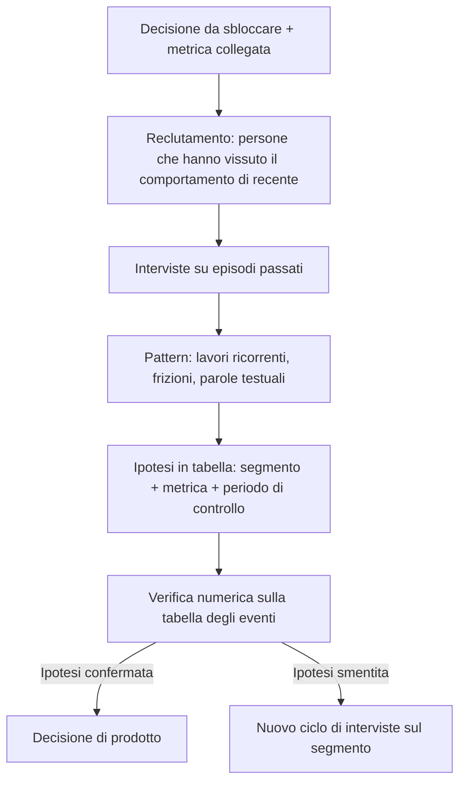

Cinque interviste, tre persone su cinque dicono che vorrebbero la funzione. Nel verbale compare la riga «il 60% dei clienti la vuole», e da quel momento il numero circola come un dato.

I numeri di esempio vengono da un caso ricostruito. Un team di prodotto di un negozio online intervista cinque clienti per capire se valga la pena costruire una funzione di confronto tra prodotti. Tre dicono che la userebbero. Il verbale riporta il 60%, e la percentuale entra nella presentazione della roadmap, accanto ai dati della dashboard e con lo stesso peso grafico.

## Il 60% che non esiste

Un campione di cinque persone non misura una quota. L'intervallo di confidenza al 95% per tre su cinque, calcolato con il metodo di Wilson, va dal 23,1% all'88,2%: è compatibile con una funzione che interessa a una persona su quattro e con una che interessa a quasi nove su dieci. Con 50 persone la stessa quota del 60% darebbe un intervallo tra il 46,2% e il 72,4%, ancora largo ma abbastanza stretto da orientare una decisione. L'errore del team non è nell'aritmetica, che è corretta: tre su cinque è il 60%.

La causa è un'altra. Si è chiesto a uno strumento di scoperta il lavoro di uno strumento di misura. Le interviste generano ipotesi con una storia dietro, e le frequenze le stabilisce la tabella degli eventi. Tre su cinque resta comunque un'osservazione utile: dice che cosa hanno detto quei tre, con quali parole e in quale circostanza, e quindi che cosa andare a contare. Il guasto sta nell'etichetta con cui l'osservazione entra nel documento. Una riga che dice «tre intervistati su cinque descrivono di aprire più schede prodotto per confrontarle a mano» conserva l'informazione. Una riga che dice «il 60% la vuole» la trasforma in una stima che nessuno ha calcolato.

Il costo di questo scambio si vede mesi dopo. La funzione viene costruita, il rilascio ha un'adozione del 4%, e in riunione qualcuno ricorda che «le interviste dicevano il 60%». Nessuno ricorda che erano cinque persone, selezionate tra quelle che avevano risposto volentieri alla richiesta del team.

## Che cosa può produrre un'intervista, e che cosa no

Il metodo si regge su tre abitudini.

La prima: si chiedono fatti passati, mai opinioni sul futuro. Le previsioni di una persona su ciò che farebbe sono inaffidabili, mentre i suoi racconti su ciò che ha fatto lo sono meno, perché contengono dettagli che sarebbe difficile inventare: il giorno, il dispositivo, la persona con cui ne ha parlato. «Raccontami l'ultima volta che hai cercato un prodotto sul sito» dice più di «useresti una funzione di confronto?».

La seconda: l'intervista ha una struttura in cinque momenti. Due minuti di apertura, con il contesto e la precisazione che non esistono risposte giuste. Il comportamento passato. I momenti di difficoltà. I momenti di successo. Due minuti di chiusura. Dopo una risposta che pesa non si riempie il silenzio: l'osservazione migliore arriva spesso quando il silenzio mette un po' a disagio, perché la persona aggiunge ciò che aveva scartato come irrilevante.

La terza: ogni pattern diventa un'ipotesi in tabella, con un segmento e un periodo di confronto. Una citazione senza questo collegamento è aneddotica, e un archivio di citazioni senza ipotesi è il modo in cui i team accumulano ricerca che non cambia nessuna decisione.

> **Idea chiave:** Un'intervista produce ipotesi con una storia dietro, non frequenze: la quota la stabilisce la tabella, e un pattern emerso da cinque persone vale quanto l'ipotesi che permette di scrivere.

Il flusso completo, dalla decisione da sbloccare fino alla verifica numerica, ha questa forma.

## La traccia per episodi

Una traccia per episodi ha pochi momenti e domande che invitano a raccontare. La tabella seguente è la versione di lavoro, pensata per trenta minuti.

| Momento | Domanda tipo | Che cosa si cerca |
| --- | --- | --- |
| Apertura, 2 minuti | Contesto, scopo, nessuna risposta giusta o sbagliata | Mettere a proprio agio, ottenere il consenso |
| Comportamento passato | Raccontami l'ultima volta che hai cercato un prodotto sul sito | Sequenza reale, strumenti usati, tempi |
| Difficoltà | C'è stato un momento in cui hai pensato di abbandonare? Che cosa era successo subito prima? | Frizioni, vincoli, alternative considerate |
| Successo | Quando hai pensato «finalmente ci sono riuscito»? | Che cosa ha fatto la differenza |
| Chiusura, 2 minuti | C'è qualcosa che non ti ho chiesto? | Temi che il conduttore non aveva previsto |

La domanda finale è la più sottovalutata. Molte scoperte arrivano nell'ultimo minuto, quando l'intervistato ha smesso di rispondere alla traccia e comincia a dire ciò che gli sembra importante.

Il conduttore ha due compiti che sembrano contraddittori. Deve tenere la conversazione ancorata a un episodio concreto, riportandola ogni volta che scivola verso le opinioni generali («di solito io...»), e deve lasciare spazio alla persona senza suggerirle le parole. La tecnica minima è chiedere «e poi?» e «che cosa è successo subito prima?», che spingono verso la sequenza dei fatti. Le domande sul perché, se poste troppo presto, producono giustificazioni costruite a posteriori. Conviene chiedere prima che cosa è successo, e lasciare il perché emergere dai dettagli.

Una buona prassi è registrare, con consenso, e scrivere subito dopo un riassunto di mezza pagina con tre elementi: l'episodio principale, le frasi testuali più nette e una frase sul punto che ha sorpreso il conduttore. Le sorprese sono il materiale più prezioso, perché indicano dove il modello mentale del team e quello del cliente divergono.

## Reclutare chi ha vissuto il comportamento

Il reclutamento è metà del risultato. Se si intervistano solo i clienti che rispondono volentieri, si ascolta chi è già contento e ha tempo da dedicare. Le persone con la storia più utile sono spesso le meno disponibili: chi ha abbandonato, chi ha comprato una sola volta, chi è arrivato dal supporto con un problema.

Il criterio pratico è reclutare dalla tabella degli eventi, non dalla lista di chi si è offerto. Se la decisione riguarda il confronto tra prodotti, si estraggono i clienti che nelle ultime due settimane hanno aperto almeno tre schede della stessa categoria. Tra i cinque conviene includere almeno una persona che ha abbandonato, trovata nei dati, perché le sue parole sono quelle che la dashboard non conserva. Un incentivo modesto, come un buono da 15 €, aumenta la partecipazione senza spostare troppo la composizione del gruppo.

Resta un limite che nessun reclutamento elimina: un gruppo di cinque-otto persone, anche ben scelto, non è rappresentativo. Serve a mostrare come il comportamento si presenta, non quanto sia diffuso. Dichiararlo nel verbale, con una frase come «il gruppo non permette di stimare quote», costa una riga e protegge da quasi tutti i fraintendimenti.

## Dall'intervista all'ipotesi: un esempio svolto

Torniamo al negozio. Dalle cinque interviste emerge un pattern: tre persone descrivono di aprire tre o più schede della stessa categoria in schede diverse del browser e di confrontarle a mano, passando da una all'altra. Una di loro usa questa frase: «li metto uno accanto all'altro, ma poi mi perdo». L'ipotesi in tabella è che le sessioni con tre o più schede della stessa categoria siano sessioni di confronto manuale e abbiano una conversione più bassa del resto.

Il team estrae dalla tabella degli eventi le sessioni con ricerca di due settimane: sono 20.000. Di queste, 4.600 (il 23%) contengono tre o più schede della stessa categoria. La conversione osservata è del 2,5% per il gruppo di confronto manuale e del 3,5% per le altre 15.400 sessioni. I conti: 4.600 × 2,5% = 115 ordini, 15.400 × 3,5% = 539 ordini, in totale 654 ordini su 20.000 sessioni, cioè una conversione media del 3,27%. La differenza tra i due gruppi è di 1 punto percentuale.

Se una funzione di confronto portasse il gruppo manuale al livello degli altri, l'incremento sarebbe di 4.600 × 1% = 46 ordini ogni due settimane. Con un ordine medio di 80 € il valore lordo è 46 × 80 € = 3.680 € ogni due settimane. Questo è un limite superiore dichiarato, non una previsione: presuppone che il gruppo manuale sia identico agli altri a parte il confronto, e le interviste non lo dicono. L'ipotesi, però, è ora verificabile con un test controllato su un campione, e la quota del 23% è una misura vera, calcolata su 20.000 sessioni e non su cinque persone.

Il costo del ciclo è modesto: cinque interviste da 30 minuti più 30 minuti di sintesi ciascuna fanno 5 × 60 minuti = 300 minuti, cioè 5 ore di lavoro, più la query sulla tabella. Il confronto con il «60%» iniziale è istruttivo. Il numero che circolava non poteva essere controllato da nessuno, mentre il 23% e il 2,5% di conversione si possono ricalcolare ogni settimana.

Se la tabella smentisce l'ipotesi, per esempio se il gruppo manuale convertisse come gli altri, la storia raccolta nelle interviste resta valida come descrizione del comportamento, e il team riparte dal segmento: chi sono quelle 4.600 sessioni, quali prodotti guardano, da quale canale arrivano.

## Quante interviste

Resta da decidere quando smettere. Gli approcci sono due: un numero fisso, deciso prima, oppure la saturazione, cioè si continua finché le interviste portano temi nuovi. La tabella mostra come si presenta la saturazione in una serie di otto interviste, con numeri di esempio.

| Intervista | Temi nuovi emersi | Temi cumulati |
| --- | --- | --- |
| 1 | 4 | 4 |
| 2 | 3 | 7 |
| 3 | 2 | 9 |
| 4 | 1 | 10 |
| 5 | 1 | 11 |
| 6 | 0 | 11 |
| 7 | 0 | 11 |
| 8 | 0 | 11 |

Le prime tre interviste hanno portato 9 temi su 11, cioè l'81,8% del totale. Le ultime tre non ne hanno portato nessuno, e a quel punto ci si ferma. Il criterio: **numero fisso, da cinque a otto, se il segmento è omogeneo e il budget è dato; saturazione, cioè ci si ferma quando le ultime tre interviste non portano temi nuovi, se il segmento è vario o la domanda è nuova.**

Le fonti non offrono un numero magico. Il lavoro di Guest, Bunce e Johnson del 2006 su sessanta interviste ([scheda dell'articolo](https://library.alnap.org/node/58582)) è citato di solito per l'osservazione che la gran parte dei codici emerge entro le prime dodici interviste, con i temi principali già dopo le prime sei. Sono cifre riportate da sintesi, e gli stessi riassunti avvertono di non trasformarle in una soglia universale. Il Nielsen Norman Group scrive che non esiste un numero d'oro e che, per molti studi esplorativi, cinque partecipanti sono pochi ([NN/g](https://www.nngroup.com/articles/interview-sample-size/)).

La confusione comune è la regola dei cinque utenti. Nasce dai test di usabilità qualitativi: con una proporzione media del 31% di problemi trovati da ogni utente, cinque utenti ne trovano circa l'85% ([NN/g](https://www.nngroup.com/articles/why-you-only-need-to-test-with-5-users/)). Il calcolo è 1 − 0,69⁵ ≈ 84,4%, e lo stesso articolo indica almeno venti utenti per uno studio quantitativo. Trasportata sulle interviste di scoperta, la regola lascia fuori i segmenti che non si sono sentiti. Usata per stimare una quota, produce il 60% del caso di apertura.

Questa lezione non copre l'analisi tematica, cioè come si codificano le interviste, né il consenso e la tutela dei dati degli intervistati. La regola delle ultime tre interviste è una convenzione di lavoro, non un risultato della letteratura citata.

## Tre domande che rovinano l'intervista

Questa è la traccia che molti team portano a un'intervista:

> Traccia dell'intervista, 30 minuti.
>
> 1. Useresti una funzione per confrontare i prodotti?
>
> 2. Quanto è importante per te il prezzo, da 1 a 10?
>
> 3. Non trovi che il checkout sia troppo lungo?

Ciascuna delle tre domande contiene un errore diverso.

### Le domande sul futuro

Il sintomo è un'intervista piena di risposte positive e di nessun racconto. Sembra ragionevole: chiedere se si userebbe una funzione è il modo più diretto per saperlo. Ma la risposta è un'intenzione di cortesia, non un comportamento. Chi dice di sì non ha speso niente per dirlo, e il team conserva un «sì» che non prevede nessun uso. Il rimedio è trasformare la domanda in un episodio: «Raccontami l'ultima volta che hai dovuto scegliere tra due prodotti simili».

### Le domande che chiedono un numero

Il sintomo è un foglio di calcolo con le medie delle risposte su una scala. Una scala da 1 a 10 trasforma un'intervista in un sondaggio con cinque rispondenti. Il risultato sembra preciso e non lo è, come nel caso di apertura, e si perde ciò per cui si fa un'intervista: l'episodio e la parola usata dalla persona. Il rimedio è chiedere a che cosa la persona ha rinunciato o che cosa ha confrontato l'ultima volta, e lasciare i numeri al sondaggio.

### Le domande che suggeriscono la risposta

Il sintomo è un accordo generale su un problema che nessuno aveva nominato prima. «Non trovi che il checkout sia troppo lungo?» contiene la risposta. Chi è gentile annuisce, e il team scambia l'assenso per un problema. Una domanda che apre non nomina il problema: chiede che cosa è successo l'ultima volta che si è arrivati alla cassa, e aspetta di sentire se la lunghezza compare nel racconto.

## Controllo prima di intervistare

1. Hai scritto la decisione che la ricerca deve sbloccare, con la metrica collegata?

Mostra risposta

Se la risposta è no, le interviste produrranno citazioni senza destinazione. La decisione scritta, per esempio «costruire o no il confronto tra prodotti», e la metrica collegata, per esempio la conversione delle sessioni con tre o più schede, permettono di riconoscere quali pattern sono rilevanti e quali no.

2. Tre intervistati su cinque dicono di volere una funzione. Perché non puoi riportare «il 60% dei clienti»?

Mostra risposta

Perché l'intervallo di Wilson al 95% per 3 su 5 va dal 23,1% all'88,2%, cioè dall'ipotesi che interessi a una persona su quattro a quella che interessi a quasi nove su dieci. Il campione, inoltre, non è casuale. Si può riportare l'osservazione («tre persone su cinque descrivono questo comportamento») e usarla per costruire un'ipotesi da contare in tabella.

3. Un'intervista ti ha portato a ipotizzare che le sessioni con tre o più schede della stessa categoria convertano meno. Con 4.600 sessioni al 2,5% e 15.400 al 3,5%, quanti ordini totali ottieni e qual è la conversione media?

Mostra risposta

4.600 × 2,5% = 115 ordini e 15.400 × 3,5% = 539 ordini, quindi 654 ordini su 20.000 sessioni, pari al 3,27%. Se il gruppo di confronto manuale convertisse al 3,5%, otterresti 4.600 × 1% = 46 ordini in più ogni due settimane, un limite superiore da verificare con un test.

4. Le ultime tre interviste di una serie di otto non hanno aggiunto temi nuovi. Che cosa decidi e perché?

Mostra risposta

Ti fermi: il criterio di saturazione, tre interviste consecutive senza temi nuovi, è soddisfatto. È una convenzione di lavoro e non una soglia della letteratura, quindi conviene verificare che il gruppo comprendesse anche i segmenti rilevanti, per esempio almeno una persona che ha abbandonato. Se mancano, la saturazione riguarda solo chi è stato intervistato.

5. Quale tra queste domande trasformi in un episodio passato: «useresti il confronto?», «quanto è lungo il checkout da 1 a 10?», «non trovi il checkout troppo lungo?»

Mostra risposta

Tutte e tre. La prima chiede un'intenzione futura, la seconda un numero, la terza suggerisce la risposta. Tutte si possono riscrivere come «Raccontami l'ultima volta che hai comprato qualcosa sul sito, dall'inizio alla cassa», e poi si ascolta se compaiono il confronto o la lunghezza del checkout.

