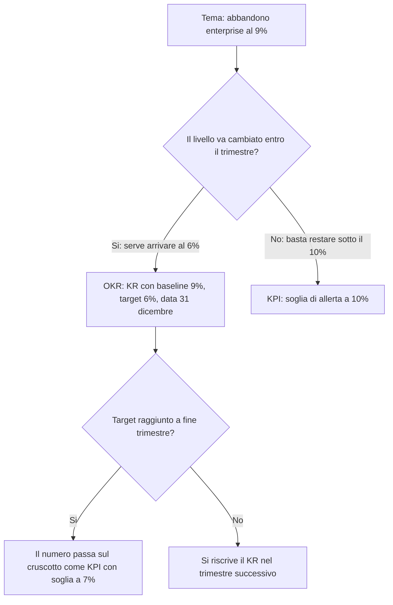

Nove Key Result su nove sono al 100%. Nello stesso trimestre il ricavo enterprise è sceso dell'8%, e nessuno ha barato.

Lo scenario è costruito, con numeri di esempio. Il team enterprise di una software house chiude il trimestre con tutti i suoi 9 Key Result raggiunti. Erano scritti così: «Lanciare la campagna enterprise», «Organizzare 3 webinar», «Pubblicare 6 casi cliente». Sono stati fatti, uno per uno. Alla revisione il ricavo mensile ricorrente enterprise risulta sceso da 1,20 a 1,104 milioni di euro, cioè 1,20 × 0,92: novantaseimila euro al mese in meno.

## Nove su nove, e ricavi in calo

Si cerca la colpa dove di solito si cerca: un obiettivo troppo timido o un mercato difficile. Nel caso il team ha lavorato bene e il mercato è stabile. La causa sta nella scrittura. Quei Key Result descrivevano attività, e un'attività si completa sempre, anche quando il risultato non arriva. La campagna è partita, i webinar si sono tenuti, i casi cliente sono usciti, e il fatto che nessun cliente in più abbia firmato non rientrava in ciò che il trimestre misurava.

Il problema è sottile perché ogni singola riga sembra ragionevole. Un manager che legge «Organizzare 3 webinar» vede un impegno concreto, assegnabile, verificabile. Nessun comitato respinge una riga così. Ma una scheda di nove attività completate non dice nulla sul fatto che l'azienda si sia avvicinata a dove voleva andare, perché il collegamento tra attività e risultato è un'ipotesi che nessuno ha scritto e nessuno controlla.

## Due strumenti, due domande

Gli OKR e i KPI rispondono a domande diverse, e confonderli è l'origine della maggior parte dei guai.

Gli OKR rispondono a «dove vogliamo arrivare?». L'Objective è qualitativo e memorabile, i Key Result sono i numeri che dicono se ci siamo arrivati. Sono ambiziosi per costruzione: le fonti su Google parlano di una scala da 0 a 1,0 e di un risultato tra il 60 e il 70% come tipico, non come fallimento ([re:Work](https://rework.withgoogle.com/intl/en/guides/set-goals-with-okrs)).

I KPI rispondono a «come stiamo andando?». Sono metriche continue di salute, con una soglia di allerta, e il risultato atteso è quello pieno: un KPI al 70% è un allarme, non un successo.

> **Idea chiave:** Un Key Result è un numero con una baseline e una data; se non può fallire, non è un Key Result. Un KPI è un numero che deve restare dentro una soglia; se può peggiorare senza allarmare nessuno, non è un KPI.

La tabella confronta i due strumenti sulle caratteristiche che contano nel lavoro quotidiano.

| Caratteristica | OKR | KPI |
| --- | --- | --- |
| Domanda a cui risponde | Dove vogliamo arrivare | Come stiamo andando |
| Orizzonte | Un trimestre, poi si riscrive | Continuo, senza scadenza |
| Esito atteso | 60-70% è un buon risultato | Pieno, sotto soglia è allarme |
| Numero tipico | Circa 3 Key Result per Objective | Da 5 a 10 per team |
| Quando scatta l'azione | A fine trimestre e nelle revisioni intermedie | Quando si supera la soglia di allerta |

Un Key Result si distingue da un'intenzione per tre elementi: un numero, una baseline, una data. «Aumentare i clienti enterprise» non è un Key Result. «Passare da 120 a 200 clienti enterprise attivi entro il 31 dicembre» lo è.

La distinzione ha conseguenze pratiche sul modo di lavorare. Un team che governa con gli OKR accetta di chiudere il trimestre con un risultato parziale e di discuterne apertamente, perché un obiettivo che si raggiunge sempre al 100% ha probabilmente fissato un livello troppo basso. Un team che governa con i KPI accetta invece che il lavoro più importante sia spesso invisibile: tenere un indicatore dentro la soglia non produce nessuna storia da raccontare, ma evita i guasti che la produrrebbero.

## Come si scrive un Key Result

La scheda OKR del trimestre, come la scrive la maggior parte dei team, ha questa forma.

| Livello | Testo |
| --- | --- |
| Objective | Aumentare la presenza enterprise |
| KR1 | Lanciare la campagna enterprise |
| KR2 | Organizzare 3 webinar |
| KR3 | Pubblicare 6 casi cliente |

La stessa scheda, riscritta con numeri di esempio, cambia natura.

| Livello | Testo |
| --- | --- |
| Objective | Diventare il fornitore di riferimento delle aziende medio-grandi |
| KR1 | Clienti enterprise attivi da 120 a 200 entro il 31 dicembre |
| KR2 | Ricavo mensile ricorrente enterprise da 1,2 a 1,8 milioni di euro entro il 31 dicembre |
| KR3 | Abbandono enterprise a 90 giorni dal 9% al 6% entro il 31 dicembre |

Ogni riga della seconda scheda può fallire. I tre Key Result di prima erano mezzi: la campagna serve ad avere clienti, i webinar a generare contatti, i casi cliente a convincerli. Quelli nuovi chiedono il fine. A fine trimestre il team sa di quanto ha mancato o raggiunto il target e può chiedersi perché. Il passaggio da attività a risultato ha un effetto collaterale utile: le attività non spariscono, diventano iniziative a supporto dei Key Result, e possono essere cambiate a metà trimestre se non funzionano, senza riscrivere l'obiettivo.

I numeri della scheda sono coerenti tra loro. Il ricavo medio per cliente oggi è 1,2 milioni / 120 = 10.000 € al mese. I nuovi clienti sono mediamente più piccoli, e l'ipotesi del team è un ricavo medio di 9.000 € al mese a fine trimestre: 200 clienti × 9.000 € = 1,8 milioni di euro, che è il target del KR2. Una scheda in cui il target di ricavo e quello di clienti non si tengono insieme è il segnale che nessuno ha fatto questo controllo.

## Un esempio svolto: il progresso a metà trimestre

A metà trimestre il team misura la situazione. I clienti enterprise attivi sono 180, il ricavo mensile ricorrente è 1,53 milioni di euro e l'abbandono a 90 giorni è al 7,5%. Il progresso di ciascun Key Result si calcola con la stessa formula: (valore attuale − baseline) / (target − baseline).

Per il KR1: (180 − 120) / (200 − 120) = 60 / 80 = 75%. Per il KR2: (1,53 − 1,20) / (1,80 − 1,20) = 0,33 / 0,60 = 55%. Per il KR3 la direzione è inversa, perché il numero deve scendere: (9 − 7,5) / (9 − 6) = 1,5 / 3 = 50%. La media dei tre progressi è (75% + 55% + 50%) / 3 = 60%, nel punto in cui le fonti su Google collocano un risultato tipico per obiettivi ambiziosi.

La lettura dei numeri è più utile della media. I 180 clienti a un ricavo medio di 1,53 milioni / 180 = 8.500 € sono sotto i 9.000 € ipotizzati: il team sta acquisendo clienti più piccoli del previsto, ed è questo che frena il KR2 rispetto al KR1. Se i 20 clienti restanti arrivassero a 8.500 €, il ricavo finale sarebbe 200 × 8.500 € = 1,70 milioni, cioè (1,70 − 1,20) / 0,60 = 83%. Per chiudere il KR2 servono 9.000 € di ricavo medio, quindi un'iniziativa su listini o upsell, oltre a quelle di acquisizione.

Questo è il vantaggio del progresso calcolato: porta a una decisione. Con la scheda delle attività, a metà trimestre si scopre che la campagna è partita e i webinar sono a due su tre, informazione che non dice dove intervenire. Con la baseline scritta il primo giorno, il 75% e il 55% dicono quale Key Result è in ritardo e perché.

Un'avvertenza sul modo di usare i punteggi: in un'intervista pubblicata su WhatMatters, Laszlo Bock sostiene che gli OKR vadano separati dalla retribuzione ([intervista](https://www.whatmatters.com/articles/laszlo-bock-divorce-compensation-from-okrs)). Chi viene pagato sul 100% tende a scegliere obiettivi che raggiungerà, e l'ambizione, che è il senso del 60-70%, scompare.

## KPI: pochi, bilanciati, azionabili

Si misura tutto perché misurare costa poco, e il cruscotto cresce a ogni richiesta. Il costo è il fuoco che si disperde: in questo corso la regola pratica è da cinque a dieci indicatori, una soglia di lavoro e non una legge. Il test migliore è l'azionabilità. Il tempo medio sul sito non è azionabile: se sale, non si sa che cosa fare. Il tasso di conversione del checkout lo è: se scende, si sa dove guardare.

Un set equilibrato contiene indicatori anticipatori, che si muovono prima del risultato, e indicatori storici, che lo registrano a posteriori. La pipeline qualificata è anticipatrice: un calo oggi anticipa un calo del ricavo fra uno o due trimestri. Il ricavo è storico: quando scende, il danno è già avvenuto. Un cruscotto fatto solo di indicatori storici avvisa tardi, mentre uno fatto solo di anticipatori può restare verde mentre l'azienda perde clienti.

| KPI | Tipo | Soglia di allerta (esempio) | Che cosa si fa quando scatta |
| --- | --- | --- | --- |
| Pipeline enterprise qualificata | Anticipatore | Sotto 3 volte il target mensile | Rivedere le fonti di lead con il marketing |
| Conversione da prova a contratto | Anticipatore | Sotto il 18% | Analizzare le prove perse per segmento |
| Ricavo mensile ricorrente | Storico | Calo di oltre il 3% in un mese | Convocare la revisione del portafoglio |
| Abbandono a 90 giorni | Storico | Sopra il 10% | Ricontattare gli account a rischio |
| Tempo di prima risposta al supporto | Anticipatore | Sopra 8 ore | Spostare risorse sulla coda enterprise |

La colonna decisiva è l'ultima. Un KPI senza una persona che sa che cosa fare quando la soglia viene superata è una cifra decorativa. Ogni metrica va inoltre agganciata a una tabella, con unità di analisi, segmento e finestra: senza di essi due persone calcolano due valori diversi dallo stesso nome, e la riunione si trasforma in una discussione sulle definizioni.

## Obiettivo o indicatore

Lo stesso tema può stare da una parte o dall'altra. Il metodo ha origine in Intel, dove Andy Grove lo descrisse in *High Output Management*, partendo dalla gestione per obiettivi di Peter Drucker ([voce di Wikipedia](https://en.wikipedia.org/wiki/Objectives_and_key_results)). John Doerr, che lo aveva imparato da Grove, lo portò a Google nel 1999, secondo le fonti consultate.

Il caso: l'abbandono enterprise è al 9%, ovvero circa 11 clienti su 120 in un trimestre (9% × 120 = 10,8). Il criterio: **OKR se serve cambiare il livello in un trimestre, KPI se serve tenerlo entro una soglia.** Se il 9% è accettabile e basta non superare il 10%, è un KPI con una soglia di allerta a 10. Se deve scendere al 6% entro dicembre, è un OKR con il 9% come baseline.

Lo stesso indicatore può cambiare ruolo da un trimestre all'altro: quando l'abbandono rientra al 6%, l'OKR finisce e il numero passa sul cruscotto come KPI, con una soglia di allerta a 7%.

Questa lezione non copre la valutazione delle persone né il calcolo dei punteggi a fine trimestre oltre la formula del progresso. I numeri dei casi sono di esempio e il 60-70% di Google è una convenzione, non una misura dell'effetto degli OKR.

## Tre errori ricorrenti

### Key Result che sono attività

Il sintomo è una scheda in cui ogni riga inizia con un verbo di azione: lanciare, organizzare, pubblicare. Sembra ragionevole: un'attività si assegna, si controlla, si chiude, e a fine trimestre c'è una colonna di caselle spuntate. Il difetto è lì: si completa sempre. Organizzare tre webinar è un'attività. Generare 200 contatti qualificati dai webinar è un risultato. Solo il secondo può non riuscire, e per questo solo il secondo dice qualcosa. Il rimedio è chiedersi, per ogni riga, quale numero cambierebbe se l'attività avesse successo, e scrivere quel numero.

### Key Result senza baseline

Il sintomo è un «aumentare» senza un punto di partenza. Senza la baseline nessuno distingue un obiettivo ambizioso da uno già raggiunto, e a fine trimestre ogni numero si legge come successo. La baseline costa una query sulla tabella dei clienti e rende il target discutibile. Permette anche di calcolare il progresso, come nell'esempio: con 120 clienti di partenza e un target di 200, arrivare a 180 vale il 75%. Senza il 120, il 180 non dice niente.

### Cinquanta KPI, o un OKR che ricopia un KPI

Il primo sintomo è un cruscotto che nessuno guarda per intero. Si arriva a cinquanta indicatori una richiesta alla volta, e il test di azionabilità li ridurrebbe a una decina. Il secondo è speculare: i Key Result sono i numeri già sul cruscotto, nessuno cambia lavoro, e a fine trimestre il team ha riscritto la dashboard e basta. L'errore opposto è il KPI trattato come obiettivo ambizioso: se il 70% va bene, la soglia di allerta smette di allertare. Il rimedio, per tutti e tre i casi, è la domanda del criterio: questo tema va cambiato o va tenuto?

## Controllo prima del trimestre

1. Ogni Key Result ha un numero, una baseline e una data?

Mostra risposta

Il controllo è meccanico: se manca uno dei tre elementi, la riga è un'intenzione. «Aumentare i clienti enterprise» non ha baseline né data. «Da 120 a 200 clienti enterprise attivi entro il 31 dicembre» li ha tutti e tre e può quindi fallire.

2. Un Key Result parte da 120 clienti, ha come target 200 e a metà trimestre si è a 180. Quanto vale il progresso, e come cambia il calcolo per un abbandono che deve scendere dal 9% al 6% ed è al 7,5%?

Mostra risposta

Per i clienti: (180 − 120) / (200 − 120) = 60 / 80 = 75%. Per l'abbandono la direzione è inversa, quindi (9 − 7,5) / (9 − 6) = 1,5 / 3 = 50%. La formula (attuale − baseline) / (target − baseline) funziona in entrambe le direzioni perché numeratore e denominatore cambiano segno insieme.

3. Il target di ricavo è 1,8 milioni di euro con 200 clienti, e oggi il ricavo medio per cliente è 10.000 €. Che cosa controlli prima di approvare la scheda?

Mostra risposta

Che i due target siano coerenti: 200 × 10.000 € = 2,0 milioni, non 1,8. Il target di 1,8 milioni implica un ricavo medio di 9.000 € per cliente, quindi un'ipotesi sui nuovi clienti più piccoli che va dichiarata. Se l'ipotesi è errata, uno dei due Key Result è mal calibrato.

4. L'abbandono enterprise è al 9% e il rischio accettabile è il 10%. È un OKR o un KPI, e che cosa cambia se la direzione decide di scendere al 6%?

Mostra risposta

Con il 10% come limite è un KPI con soglia di allerta a 10. Con la decisione di arrivare al 6% entro dicembre diventa un OKR con baseline al 9%. A obiettivo raggiunto torna sul cruscotto come KPI, con una soglia più stretta, per esempio 7%.

5. Perché un cruscotto fatto di soli indicatori storici avvisa tardi, e come lo correggi?

Mostra risposta

Perché il ricavo o l'abbandono registrano un danno già avvenuto. Si aggiungono indicatori anticipatori come la pipeline qualificata o la conversione da prova a contratto, che si muovono uno o due trimestri prima, ciascuno con una soglia e una persona incaricata di agire.

