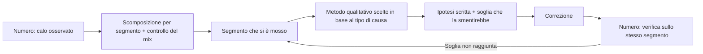

L'abbandono al checkout sale dal 62% al 71% in due settimane. Il team passa uno sprint a togliere un passaggio dal flusso, e l'abbandono resta al 71%.

È uno scenario costruito, con numeri di esempio. Un negozio online vede l'abbandono al checkout salire in due settimane dal 62% al 71%. Il team legge il numero come un problema di lunghezza del flusso, elimina un passaggio e rilascia dopo uno sprint. Al controllo successivo l'abbandono è ancora al 71%.

## Uno sprint sulla causa sbagliata

Il numero non era sbagliato, e nemmeno il team: era incompleto. Diviso in due segmenti, il calo avrebbe mostrato che l'abbandono su mobile è passato dal 66% al 78%, mentre su desktop è rimasto tra il 51% e il 52%. Il passaggio eliminato riguardava tutti. Il problema, un modulo di pagamento che si bloccava su alcuni telefoni, riguardava un segmento solo.

La causa non è la poca analisi: ce n'era abbastanza, e il cruscotto aggiornava ogni ora. Il numero dice dove e quanto, non perché, e da un livello solo non si capisce nemmeno quale segmento si sia mosso. Lo sprint non è stato sprecato perché il team lavorasse male, ma perché ha risposto a una domanda che i dati non avevano posto: la lunghezza del flusso non era mai stata messa in relazione con il calo, era soltanto l'ipotesi più a portata di mano.

C'è un costo nascosto che si somma allo sprint. Per due settimane il segmento mobile ha continuato a perdere ordini, e quando il problema viene individuato il calo ha già generato un danno che si può quantificare. Lo si fa più avanti nell'esempio svolto: le cifre mostrano quanto costa partire dal metodo sbagliato.

## Numeri, persone, numeri

Il metodo poggia su tre concetti.

Il primo concetto è l'alternanza. Il numero segnala dove guardare, la persona o la sessione registrata spiega che cosa correggere, il numero verifica che la correzione abbia funzionato. Nessun metodo decide da solo: una rassegna metodologica sulla ricerca qualitativa osserva che uno studio quantitativo misura i fattori già noti o sospettati, e che per scoprire le ragioni di un fenomeno servono disegni qualitativi ([rassegna su PubMed Central](https://www.ncbi.nlm.nih.gov/pmc/articles/PMC7650082/)).

Il secondo è il segmento prima del metodo. La media globale può nascondere due gruppi con livelli molto diversi, e un metodo qualitativo applicato alla media osserva sessioni che non c'entrano. Prima di aprire una registrazione o fissare un'intervista bisogna sapere quale gruppo si è mosso.

Il terzo è la chiusura del ciclo. La spiegazione qualitativa è un'ipotesi finché un numero non la conferma. Se il modulo di pagamento è il colpevole, dopo la correzione l'abbandono su mobile deve scendere, e il team deve aver scritto prima di quanto e entro quando.

> **Idea chiave:** Il numero dice dove e quanto, la persona dice perché, e il numero torna a dire se la correzione ha funzionato: chi salta uno dei tre passaggi ottiene una storia senza prova o una cifra senza spiegazione.

Il ciclo completo si può rappresentare così.

## Scomporre il numero prima di cercare il perché

La scomposizione per segmento è il primo atto di ogni indagine, e ha una precauzione obbligatoria: la composizione. Se la quota di traffico da mobile sale mentre ogni segmento resta fermo, la media peggiora lo stesso, senza che nessuna causa sia cambiata. Prima di cercare una spiegazione si controlla che il calo non sia solo un cambio di mix.

Riprendiamo il negozio con i numeri di esempio. Nelle due settimane del confronto i checkout avviati sono 30.000 per periodo, e la quota mobile è del 73% in entrambi: 21.900 checkout da mobile e 8.100 da desktop. La quota non cambia, quindi un effetto mix è escluso. L'abbandono medio si ricostruisce come media pesata. Nel primo periodo: 0,73 × 66% + 0,27 × 51% = 48,18% + 13,77% = 61,95%, cioè il 62%. Nel secondo: 0,73 × 78% + 0,27 × 52% = 56,94% + 14,04% = 70,98%, cioè il 71%.

La variazione totale è di circa 9 punti percentuali, e si scompone in due contributi: 0,73 × (78 − 66) = 8,76 punti dal mobile e 0,27 × (52 − 51) = 0,27 punti dal desktop, per un totale di 9,03 punti. Il mobile spiega 8,76 / 9,03 = 97% del peggioramento. Il passaggio eliminato dallo sprint riguardava tutti i checkout, ma il problema ne riguardava uno solo.

Si può stimare anche il danno. Il completamento passa dal 38% al 29% dei checkout avviati: 30.000 × 38% = 11.400 ordini nel primo periodo e 30.000 × 29% = 8.700 nel secondo, quindi 2.700 ordini in meno. Con un ordine medio di 60 € la perdita è 2.700 × 60 € = 162.000 € in due settimane, quasi tutta attribuibile al mobile: 21.900 × 12% = 2.628 ordini, contro 8.100 × 1% = 81 del desktop. Le cifre mostrano perché la scomposizione viene prima: ogni giorno speso a ottimizzare l'intero flusso lascia il segmento colpevole dove si trova.

Se invece la quota mobile fosse salita dal 60% al 73%, con i livelli di segmento fermi, la media sarebbe peggiorata lo stesso: con 66% sul mobile e 51% sul desktop, il 60% di mobile darebbe 0,60 × 66 + 0,40 × 51 = 60,0%, e il 73% darebbe 61,95%. Un salto di soli 2 punti, e senza alcun guasto. È il caso in cui cercare un colpevole nel prodotto porta fuori strada.

## Gli strumenti qualitativi dell'analista

Una volta individuato il segmento, gli strumenti qualitativi lavorano su un campione piccolo e mirato. La tabella riassume che cosa mostra ciascuno e dove si ferma.

| Strumento | Che cosa mostra | Limite principale | Campione tipico |
| --- | --- | --- | --- |
| Sessioni registrate | Dove l'utente si blocca sullo schermo | Non dice che cosa pensasse | Da 15 a 20 sessioni del segmento |
| Domanda in-app all'uscita | La ragione dichiarata mentre è fresca | Risposte brevi, solo da chi risponde | Qualche centinaio di risposte |
| Ticket di supporto categorizzati | Temi ricorrenti nel tempo | Vede solo chi scrive al supporto | Tutti i ticket del periodo |
| Interviste | Motivazione, contesto, alternative | Poche persone, fuori dal contesto | Da cinque a otto persone |

Le sessioni registrate mostrano dove l'utente si blocca. Una domanda in-app nel momento in cui qualcuno esce coglie la ragione mentre è fresca, e a differenza del sondaggio inviato via email una settimana dopo non dipende da una ricostruzione del ricordo. I ticket di supporto, categorizzati per tema e letti nel tempo, diventano dati qualitativi strutturati: un tema che passa da 12 a 70 ticket a settimana è un segnale quantitativo ottenuto da testo. Le interviste approfondiscono ciò che gli altri tre mostrano soltanto.

Tutti e quattro funzionano con campioni piccoli, purché mirati: per le interviste cinque-otto persone sono un punto di partenza comune, un'euristica e non una legge, e ci si ferma quando non emergono più schemi nuovi. Nel caso del negozio, venti sessioni di abbandono su mobile bastano per vedere se un campo del modulo di pagamento si blocca ripetutamente. Se in 14 delle 20 la persona tocca lo stesso campo senza risposta, il meccanismo è visibile, anche se quel 14 su 20 non è una stima della frequenza nella popolazione.

## Sessioni o interviste

Per spiegare un calo restano due strumenti qualitativi principali, le sessioni registrate e le interviste. Il caso difficile è sceglierne uno.

Il criterio: **sessioni registrate se la causa è dentro il prodotto e si vede sullo schermo, interviste se è fuori dallo schermo, nella motivazione o nel contesto.**

Un modulo che si blocca, un errore che compare, un pulsante che non risponde: tutto questo è nelle sessioni. Una persona che esita perché non si fida del sito o perché sta confrontando il prezzo altrove non lo mostra a nessuna registrazione. L'intervista ha il suo limite: toglie la persona dal proprio contesto e dura poco, come osserva il Nielsen Norman Group a proposito dei metodi a sessione singola ([Nielsen Norman Group](https://www.nngroup.com/articles/diary-studies/)). Per questo il perché che ne esce va verificato sui numeri.

La confusione comune è chiedere alle sessioni il perché e alle interviste il quanto. Una registrazione mostra che cosa è successo, non che cosa pensasse chi la stava vivendo. Un'intervista dà il perché ma non una quota. Il costo è un'ipotesi senza sostegno, che in riunione sembra una spiegazione.

Questa lezione non copre il consenso e il mascheramento dei campi di pagamento nelle registrazioni, che vanno risolti prima di installare lo strumento, né il calcolo del campione di un sondaggio. Il caso è ricostruito e le cifre sono di esempio.

## Il piano di ricerca scritto

Il piano trasforma l'indagine in un documento che si può controllare. Cinque passi, in ordine: partire dalla decisione che l'analisi deve cambiare, ricavare dal numero il segmento che si è mosso, scegliere il metodo qualitativo in base al tipo di causa, lavorare su quel segmento con campioni piccoli e mirati, tornare ai numeri con un'ipotesi scritta e una soglia che la smentirebbe.

| Passo | Contenuto |
| --- | --- |
| Segnale | Abbandono al checkout dal 62% al 71% in due settimane; mobile dal 66% al 78%, desktop dal 51% al 52% |
| Ipotesi | Un problema del modulo di pagamento su alcuni telefoni |
| Metodo | Venti sessioni di abbandono su mobile e una domanda aperta in-app, al momento dell'uscita |
| Verifica numerica | Dopo la correzione l'abbandono su mobile torna sotto il 70% entro due settimane |
| Decisione | Correggere il modulo, oppure riaprire l'ipotesi se la soglia non viene raggiunta |

La soglia numerica è la parte che protegge dal ragionamento circolare. Se l'ipotesi è giusta, riportare il mobile dal 78% sotto il 70% recupera almeno 8 punti sul segmento: 21.900 × 8% = 1.752 ordini ogni due settimane, cioè 1.752 × 60 € = 105.120 €. Se dopo la correzione il mobile resta al 77%, la spiegazione è incompleta e il ciclo riparte dal segmento. Il costo del piano è un paio di giorni di sessioni al posto di uno sprint sull'ipotesi sbagliata, una stima dichiarata del caso e non una misura. È una scelta reversibile: se l'ipotesi cade, si riparte dal segmento senza aver cambiato il prodotto.

## Come si ascolta male

Questo è il sondaggio che molti team mandano dopo un calo:

> Sondaggio inviato per email una settimana dopo l'acquisto o l'abbandono.
>
> 1. Quanto è stata lenta la procedura di pagamento?
>
> 2. Quale passaggio del checkout vorresti eliminare?
>
> 3. Quanto consiglieresti il sito a un amico?

Contiene tre difetti diversi, ciascuno ricorrente.

### Le interviste usate per contare

Il sintomo è una frase come «otto persone su dieci dicono che il modulo è lento, quindi l'80% dei clienti ha il problema». Sembra ragionevole perché il numero è alto e la fonte è diretta. Ma le interviste mostrano un meccanismo, non una frequenza: dieci persone scelte tra i clienti più disponibili non stimano nessuna quota, e il numero che ne esce regge finché nessuno lo confronta con la tabella. Il rimedio è riportare l'osservazione come tale e misurare la quota sulla tabella degli eventi.

### Il sondaggio che presuppone la causa

Il sintomo è un'unanimità sospetta. La prima domanda dà per scontato che la procedura sia lenta, la seconda che vada accorciata, e chi risponde adatta la risposta alla cornice. Il questionario arriva inoltre una settimana dopo, quando il ricordo dell'abbandono è sostituito da una ragione ricostruita, e a chi se ne è andato in silenzio non arriva affatto: il numero di risposte è alto, l'informazione scarsa. Il rimedio è una domanda aperta nel momento dell'uscita, senza nominare nessuna causa.

### Le sessioni guardate a caso

Il sintomo è una serata passata a guardare registrazioni senza trovare niente. Aprire venti sessioni qualsiasi sembra un modo veloce per capire, ma la maggior parte delle sessioni è di chi ha comprato, e molti degli altri hanno abbandonato per ragioni di sempre. Senza filtrare per segmento e per esito si guarda rumore, e il modulo bloccato si perde in mezzo. Il rimedio è filtrare prima: sessioni mobile, checkout avviato, nessun ordine, nel periodo del calo.

## Controllo prima di cercare la causa

1. Hai scritto quale decisione deve cambiare l'analisi?

Mostra risposta

Senza decisione l'indagine non ha un punto di arrivo e produce spiegazioni che non cambiano nulla. Nel caso del negozio la decisione è «correggere il modulo di pagamento mobile oppure riaprire l'ipotesi», e determina quali sessioni guardare e quale soglia usare per la verifica.

2. L'abbandono medio passa dal 62% al 71%, con quota mobile al 73% in entrambi i periodi, mobile dal 66% al 78% e desktop dal 51% al 52%. Quanto del peggioramento spiega il mobile?

Mostra risposta

Il contributo del mobile è 0,73 × (78 − 66) = 8,76 punti, quello del desktop 0,27 × (52 − 51) = 0,27 punti, per un totale di 9,03. Il mobile spiega 8,76 / 9,03, circa il 97%. Poiché la quota mobile è invariata, un effetto mix è escluso.

3. La quota mobile sale dal 60% al 73% con i livelli di segmento fermi al 66% e al 51%. Come cambia la media e che cosa ne concludi?

Mostra risposta

Con il 60% di mobile la media è 0,60 × 66 + 0,40 × 51 = 60,0%. Con il 73% è 0,73 × 66 + 0,27 × 51 = 61,95%. Aumenta di circa 2 punti senza alcun guasto: è un cambio di composizione e non serve cercare una causa nel prodotto.

4. Un utente esita sul pagamento perché non si fida del sito e sta confrontando il prezzo altrove. Sessioni registrate o interviste?

Mostra risposta

Interviste. La causa è fuori dallo schermo, nella motivazione e nel contesto, e nessuna registrazione la mostra: si vede solo un'esitazione. Il perché che ne esce va poi verificato con un numero, per esempio il tasso di abbandono dei clienti che arrivano da comparatori di prezzo.

5. Dopo la correzione l'abbandono mobile scende dal 78% al 77%. Che cosa decidi, con la soglia del 70%?

Mostra risposta

La soglia non è raggiunta, quindi l'ipotesi è incompleta: il modulo di pagamento non spiega tutto il calo sul segmento. Si riapre l'indagine sullo stesso segmento con nuove sessioni o una domanda in-app, perché il numero che ha smentito la spiegazione è la prova che il ciclo funziona.

