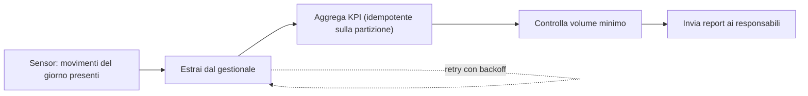

## Il report di magazzino che alle 6:10 mostrava zero pacchi

Scenario costruito con numeri di esempio su un operatore logistico italiano. Ogni notte tre cron job indipendenti gestiscono il flusso dei colli: alle 5:30 uno script estrae i movimenti dal gestionale, alle 6:00 una query aggrega i KPI di magazzino, alle 6:30 parte l'email ai responsabili. Di solito l'estrazione dura 10 minuti e finisce alle 5:40, con un margine di 20 minuti prima dell'aggregazione. Una notte il gestionale è lento per un backup e l'estrazione impiega 40 minuti: finisce alle 6:10. L'aggregazione delle 6:00 non lo sa, legge una tabella ancora vuota, sovrascrive i KPI del giorno con zero e l'email delle 6:30 comunica a tutti che sono stati movimentati zero pacchi.

Nessuno dei tre script è sbagliato. Il difetto sta nel fatto che la dipendenza tra l'estrazione e l'aggregazione esiste solo nella testa di chi ha scelto gli orari. Un orchestratore serve a rendere quella dipendenza un oggetto esplicito, eseguibile e osservabile.

> **Idea chiave:** Un orchestratore sostituisce gli orari scelti a occhio con dipendenze dichiarate: un task parte quando i suoi dati a monte esistono davvero, e se fallisce lo fa in modo ripetibile, misurabile e senza duplicare nulla.

## Cosa cambia passando dai cron ai grafi di dipendenze

Un cron job conosce un solo concetto, l'ora. Se vuoi che B parta dopo A, puoi solo stimare quanto dura A e aggiungere un margine. Quel margine è un debito: basta un rallentamento, un volume doppio nel periodo dei saldi o un backup concorrente per far crollare l'ipotesi. Un orchestratore trasforma la stessa catena in un grafo aciclico diretto, il DAG, dove ogni freccia dice che il task a valle parte solo quando quello a monte è finito con successo.

Il grafo porta con sé tre capacità che i cron non hanno. La prima è l'attesa attiva sui dati: un sensor controlla periodicamente se la tabella o il file attesi sono arrivati e sblocca il task successivo solo allora. La seconda è la gestione dei fallimenti: un errore transitorio di rete viene ritentato con attese crescenti, mentre un errore logico viene segnalato dopo pochi tentativi invece di ripetersi all'infinito. La terza è la storia delle esecuzioni: ogni run ha una durata, un esito e un log consultabili, e da lì si ricavano le metriche con cui si governa il flusso.



Il diagramma mostra la differenza con la catena dei cron: nessun nodo ha un orario proprio. Il DAG parte alle 5:30, ma l'aggregazione parte quando l'estrazione ha terminato, che sia alle 5:40 o alle 6:10.

## Airflow, Prefect e Dagster: tre modelli mentali

I tre strumenti più diffusi risolvono lo stesso problema con filosofie diverse. Apache Airflow ragiona per task e operatori: scrivi un DAG in Python, ogni nodo è un'istanza di un operatore (eseguire uno script, interrogare un database, attendere un file) e lo scheduler li esegue nell'ordine richiesto. Ha l'ecosistema di connettori più ampio e una base di utenti enorme, il che significa documentazione abbondante e persone sul mercato che lo conoscono, a prezzo di una infrastruttura da gestire: scheduler, metadata database, worker.

Prefect ragiona per flussi Python nativi. Decori una funzione con `@flow` e le funzioni che chiama con `@task`, e ottieni retry, logging e osservabilità senza dichiarare un grafo separato: il grafo emerge da come le funzioni si chiamano. L'attrito iniziale è minimo, e per un team Python piccolo è spesso la strada più rapida verso una prima pipeline affidabile.

Dagster sposta il punto di vista dai task agli asset. Dichiari che esiste una tabella `daily_kpi` e come si ottiene a partire da `movimenti_raw`; l'orchestratore ricava le dipendenze e sa dirti quali asset sono aggiornati e quali no. È la scelta naturale quando il centro del lavoro sono tabelle e modelli dbt più che attività temporali.

| Strumento | Unità di base | Punto di forza | Quando ha senso |
| :--- | :--- | :--- | :--- |
| Apache Airflow | DAG di task e operatori | Ecosistema di connettori e diffusione | Molti sistemi eterogenei da coordinare, team con competenze consolidate |
| Prefect | Flow e task Python | Sviluppo rapido, poco codice di infrastruttura | Team Python piccolo che vuole retry e osservabilità presto |
| Dagster | Software-defined asset | Lineage tra tabelle e integrazione con dbt | Team centrato su analytics engineering e qualità degli asset |

La scelta conta meno della disciplina applicata: un flusso con task idempotenti, retry sensati e metriche misurate è affidabile su tutti e tre, uno senza queste proprietà è fragile su tutti e tre.

## Un DAG Airflow con sensor, retry e task idempotente

Traduciamo il caso del magazzino in un DAG. Il sensor attende che la tabella dei movimenti contenga righe per la data logica del run; l'estrazione e l'aggregazione sono parametrizzate sulla stessa data, così un secondo tentativo o un ricalcolo riscrive la stessa partizione invece di accumularne di nuove.

```python
# dags/kpi_magazzino.py - DAG giornaliero con sensor, retry esponenziali e scrittura idempotente
from datetime import datetime, timedelta

from airflow.decorators import dag, task
from airflow.providers.postgres.hooks.postgres import PostgresHook
from airflow.sensors.python import PythonSensor

DEFAULT_ARGS = {
    "owner": "data-team",
    "retries": 3,
    "retry_delay": timedelta(minutes=2),      # primo tentativo dopo 2 min
    "retry_exponential_backoff": True,         # poi 4 min, poi 8 min
    "max_retry_delay": timedelta(minutes=10),
}


def movimenti_arrivati(ds: str) -> bool:
    # Il sensor passa quando esistono righe per la data logica del run
    hook = PostgresHook(postgres_conn_id="warehouse")
    righe = hook.get_first(
        "SELECT count(*) FROM staging.movimenti WHERE data_movimento = %s", parameters=(ds,)
    )[0]
    return righe > 0


@dag(
    dag_id="kpi_magazzino",
    schedule="30 5 * * *",
    start_date=datetime(2026, 1, 1),
    catchup=False,
    max_active_runs=1,
    default_args=DEFAULT_ARGS,
)
def kpi_magazzino():
    attendi_movimenti = PythonSensor(
        task_id="attendi_movimenti",
        python_callable=movimenti_arrivati,
        op_kwargs={"ds": "{{ ds }}"},
        mode="reschedule",            # libera lo slot del worker tra un controllo e l'altro
        poke_interval=300,            # controlla ogni 5 min
        timeout=2 * 60 * 60,          # dopo 2 ore il run fallisce e scatta l'alert
    )

    @task
    def aggrega_kpi(ds=None):
        # Delete + insert nella stessa transazione: il retry riscrive la stessa partizione
        hook = PostgresHook(postgres_conn_id="warehouse")
        with hook.get_conn() as conn, conn.cursor() as cur:
            cur.execute("DELETE FROM prod.kpi_magazzino WHERE data_kpi = %s", (ds,))
            cur.execute(
                """
                INSERT INTO prod.kpi_magazzino (data_kpi, colli_movimentati, colli_in_ritardo)
                SELECT data_movimento, count(*), count(*) FILTER (WHERE in_ritardo)
                FROM staging.movimenti
                WHERE data_movimento = %s
                GROUP BY data_movimento
                """,
                (ds,),
            )

    attendi_movimenti >> aggrega_kpi()


kpi_magazzino()
```

Tre scelte meritano attenzione. `mode="reschedule"` evita che il sensor occupi uno slot del worker per ore mentre aspetta. `timeout` impedisce l'attesa infinita: se i dati non arrivano entro due ore, il run fallisce e qualcuno viene avvisato, che è meglio di un report silenziosamente sbagliato. Infine, l'aggregazione usa `DELETE` e `INSERT` nella stessa transazione sulla data logica `ds`: se il task viene ritentato o rilanciato a mano, il risultato finale è lo stesso.

La stessa logica in Prefect è più compatta, perché i retry si dichiarano sul decoratore e il grafo è codice Python ordinario.

```python
# flows/kpi_magazzino_prefect.py - stesso flusso in Prefect, retry con attese crescenti
from prefect import flow, task


@task(retries=3, retry_delay_seconds=[120, 240, 480])  # 2, 4, 8 minuti
def estrai_movimenti(data_logica: str) -> int:
    # Restituisce il numero di righe caricate in staging per quel giorno
    ...


@task
def aggrega_kpi(data_logica: str) -> None:
    # Stessa scrittura idempotente sulla partizione del giorno
    ...


@flow(name="kpi-magazzino")
def kpi_magazzino(data_logica: str):
    righe = estrai_movimenti(data_logica)
    if righe == 0:
        raise ValueError(f"nessun movimento per {data_logica}: report non inviato")
    aggrega_kpi(data_logica)
```

In Dagster lo stesso flusso sarebbe scritto come due asset, `movimenti_staging` e `kpi_magazzino`, il secondo dipendente dal primo per nome: il grafo si legge dalle firme delle funzioni e l'interfaccia mostra a colpo d'occhio quali asset sono aggiornati.

## Durata del backfill e retry: un esempio numerico svolto

Due calcoli decidono se la configurazione regge: l'attesa totale dei retry e il tempo di un backfill. Partiamo dai retry con `retry_delay` di 2 minuti, backoff esponenziale e 3 tentativi aggiuntivi. Le attese tra i tentativi sono 2 min, 4 min e 8 min, quindi la finestra massima di recupero è 2 + 4 + 8 = 14 minuti, a cui si sommano i quattro tempi di esecuzione. Se l'estrazione dura 10 minuti, nel caso peggiore il task consuma 14 + 4 × 10 = 54 minuti prima di essere dichiarato fallito. Un'estrazione che parte alle 5:30 e fallisce quattro volte sarà dichiarata fallita intorno alle 6:24, e l'alert arriva con l'email ancora da inviare alle 6:30: il margine di decisione è stretto, e per questo conviene fissare una soglia di durata sul DAG.

Passiamo al backfill. Dopo una correzione di logica devi ricalcolare 180 giorni di KPI. Ogni run dura 6 minuti. Se lanci tutti i 180 run insieme, il database sorgente riceve 180 query concorrenti e rischia di saturarsi. Con `max_active_runs=4` i run procedono a blocchi: 180 / 4 = 45 blocchi, ciascuno da 6 minuti, per un totale di 45 × 6 = 270 minuti, cioè 4 ore e 30 minuti, con un carico costante di 4 query contemporanee. Con `max_active_runs=10` si scende a 18 blocchi × 6 min = 108 minuti, ma il carico sul sorgente sale a 10 query contemporanee. Non esiste valore giusto in assoluto: si sceglie il più alto che il sorgente sopporta senza degradare i report mattutini, e si lancia il backfill in una pool dedicata.

```bash
# Backfill dei 180 giorni in una pool dedicata, 4 run alla volta
airflow pools set backfill_pool 4 "Ricalcoli storici (max 4 slot)"
airflow dags backfill kpi_magazzino \
  --start-date 2026-05-01 --end-date 2026-10-27 \
  --pool backfill_pool --reset-dagruns -y
```

La pool `backfill_pool` con 4 slot separa i ricalcoli dalle code prioritarie delle pipeline mattutine, che usano la pool di default. Così un backfill di quattro ore e mezza non toglie slot al DAG delle 5:30.

## Le metriche per scegliere e governare lo strumento

Dopo un mese di esecuzioni hai i dati per decidere con numeri anziché per preferenza. Tre misure per flusso bastano. La durata al 95° percentile dice quanto tempo ti serve in pratica, non in media, e va confrontata con la finestra concessa dallo SLA. Il failure rate al primo tentativo, cioè la quota di run che non riesce senza retry, distingue un flusso instabile da uno che si appoggia ai retry per nascondere i problemi. Il costo per flusso, somma di compute e ore di lavoro umano per mantenerlo, mostra se uno strumento gestito costa davvero meno di uno self-hosted.

Un esempio di lettura. Il flusso `kpi_magazzino` ha eseguito 300 run in un trimestre, dei quali 12 sono falliti al primo tentativo: il failure rate è 12 / 300 = 4%. Dei 12, 9 sono rientrati con il retry e 3 hanno richiesto un intervento manuale: la quota di errori che il retry assorbe è 9 / 12 = 75%, i problemi non transitori sono 3 / 300 = 1%. Se la durata mediana è 8 minuti e il 95° percentile è 14 minuti, con uno SLA di 30 minuti hai 16 minuti di margine al caso peggiore tipico. Se invece il 95° percentile fosse 28 minuti, il flusso sarebbe fuori controllo anche con un failure rate basso.

Il confronto tra strumenti si fa sullo stesso flusso. Se il team scrive già Python e ha un solo flusso critico, Prefect Cloud riduce a zero il lavoro di infrastruttura. Se i flussi sono decine e toccano sistemi molto diversi, Airflow gestito (da un provider cloud) offre i connettori già pronti. Se il cuore del lavoro è un grafo di modelli dbt con test di qualità sugli asset, Dagster dà più valore di lineage. Registrare queste tre misure per ogni flusso rende la discussione concreta.

## Tre errori che rendono fragile un orchestratore

### Usare i worker come motore di calcolo

Sintomo: i task falliscono con errori di memoria esaurita, il worker viene terminato dal sistema operativo e i retry ripetono lo stesso crash. Succede perché è comodo scaricare un dataframe con milioni di righe nel task Python e fare il join in memoria. Rimedio: l'orchestratore coordina, non calcola. Il task invia al warehouse il comando SQL o avvia il job sul motore di calcolo, e controlla solo l'esito. Se un task ha bisogno di più di qualche centinaio di megabyte, il lavoro va spostato.

### Scrivere task non idempotenti

Sintomo: dopo un errore di rete, il fatturato del giorno compare doppio nella dashboard. Succede perché il task ha eseguito un `INSERT` a metà, è fallito, e il retry ha ripetuto l'inserimento senza cancellare le righe già scritte. Rimedio: ogni task scrive sulla propria partizione logica con sostituzione atomica, come nell'esempio con `DELETE` e `INSERT` nella stessa transazione, oppure usa un `MERGE` con chiave naturale. Un test utile: lancia lo stesso task due volte e verifica che il conteggio righe non cambi.

### Non misurare durata e costo dei flussi

Sintomo: un flusso che durava 10 minuti oggi ne impiega 55, e nessuno se ne accorge finché non si sovrappone al run del giorno dopo. Succede perché la durata cresce piano con i volumi e nessuna soglia la intercetta. Rimedio: imposta `sla` o un alert sulla durata del DAG, esporta le metriche di durata e fallimento in una tabella e rivedile ogni mese insieme ai costi. Un flusso che cresce del 10% al mese raddoppia in circa sette mesi: meglio accorgersene dopo uno.

## Controllo prima di mettere un flusso in produzione

1. Un cron job lancia l'estrazione alle 5:30 e l'aggregazione alle 6:00, ma una notte l'estrazione finisce alle 6:10. Quale elemento del DAG impedisce l'aggregazione su dati vuoti, e quale parametro evita un'attesa infinita?

<details>
<summary>Mostra risposta</summary>

Il sensor sui movimenti del giorno (o la dipendenza esplicita tra i due task) fa partire l'aggregazione solo quando i dati esistono. Il parametro `timeout` del sensor, per esempio 2 ore, fa fallire il run se i dati non arrivano, così scatta un alert invece di un report sbagliato o di un'attesa senza fine.

</details>

2. Un task con `retries=3`, `retry_delay` di 2 minuti e backoff esponenziale dura 10 minuti per tentativo. Quanto tempo passa, al massimo, prima che sia dichiarato fallito?

<details>
<summary>Mostra risposta</summary>

Le attese sono 2 + 4 + 8 = 14 minuti. I tentativi totali sono 4 (uno iniziale più tre retry), quindi 4 × 10 = 40 minuti di esecuzione. Il totale è 14 + 40 = 54 minuti.

</details>

3. Devi ricalcolare 240 giorni con run da 5 minuti e il database sorgente sopporta 6 query concorrenti. Quanto dura il backfill con `max_active_runs=6`?

<details>
<summary>Mostra risposta</summary>

240 / 6 = 40 blocchi, ciascuno da 5 minuti: 40 × 5 = 200 minuti, cioè 3 ore e 20 minuti, con 6 query contemporanee sul sorgente. Conviene lanciarlo in una pool dedicata per non sottrarre slot ai DAG mattutini.

</details>

4. Un flusso ha 450 run nel trimestre e 18 falliscono al primo tentativo, di cui 12 rientrano col retry. Calcola failure rate e quota assorbita dal retry. Cosa concludi?

<details>
<summary>Mostra risposta</summary>

Failure rate al primo tentativo: 18 / 450 = 4%. Quota assorbita dal retry: 12 / 18 ≈ 67%. I problemi che richiedono intervento sono 6 su 450, cioè circa 1,3%. Il flusso è accettabile, ma un terzo dei fallimenti non è transitorio e va analizzato nella causa invece di aumentare i retry.

</details>
