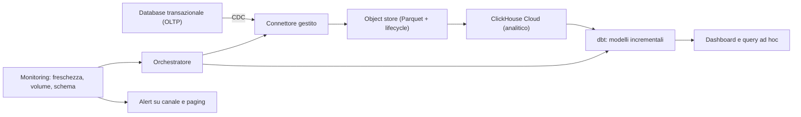

## Il database transazionale che si bloccava ogni mattina alle 9:15

Scenario costruito con numeri di esempio su una scale-up italiana B2B2C che offre mobilità e pagamenti. Un anno fa la piattaforma generava 10 milioni di eventi al mese e il database transazionale reggeva anche i report. Oggi ne genera 100 milioni. Ogni mattina alle 9:15, quando i responsabili aprono le dashboard, le query analitiche fanno concorrenza alle transazioni dei clienti: le ricerche rallentano, qualche pagamento va in timeout e l'assistenza riceve segnalazioni. Il team dati è di tre persone, ha un budget operativo definito e dodici mesi per costruire una piattaforma che regga una crescita ulteriore.

Questo progetto riassume tutto il modulo su un caso unico. Partiamo dai requisiti, li trasformiamo in impegni misurabili, dimensioniamo la piattaforma con calcoli espliciti, scriviamo i controlli come codice, pianifichiamo una migrazione senza interrompere i report e prepariamo il ripristino.

> **Idea chiave:** Un'architettura dati completa si giudica dalla chiarezza di SLA, costi mensili previsti e tempi di ripristino provati, non dal numero di tecnologie elencate nel diagramma.

## Dai requisiti agli impegni misurabili

Un elenco di strumenti non è un progetto. Il progetto comincia dalle richieste degli stakeholder, tradotte in frasi verificabili. Il responsabile operativo vuole le dashboard pronte alle 9:00 con dati aggiornati: diventa uno SLA di freschezza di 15 minuti per le tabelle degli eventi e di 60 minuti per quelle aggregate. L'assistenza vuole smettere di ricevere timeout dai pagamenti: diventa un requisito di separazione, nessuna query analitica sul database transazionale. La direzione vuole un costo prevedibile: diventa un budget mensile con soglia di allarme all'80%. Il team vuole dormire: diventa un tempo di ripristino massimo di 60 minuti, da provare ogni trimestre.

Ogni impegno ha un numero e una data di verifica. Quando un requisito non si riesce a trasformare in un numero, di solito non è ancora chiaro cosa si sta promettendo, ed è meglio scoprirlo prima di scegliere gli strumenti.

## L'architettura per un team di tre persone

Con tre persone, l'architettura vincente evita cluster da amministrare e usa servizi gestiti standard. Gli eventi arrivano tramite un connettore con cattura delle modifiche (CDC) dal database transazionale e vengono scritti su un object store in formato Parquet. Un warehouse colonnare gestito, ClickHouse Cloud, serve dashboard e query ad hoc. dbt versiona le trasformazioni in SQL, GitHub Actions esegue la CI e un orchestratore gestito coordina le dipendenze. Gli alert arrivano su un canale di messaggistica, con paging solo per i guasti critici.



La tabella associa a ogni componente la scelta, lo SLA e la stima di costo mensile. I costi sono intervalli di esempio, da sostituire con i listini reali.

| Componente | Scelta | SLA | Costo mensile (EUR) |
| :--- | :--- | :--- | :--- |
| Storage raw e lake | Object store con Parquet e lifecycle | Freschezza sotto 15 minuti | 80 – 150 |
| Ingestione | Connettore gestito con CDC | Freschezza sotto 15 minuti | 250 – 400 |
| Compute analitico | ClickHouse Cloud separato dall'OLTP | Query sotto 2 secondi | 450 – 700 |
| Trasformazione e CI | dbt e GitHub Actions con Slim CI | Aggiornamento orario o giornaliero | 50 – 100 |
| Orchestrazione e alert | Orchestratore gestito, canale e paging | Notifica critica sotto 5 minuti | 100 – 200 |

## Dimensionare dai numeri: carico, crescita e budget

Prima di accettare una cifra, la si calcola. Il volume attuale è di 100 milioni di eventi al mese. In 30 giorni, la media giornaliera è 100.000.000 / 30 = 3.333.333 eventi, cioè 3.333.333 / 86.400 ≈ 39 eventi al secondo. Gli eventi però non arrivano uniformi: con un fattore di picco di 8 volte nelle ore di punta, il carico da sostenere è 39 × 8 ≈ 309 eventi al secondo. Il dimensionamento si fa sul picco, non sulla media.

La crescita è stata da 10 a 100 milioni in 12 mesi, un fattore 10. Il tasso mensile composto è la radice dodicesima di 10, cioè 10^(1/12) ≈ 1,2115: circa 21% al mese. Se il ritmo continuasse, tra 12 mesi il volume sarebbe 100 × 10 = 1.000 milioni al mese. Un'ipotesi di questo tipo non va usata per comprare oggi la capacità di domani: va usata per scegliere componenti che scalano a richiesta, partendo dalla configurazione minima affidabile e rivedendo la stima ogni trimestre.

Lo storage è modesto. Con eventi da circa 300 byte in JSON, 100 milioni di eventi occupano 100.000.000 × 300 B = 30 GB al mese. Il formato Parquet con compressione riduce tipicamente di 5 volte, quindi circa 6 GB al mese compressi: dopo un anno di storico alla scala attuale sono 72 GB. Il costo di storage è quindi una frazione piccola del budget, e a pesare sono ingestione e compute, come mostra la tabella.

Il budget si ottiene sommando gli estremi della tabella: il minimo è 80 + 250 + 450 + 50 + 100 = 930 euro al mese, il massimo è 150 + 400 + 700 + 100 + 200 = 1.550 euro. Il costo per milione di eventi va quindi da 930 / 100 = 9,30 euro a 1.550 / 100 = 15,50 euro. Con soglia di allarme all'80% sul massimo, l'avviso scatta a 0,8 × 1.550 = 1.240 euro: oltre quella cifra si apre una revisione dei cinque modelli più costosi prima di fine mese.

## Controlli di freschezza e monitoraggio come codice

Gli SLA sono promesse solo se qualcuno li verifica. In dbt, la freschezza delle sorgenti si dichiara in YAML e si esegue con `dbt source freshness`, che l'orchestratore lancia a intervalli.

```yaml
# models/sources.yml - SLA di freschezza dichiarati per le sorgenti del lake
version: 2
sources:
  - name: lake
    database: analytics
    schema: raw
    loaded_at_field: ingested_at
    freshness:
      warn_after: {count: 10, period: minute}   # avviso prima di violare lo SLA di 15 minuti
      error_after: {count: 15, period: minute}
    tables:
      - name: eventi_app
      - name: pagamenti
        freshness:
          error_after: {count: 30, period: minute}  # SLA meno stringente per i pagamenti batch
```

Il volume e la crescita si controllano con una query sul dizionario di sistema di ClickHouse. Le colonne usate sono quelle reali della tabella `system.parts`.

```sql
-- ClickHouse: righe e dimensioni per partizione mensile della tabella degli eventi
SELECT
    partition,
    sum(rows) AS righe,
    round(sum(data_uncompressed_bytes) / 1e9, 2) AS gb_non_compressi,
    round(sum(data_compressed_bytes) / 1e9, 2) AS gb_compressi
FROM system.parts
WHERE active AND database = 'analytics' AND table = 'fact_eventi'
GROUP BY partition
ORDER BY partition DESC
LIMIT 6;
```

L'output serve a confrontare la crescita reale con quella stimata. Se la partizione del mese corrente ha 100 milioni di righe e 6 GB compressi, il calcolo precedente è confermato. Se i GB compressi sono 15, il rapporto di compressione è molto peggiore di 5 a 1 e va indagato, per esempio sui tipi delle colonne o sulla chiave di ordinamento.

## Il piano in tre fasi trimestrali

L'implementazione si sviluppa in tre fasi. Nei primi 30 giorni si attivano object store, ClickHouse e la replica CDC, separando subito le dashboard dal database transazionale: è l'intervento che risolve il problema delle 9:15. Entro 90 giorni si completano i modelli dbt incrementali con Slim CI, gli alert su freschezza, volume e schema e il runbook per i cinque guasti più probabili. Nei mesi successivi si ottimizzano i cinque modelli più costosi, si imposta la retention dei dati grezzi e si esegue la prima prova trimestrale di ripristino.

Ogni fase ha un criterio di uscita numerico, non una data soltanto. La fase 1 è chiusa quando nessuna query analitica gira più sull'OLTP, verificato con il log delle connessioni. La fase 2 è chiusa quando tutte le tabelle critiche hanno SLA, owner e runbook. La fase 3 è chiusa quando la prova di ripristino rispetta il limite di 60 minuti. Con i criteri scritti, la direzione può leggere lo stato senza tradurre.

## Migrazione in ombra senza fermare i report

Il passaggio dal vecchio al nuovo sistema deve avvenire senza interrompere i report. Per 30 giorni le nuove pipeline girano in parallelo e ogni notte uno script confronta i totali giornalieri dei due sistemi. Il criterio di accettazione è scritto in anticipo: scarto massimo dello 0,1% sul conteggio eventi e sul totale dei pagamenti per 14 giorni consecutivi. Solo allora le dashboard vengono ripuntate sul nuovo warehouse.

```bash
# scripts/shadow_compare.sh - confronta eventi del giorno tra vecchio OLTP e nuovo ClickHouse
set -euo pipefail
GIORNO="${1:-$(date -d yesterday +%F)}"
VECCHIO=$(psql "$OLTP_URL" -t -A -c \
  "SELECT count(*) FROM eventi WHERE created_at::date = '${GIORNO}'")
NUOVO=$(clickhouse-client --host "$CH_HOST" --secure --query \
  "SELECT count() FROM analytics.fact_eventi WHERE toDate(event_time) = '${GIORNO}'")
SCOSTO=$(awk -v a="$VECCHIO" -v b="$NUOVO" 'BEGIN { d = (a-b)/a*100; if (d<0) d=-d; printf "%.4f", d }')
echo "${GIORNO} vecchio=${VECCHIO} nuovo=${NUOVO} scarto=${SCOSTO}%"
# soglia di accettazione: 0,1%
awk -v s="$SCOSTO" 'BEGIN { exit (s <= 0.1 ? 0 : 1) }'
```

Un esempio di lettura. Il giorno 12 il vecchio sistema conta 3.402.118 eventi e il nuovo 3.401.950. La differenza è 3.402.118 − 3.401.950 = 168 eventi, lo scarto è 168 / 3.402.118 ≈ 0,0049%, ben sotto lo 0,1%. Il giorno è accettato. Se un altro giorno il nuovo sistema contasse 3.395.000, la differenza sarebbe 7.118 eventi, lo 0,21%: il criterio non è soddisfatto e il contatore dei 14 giorni consecutivi riparte da zero, in attesa di capire la causa, per esempio eventi in ritardo non ancora arrivati.

## Il ripristino: provarlo prima che serva

Il runbook di ripristino dice cosa fare, in quale ordine e con quali comandi se ClickHouse non è raggiungibile o se un deploy ha corrotto una tabella. La parte più importante è la prova. Il team ripristina un backup in un ambiente separato e cronometra: se l'operazione richiede 22 minuti, il tempo di ripristino misurato è 22 minuti, ben dentro i 60 promessi. Se la prova non è mai stata fatta, il numero 60 è una speranza, non un impegno.

Il runbook di ogni guasto ha la stessa struttura: sintomo osservabile, verifica di conferma, azione di contenimento, azione di correzione, controllo finale. Per un ritardo di ingestione, per esempio: lo SLA di 15 minuti è violato, si controlla lo stato del connettore, si riavvia la replica dall'ultimo offset noto, si verifica che il conteggio degli ultimi 60 minuti coincida con l'OLTP. Un runbook scritto in un momento di calma vale più di tre scritti durante un incidente.

## Errori da evitare nel progetto a 12 mesi

### Sovradimensionare per carichi ipotetici

Sintomo: il budget di un trimestre finisce in capacità inutilizzata, pensata per miliardi di righe al giorno quando oggi ne arrivano pochi milioni. Succede perché la crescita recente fa sembrare prudente comprare in anticipo. Si risolve con componenti che scalano a richiesta, una configurazione minima affidabile e una revisione trimestrale della stima con i dati reali della query sulle partizioni.

### Dimenticare trasferimenti e retention

Sintomo: la fattura cresce più dei volumi. Succede quando i dati attraversano regioni cloud diverse o i log grezzi restano non compressi per anni. Si risolve tenendo storage e compute nella stessa regione, definendo regole di ciclo di vita sull'object store (per esempio passaggio a classi di archiviazione più economiche dopo 90 giorni) e contando i costi di trasferimento nella stima iniziale.

### Consegnare l'architettura senza runbook né prova di backup

Sintomo: al primo incidente vero il team scopre che il ripristino richiede 4 ore, non 60 minuti. Succede perché un diagramma pulito dà l'impressione di aver finito. Si risolve imponendo, per ogni componente critico, un runbook e una prova di ripristino cronometrata prima del passaggio in produzione, e una ripetizione trimestrale.

## Controllo di fine progetto

1. L'azienda stima un picco di 8 volte la media e un volume di 150 milioni di eventi al mese. Quanti eventi al secondo deve sostenere l'ingestione al picco?

<details>
<summary>Mostra risposta</summary>

La media è 150.000.000 / 30 = 5.000.000 eventi al giorno, cioè 5.000.000 / 86.400 ≈ 58 eventi al secondo. Al picco: 58 × 8 ≈ 463 eventi al secondo.

</details>

2. Un volume passa da 20 a 60 milioni di eventi in 6 mesi. Qual è il tasso di crescita mensile composto?

<details>
<summary>Mostra risposta</summary>

Il fattore totale è 60 / 20 = 3. Il tasso mensile è 3^(1/6) ≈ 1,2009, cioè circa 20% al mese. Questo ritmo, mantenuto per un anno, moltiplicherebbe il volume per 3² = 9.

</details>

3. Nella migrazione in ombra il vecchio sistema conta 2.800.000 eventi e il nuovo 2.796.000. Il criterio è uno scarto massimo dello 0,1%. Il giorno è accettato?

<details>
<summary>Mostra risposta</summary>

La differenza è 4.000 eventi. Lo scarto è 4.000 / 2.800.000 ≈ 0,143%, sopra lo 0,1%. Il giorno non è accettato e il conteggio dei giorni consecutivi riparte da zero; va indagata la causa, per esempio eventi in ritardo o duplicati filtrati.

</details>

4. La somma dei costi minimi di cinque componenti è 930 euro e quella dei massimi 1.550 euro. A quale spesa mensile imposti l'allarme all'80% del massimo?

<details>
<summary>Mostra risposta</summary>

0,8 × 1.550 = 1.240 euro. Oltre questa soglia si avvia la revisione dei cinque modelli più costosi prima della fine del mese.

</details>

5. Perché una prova di ripristino cronometrata vale più del numero scritto nel runbook?

<details>
<summary>Mostra risposta</summary>

Perché il tempo scritto è una stima e quello misurato è un fatto. La prova scopre passaggi dimenticati, permessi mancanti e tempi di copia reali, e permette di promettere un tempo di ripristino che il team ha già rispettato almeno una volta.

</details>
