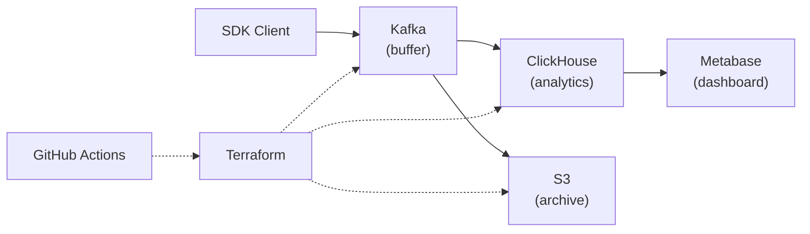

# Caso Studio — Infrastructure & Data Ops

> **Scenario:** Una scale-up (Series B, 50 dipendenti) deve costruire un'infrastruttura dati scalabile per supportare 10M eventi/giorno.

## 1. Requisiti

| Requisito | Specifica |
|:---|:---|
| Volume | 10M eventi/giorno → 300M/mese |
| Latenza | Dashboard aggiornate ogni 5 minuti |
| Costo | Budget infra: €3K/mese |
| Team | 1 data engineer, 1 analyst |
| Disponibilità | 99.9% uptime |

## 2. Architettura Scelta

### Stack Selezionato

| Componente | Tool | Costo/mese |
|:---|:---|:---:|
| Streaming | Kafka (Confluent Cloud Basic) | €200 |
| Analytics DB | ClickHouse Cloud (Dev) | €300 |
| Storage | AWS S3 | €50 |
| Dashboard | Metabase (self-hosted) | €0 |
| IaC | Terraform | €0 |
| CI/CD | GitHub Actions | €0 |
| Monitoring | Grafana Cloud (free tier) | €0 |
| **Totale** | | **€550/mese** |

## 3. Risultati dopo 6 Mesi

| Metrica | Obiettivo | Risultato |
|:---|:---:|:---:|
| Uptime | 99.9% | 99.95% |
| Latenza query p95 | meno di 5s | 2.1s |
| Costo/mese | €3K | €550 |
| Deploy time | meno di 30 min | 8 min |
| Incidenti gravi | 0 | 0 |

## Lezioni
1. Start small: ClickHouse Dev tier gestisce 10M eventi/giorno senza problemi
2. Kafka come buffer protegge ClickHouse da spike di traffico
3. Terraform + GitHub Actions = infrastruttura riproducibile dal giorno 1
