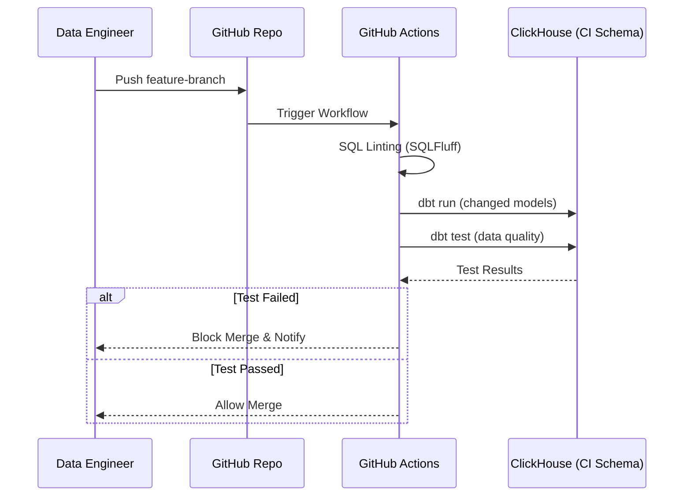
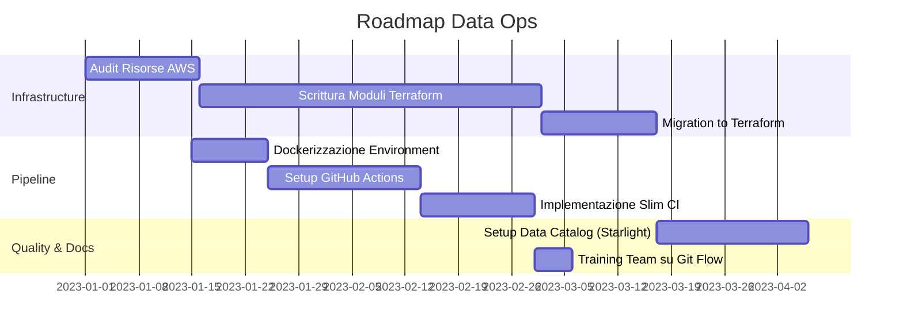
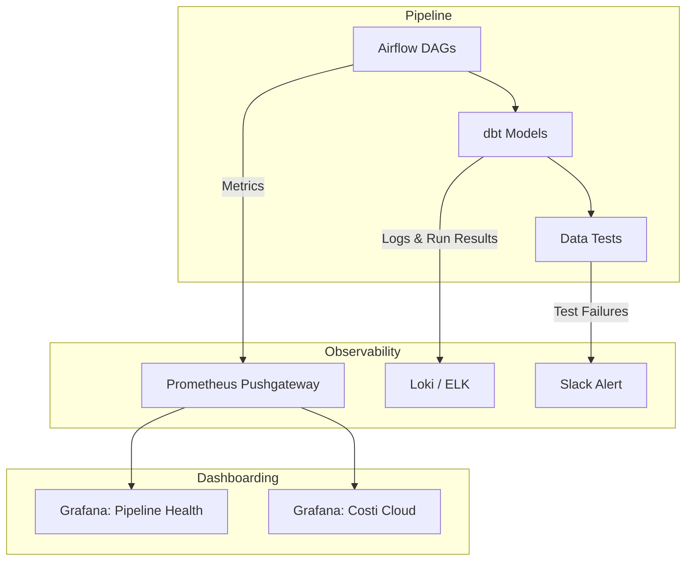

## Contesto Aziendale

**Azienda:** *ScaleUp Data Inc.* (nome fittizio)
**Settore:** B2B SaaS Analytics
**Team Dati:** 10 Data Engineer/Analytics Engineer
**Stack:** AWS, ClickHouse, dbt, Airflow

Il team dati è cresciuto rapidamente, ma i processi sono rimasti artigianali. I deployment vengono fatti manualmente lanciando comandi dal laptop del Lead Engineer. Spesso, una modifica a una vista rompe una dashboard critica perché nessuno ha testato le dipendenze.
I costi cloud sono fuori controllo: nessuno sa perché la bolletta AWS è raddoppiata in 3 mesi.

### Dati Iniziali

| Metrica | Situazione Attuale | Obiettivo | Note |
| :--- | :--- | :--- | :--- |
| **Deployment Failure Rate** | 25% | < 2% | Una release su 4 rompe qualcosa |
| **Tempo di Ripristino (MTTR)** | 4-6 ore | < 15 minuti | Rollback manuale lento |
| **Costo Cloud Mensile** | €15.000 | €9.000 | Risorse orfane e sovradimensionate |
| **Coverage Documentazione** | 5% | 100% (Core Models) | Conoscenza tribale |
| **Ambienti** | Solo Prod (e laptop) | Dev, Staging, Prod | "Sulla mia macchina funziona" |

**Problema Principale:** Mancanza di **Data Ops**. L'ingegneria dei dati è trattata come uno script usa e getta, non come un prodotto software critico.

## Obiettivi del Progetto

Il progetto "Ironclad Infrastructure" mira a:

1.  **Implementare una pipeline CI/CD completa** che esegua test automatici (dbt test) e linting SQL su ogni Pull Request.
2.  **Gestire tutta l'infrastruttura come codice (IaC)** usando Terraform per garantire riproducibilità e disaster recovery.
3.  **Ridurre i costi del 40%** identificando sprechi e implementando policy di auto-scaling e spot instances.
4.  **Monitorare la salute della pipeline** definendo SLI (Indicatori) e SLO (Obiettivi) chiari per la freschezza dei dati.

## Analisi e Strategia

### 1. Infrastructure as Code (Terraform)
Basta cliccare nella console AWS. Definiremo ogni risorsa (bucket S3, cluster ClickHouse, istanze EC2 per Airflow) in file `.tf`.
*   **Beneficio:** Versionamento dell'infrastruttura. Possiamo distruggere e ricreare l'ambiente di Staging in 10 minuti.

### 2. CI/CD con GitHub Actions
Adotteremo il "Git Flow". Nessuno pusha in `main`.
*   **PR Open:** Parte la CI. Linta il codice SQL, costruisce un ambiente temporaneo (schema isolato), esegue `dbt run` e `dbt test` solo sui modelli modificati (Slim CI).
*   **Merge:** Deploy in Staging.
*   **Tag Release:** Deploy in Produzione.

### 3. Cost Management
Analizzeremo i costi con Tagging rigoroso.
*   *Storage:* Spostamento dati freddi su S3 Glacier.
*   *Compute:* Uso di Spot Instances per i worker di Airflow che gestiscono job non critici.

### Diagramma Pipeline CI/CD

**Decisioni Chiave:**
*   **Slim CI:** Non possiamo ricostruire l'intero Warehouse (TB di dati) a ogni commit. Useremo la feature `state:modified` di dbt per testare solo ciò che è cambiato.
*   **Blue/Green Deployment:** Per i servizi critici (API), terremo due ambienti paralleli per azzerare il downtime durante il deploy.

## Implementazione

### Timeline (Semestrale)

### Dati Intermedi: Report Ottimizzazione Costi

Dopo aver importato l'infrastruttura in Terraform, abbiamo scoperto:

| Voce di Costo | Spreco Rilevato | Azione | Risparmio Mensile |
| :--- | :--- | :--- | :--- |
| **EC2 (Airflow)** | Istanze m5.2xlarge sempre accese | Auto-scaling group (min 1, max 10) | €800 |
| **EBS Volumes** | Volumi orfani non attaccati | Script di pulizia automatica | €200 |
| **S3 Storage** | Log vecchi di 3 anni in Standard | Lifecycle Policy -> Glacier | €1.500 |
| **ClickHouse** | Query non ottimizzate (scan completo) | Aggiunta indici e Materialized Views | €3.000 (Compute) |

**Problema Incontrato:** Resistenza culturale. I Data Scientist non volevano usare Git e preferivano i Notebook.
**Soluzione:** Integrazione dei Notebook nella CI/CD (convertendoli in script eseguibili) e sessioni di pair programming.

## Risultati

L'infrastruttura è ora stabile, documentata e meno costosa.

### KPI Prima vs Dopo

| KPI | Prima (T0) | Dopo (T6) | Variazione |
| :--- | :--- | :--- | :--- |
| **Deployment** | 1/settimana (con paura) | 5/giorno (con fiducia) | +2400% |
| **Costo AWS** | €15.000 | €8.500 | -43% |
| **Data Freshness SLO** | 90% (spesso in ritardo) | 99.9% (Alerting proattivo) | Obiettivo Raggiunto |
| **Onboarding Nuovi Assunti**| 3 settimane | 2 giorni (Docs + Terraform) | -90% |

### Analisi ROI

Il progetto ha richiesto 3 mesi di lavoro di 2 Senior Engineer (€60k costo opportunità).
Il risparmio cloud annualizzato è di €78.000.
Il risparmio in produttività (meno tempo a fixare bug) è stimato in €100.000/anno.
**ROI Primo Anno:** 196%

### Visualizzazione Stack di Monitoraggio

## Lezioni Apprese

1.  **L'automazione libera creatività:** Meno tempo passato a fare deploy manuali significa più tempo per modellare dati complessi.
2.  **I costi sono una metrica di ingegneria:** Ottimizzare una query non è solo "eleganza", è risparmio diretto di soldi.
3.  **Documentazione viva:** La documentazione che non si aggiorna da sola (tramite CI/CD) è documentazione morta.
4.  **Non ottimizzare prematuramente:** Abbiamo speso tempo a ottimizzare costi di servizi che pesavano lo 0.1% del budget. Bisogna guardare il diagramma di Pareto dei costi.
5.  **Fail Fast:** Meglio che la pipeline fallisca in PR (Pull Request) piuttosto che svegliare qualcuno alle 3 di notte perché la produzione è rotta.

## Domande di Discussione

1.  Come gestiresti i dati sensibili (password DB, chiavi API) in un repository Terraform pubblico o condiviso?
2.  Qual è il punto di pareggio tra "costruire una piattaforma dati interna" (Self-hosted) e usare soluzioni SaaS gestite (es. dbt Cloud, Snowflake)?
3.  In che modo l'implementazione di SLI/SLO cambia il rapporto tra il team dati e i business stakeholder?
4.  Come garantire che i test automatici coprano non solo la sintassi SQL ma anche la logica di business (es. "il fatturato non può essere negativo")?
5.  Quali sono le sfide di gestire lo "state" di Terraform in un team distribuito e come le risolveresti?

**Cosa faresti diversamente?**
*   *Se fossimo su Cloudfare:* Avrei usato Cloudflare R2 invece di S3 per azzerare i costi di Egress (uscita dati).
*   *Se il team fosse solo SQL-based:* Avrei spinto di più su dbt Cloud invece di costruire una CI custom con GitHub Actions, per ridurre la complessità di manutenzione.
