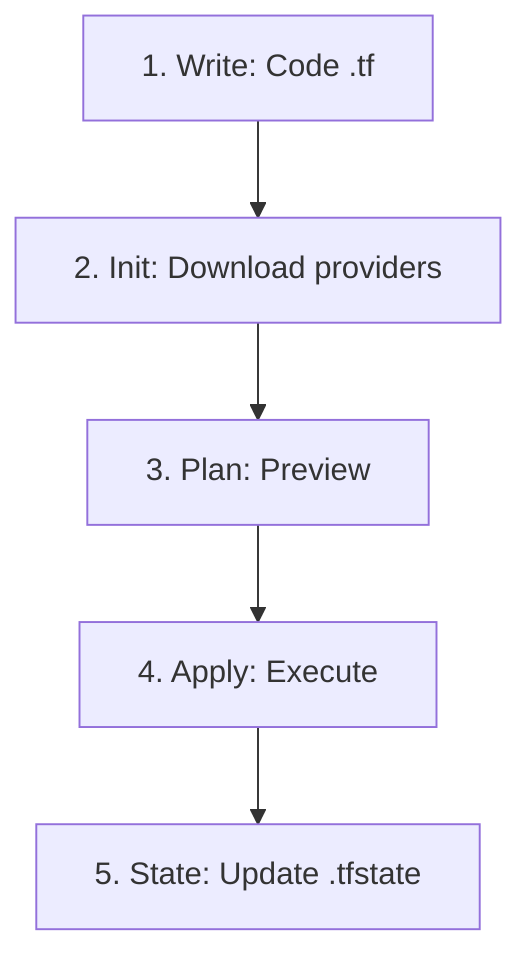

## Concetti Chiave

- **IaC (Infrastructure as Code)**: Gestire server e risorse tramite codice (es. Terraform) invece che manualmente. Permette versionamento e replicabilità.
- **CI/CD**: *Continuous Integration* (test automatici a ogni commit) e *Continuous Deployment* (rilascio automatico in produzione).
- **Immutability**: Non modificare mai un server acceso. Se devi cambiare qualcosa, distruggi il server e ricrealo aggiornato.
- **Observability**: Capire lo stato interno del sistema guardando solo gli output esterni (Logs, Metrics, Traces).
- **SLI / SLO / SLA**:
    - *Indicator*: Cosa misuro (es. latenza).
    - *Objective*: Il target interno (es. < 200ms nel 99% dei casi).
    - *Agreement*: Il contratto legale con il cliente (se fallisco, pago penale).
- **Idempotenza**: Eseguire un'operazione più volte produce lo stesso risultato della prima volta (essenziale per Ansible/Terraform).
- **GitOps**: Usare Git come "Single Source of Truth". Ogni modifica all'infrastruttura avviene tramite Pull Request.

## Metriche SRE

| Metrica | Formula | Significato |
|---------|---------|-------------|
| **Availability** | `Uptime / (Uptime + Downtime)` | La percentuale di tempo in cui il servizio è disponibile (es. 99.9%). |
| **Error Budget** | `100% - SLO` | Quanto "tempo di disservizio" ci possiamo permettere prima di bloccare i rilasci. |
| **MTTR** | `Mean Time To Recovery` | Tempo medio per riparare un guasto. Metrica chiave per la resilienza. |
| **MTBF** | `Mean Time Between Failures` | Tempo medio tra due guasti. Indica l'affidabilità. |
| **Burn Rate** | `Error Rate Attuale / Error Rate Concesso` | Velocità con cui stiamo consumando l'Error Budget. |

## Framework e Modelli

### The 4 Golden Signals (Google SRE)
Cosa monitorare in qualsiasi sistema distribuito.

1.  **Latency**: Quanto tempo impiega una richiesta (successo vs errore).
2.  **Traffic**: Quanta domanda c'è sul sistema (req/sec, I/O).
3.  **Errors**: Tasso di richieste fallite (HTTP 500, eccezioni).
4.  **Saturation**: Quanto è "pieno" il sistema (CPU, RAM, Disk I/O).

### Incident Response Cycle
Cosa fare quando tutto crolla.

```mermaid
flowchart TD
    Detect[Rilevamento<br/>(Alert scatta)] --> Triage[Triage<br/>(Gravità P1-P3)]
    Triage --> Diagnose[Diagnosi<br/>(Log, Grafici)]
    Diagnose --> Mitigate[Mitigazione<br/>(Rollback, Riavvio)]
    Mitigate --> Resolve[Risoluzione<br/>(Fix definitiva)]
    Resolve --> PostMortem[Post-Mortem<br/>(Analisi cause)]
```

## Processo Step-by-Step: Terraform Workflow

1.  **Write**: Scrivi la configurazione in file `.tf` (es. definisci una istanza EC2).
2.  **Init**: `terraform init` scarica i provider (AWS, Google) necessari.
3.  **Plan**: `terraform plan` mostra cosa succederà *senza* farlo. (Essenziale per la review).
4.  **Apply**: `terraform apply` esegue le modifiche reali sull'infrastruttura cloud.
5.  **State**: Terraform aggiorna il file `terraform.tfstate` che mappa le risorse reali al codice.



## Errori da Evitare

-   ❌ **ClickOps** → ✅ Configurare i server a mano dalla console AWS. Non è riproducibile. Usa Terraform.
-   ❌ **Segreti in Git** → ✅ Committare password o API Key nel codice. Usa variabili d'ambiente o Secret Manager.
-   ❌ **Alert Fatigue** → ✅ Avere 1000 alert che suonano sempre. Alla fine li ignorerai tutti. Configura alert solo su sintomi che richiedono azione umana immediata.
-   ❌ **Nessun Resource Limit** → ✅ Lanciare container senza limiti di CPU/RAM. Un bug può mandare in crash l'intero cluster.
-   ❌ **Ottimizzazione Prematura dei Costi** → ✅ Perdere giorni per risparmiare 5€ su un server di sviluppo. Focalizzati prima sui grossi sprechi (es. istanze orfane).

## Quick Reference

| Strumento | A cosa serve | Quando usarlo |
|-----------|--------------|---------------|
| **Terraform** | IaC (Provisioning) | Creare risorse cloud (VPC, DB, VM) via codice. |
| **Docker** | Containerization | Pacchettizzare l'app con le sue dipendenze. |
| **Kubernetes** | Orchestration | Gestire container su larga scala in produzione. |
| **Prometheus** | Monitoring (Metrics) | Raccogliere metriche numeriche (serie temporali). |
| **Grafana** | Visualization | Creare dashboard dai dati di Prometheus/Loki. |
| **GitHub Actions** | CI/CD | Automatizzare test e deploy direttamente da GitHub. |
| **AWS Cost Explorer** | FinOps | Analizzare dove vanno i soldi nel cloud. |
