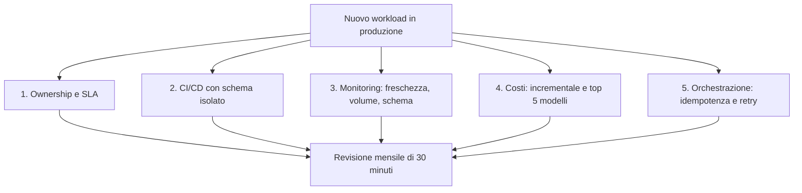

## La revisione di 30 minuti che ha dimezzato le notti di reperibilità

Caso ricostruito con numeri di esempio su un team dati italiano di quattro persone. Per un trimestre il team registra 20 incidenti fuori orario, quasi tutti per la stessa famiglia di cause: modifiche urgenti rilasciate senza passare dalla CI, alert senza responsabile, modelli che continuano a ricostruire per intero tabelle diventate enormi. La spesa cloud del trimestre è di 20.000 euro. Il team introduce una revisione mensile di 30 minuti guidata da una scheda con cinque domande, sempre le stesse. Nel trimestre successivo gli incidenti fuori orario scendono a 6 e la spesa a 13.000 euro.

Questa pagina è quella scheda. Non spiega i concetti da zero, per quello ci sono le lezioni del modulo, ma raccoglie in un posto solo le regole, le metriche e i controlli da applicare a ogni pipeline o tabella prima di metterla in produzione e a ogni revisione periodica.

> **Idea chiave:** Cinque verifiche ripetute con regolarità, su ownership, deploy, monitoring, costi e orchestrazione, prevengono più incidenti di qualsiasi strumento aggiuntivo, perché i guasti ricorrenti nascono quasi sempre dagli stessi cinque punti trascurati.

## La mappa dei cinque pilastri

Ogni pipeline in produzione si regge su cinque requisiti minimi. Il primo è un proprietario nominato con uno SLA scritto: senza qualcuno che risponde della freschezza di una tabella, ogni guasto diventa un problema di nessuno. Il secondo è un percorso di deploy isolato: tutto passa da una pull request e da uno schema temporaneo. Il terzo è l'osservabilità: controlli automatici su freschezza, volume e schema, con alert che dicono a chi tocca intervenire. Il quarto è il controllo dei costi: elaborazione incrementale per le tabelle che crescono e una revisione periodica dei modelli più cari. Il quinto è l'orchestrazione affidabile: task idempotenti, sensor al posto degli orari stimati e limiti di concorrenza per i ricalcoli.



| Pilastro | Regola | Metrica da seguire | Controllo minimo |
| :--- | :--- | :--- | :--- |
| Ownership e SLA | Un nome per ogni tabella critica | Ritardo rispetto allo SLA in minuti | Prova di ripristino ogni trimestre |
| CI/CD | Nessun deploy senza pull request | Tasso di rollback dopo il deploy | Slim CI in uno schema `pr_<numero>` |
| Monitoring | Solo alert azionabili con runbook | Falsi positivi sotto il 10% | Freschezza, volume (z-score), schema |
| Costi | Incrementale sui modelli storici | Costo per modello e per GB letto | I cinque modelli più cari ogni mese |
| Orchestrazione | Task idempotenti con sensor | Durata al 95° percentile, failure rate | `max_active_runs` e backoff dei retry |

## La checklist come file versionato nel repository

Una scheda in un documento condiviso invecchia in fretta. Se la checklist vive nel repository, accanto al codice, viene aggiornata nelle stesse pull request che cambiano la pipeline, e la CI può controllare che ogni nuovo workload ne contenga una compilata. Un formato semplice è un file YAML per workload, con le cinque aree e un campo per lo stato.

```yaml
# ops/checklist/fact_ordini.yml - scheda operativa del workload, compilata prima del rilascio
workload: fact_ordini
owner: "giulia.rinaldi"            # una persona, non un gruppo generico
sla_freshness_minutes: 60
runbook: "docs/runbook/fact_ordini.md"
checks:
  ci_cd:
    pull_request_required: true
    slim_ci_schema: "pr_<numero>"
    rollback_tested_on: 2026-10-14
  monitoring:
    freshness_alert: true
    volume_zscore_threshold: 3
    schema_change_alert: true
  cost:
    materialization: incremental   # dopo i 5 milioni di righe niente full refresh
    in_top5_cost_review: true
  orchestration:
    idempotent_write: true
    retries: 3
    max_active_runs: 1
```

Il valore sta nei campi più che nel formato. `owner` obbliga a scrivere un nome. `rollback_tested_on` dà una data: se risale a più di tre mesi, la riga è da rifare. `idempotent_write` costringe a rispondere a una domanda che spesso si evita, cioè cosa succede se il task viene eseguito due volte.

Un breve script bash, eseguibile in CI o a mano, controlla che ogni scheda abbia i campi obbligatori e che nessuna prova di rollback sia scaduta.

```bash
# scripts/check_checklist.sh - verifica campi obbligatori e prova di rollback recente (max 90 giorni)
set -euo pipefail
OGGI=$(date +%s)
for f in ops/checklist/*.yml; do
  for campo in owner sla_freshness_minutes runbook; do
    grep -q "^${campo}:" "$f" || { echo "ERRORE $f: manca $campo"; exit 1; }
  done
  data=$(grep "rollback_tested_on" "$f" | awk '{print $2}')
  giorni=$(( (OGGI - $(date -d "$data" +%s)) / 86400 ))
  [ "$giorni" -le 90 ] || { echo "ERRORE $f: rollback non provato da $giorni giorni"; exit 1; }
done
echo "checklist valide"
```

## Quanto rende la revisione mensile: un calcolo svolto

La revisione ha un costo e un ritorno, e conviene scriverli. Il costo è il tempo di quattro persone per 30 minuti a revisione, per tre revisioni a trimestre: 4 × 0,5 ore × 3 = 6 ore. A un costo orario interno di 50 euro, sono 6 × 50 = 300 euro a trimestre.

Il ritorno ha due voci. Gli incidenti fuori orario scendono da 20 a 6, quindi 14 incidenti in meno, cioè il 70% di riduzione (14 / 20 = 0,70). Se ogni incidente costa in media 2 ore di una persona a 50 euro l'ora, ciascuno vale 100 euro, e 14 incidenti evitati valgono 14 × 100 = 1.400 euro. La spesa cloud passa da 20.000 a 13.000 euro: la differenza è 7.000 euro, il 35% in meno (7.000 / 20.000 = 0,35).

Il ritorno totale è 1.400 + 7.000 = 8.400 euro contro un costo di 300 euro. Il rapporto è 8.400 / 300 = 28 volte. Il calcolo trascura il disagio delle notti di reperibilità e il tempo recuperato per lavoro di valore, che sono reali ma difficili da quantificare. Il punto è l'ordine di grandezza: anche dimezzando il beneficio stimato, la revisione si ripaga con ampio margine.

Va detto con onestà che i numeri sono di esempio e che parte del beneficio dipende da cosa si decide in revisione, non dalla riunione in sé. L'incontro funziona se produce azioni con un responsabile e una data, per esempio convertire in incrementali due modelli o aggiungere un runbook a un alert, altrimenti diventa un rito.

## Cosa guardare ogni lunedì in cinque minuti

Il controllo settimanale è più leggero di quello mensile. Basta una vista che riassuma la freschezza delle tabelle critiche, gli alert scattati con l'esito e la spesa cumulata rispetto al budget. Se tutte le tabelle rientrano nello SLA, i falsi positivi stanno sotto il 10% e il costo è nella soglia, la settimana si dedica allo sviluppo.

Un esempio numerico di lettura. Le tabelle critiche sono 12 e 11 rispettano lo SLA: la conformità è 11 / 12 ≈ 92%. Nella settimana sono scattati 15 alert, di cui 2 falsi: il tasso è 2 / 15 ≈ 13%, sopra la soglia del 10%, quindi la priorità è calibrare le soglie e non aggiungere nuovi controlli. La spesa a metà mese è di 6.400 euro su un budget di 13.000: 6.400 / 13.000 ≈ 49%, in linea con il 50% del tempo trascorso. Tre numeri, tre decisioni.

## Errori operativi che si ripetono

### Rilasciare solo una piccola fix saltando CI e staging

Sintomo: il guasto più grave del trimestre nasce da una modifica di due righe fatta in produzione per chiudere un'urgenza. Succede perché l'urgenza fa sembrare i controlli un costo. Si risolve con una regola senza eccezioni: più la modifica è urgente, più importa la pull request, perché lo schema isolato richiede minuti e un errore in produzione richiede ore.

### Accumulare alert senza proprietario né procedura

Sintomo: il canale degli avvisi ha 300 messaggi non letti e nessuno li apre. Succede perché ogni controllo nuovo viene aggiunto senza chiedersi chi interviene. Si risolve con la regola che un alert esiste solo se ha un owner e un link a un runbook, e con la potatura mensile degli alert che non hanno mai portato a un'azione.

### Lasciare i modelli in full refresh finché diventano enormi

Sintomo: un modello che a gennaio girava in 10 secondi a ottobre impiega 9 minuti e compare tra i più costosi in fattura. Succede perché la crescita è graduale e il costo non ha un segnale. Si risolve rivedendo ogni mese i cinque modelli più costosi e convertendo in incrementali quelli che superano una soglia di righe o di durata.

## Dove tornare per i dettagli

Questa scheda richiama cinque lezioni del modulo. Per i pilastri e i costi di base c'è la lezione sull'infrastruttura dati moderna; per il percorso di deploy quella sulla CI/CD per pipeline dati; per freschezza, volume e schema quella su monitoring e alerting; per la riduzione della spesa quella sulla gestione dei costi; per sensor, retry e backfill quella su Airflow, Prefect e Dagster. Il progetto finale applica tutto insieme su un caso completo.

## Verifica sulla tua piattaforma

1. Una tabella critica non ha un owner nominato. Quale dei cinque pilastri viola e quale effetto pratico ti aspetti al primo guasto?

<details>
<summary>Mostra risposta</summary>

Viola il pilastro ownership e SLA. Al primo guasto nessuno si sente responsabile del ripristino, l'alert viene ignorato o rimbalzato tra persone, e il tempo di rilevazione e correzione si allunga. La soluzione è un nome nel campo `owner` della checklist e uno SLA di freschezza scritto.

</details>

2. Il lunedì risultano 20 alert, di cui 4 falsi positivi. La soglia accettata è il 10%. Che cosa decidi?

<details>
<summary>Mostra risposta</summary>

Il tasso è 4 / 20 = 20%, il doppio della soglia. La priorità della settimana è calibrare o eliminare gli alert rumorosi, per esempio alzando la soglia dello z-score o raggruppando gli avvisi, prima di aggiungere nuovi controlli.

</details>

3. Una revisione mensile costa 6 ore di lavoro a trimestre a 50 euro l'ora e porta 2.000 euro di risparmio sul cloud. Qual è il rapporto tra ritorno e costo?

<details>
<summary>Mostra risposta</summary>

Il costo è 6 × 50 = 300 euro. Il rapporto è 2.000 / 300 ≈ 6,7 volte. Anche senza contare gli incidenti evitati, la revisione si ripaga.

</details>

4. Perché `idempotent_write: true` nella checklist è una domanda più utile di un semplice controllo dei retry?

<details>
<summary>Mostra risposta</summary>

I retry senza idempotenza trasformano un errore transitorio in dati duplicati. Rispondere a `idempotent_write` obbliga a verificare cosa succede se il task gira due volte, che è esattamente ciò che fanno i retry e i backfill.

</details>
