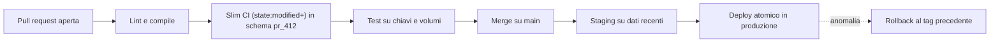

## Il join che raddoppiò il fatturato mostrato al consiglio

Caso ricostruito con numeri di esempio su un team analytics italiano. Un analista deve escludere dal modello dei ricavi gli ordini annullati. Modifica il filtro direttamente sulla vista di produzione e, per recuperare lo stato di pagamento, aggiunge un join con la tabella dei pagamenti. Ogni ordine ha in media due righe di pagamento (acconto e saldo), quindi il join moltiplica le righe: la query che ieri restituiva 10.000 ordini e 480.000 euro di fatturato ora restituisce 20.000 righe e 960.000 euro. La dashboard si aggiorna alle 7:00 e alle 9:00 il consiglio di amministrazione discute un fatturato doppio.

La modifica era corretta nelle intenzioni e sbagliata nella forma, ma il vero problema è un altro: nessun meccanismo ha costretto la modifica a incontrare dati reali prima di arrivare agli utenti. Nel software questo meccanismo esiste da decenni e si chiama integrazione continua. Per i dati si adatta con qualche accorgimento, perché il risultato di una trasformazione non è un programma da avviare ma una tabella da riempire.

> **Idea chiave:** Ogni modifica a un modello SQL o a un DAG deve passare da una pull request, essere eseguita in uno schema isolato su dati reali e superare test automatici sulle chiavi e sui volumi prima di toccare le tabelle che leggono gli utenti.

## Le tre fasi di una pipeline CI/CD per i dati

Una pipeline per i dati si articola in tre momenti. Nella fase di integrazione continua, che scatta all'apertura o all'aggiornamento della pull request, il sistema esegue il controllo di stile sull'SQL, compila il progetto e costruisce solo i modelli modificati e i loro discendenti, dentro uno schema temporaneo dedicato a quella pull request. Nella fase di staging, dopo il merge sul ramo principale, la modifica gira su dati recenti completi, con controlli sul numero di righe e sull'unicità delle chiavi. Nella fase di deploy, il rilascio in produzione avviene in modo atomico oppure su una frazione dei dati (canarino), con la versione precedente sempre pronta al ripristino.



Ogni freccia è un punto in cui la modifica può essere fermata, e ogni arresto avviene lontano dagli utenti. Il costo di un errore cresce a ogni passaggio verso destra: un join moltiplicativo trovato nello schema `pr_412` costa un commento sulla pull request, lo stesso errore trovato dal consiglio di amministrazione costa fiducia.

| Fase | Quando scatta | Cosa verifica | Se fallisce |
| :--- | :--- | :--- | :--- |
| Lint e compile | Ogni commit su un ramo | Sintassi SQL, riferimenti, YAML | La pull request non può essere unita |
| Slim CI | Apertura o aggiornamento della pull request | Build e test dbt nello schema isolato | Errore segnalato su GitHub |
| Staging | Merge sul ramo principale | Righe, null e duplicati su dati recenti | Il deploy in produzione si ferma |
| Deploy | Approvazione dopo staging | Aggiornamento atomico, pulizia schemi | Ripristino del tag precedente |

## Slim CI: costruire solo ciò che è cambiato

Il comando `dbt build` esegue modelli e test nell'ordine del grafo. In un progetto con centinaia di modelli, ricostruirli tutti a ogni pull request è lento e costoso. La selezione `state:modified+` confronta il progetto corrente con il `manifest.json` dell'ultimo deploy di produzione e seleziona solo i modelli cambiati e i loro discendenti. L'opzione `--defer` permette ai modelli selezionati di leggere gli upstream non ricostruiti direttamente dalle tabelle di produzione, evitando di replicarli nello schema della pull request.

Il workflow seguente scarica il manifest di produzione, crea uno schema `pr_<numero>` e lancia la build incrementale. Il file vive in `.github/workflows/dbt-ci.yml`.

```yaml
# .github/workflows/dbt-ci.yml - Slim CI per dbt su ogni pull request
name: dbt-ci
on:
  pull_request:
    paths: ["models/**", "macros/**", "dbt_project.yml"]

concurrency:
  group: dbt-ci-${{ github.event.pull_request.number }}
  cancel-in-progress: true          # un nuovo push annulla la build precedente

jobs:
  slim-ci:
    runs-on: ubuntu-latest
    timeout-minutes: 20
    env:
      DBT_SCHEMA: pr_${{ github.event.pull_request.number }}   # schema isolato per la PR
      DBT_PROFILES_DIR: ./ci
    steps:
      - uses: actions/checkout@v4
      - uses: actions/setup-python@v5
        with:
          python-version: "3.12"
      - run: pip install -r requirements.txt
      - name: Scarica il manifest di produzione
        run: aws s3 cp s3://dati-ci/prod/manifest.json ./prod-manifest/manifest.json
      - name: Lint SQL
        run: sqlfluff lint models --dialect postgres
      - name: Build dei soli modelli modificati
        run: dbt build --select state:modified+ --defer --state ./prod-manifest --fail-fast
```

Alcuni dettagli contano più di quanto sembri. `concurrency` con `cancel-in-progress` evita che dieci push consecutivi lancino dieci build in parallelo sullo stesso schema. `timeout-minutes` impedisce che una query bloccata consumi ore di crediti. `paths` limita il workflow ai file che contano: una modifica al README non deve costare minuti di warehouse.

Lo schema temporaneo va eliminato quando la pull request si chiude. Un secondo workflow, attivato dall'evento `closed`, lo rimuove, e uno script bash lo rende indipendente dal numero di tabelle contenute.

```bash
# scripts/drop_pr_schema.sh - elimina lo schema isolato quando la PR viene chiusa o unita
set -euo pipefail
PR_NUMBER="$1"
psql "$WAREHOUSE_URL" -v ON_ERROR_STOP=1 -c "DROP SCHEMA IF EXISTS pr_${PR_NUMBER} CASCADE;"
echo "schema pr_${PR_NUMBER} rimosso"
```

## Quanto si risparmia: tempi e costi di CI con numeri

Prendiamo un progetto dbt di 400 modelli, con un tempo medio di 6 secondi per modello e un warehouse che costa 12 euro all'ora di calcolo attivo. Una build completa dura 400 × 6 s = 2.400 s, cioè 40 minuti, e costa 40 / 60 × 12 = 8 euro per esecuzione. Il team apre in media 30 pull request a settimana, quindi la CI completa costa 30 × 8 = 240 euro a settimana e blocca ogni sviluppatore per 40 minuti a ogni push.

Con Slim CI, una pull request tipica modifica 12 modelli, che hanno 18 discendenti. I modelli selezionati sono 12 + 18 = 30. Il tempo scende a 30 × 6 s = 180 s, cioè 3 minuti, e il costo a 3 / 60 × 12 = 0,60 euro per esecuzione. A settimana si spendono 30 × 0,60 = 18 euro invece di 240: il risparmio è 240 − 18 = 222 euro, pari al 92,5%, e il tempo di attesa per lo sviluppatore passa da 40 a 3 minuti, con una riduzione di 37 minuti per push.

Il costo dei test aggiuntivi nello schema isolato va conteggiato. Se ogni pull request esegue anche 25 test di unicità e volume da 2 secondi ciascuno, si aggiungono 50 s, cioè meno di un minuto e circa 0,17 euro: la CI completa resta a 3,8 minuti e 0,77 euro circa per esecuzione, sempre dieci volte meno della build intera. Il risparmio non deve essere pagato con una copertura peggiore: la selezione per stato modificato include i test dei discendenti proprio per questo.

## Test che avrebbero fermato il join moltiplicativo

Un test efficace per il caso d'apertura controlla due cose: che la chiave dell'ordine sia unica e che il numero di righe non cambi in modo anomalo rispetto alla produzione. In dbt la prima si dichiara nel file YAML dei modelli.

```yaml
# models/marts/schema.yml - test dichiarativi sulle chiavi del modello dei ricavi
version: 2
models:
  - name: fact_ordini
    columns:
      - name: order_id
        tests:
          - unique        # intercetta il join moltiplicativo
          - not_null
      - name: importo_eur
        tests:
          - not_null
    tests:
      - dbt_utils.equal_rowcount:
          compare_model: ref('fact_ordini_prod_snapshot')
          # fallisce se il conteggio righe differisce dalla produzione
```

Nel caso del join con i pagamenti, la tabella nello schema `pr_412` avrebbe 20.000 righe e 10.000 valori distinti di `order_id`: il test `unique` segnala 10.000 duplicati e blocca la pull request. Il test sul conteggio righe avrebbe ottenuto lo stesso risultato con un confronto 20.000 contro 10.000, uno scarto del 100% rispetto a una soglia che dovrebbe essere dell'ordine di pochi punti percentuali.

Per i DAG Airflow la logica analoga è il test di importazione. Un errore di sintassi o un import mancante in un DAG non appare finché lo scheduler non lo carica, spesso in produzione. In CI si carica la cartella dei DAG con `DagBag` e si verifica che l'elenco degli errori di importazione sia vuoto.

```python
# tests/test_dag_integrity.py - esegue il parsing di tutti i DAG e fallisce se ce n'è uno rotto
from airflow.models import DagBag


def test_nessun_errore_di_import():
    dag_bag = DagBag(dag_folder="dags/", include_examples=False)
    assert dag_bag.import_errors == {}, f"DAG non caricabili: {dag_bag.import_errors}"


def test_ogni_dag_ha_owner_e_retry():
    dag_bag = DagBag(dag_folder="dags/", include_examples=False)
    for dag_id, dag in dag_bag.dags.items():
        assert dag.default_args.get("owner"), f"{dag_id}: owner mancante"
        assert dag.default_args.get("retries", 0) >= 1, f"{dag_id}: nessun retry configurato"
```

Il secondo test trasforma una convenzione di team in una regola verificata: un DAG senza owner o senza retry non supera la CI. Per la logica di trasformazione pura conviene estrarre funzioni Python indipendenti da Airflow e testarle con `pytest` su piccoli fixture locali, senza avviare scheduler né connessioni.

## Staging, canarino e rollback atomico

Dopo il merge, la modifica passa in staging. Qui i dati sono quelli recenti e completi, e i controlli diventano quantitativi: il numero di righe del giorno deve stare entro una banda attesa, le chiavi devono restare uniche, i valori nulli sulle colonne critiche devono essere zero. Il deploy in produzione può essere atomico, scambiando lo schema nuovo con quello vecchio in una sola operazione, oppure canarino: la nuova logica gira per una frazione dei dati, per esempio il 10% dei clienti, e solo se i controlli reggono viene estesa al 100%.

Il rollback deve essere un comando, non un'operazione artigianale. Con deploy basati su tag Git, tornare indietro significa rieseguire la pipeline sul tag precedente e, per le tabelle, ripristinare lo schema precedente conservato.

```bash
# scripts/rollback.sh - torna al tag di produzione precedente e riesegue il deploy
set -euo pipefail
TAG_PRECEDENTE=$(git describe --tags --abbrev=0 HEAD~1)
echo "rollback a ${TAG_PRECEDENTE}"
git checkout "${TAG_PRECEDENTE}"
dbt build --target prod --select state:modified+ --state ./prod-manifest
# rinomina atomica: lo schema stabile vecchio torna al posto di quello nuovo
psql "$WAREHOUSE_URL" -v ON_ERROR_STOP=1 -c \
  "ALTER SCHEMA analytics RENAME TO analytics_failed; ALTER SCHEMA analytics_prev RENAME TO analytics;"
```

La rinomina di schema è una operazione di metadati e si completa in pochi secondi anche con miliardi di righe, ma funziona solo se il deploy ha conservato lo schema precedente come `analytics_prev`. Va quindi progettata insieme al deploy, non improvvisata durante l'incidente. Il tempo di ripristino va provato almeno una volta: se il rollback richiede 5 minuti, puoi promettere agli stakeholder una finestra di errore massima di 5 minuti più il tempo di rilevazione.

## Tre errori comuni nel configurare la CI per i dati

### Ricostruire l'intero warehouse a ogni pull request

Sintomo: gli sviluppatori aspettano 40 minuti per una modifica di due righe e smettono di aprire pull request piccole. Succede perché il comando completo è il più semplice da scrivere. Si risolve con `state:modified+` e `--defer`, con una finestra temporale ridotta sulle tabelle di fatto nello schema di CI (per esempio gli ultimi 7 giorni) e con un manifest di produzione aggiornato a ogni deploy.

### Eseguire la CI sullo schema di produzione

Sintomo: una pull request in bozza sovrascrive una tabella letta dalle dashboard e i numeri cambiano senza che nessuno abbia approvato nulla. Succede quando il profilo dbt della CI punta allo stesso schema del deploy. Si risolve imponendo lo schema `pr_<numero>` nel workflow, un utente di database senza permessi di scrittura sulla produzione e un controllo che fa fallire la CI se lo schema di destinazione non inizia per `pr_`.

### Non avere un rollback documentato e provato

Sintomo: un errore logico sottile supera i test sintattici, viene scoperto dopo ore e il team ricostruisce le tabelle a mano, con numeri diversi a ogni tentativo. Succede perché il rollback sembra un evento raro e quindi non viene preparato. Si risolve con uno script versionato come `rollback.sh`, lo schema precedente conservato e una prova trimestrale cronometrata.

## Controllo prima del merge su main

1. Una pull request modifica 8 modelli che hanno 22 discendenti, ciascuno da 5 secondi. Quanto dura Slim CI e quanto costa con un warehouse a 12 euro l'ora?

<details>
<summary>Mostra risposta</summary>

I modelli selezionati sono 8 + 22 = 30. Il tempo è 30 × 5 s = 150 s, cioè 2,5 minuti. Il costo è 2,5 / 60 × 12 = 0,50 euro per esecuzione.

</details>

2. Dopo un join con una tabella a più righe per ordine, `fact_ordini` ha 15.000 righe ma 9.000 valori distinti di `order_id`. Quali test falliscono e quanti duplicati segnalano?

<details>
<summary>Mostra risposta</summary>

Fallisce il test `unique` su `order_id`, che segnala 15.000 − 9.000 = 6.000 righe duplicate. Fallisce anche il confronto sul numero di righe con la produzione, se questa ne contava circa 9.000, con uno scarto di circa 67%.

</details>

3. Perché un workflow di CI deve avere `concurrency` con `cancel-in-progress` e un `timeout-minutes` esplicito?

<details>
<summary>Mostra risposta</summary>

`concurrency` evita che più push consecutivi sulla stessa pull request lancino build parallele sullo stesso schema, con costi doppi e risultati sovrapposti. `timeout-minutes` limita il danno di una query bloccata: senza soglia, il job consuma crediti di calcolo finché il runner non scade, di solito dopo ore.

</details>

4. Un deploy ha conservato lo schema precedente come `analytics_prev`. Perché il rollback tramite rinomina è rapido anche con miliardi di righe, e quale condizione deve essere vera in anticipo?

<details>
<summary>Mostra risposta</summary>

La rinomina modifica solo i metadati dello schema e non sposta dati, quindi richiede pochi secondi indipendentemente dalla dimensione. La condizione è che il deploy abbia già conservato lo schema precedente, e che il tempo di ripristino sia stato provato prima di un incidente reale.

</details>
