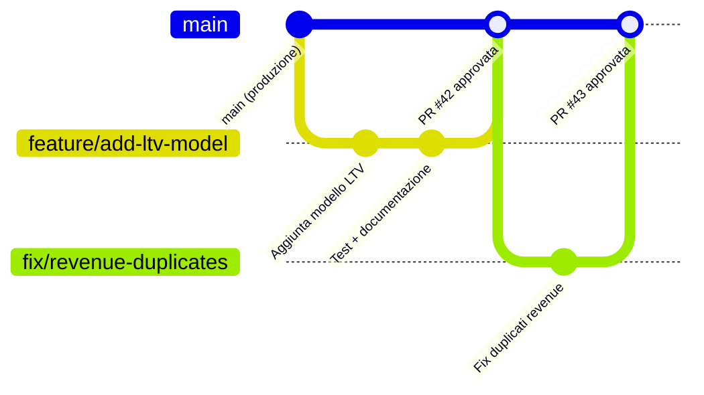
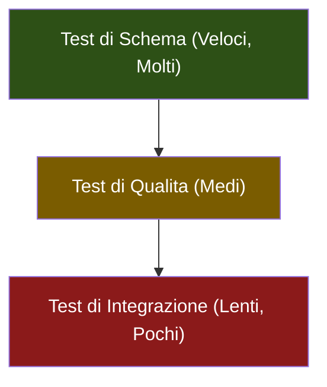
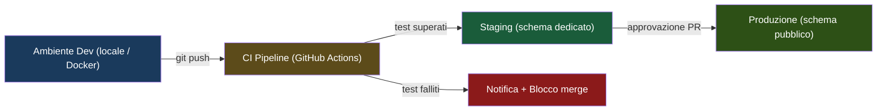
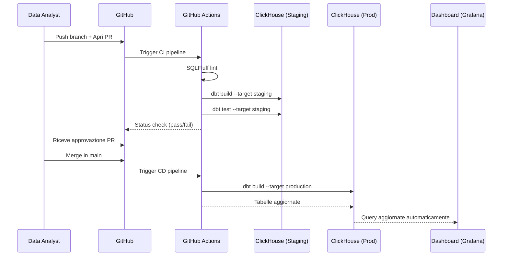

import { Aside } from '@astrojs/starlight/components'

CI/CD per i dati significa trattare query, modelli dbt e pipeline come artefatti ingegneristici che meritano test, review e deploy affidabili. Senza questo livello di disciplina, gli errori arrivano in produzione troppo facilmente e il costo di ogni cambiamento cresce nel tempo.

Questa lezione mostra come portare pratiche mature di software engineering dentro il lavoro dati, riducendo regressioni, deploy manuali e dipendenza da operazioni improvvisate.

## CI/CD for Data

Per decenni, il mondo del software engineering ha perfezionato pratiche di Continuous Integration e Continuous Deployment che hanno trasformato il modo in cui il codice viene scritto, testato e rilasciato. Il mondo dei dati, storicamente, ha operato in modo molto diverso: query SQL copiate e incollate, trasformazioni eseguite manualmente, modelli aggiornati "a mano" in produzione e nessuna tracciabilita delle modifiche.

Questa lezione affronta un cambio di paradigma: trattare il codice dati (SQL, dbt models, pipeline definitions) con lo stesso rigore del codice applicativo. Non si tratta di un esercizio accademico, ma di una necessita operativa per qualsiasi team dati che voglia scalare senza sacrificare qualita e affidabilita.

> **Consiglio:**
> Se gestisci più di 10 modelli dbt o più di 3 pipeline in produzione, l'assenza di CI/CD non è una scelta: e un debito tecnico che cresce ogni giorno.

## 1. Perché il CI/CD e Cruciale per i Team Dati

### Il Problema: Data Downtime

Il "data downtime" -- periodi in cui i dati sono incompleti, errati o non disponibili -- costa alle aziende in media 15 milioni di dollari l'anno (fonte: Monte Carlo, State of Data Quality 2023). Le cause principali sono:

| Causa | Frequenza | Impatto |
|-------|-----------|---------|
| Schema change non comunicato | Alta | Dashboard rotte, metriche errate |
| Query SQL con bug deployata in produzione | Media | Decisioni basate su dati sbagliati |
| Pipeline fallita senza alerting | Alta | Dati stale, report mancanti |
| Modello dbt modificato senza test | Media | Dati duplicati, join errati |
| Credenziali hardcoded nel codice | Bassa | Rischio di sicurezza critico |

### I Benefici del CI/CD per i Dati

1. **Qualita garantita**: Ogni modifica viene testata prima di raggiungere la produzione
2. **Tracciabilita completa**: Ogni cambiamento e collegato a un commit Git, un autore e una motivazione
3. **Rollback immediato**: Se qualcosa si rompe, si può tornare allo stato precedente in secondi
4. **Collaborazione strutturata**: Le Pull Request diventano il punto di revisione per le logiche di business
5. **Velocita di rilascio**: Nuovi modelli e trasformazioni raggiungono la produzione in minuti, non giorni

> **Attenzione:**
> Il CI/CD per i dati non è identico al CI/CD per le applicazioni. I dati hanno stato (stateful), dipendono da fonti esterne e hanno finestre temporali di aggiornamento. Queste differenze richiedono adattamenti specifici che vedremo in questa lezione.

## 2. Git Workflow per dbt e SQL

### La Struttura del Repository

Un progetto dbt ben organizzato segue una struttura chiara:

```
analytics/
├── .github/
│   └── workflows/
│       ├── ci.yml                 # Test su ogni PR
│       └── deploy.yml             # Deploy su merge in main
├── dbt_project/
│   ├── models/
│   │   ├── staging/               # Pulizia dati grezzi
│   │   │   ├── _stg_sources.yml   # Source definitions
│   │   │   ├── stg_stripe.sql
│   │   │   └── stg_ga4.sql
│   │   ├── intermediate/          # Logica di join e aggregazione
│   │   │   └── int_sessions_enriched.sql
│   │   └── marts/                 # Tabelle finali per il business
│   │       ├── fct_revenue.sql
│   │       └── dim_customers.sql
│   ├── tests/                     # Test custom
│   │   └── assert_revenue_positive.sql
│   ├── macros/                    # Funzioni SQL riutilizzabili
│   └── dbt_project.yml
├── docker/
│   └── Dockerfile
├── terraform/
│   └── main.tf
└── README.md
```

### Branching Strategy: Trunk-Based Development

Per i progetti dati, la strategia di branching consigliata e il **Trunk-Based Development**, più semplice e veloce di GitFlow:



**Regole operative:**

1. **Crea un branch** dal `main` con un nome descrittivo: `feature/add-ltv-model`, `fix/revenue-join-bug`, `refactor/staging-layer`
2. **Sviluppa e testa localmente** utilizzando `dbt run --select model_name` e `dbt test --select model_name`
3. **Apri una Pull Request** con una descrizione chiara di cosa cambia, perché, e quali modelli sono impattati
4. **La CI esegue automaticamente** i test dbt, il linting SQL e la validazione dello schema
5. **Code review obbligatoria** da almeno un altro membro del team dati
6. **Merge in main** triggera il deployment automatico in produzione

### Pull Request per Modelli Dati: Template

Ogni PR che modifica modelli dbt dovrebbe seguire un template strutturato:

```markdown

## Cosa cambia

- Aggiunto il modello `fct_monthly_revenue` nella cartella marts/

## Perché

- Il team finance ha bisogno di una tabella mensile per la riconciliazione contabile

## Modelli impattati

- `fct_monthly_revenue` (nuovo)
- `int_orders_enriched` (dipendenza)

## Test eseguiti

- [x] dbt test superati
- [x] Confronto output con query manuale di validazione
- [x] Verifica assenza duplicati sulla primary key

## Screenshot / Query di validazione

SELECT COUNT(*), COUNT(DISTINCT order_month) FROM fct_monthly_revenue;
-- Risultato atteso: 24 righe (ultimi 24 mesi)
```

## 3. Docker per gli Strumenti Dati

### Perché Containerizzare

Il problema classico "funziona sulla mia macchina" e amplificato nel mondo dati, dove le dipendenze includono versioni specifiche di Python, dbt, driver di database e librerie di sistema. Docker risolve questo problema incapsulando tutto in un container riproducibile.

### Dockerfile per dbt

```dockerfile

# Immagine base leggera con Python

FROM python:3.11-slim

# Variabili di ambiente

ENV DBT_PROFILES_DIR=/app/profiles
ENV PYTHONDONTWRITEBYTECODE=1

# Dipendenze di sistema necessarie per i driver ClickHouse

RUN apt-get update && apt-get install -y --no-install-recommends \
    git \
    && rm -rf /var/lib/apt/lists/*

# Installazione dbt con l'adapter ClickHouse

COPY requirements.txt /app/requirements.txt
RUN pip install --no-cache-dir -r /app/requirements.txt

# Copia del progetto dbt

COPY dbt_project/ /app/dbt_project/
COPY profiles/ /app/profiles/

WORKDIR /app/dbt_project

# Healthcheck: verifica che dbt sia installato correttamente

HEALTHCHECK --interval=30s CMD ["dbt", "--version"]

# Comando di default: esegui dbt run

ENTRYPOINT ["dbt"]
CMD ["run"]
```

Il file `requirements.txt` corrispondente:

```txt
dbt-core==1.8.0
dbt-clickhouse==1.8.0
great-expectations==0.18.0
sqlfluff==3.0.0
```

### Docker Compose per Ambiente Locale

Per sviluppo locale, un file `docker-compose.yml` permette di replicare l'intero stack:

```yaml
version: "3.9"

services:
  clickhouse:
    image: clickhouse/clickhouse-server:24.3
    ports:
      - "8123:8123"  # HTTP interface
      - "9000:9000"  # Native protocol
    volumes:
      - clickhouse_data:/var/lib/clickhouse
    environment:
      CLICKHOUSE_USER: analytics
      CLICKHOUSE_PASSWORD: ${CH_PASSWORD}

  dbt:
    build:
      context: .
      dockerfile: docker/Dockerfile
    depends_on:
      - clickhouse
    environment:
      CH_HOST: clickhouse
      CH_PORT: 9000
      CH_USER: analytics
      CH_PASSWORD: ${CH_PASSWORD}
    volumes:
      - ./dbt_project:/app/dbt_project  # Hot reload dei modelli

volumes:
  clickhouse_data:
```

> **Note:**
> Nota che le credenziali non sono mai hardcoded nel Dockerfile o nel docker-compose. Vengono passate come variabili d'ambiente, idealmente gestite tramite un file `.env` (aggiunto al `.gitignore`) o un secret manager come HashiCorp Vault.

## 4. Testing Automatico per i Dati

Il testing e la colonna portante del CI/CD per i dati. A differenza del software, dove i test verificano che il codice faccia cio che ci si aspetta, nel mondo dati i test verificano che **i dati stessi** siano conformi alle aspettative.

### Piramide dei Test per i Dati



### Livello 1: Test di Schema con dbt

I test built-in di dbt coprono i controlli fondamentali:

```yaml

# models/marts/_marts_schema.yml

version: 2

models:
  - name: fct_revenue
    description: "Tabella dei fatti revenue giornaliera"
    columns:
      - name: revenue_id
        description: "Chiave primaria surrogata"
        tests:
          - unique
          - not_null

      - name: order_date
        description: "Data dell'ordine"
        tests:
          - not_null

      - name: revenue_eur
        description: "Revenue in EUR"
        tests:
          - not_null
          - dbt_utils.accepted_range:
              min_value: 0
              max_value: 1000000

      - name: channel
        description: "Canale di acquisizione"
        tests:
          - not_null
          - accepted_values:
              values: ['organic', 'paid_search', 'paid_social', 'email', 'direct', 'referral']
```

### Livello 2: Test Custom di Qualita

Per logiche di business più complesse, si scrivono test SQL custom:

```sql
-- tests/assert_daily_revenue_completeness.sql
-- Verifica che ogni giorno degli ultimi 30 giorni abbia almeno una riga di revenue

WITH date_spine AS (
    SELECT
        toDate(today() - number) AS expected_date
    FROM numbers(30)
),

actual_dates AS (
    SELECT DISTINCT order_date
    FROM {{ ref('fct_revenue') }}
    WHERE order_date ≥ today() - 30
)

SELECT
    ds.expected_date
FROM date_spine ds
LEFT JOIN actual_dates ad ON ds.expected_date = ad.order_date
WHERE ad.order_date IS NULL
-- Se questa query restituisce righe, il test fallisce:
-- ci sono giorni senza dati di revenue
```

### Livello 3: Great Expectations per Validazione Avanzata

Per validazioni più sofisticate (distribuzioni statistiche, anomalie, drift), Great Expectations offre un framework potente:

```python

# great_expectations/expectations/revenue_suite.py

import great_expectations as gx

context = gx.get_context()

# Definizione della suite di aspettative

suite = context.add_expectation_suite("revenue_quality_suite")

# Aspettativa: la tabella deve avere tra 1000 e 100000 righe

suite.add_expectation(
    gx.expectations.ExpectTableRowCountToBeBetween(
        min_value=1000,
        max_value=100000
    )
)

# Aspettativa: il valore medio del revenue deve essere tra 10 e 500 EUR

suite.add_expectation(
    gx.expectations.ExpectColumnMeanToBeBetween(
        column="revenue_eur",
        min_value=10,
        max_value=500
    )
)

# Aspettativa: non più del 5% di valori nulli nella colonna channel

suite.add_expectation(
    gx.expectations.ExpectColumnValuesToBetweenNullProportion(
        column="channel",
        max_value=0.05
    )
)
```

> **Consiglio:**
> Un approccio pragmatico: inizia con i test dbt built-in (unique, not_null, accepted_values) e aggiungi Great Expectations solo quando hai bisogno di validazioni statistiche o cross-table che dbt non copre nativamente.

## 5. Pipeline di Deployment: da Staging a Produzione

### Il Flusso Completo



### Strategia Multi-Schema

La separazione tra ambienti avviene tramite schema differenti all'interno dello stesso database:

```yaml

# profiles/profiles.yml

analytics:
  target: dev
  outputs:
    dev:
      type: clickhouse
      host: localhost
      port: 9000
      user: "{{ env_var('CH_USER') }}"
      password: "{{ env_var('CH_PASSWORD') }}"
      schema: analytics_dev_{{ env_var('USER') }}  # Ogni dev ha il suo schema

    staging:
      type: clickhouse
      host: "{{ env_var('CH_HOST') }}"
      port: 9000
      user: "{{ env_var('CH_USER') }}"
      password: "{{ env_var('CH_PASSWORD') }}"
      schema: analytics_staging

    production:
      type: clickhouse
      host: "{{ env_var('CH_HOST') }}"
      port: 9000
      user: "{{ env_var('CH_USER') }}"
      password: "{{ env_var('CH_PASSWORD') }}"
      schema: analytics_production
```

## 6. GitHub Actions: CI/CD Pratico per dbt

### Workflow CI: Eseguito su Ogni Pull Request

```yaml

# .github/workflows/dbt-ci.yml

name: dbt CI

on:
  pull_request:
    branches: [main]
    paths:
      - 'dbt_project/**'

env:
  CH_HOST: ${{ secrets.CLICKHOUSE_HOST }}
  CH_USER: ${{ secrets.CLICKHOUSE_USER }}
  CH_PASSWORD: ${{ secrets.CLICKHOUSE_PASSWORD }}
  DBT_PROFILES_DIR: ./profiles

jobs:
  lint:
    name: SQL Linting
    runs-on: ubuntu-latest
    steps:
      - uses: actions/checkout@v4

      - name: Setup Python
        uses: actions/setup-python@v5
        with:
          python-version: '3.11'

      - name: Installa dipendenze
        run: pip install sqlfluff==3.0.0

      - name: Esegui linting SQL
        run: sqlfluff lint dbt_project/models/ --dialect clickhouse

  test:
    name: dbt Build + Test
    runs-on: ubuntu-latest
    needs: lint
    steps:
      - uses: actions/checkout@v4

      - name: Setup Python
        uses: actions/setup-python@v5
        with:
          python-version: '3.11'

      - name: Installa dipendenze
        run: pip install dbt-core==1.8.0 dbt-clickhouse==1.8.0

      - name: Verifica connessione
        working-directory: dbt_project
        run: dbt debug

      - name: Installa packages dbt
        working-directory: dbt_project
        run: dbt deps

      - name: Esegui build su staging
        working-directory: dbt_project
        run: dbt build --target staging --select state:modified+

      - name: Esegui test
        working-directory: dbt_project
        run: dbt test --target staging --select state:modified+

      - name: Genera documentazione
        working-directory: dbt_project
        run: dbt docs generate --target staging
```

> **Note:**
> Il flag `--select state:modified+` e fondamentale per la CI: esegue solo i modelli modificati nella PR e i loro dipendenti, evitando di ricostruire l'intero progetto ad ogni commit.

### Workflow CD: Deploy su Merge in Main

```yaml

# .github/workflows/dbt-deploy.yml

name: dbt Deploy

on:
  push:
    branches: [main]
    paths:
      - 'dbt_project/**'

env:
  CH_HOST: ${{ secrets.CLICKHOUSE_HOST }}
  CH_USER: ${{ secrets.CLICKHOUSE_USER }}
  CH_PASSWORD: ${{ secrets.CLICKHOUSE_PASSWORD }}
  DBT_PROFILES_DIR: ./profiles

jobs:
  deploy:
    name: Deploy to Production
    runs-on: ubuntu-latest
    environment: production  # Richiede approvazione manuale (opzionale)
    steps:
      - uses: actions/checkout@v4
        with:
          fetch-depth: 0  # Necessario per il confronto con lo stato precedente

      - name: Setup Python
        uses: actions/setup-python@v5
        with:
          python-version: '3.11'

      - name: Installa dipendenze
        run: pip install dbt-core==1.8.0 dbt-clickhouse==1.8.0

      - name: Scarica artifact dello stato precedente
        uses: actions/download-artifact@v4
        with:
          name: dbt-manifest
          path: dbt_project/target-prev/
        continue-on-error: true  # Prima esecuzione non avra artifact

      - name: dbt deps
        working-directory: dbt_project
        run: dbt deps

      - name: Deploy in produzione
        working-directory: dbt_project
        run: dbt build --target production

      - name: Salva stato per prossima esecuzione
        uses: actions/upload-artifact@v4
        with:
          name: dbt-manifest
          path: dbt_project/target/manifest.json
          retention-days: 90

      - name: Notifica su Slack
        if: failure()
        uses: slackapi/slack-github-action@v1
        with:
          payload: |
            {
              "text": "dbt deploy FALLITO su main. Commit: ${{ github.sha }}. Autore: ${{ github.actor }}"
            }
        env:
          SLACK_WEBHOOK_URL: ${{ secrets.SLACK_WEBHOOK }}
```

## 7. dbt Cloud vs Self-Hosted CI/CD

La scelta tra dbt Cloud e una soluzione self-hosted dipende dalla maturita del team e dalle esigenze specifiche:

| Aspetto | dbt Cloud | Self-Hosted (GitHub Actions) |
|---------|-----------|------------------------------|
| **Setup iniziale** | 10 minuti | 2-4 ore |
| **Manutenzione** | Zero (SaaS) | Media (aggiornamenti, debug) |
| **Costo mensile** | Da $100/mese (Team) | Gratuito (limiti GitHub) |
| **Personalizzazione** | Limitata | Totale |
| **IDE integrato** | Si (Cloud IDE) | No (VS Code locale) |
| **Scheduling** | Built-in | Serve orchestratore (Airflow, cron) |
| **Secrets management** | Built-in | GitHub Secrets / Vault |
| **Slim CI (state:modified)** | Nativo | Richiede gestione artifact |
| **Multi-progetto** | dbt Mesh | Custom |

> **Consiglio:**
> Consiglio pratico: se il tuo team dati ha meno di 5 persone e non hai un DevOps dedicato, parti con dbt Cloud. Quando il team cresce e le esigenze di personalizzazione aumentano, valuta la migrazione a GitHub Actions.

## 8. Infrastructure as Code per i Dati

### Terraform per ClickHouse Cloud

L'Infrastructure as Code (IaC) garantisce che l'infrastruttura dati sia riproducibile, versionata e auditabile:

```hcl

# terraform/main.tf

terraform {
  required_providers {
    clickhouse = {
      source  = "ClickHouse/clickhouse"
      version = "~> 0.2"
    }
  }
  backend "s3" {
    bucket = "terraform-state-analytics"
    key    = "clickhouse/terraform.tfstate"
    region = "eu-west-1"
  }
}

# Servizio ClickHouse Cloud

resource "clickhouse_service" "analytics" {
  name         = "analytics-production"
  cloud_provider = "aws"
  region       = "eu-west-1"
  tier         = "production"

  ip_access_list {
    source      = "0.0.0.0/0"
    description = "Accesso temporaneo - restringere in produzione"
  }

  scaling {
    min_replica_memory_gb = 24
    max_replica_memory_gb = 48
    num_replicas          = 2
  }
}

# Output per la configurazione dbt

output "clickhouse_host" {
  value = clickhouse_service.analytics.endpoints[0].host
}
```

### Terraform per Apache Airflow su AWS

```hcl

# terraform/airflow.tf

module "mwaa" {
  source  = "terraform-aws-modules/mwaa/aws"
  version = "~> 1.0"

  name               = "analytics-airflow"
  airflow_version    = "2.8.1"
  environment_class  = "mw1.medium"

  dag_s3_path        = "dags/"
  source_bucket_arn  = aws_s3_bucket.airflow_dags.arn

  min_workers = 1
  max_workers = 5

  # Rete
  vpc_id             = module.vpc.vpc_id
  private_subnet_ids = module.vpc.private_subnets

  tags = {
    Environment = "production"
    Team        = "data-engineering"
    ManagedBy   = "terraform"
  }
}
```

## 9. Il Flusso Completo: da Commit a Dashboard

Mettiamo insieme tutti i pezzi per visualizzare il flusso end-to-end:



## 10. Checklist Operativa

Prima di considerare il CI/CD "fatto", verifica ogni punto:

| Area | Check | Priorita |
|------|-------|----------|
| **Git** | Repository dbt versionato | Critica |
| **Git** | Branch protection su `main` | Critica |
| **Git** | Template PR per modelli dati | Alta |
| **CI** | Linting SQL automatico | Alta |
| **CI** | dbt test su ogni PR | Critica |
| **CI** | Slim CI (solo modelli modificati) | Media |
| **CD** | Deploy automatico su merge | Critica |
| **CD** | Notifiche su fallimento | Alta |
| **Docker** | Dockerfile per ambiente riproducibile | Media |
| **Docker** | docker-compose per sviluppo locale | Media |
| **IaC** | Infrastruttura definita in Terraform | Media |
| **Secrets** | Nessuna credenziale nel codice | Critica |

## Esercizi

### Esercizio 1: Configura una CI Pipeline Base

1. **Crea un repository GitHub** con un progetto dbt minimo (almeno 2 staging models e 1 mart)
2. **Scrivi un file `.github/workflows/ci.yml`** che esegua `dbt build` e `dbt test` su ogni Pull Request
3. **Configura i secrets di GitHub** per le credenziali del database
4. **Apri una PR** con un modello contenente un errore intenzionale e verifica che la CI lo rilevi
5. **Correggi l'errore** e verifica che la CI passi

### Esercizio 2: Scrivi Test di Qualita

Dato il modello `fct_daily_orders` con le colonne `order_id`, `customer_id`, `order_date`, `total_amount`, `status`:

1. **Scrivi i test dbt YAML** per garantire: unicita di `order_id`, non-nullita delle colonne critiche, valori ammessi per `status` (pending, completed, refunded, cancelled)
2. **Scrivi un test SQL custom** che verifichi che il `total_amount` medio degli ultimi 7 giorni non si discosti più del 50% dalla media dei 30 giorni precedenti
3. **Documenta ogni test** con una descrizione del perché esiste e cosa rileva

### Esercizio 3: Dockerizza il Tuo Progetto

1. **Scrivi un `Dockerfile`** che installi dbt con il tuo adapter preferito
2. **Scrivi un `docker-compose.yml`** che includa il database locale e il container dbt
3. **Verifica che `docker compose run dbt build`** funzioni correttamente
4. **Aggiungi il `Dockerfile` alla CI pipeline** in modo che i test vengano eseguiti all'interno del container

## 11. GitOps per le Data Pipeline

Il **GitOps** è un'evoluzione del CI/CD dove Git è la singola fonte di verità per tutta l'infrastruttura e le pipeline. Ogni cambiamento — allo schema, ai modelli dbt, alle configurazioni Airflow — avviene tramite una Pull Request, mai manualmente sul server.

Per i team dati, GitOps risolve tre problemi specifici delle pipeline:

**1. Drift di configurazione**: Senza GitOps, un ingegnere potrebbe modificare un DAG Airflow direttamente sul server "per un test veloce". Il repo non sa nulla di questa modifica. Il prossimo deploy sovrascrive il cambiamento. Con GitOps, ogni configurazione è in Git e lo stato reale deve sempre corrispondere al repo.

**2. Rollback immediato**: Se una pipeline dbt introdotta in produzione causa dati errati, il rollback è un singolo `git revert` + merge — l'ambiente ritorna automaticamente allo stato precedente senza intervento manuale.

**3. Audit trail completo**: Chi ha cambiato cosa, quando e perché è sempre tracciato nella storia Git, con i commenti della PR come documentazione contestuale.

<Aside type="tip">
**Best practice CI/CD per pipeline di dati**: Testa sempre sui dati di staging prima della produzione. Usa `--select state:modified+` in dbt per eseguire solo i modelli modificati e i loro downstream. Configura gli alert Slack per ogni fallimento del pipeline CD. Mantieni il manifest dbt degli ultimi 90 deploy come artifact per confrontare le differenze tra versioni.
</Aside>

## Risorse di Approfondimento

- **dbt Documentation**: Guida ufficiale al testing e al deployment
- **GitHub Actions Documentation**: Reference completo per la configurazione dei workflow
- **SQLFluff**: Linter per SQL con supporto per dbt e ClickHouse
- **Great Expectations**: Framework open source per la validazione dei dati
- **Terraform ClickHouse Provider**: Provider ufficiale per gestire ClickHouse Cloud via IaC

## Riepilogo Operativo

- CI/CD per i dati riduce regressioni, deploy manuali e differenze non controllate tra ambienti.
- Test, review e artifact di deploy devono accompagnare ogni cambiamento importante nello stack dati.
- La velocita' di rilascio conta solo se resta compatibile con affidabilita' e rollback chiari.
- Trattare SQL e pipeline come codice e' uno dei salti di maturita' piu' importanti per il team.
