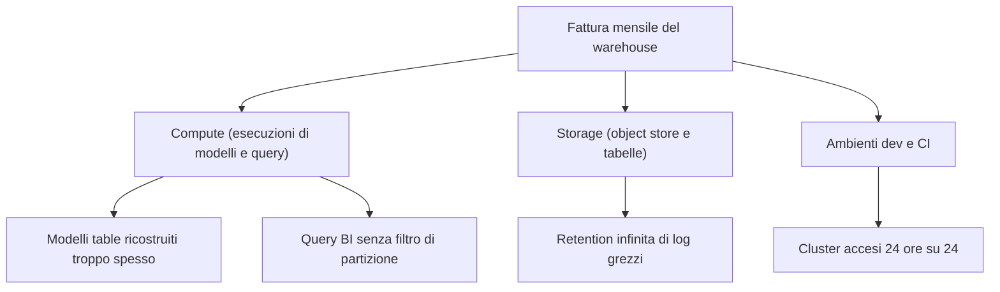

## La fattura da 1.800 a 5.400 euro in due mesi

Caso ricostruito con numeri di esempio, su un'azienda retail italiana. La fattura mensile del data warehouse passa da 1.800 a 5.400 euro in due mesi, senza che i dati archiviati siano cresciuti in modo comparabile. L'analisi dei log mostra una sola causa dominante: un modello dbt materializzato come `table` ricostruisce da zero tre anni di storico transazioni ogni sessanta minuti per alimentare una dashboard che la direzione apre due volte a settimana.

Il conto è immediato. Il modello gira 24 × 30 = 720 volte al mese e ogni esecuzione costa circa 5,00 euro di compute, quindi 720 × 5,00 = 3.600 euro al mese. La differenza tra la fattura vecchia e la nuova è 5.400 − 1.800 = 3.600 euro: il modello da solo spiega l'intero aumento.

> **Idea chiave:** nel cloud analitico la spesa segue il compute sprecato a rileggere e riscrivere gli stessi dati, molto più dei terabyte archiviati; per ridurla servono visibilità per modello, elaborazione incrementale e limiti automatici.

La lezione segue l'ordine con cui si interviene in pratica: prima si guarda dove va la spesa, poi si corregge il modello peggiore, poi si mettono guardrail perché il problema non si ripresenti.

## Dove vanno davvero i soldi

Molti team cercano di risparmiare cancellando vecchi file dall'object store, dove un terabyte costa poche decine di euro al mese, e ignorano le query che scansionano l'intera tabella a ogni apertura di dashboard. Le voci che dominano la spesa sono quasi sempre tre: modelli `table` completi eseguiti troppo spesso, query senza filtro sulla chiave di partizione, ambienti di sviluppo e test lasciati accesi senza spegnimento automatico. Lo storage conta, ma in genere è la voce più piccola e la più lenta a crescere.



Ogni ramo ha un intervento tipico e un ordine di grandezza di risparmio, riportati nella tabella. Sono intervalli indicativi da verificare sui tuoi log, non promesse.

| Voce di costo | Causa tipica di spreco | Intervento ad alto impatto | Risparmio atteso |
| :--- | :--- | :--- | :--- |
| Modelli dbt `table` | Riscrittura totale dello storico a ogni esecuzione | Conversione a `incremental` su partizione | 50% – 80% del compute |
| Dashboard BI | Query `SELECT *` senza filtro temporale | Tabelle aggregate precalcolate e cache | 30% – 60% delle query |
| Ambienti dev e CI | Cluster attivi 24 ore su 24 o full refresh nelle pull request | Auto-suspend a 5 minuti e CI su sole modifiche | 40% – 70% dei costi dev |
| Storage su object store | Retention infinita di log grezzi non compressi | Lifecycle verso archiviazione fredda o cancellazione | 20% – 40% dello storage |

## La classifica dei cinque modelli più costosi

Il primo passo è sempre misurare. Dal log delle query del warehouse si estrae, per ogni modello, la spesa degli ultimi trenta giorni, e si ordina dalla più alta. Basta un export in CSV con due colonne, nome del modello e costo in euro, e uno script Python che calcola la quota cumulata.

```python
# ops/top_cost_models.py - classifica cumulata dei modelli per costo mensile di compute
costi_euro = {
    "fact_orders_full": 3600,
    "dash_sales_agg": 420,
    "sessions_rebuild": 310,
    "stg_events_dedup": 260,
    "ml_features_daily": 190,
    "altri_22_modelli": 620,
}
totale = sum(costi_euro.values())  # 5400
cumulato = 0
for nome, costo in sorted(costi_euro.items(), key=lambda kv: kv[1], reverse=True)[:5]:
    cumulato += costo
    print(f"{nome:20s} {costo:6d} euro  quota cumulata {cumulato / totale:.1%}")
# l'ultima riga stampa 88.5%: cinque modelli su 27 spiegano quasi tutta la fattura
```

Con i numeri dell'esempio, i cinque modelli valgono 3.600 + 420 + 310 + 260 + 190 = 4.780 euro. La quota sul totale di 5.400 euro è 4.780 / 5.400 = 88,5%. Gli altri ventidue modelli pesano 620 euro, l'11,5%. Ottimizzare ventisette modelli in modo uniforme sarebbe lavoro sprecato: la leva è nei primi cinque, e dentro i primi cinque nel primo, che da solo vale 3.600 / 5.400 = 66,7% della spesa.

## Dal ricostruire tutto all'elaborazione incrementale

Un modello incrementale legge dalla tabella di origine soltanto le righe nuove o modificate dall'ultima esecuzione e le aggiunge o sostituisce nella tabella di destinazione. Nel caso della fattura, il modello ricostruiva 1.095 giorni di storico (tre anni) a ogni ora. In versione incrementale elabora una finestra di tre giorni, per assorbire gli ordini che arrivano in ritardo, cioè 3 / 1.095 = 0,27% dei dati.

La configurazione si dichiara nel progetto dbt. Il filtro sulla finestra temporale vive nel corpo SQL del modello, dentro il blocco condizionale che dbt esegue solo nelle esecuzioni incrementali; qui si mostra la parte di configurazione.

```yaml
# dbt_project.yml - conversione del modello più costoso da table a incremental
models:
  retail:
    marts:
      fact_orders:
        +materialized: incremental
        +unique_key: order_id               # evita duplicati sulle righe riscritte
        +incremental_strategy: delete+insert
        +on_schema_change: append_new_columns
        +partition_by: toYYYYMM(order_date)  # il filtro per mese permette di saltare le partizioni vecchie
```

Il risparmio si calcola dal costo per esecuzione e dalla frequenza. Il costo non scende in proporzione ai dati letti, perché ogni esecuzione ha un overhead fisso di avvio e di scrittura. Ipotizziamo che l'esecuzione incrementale costi 0,40 euro invece di 5,00.

1. Stato iniziale: 720 esecuzioni × 5,00 euro = 3.600 euro al mese.
2. Solo incrementale, frequenza oraria invariata: 720 × 0,40 euro = 288 euro al mese. Risparmio 3.600 − 288 = 3.312 euro, pari al 92%.
3. Incrementale e frequenza giornaliera, perché la dashboard è aperta due volte a settimana: 30 × 0,40 euro = 12 euro al mese. Risparmio 3.600 − 12 = 3.588 euro, pari al 99,7%.

Il terzo passaggio dipende da una decisione di business e non da una tecnica: serve chiedere ai lettori della dashboard quanto è fresco il dato di cui hanno bisogno. Se due aperture a settimana tollerano il dato di ieri, la frequenza oraria era un costo senza beneficiario. Il risparmio del 92% del secondo passaggio è già sopra l'intervallo 50%–80% della tabella, ed è plausibile solo perché qui un singolo modello domina la fattura; su un portafoglio di modelli ordinari l'ordine di grandezza resta quello dell'intervallo.

## Ambienti di sviluppo e storage: due perdite silenziose

Gli ambienti di sviluppo non compaiono nei dashboard di produzione, per cui il loro costo passa inosservato. Un cluster di sviluppo da 2,00 euro all'ora lasciato acceso 24 ore su 24 costa 2,00 × 24 × 30 = 1.440 euro al mese. Con un auto-suspend a cinque minuti, e supponendo che il team lo usi in media 6 ore al giorno, il costo diventa 2,00 × 6 × 30 = 360 euro: risparmio 1.080 euro, il 75%. La CI merita la stessa attenzione, con un criterio semplice: una pull request deve ricostruire solo i modelli modificati e quelli a valle, non l'intero progetto.

Sullo storage la leva è la politica di retention. Supponiamo 40 TB di log grezzi, di cui 30 TB più vecchi di 90 giorni, a 23 euro per TB al mese nello storage standard e 4 euro per TB al mese in archiviazione fredda. Spostare i 30 TB vecchi riduce la spesa di 30 × (23 − 4) = 570 euro al mese. La regola si dichiara una volta sul bucket.

```bash
#!/usr/bin/env bash
# apply_lifecycle.sh - sposta i log grezzi in archiviazione fredda dopo 90 giorni
set -euo pipefail

cat > /tmp/lifecycle.json <<'EOF'
{
  "Rules": [
    {
      "ID": "raw-logs-to-cold-storage",
      "Status": "Enabled",
      "Filter": { "Prefix": "raw/logs/" },
      "Transitions": [ { "Days": 90, "StorageClass": "GLACIER" } ],
      "Expiration": { "Days": 730 }
    }
  ]
}
EOF
# applica la regola al bucket (i log oltre 730 giorni vengono cancellati)
aws s3api put-bucket-lifecycle-configuration \
  --bucket acme-data-lake --lifecycle-configuration file:///tmp/lifecycle.json
```

Prima di impostare la cancellazione a 730 giorni, verifica che nessun obbligo normativo o di audit richieda una retention più lunga per quel prefisso. La transizione a archiviazione fredda ha un costo di recupero: va usata per dati che si leggono raramente, non per quelli che un modello riscansiona ogni settimana.

## Guardrail di budget con proiezione di fine mese

Un avviso che arriva a fine mese, con la fattura, è un resoconto e non un guardrail. Serve un controllo giornaliero che proietti la spesa sul mese intero e avvisi mentre c'è ancora tempo per intervenire. La proiezione lineare è la più semplice: spesa finora divisa per i giorni trascorsi, moltiplicata per i giorni del mese.

```python
# ops/budget_guardrail.py - proiezione lineare di fine mese e soglia al 75% del budget
def controlla_budget(spesa_finora: float, giorno_del_mese: int, giorni_nel_mese: int, budget: float) -> str:
    proiezione = spesa_finora / giorno_del_mese * giorni_nel_mese
    if spesa_finora >= 0.75 * budget:
        return f"ALERT soglia 75%: speso {spesa_finora:.0f} su {budget:.0f} euro"
    if proiezione > budget:
        return f"ALERT proiezione: {proiezione:.0f} euro previsti contro {budget:.0f} di budget"
    return "ok"

# esempio: 900 euro spesi in 10 giorni di un mese da 30, budget 2000 euro
print(controlla_budget(900, 10, 30, 2000))  # proiezione 2700 euro, supera il budget: ALERT proiezione
```

Esempio numerico. Il budget mensile è 2.000 euro e il decimo giorno del mese la spesa è 900 euro. La soglia del 75% vale 0,75 × 2.000 = 1.500 euro, non ancora raggiunta. La proiezione è 900 / 10 × 30 = 2.700 euro, cioè 700 euro (il 35%) oltre il budget. L'avviso di proiezione scatta il giorno 10, mentre quello sulla soglia sarebbe scattato attorno al giorno 17, perché 1.500 / 90 euro al giorno = circa 16,7 giorni. Sette giorni di anticipo bastano per trovare il modello responsabile con la classifica vista prima.

A ogni dominio di spesa serve un owner nominato e una dashboard visibile ai team tecnici: chi scrive le query deve vedere quanto costa eseguirle ogni ora invece che ogni giorno. Su query esplorative e ambienti ad hoc, aggiungi un limite rigido di durata e di memoria per singola query. Un join cartesiano lanciato per errore su tabelle da miliardi di righe può consumare in un pomeriggio il budget di una settimana se non c'è un timeout.

## Tre errori che fanno perdere tempo senza ridurre la spesa

### Spegnere risorse senza misurare chi le usa

Sintomo: dopo un taglio sulla fattura gli analisti esportano CSV in locale e le richieste urgenti aumentano. Perché succede: si è tagliato guardando solo il costo, senza confrontarlo con il numero di letture. Correzione: prima di spegnere qualsiasi risorsa, calcola il costo per lettura. Un modello da 300 euro al mese letto 2 volte al mese costa 150 euro a lettura; uno da 300 euro letto 600 volte ne costa 0,50. Il primo è un candidato al taglio, il secondo no.

### Tenere la fattura nascosta a chi scrive il codice

Sintomo: modelli ricostruiti ogni ora senza che nessuno sappia quanto costino. Perché succede: la fattura arriva all'amministrazione, il codice lo scrivono altre persone, e nessun incentivo collega i due. Correzione: pubblica ogni settimana una dashboard con costo per modello e per team, e inserisci nella revisione del codice una domanda esplicita sul costo di esecuzione dei modelli nuovi.

### Ottimizzare tutto invece dei primi cinque

Sintomo: settimane di lavoro su modelli da pochi euro al mese mentre il primo ne vale migliaia. Perché succede: la fattura è percepita come un problema diffuso e non come una distribuzione molto concentrata. Correzione: ordina per costo e lavora dall'alto finché la quota cumulata supera l'80%. Nell'esempio bastano i primi cinque modelli per arrivare all'88,5%.

## Il caso dei picchi imprevisti da carichi ad hoc

Anche con pipeline notturne ottimizzate, un picco può arrivare da fuori: un nuovo strumento BI o un notebook esplorativo che interroga direttamente le tabelle grezze ad alta granularità. La protezione non deve frenare l'esplorazione. Funzionano meglio due livelli: un avviso automatico su un canale condiviso al raggiungimento del 75% del budget previsto e un limite rigido sulle query degli ambienti dedicati all'analisi ad hoc.

La tentazione è alzare il limite quando un analista lo urta. Prima di farlo chiedi quale tabella sta leggendo e se esiste una versione aggregata che risponde alla stessa domanda a una frazione del costo. Una tabella giornaliera aggregata con 100 righe al giorno al posto di 50 milioni di eventi riduce i byte letti di un fattore 500.000, e l'analista ottiene la risposta più in fretta. Il limite funziona come segnale: serve a far emergere il bisogno di una tabella pronta, non a punire chi lo incontra.

## Verifica sulla tua fattura

1. Un modello `table` da 8,00 euro per esecuzione gira ogni 2 ore. Quanto costa al mese e quanto costa se diventa incrementale a 0,50 euro per esecuzione con la stessa frequenza?

<details>
<summary>Mostra risposta</summary>

Esecuzioni al mese: 12 al giorno × 30 = 360. Costo attuale: 360 × 8,00 = 2.880 euro. Costo incrementale: 360 × 0,50 = 180 euro. Risparmio 2.880 − 180 = 2.700 euro al mese, pari al 93,75%. Se il consumatore del dato accetta un aggiornamento giornaliero, il costo scende a 30 × 0,50 = 15 euro.

</details>

2. Spesa di 1.100 euro dopo 12 giorni in un mese da 30 giorni, budget 2.500 euro. Scatta l'avviso di proiezione? E quello sulla soglia del 75%?

<details>
<summary>Mostra risposta</summary>

Proiezione: 1.100 / 12 × 30 = 2.750 euro, oltre il budget di 2.500 di 250 euro (10%): l'avviso di proiezione scatta. La soglia del 75% vale 1.875 euro e la spesa attuale è 1.100, quindi quell'avviso non è ancora scattato. La proiezione segnala il problema con circa una settimana di anticipo.

</details>

3. Un cluster di sviluppo da 1,50 euro all'ora resta acceso 24 ore su 24. Con auto-suspend il team lo usa in media 8 ore al giorno. Quanto si risparmia in un mese da 30 giorni?

<details>
<summary>Mostra risposta</summary>

Prima: 1,50 × 24 × 30 = 1.080 euro. Dopo: 1,50 × 8 × 30 = 360 euro. Risparmio 720 euro al mese, pari al 66,7%.

</details>

4. Perché la classifica cumulata dei modelli è preferibile a un intervento uniforme su tutti i modelli?

<details>
<summary>Mostra risposta</summary>

La spesa è molto concentrata: nell'esempio il primo modello vale il 66,7% della fattura e i primi cinque l'88,5%. Un intervento uniforme dedica lo stesso tempo a modelli da pochi euro e a quello da migliaia, mentre la classifica indica dove un'ora di lavoro rende di più.

</details>
