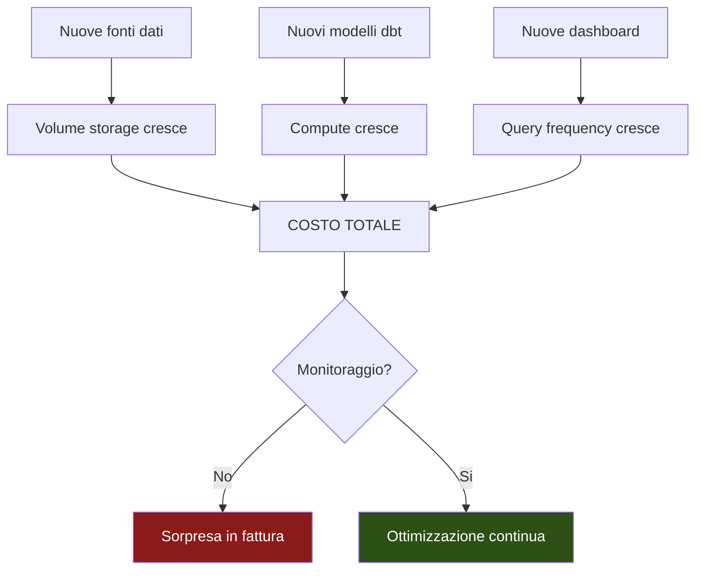
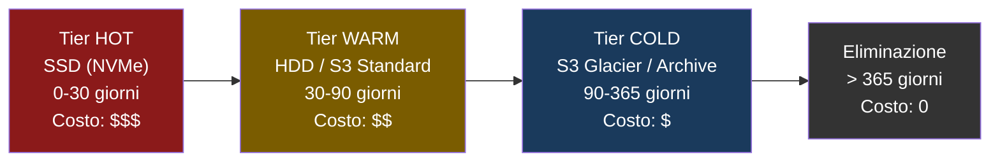
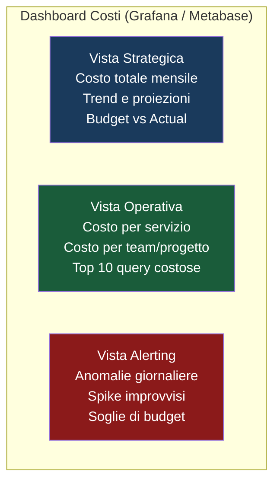
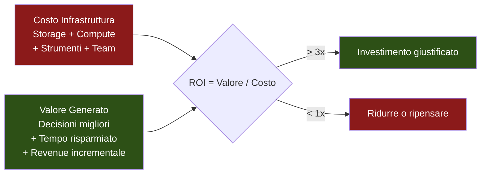

Questa lezione affronta i costi infrastrutturali come problema di progettazione continua, non come controllo a posteriori della fattura cloud. Nei sistemi dati, costo, performance e affidabilita' sono intrecciati: ottimizzarne uno senza leggere gli altri porta spesso a decisioni miopi.

Vedremo come trasformare il cost management in una disciplina concreta, con metriche, priorita' e criteri di investimento piu' difendibili davanti a team tecnici e management.

## Cost Management

I costi dell'infrastruttura dati sono tra le voci di spesa tecnologica che crescono più rapidamente nelle aziende moderne. A differenza del software applicativo, dove i costi di infrastruttura sono relativamente prevedibili, il mondo dei dati presenta una dinamica insidiosa: il consumo di risorse scala con il volume dei dati, la complessita delle trasformazioni e il numero di utenti che interrogano il sistema. Senza una governance attenta, una fattura cloud può raddoppiare in un trimestre senza che nessuno se ne accorga fino all'arrivo del conto.

Questa lezione fornisce un framework pratico per comprendere, monitorare e ottimizzare i costi della propria infrastruttura dati, trasformando la gestione dei costi da attivita reattiva a disciplina proattiva.

> **Attenzione:**
> Il costo più pericoloso non è quello alto: e quello che cresce senza che nessuno lo noti. Un alert su un aumento del 20% dello spend giornaliero può risparmiare decine di migliaia di euro l'anno.

## 1. Perché i Costi dell'Infrastruttura Dati Sfuggono al Controllo

### Le Cause Strutturali

Il mondo dei dati presenta caratteristiche uniche che rendono i costi particolarmente difficili da controllare:

1. **Crescita organica dei dati**: Ogni giorno arrivano nuovi eventi, nuove fonti, nuovi tracking. Il volume cresce in modo monotono -- i dati non diminuiscono mai spontaneamente.

2. **Complessita nascosta delle query**: Una singola dashboard Grafana può triggerare 50 query SQL ad ogni refresh. Se 20 utenti la aprono contemporaneamente, sono 1000 query in pochi secondi.

3. **Assenza di ownership**: Nessuno "possiede" il costo. Il data engineer crea le tabelle, l'analista scrive le query, il PM apre la dashboard -- ma chi paga? Spesso nessuno si sente responsabile.

4. **Pay-per-use opaco**: I modelli di pricing cloud (per GB scansionato, per slot-secondo, per credito consumato) sono complessi e difficili da tradurre in costi per singola operazione.



### Anatomia di una Fattura Cloud per i Dati

Una fattura tipica per un'infrastruttura dati di medie dimensioni si compone di queste voci:

| Voce di Costo | Percentuale Tipica | Controllabilita |
|---------------|-------------------|-----------------|
| **Compute (query processing)** | 40-55% | Alta |
| **Storage (dati + backup)** | 15-25% | Media |
| **Data ingestion (Fivetran, Airbyte)** | 10-20% | Media |
| **Networking (egress, cross-region)** | 5-10% | Bassa |
| **Strumenti SaaS (BI, orchestrazione)** | 5-15% | Media |

## 2. Modelli di Pricing delle Piattaforme Principali

### ClickHouse Cloud

ClickHouse Cloud utilizza un modello basato su compute e storage separati:

| Componente | Unita di Misura | Prezzo Indicativo |
|------------|-----------------|-------------------|
| **Compute** | Per GB di RAM allocata / ora | ~$0.06/GB/ora |
| **Storage** | Per GB / mese | ~$0.024/GB/mese |
| **Data Transfer** | Per GB in uscita | ~$0.09/GB |

**Caratteristiche chiave per il costo:**
- Auto-scaling: il cluster scala automaticamente in base al carico
- Auto-suspend: il compute si spegne dopo un periodo di inattivita (configurabile)
- Compressione eccellente: i dati occupano tipicamente 10-40x meno spazio rispetto al formato originale

```sql
-- Verificare lo spazio occupato da ogni tabella in ClickHouse
SELECT
    database,
    table,
    formatReadableSize(sum(bytes_on_disk)) AS disk_size,
    formatReadableSize(sum(data_uncompressed_bytes)) AS uncompressed_size,
    round(sum(data_uncompressed_bytes) / sum(bytes_on_disk), 1) AS compression_ratio,
    sum(rows) AS total_rows
FROM system.parts
WHERE active = 1
GROUP BY database, table
ORDER BY sum(bytes_on_disk) DESC
LIMIT 20;
```

### BigQuery (Google Cloud)

BigQuery ha un modello per-query unico nel settore:

| Modello | Unita di Misura | Prezzo |
|---------|-----------------|--------|
| **On-Demand** | Per TB scansionato | $6.25/TB |
| **Flat-Rate (Editions)** | Per slot-ora | Da $0.04/slot-ora |
| **Storage (attivo)** | Per GB / mese | $0.02/GB |
| **Storage (long-term, >90gg)** | Per GB / mese | $0.01/GB |

> **Note:**
> In BigQuery on-demand, il costo e determinato dalla quantita di dati scansionati, non dalla complessita della query. Una SELECT * su una tabella da 1 TB costa uguale sia che restituisca 1 riga sia 1 miliardo. Per questo motivo, selezionare solo le colonne necessarie e usare partizioni sono le ottimizzazioni più importanti.

### Snowflake

Snowflake utilizza un modello a crediti:

| Componente | Unita di Misura | Prezzo Indicativo |
|------------|-----------------|-------------------|
| **Compute** | Crediti / ora | Da $2/credito (Standard) a $4/credito (Enterprise) |
| **Storage** | Per TB / mese | ~$23/TB (on-demand) |
| **Serverless** | Crediti / secondo | Variabile per servizio |

Un warehouse XS consuma 1 credito/ora, un S consuma 2, un M consuma 4, e così via raddoppiando.

### Fivetran (Data Ingestion)

Fivetran ha un modello basato sulle righe sincronizzate:

| Piano | Prezzo | Righe Incluse |
|-------|--------|---------------|
| **Free** | $0 | 500.000 MAR |
| **Starter** | $1/credito | Pay as you go |
| **Standard** | Contratto | Volume discount |
| **Enterprise** | Contratto | Volume discount |

**MAR** = Monthly Active Rows: il numero di righe nuove o aggiornate sincronizzate in un mese.

> **Attenzione:**
> Attenzione al "MAR creep" con Fivetran: una tabella che viene aggiornata interamente ad ogni sync (UPDATE su tutte le righe) consuma MAR come se tutte le righe fossero nuove. Configura sempre l'incremental sync dove possibile.

## 3. Ottimizzazione dello Storage

### Compressione

La compressione e la prima linea di difesa contro i costi di storage. ClickHouse eccelle in questo ambito grazie alla sua architettura colonnare:

```sql
-- Confronto compressione per colonna
SELECT
    column,
    formatReadableSize(sum(column_data_compressed_bytes)) AS compressed,
    formatReadableSize(sum(column_data_uncompressed_bytes)) AS uncompressed,
    round(sum(column_data_uncompressed_bytes) / sum(column_data_compressed_bytes), 1) AS ratio
FROM system.parts_columns
WHERE table = 'campaign_events' AND active = 1
GROUP BY column
ORDER BY sum(column_data_compressed_bytes) DESC;
```

**Best practice per migliorare la compressione:**

| Tecnica | Impatto | Esempio |
|---------|---------|---------|
| `LowCardinality(String)` | Alto | Colonne con pochi valori distinti (country, channel) |
| `ORDER BY` ottimale | Alto | Colonne con bassa cardinalita prima nella chiave |
| Codec specifici | Medio | `CODEC(Delta, ZSTD)` per timestamp sequenziali |
| Tipi dati appropriati | Medio | `UInt16` al posto di `UInt64` se il range lo permette |

### TTL (Time-To-Live) e Lifecycle dei Dati

Non tutti i dati hanno lo stesso valore nel tempo. Una strategia di TTL permette di eliminare o spostare automaticamente i dati vecchi:

```sql
-- Tabella con TTL: elimina i dati grezzi dopo 90 giorni
CREATE TABLE raw_events (
    event_date Date,
    event_name String,
    user_id UInt64,
    properties String
)
ENGINE = MergeTree()
PARTITION BY toYYYYMM(event_date)
ORDER BY (event_date, user_id)
TTL event_date + INTERVAL 90 DAY DELETE;

-- Alternativa: sposta i dati vecchi su uno storage più economico
ALTER TABLE raw_events
    MODIFY TTL
        event_date + INTERVAL 30 DAY TO VOLUME 'hot',
        event_date + INTERVAL 90 DAY TO VOLUME 'cold',
        event_date + INTERVAL 365 DAY DELETE;
```

### Tiered Storage



## 4. Ottimizzazione del Compute

### Right-Sizing: Dimensionare Correttamente le Risorse

Il right-sizing e l'arte di allocare le risorse giuste per il carico di lavoro effettivo, senza sovra-dimensionare (spreco) ne sotto-dimensionare (performance degradate).

1. **Analizza il carico attuale**: Monitora l'utilizzo di CPU e RAM per almeno 2 settimane. Se l'utilizzo medio e sotto il 30%, stai sprecando risorse.
2. **Identifica i picchi**: I picchi di carico sono prevedibili (es. il dbt run delle 6:00 AM) o casuali? Se prevedibili, configura l'auto-scaling.
3. **Separa i workload**: Le query interattive (dashboard) e i batch job (dbt run) hanno profili di risorse diversi. Usa cluster o warehouse separati.
4. **Testa il downsizing**: Riduci la dimensione del cluster del 25% e monitora le performance per una settimana. Se non c'è degradazione percepibile, il risparmio e reale.
5. **Automatizza**: Configura policy di auto-scaling basate sulle metriche di utilizzo, non sulla percezione.

### Auto-Scaling e Auto-Suspend

In ClickHouse Cloud e Snowflake, l'auto-suspend e una delle ottimizzazioni più efficaci:

```sql
-- Snowflake: configurare auto-suspend a 60 secondi
ALTER WAREHOUSE analytics_wh SET
    AUTO_SUSPEND = 60
    AUTO_RESUME = TRUE
    MIN_CLUSTER_COUNT = 1
    MAX_CLUSTER_COUNT = 3
    SCALING_POLICY = 'ECONOMY';
```

**Impatto dell'auto-suspend:**

| Scenario | Senza Auto-Suspend | Con Auto-Suspend (60s) | Risparmio |
|----------|-------------------|----------------------|-----------|
| Warehouse XS, 8h lavorative | 8 crediti/giorno | ~2 crediti/giorno | 75% |
| Warehouse M, uso sporadico | 32 crediti/giorno | ~5 crediti/giorno | 84% |

### Reserved Instances e Committed Use

Per workload prevedibili e costanti, le reserved instances offrono sconti significativi:

| Provider | Tipo di Commitment | Sconto Tipico | Periodo |
|----------|-------------------|---------------|---------|
| **AWS (ClickHouse su EC2)** | Reserved Instance | 30-60% | 1-3 anni |
| **GCP (BigQuery)** | Flat-Rate Editions | 20-40% | 1-3 anni |
| **Snowflake** | Capacity Contract | 10-25% | 1 anno |
| **ClickHouse Cloud** | Annual Commit | 15-30% | 1 anno |

> **Consiglio:**
> Non impegnarti in reserved instances finche non hai almeno 3 mesi di dati di consumo stabili. Impegnarsi troppo presto, basandosi su stime, e un errore comune che può vincolarti a risorse inutilizzate.

## 5. Ottimizzazione dei Costi delle Query

Le query sono il principale driver di costo compute. Ottimizzarle ha un impatto diretto e immediato sulla fattura.

### Materialized Views

Le materialized views pre-calcolano aggregazioni frequenti, eliminando la necessita di ricalcolarle ad ogni query:

```sql
-- Problema: questa query viene eseguita 100 volte al giorno da diverse dashboard
-- Costa molto perché scansiona l'intera tabella raw_events ogni volta
SELECT
    toDate(event_date) AS day,
    source,
    COUNT() AS total_events,
    uniqExact(user_id) AS unique_users,
    SUM(revenue) AS total_revenue
FROM raw_events
WHERE event_date ≥ today() - 30
GROUP BY day, source;

-- Soluzione: Materialized View che pre-aggrega automaticamente
CREATE MATERIALIZED VIEW mv_daily_source_metrics
ENGINE = SummingMergeTree()
PARTITION BY toYYYYMM(day)
ORDER BY (day, source)
AS SELECT
    toDate(event_date) AS day,
    source,
    count() AS total_events,
    uniqState(user_id) AS unique_users_state,
    sum(revenue) AS total_revenue
FROM raw_events
GROUP BY day, source;

-- Ora la query usa la materialized view (10-100x più veloce e meno costosa)
SELECT
    day,
    source,
    total_events,
    uniqMerge(unique_users_state) AS unique_users,
    total_revenue
FROM mv_daily_source_metrics
WHERE day ≥ today() - 30
GROUP BY day, source, total_events, total_revenue
ORDER BY day DESC;
```

### Pre-Aggregazione con dbt

In dbt, le tabelle pre-aggregate (mart) riducono il costo delle query downstream:

```sql
-- models/marts/fct_daily_channel_metrics.sql
-- Questa tabella viene calcolata una volta al giorno dal dbt run
-- Tutte le dashboard la usano al posto delle tabelle raw

{{ config(
    materialized='incremental',
    unique_key='metric_date || channel',
    incremental_strategy='append'
) }}

SELECT
    toDate(event_date) AS metric_date,
    channel,
    COUNT(DISTINCT session_id) AS sessions,
    COUNT(DISTINCT user_id) AS unique_users,
    SUM(CASE WHEN event_name = 'purchase' THEN 1 ELSE 0 END) AS purchases,
    SUM(revenue) AS total_revenue,
    round(SUM(revenue) / nullIf(COUNT(DISTINCT user_id), 0), 2) AS revenue_per_user
FROM {{ ref('int_sessions_enriched') }}

WHERE event_date > (SELECT max(metric_date) FROM {{ this }})

GROUP BY metric_date, channel
```

### Caching

Il caching riduce le query ridondanti. La maggior parte delle piattaforme offre cache a più livelli:

| Livello di Cache | Dove | Efficacia | Esempio |
|-----------------|------|-----------|---------|
| **Result Cache** | Database | Alta per query identiche | ClickHouse: query_cache, Snowflake: result cache |
| **Dashboard Cache** | BI Tool | Alta per utenti multipli | Grafana: cache TTL, Metabase: cache |
| **CDN Cache** | Edge | Media per dashboard pubbliche | Cloudflare Workers + KV |
| **Application Cache** | App layer | Alta per API | Redis, Memcached |

```sql
-- ClickHouse: abilitare la query cache
SET use_query_cache = 1;
SET query_cache_ttl = 300; -- 5 minuti

-- Snowflake: sfruttare il result cache (attivo di default)
-- Le query identiche eseguite entro 24 ore non consumano crediti
-- Attenzione: il cache si invalida se i dati sottostanti cambiano
```

## 6. Monitoraggio dei Costi

### Dashboard di Spesa

Un sistema di monitoraggio efficace dei costi richiede almeno tre viste:



### Query per il Monitoraggio in ClickHouse

```sql
-- Top 10 query più costose (per bytes letti) nelle ultime 24 ore
SELECT
    query,
    user,
    formatReadableSize(read_bytes) AS data_read,
    formatReadableTimeDelta(query_duration_ms / 1000) AS duration,
    read_rows,
    result_rows,
    event_time
FROM system.query_log
WHERE type = 'QueryFinish'
    AND event_time ≥ now() - INTERVAL 24 HOUR
    AND query NOT LIKE '%system.%'
ORDER BY read_bytes DESC
LIMIT 10;

-- Consumo aggregato per utente nelle ultime 24 ore
SELECT
    user,
    COUNT() AS query_count,
    formatReadableSize(SUM(read_bytes)) AS total_data_read,
    round(SUM(query_duration_ms) / 1000, 1) AS total_seconds,
    round(AVG(query_duration_ms), 0) AS avg_ms_per_query
FROM system.query_log
WHERE type = 'QueryFinish'
    AND event_time ≥ now() - INTERVAL 24 HOUR
ORDER BY SUM(read_bytes) DESC;
```

### Alerting sulle Anomalie

Configura alert per rilevare anomalie di costo prima che diventino problemi:

| Alert | Soglia Suggerita | Canale |
|-------|-----------------|--------|
| Spesa giornaliera > 130% media 7gg | Dinamica | Slack + Email |
| Query singola > 100GB scansionati | Statica | Slack |
| Storage cresciuto > 10% in una settimana | Dinamica | Email |
| Warehouse attivo > 4 ore consecutive | Statica | Slack |
| Fattura mensile proiettata > budget | Dinamica | Email + PagerDuty |

```yaml

# Esempio: alert Grafana per anomalia di costo

apiVersion: 1
groups:
  - orgId: 1
    name: cost-alerts
    rules:
      - uid: daily-spend-anomaly
        title: "Spesa giornaliera anomala"
        condition: C
        data:
          - refId: A
            queryType: ''
            model:
              rawSql: |
                SELECT
                    toDate(event_time) AS day,
                    SUM(read_bytes) / 1e12 AS tb_scanned
                FROM system.query_log
                WHERE type = 'QueryFinish'
                GROUP BY day
                ORDER BY day DESC
                LIMIT 8
          - refId: B
            queryType: ''
            model:
              type: reduce
              expression: A
              reducer: mean
          - refId: C
            queryType: ''
            model:
              type: threshold
              expression: A
              conditions:
                - evaluator:
                    type: gt
                    params: [1.3]  # 130% della media
        for: 0s
        annotations:
          summary: "La spesa giornaliera supera il 130% della media settimanale"
```

> **Consiglio:**
> Non limitarti ad alert sulla spesa totale. Le metriche più utili sono quelle "per unita": costo per query, costo per utente attivo, costo per GB di dati processato. Queste metriche rivelano inefficienze strutturali che il costo totale maschera.

## 7. Il Framework ROI: Giustificare la Spesa

### Calcolare il Valore dell'Infrastruttura Dati

Per giustificare i costi presso il management, serve un framework che traduca la spesa tecnica in valore di business:



### Le Tre Dimensioni del Valore

**1. Tempo Risparmiato (quantificabile)**

| Attivita | Senza infrastruttura dati | Con infrastruttura dati | Risparmio/anno |
|----------|--------------------------|------------------------|----------------|
| Report settimanale marketing | 4 ore/settimana (manuale) | 0 ore (automatico) | 208 ore |
| Analisi ad-hoc per decisioni | 2 giorni (estrazione manuale) | 15 minuti (self-service) | ~400 ore |
| Riconciliazione dati | 8 ore/mese | 1 ora/mese (automatizzato) | 84 ore |

**2. Decisioni Migliori (stimabile)**

- Campagne marketing ottimizzate in base ai dati: +15-30% ROAS
- Identificazione precoce del churn: -10-20% di churn rate
- Pricing dinamico basato su dati: +5-15% revenue

**3. Revenue Incrementale (misurabile)**

- A/B testing abilitato dall'infrastruttura: ogni test che migliora la conversion rate dell'1% su un revenue di 1M EUR genera 10.000 EUR aggiuntivi

### Esempio di Business Case

```
Costi Annuali:
  ClickHouse Cloud:         EUR  18.000
  Fivetran (ingestion):     EUR   6.000
  dbt Cloud:                EUR   2.400
  Grafana Cloud:            EUR   3.600
  Team (0.5 FTE data eng):  EUR  35.000
  ─────────────────────────────────────
  TOTALE:                   EUR  65.000

Valore Annuale Stimato:
  Tempo risparmiato:        EUR  45.000 (692 ore x EUR 65/ora)
  ROAS migliorato (+20%):   EUR 120.000 (su 600K budget media)
  Riduzione churn (-5%):    EUR  50.000 (su 1M EUR di MRR)
  ─────────────────────────────────────
  TOTALE:                   EUR 215.000

ROI = 215.000 / 65.000 = 3.3x
```

## 8. Strategie di Risparmio per Scenario

### Startup (Budget < 500 EUR/mese)

| Area | Strategia | Strumento |
|------|-----------|-----------|
| Warehouse | Free tier o self-hosted | ClickHouse free tier, BigQuery free tier (1 TB/mese) |
| Ingestion | Open source | Airbyte (self-hosted), Singer taps |
| Trasformazione | Free tier | dbt Core (gratuito) |
| Orchestrazione | Minimale | GitHub Actions (cron), cron job |
| BI | Open source | Metabase (self-hosted), Grafana |

### Scale-up (Budget 1.000-10.000 EUR/mese)

| Area | Strategia | Strumento |
|------|-----------|-----------|
| Warehouse | Cloud managed, auto-scaling | ClickHouse Cloud, BigQuery |
| Ingestion | SaaS con volume discount | Fivetran Standard, Airbyte Cloud |
| Trasformazione | SaaS | dbt Cloud Team |
| Orchestrazione | Managed | Dagster Cloud, Prefect Cloud |
| BI | SaaS | Grafana Cloud, Metabase Cloud |

### Enterprise (Budget > 10.000 EUR/mese)

| Area | Strategia | Strumento |
|------|-----------|-----------|
| Warehouse | Multi-cluster, reserved | ClickHouse Cloud (annual), Snowflake Enterprise |
| Ingestion | Enterprise con SLA | Fivetran Enterprise |
| Trasformazione | Enterprise | dbt Cloud Enterprise |
| Orchestrazione | Self-hosted o managed | Airflow su MWAA, Dagster+ |
| BI | Enterprise | Looker, Tableau, Power BI |

## 9. Checklist di Riduzione Costi

Una checklist pratica da eseguire trimestralmente per identificare opportunita di risparmio:

### Storage

1. **Verifica la compressione**: Tutte le colonne String a bassa cardinalita usano `LowCardinality`?
2. **Implementa TTL**: I dati grezzi più vecchi di 90 giorni sono ancora necessari in formato completo?
3. **Elimina tabelle inutilizzate**: Usa `system.query_log` per identificare tabelle mai interrogate negli ultimi 30 giorni
4. **Riduci le colonne**: Le tabelle staging contengono colonne che non vengono mai usate nei modelli downstream?
5. **Ottimizza i tipi dati**: Stai usando `UInt64` dove basterebbe `UInt16`? `Float64` dove basterebbe `Float32`?

### Compute

1. **Attiva auto-suspend**: Il warehouse si spegne dopo 60 secondi di inattivita?
2. **Separa i workload**: Le query interattive e i batch job usano risorse separate?
3. **Ottimizza le query pesanti**: Le top 10 query per bytes scansionati sono ottimizzate?
4. **Usa modelli incrementali**: I modelli dbt usano `incremental` dove possibile, invece di `table` (full refresh)?
5. **Rivedi la frequenza dei pipeline**: Hai pipeline che girano ogni ora ma i dati vengono consultati solo giornalmente?

### Ingestion

1. **Configura sync incrementali**: Tutte le tabelle Fivetran/Airbyte usano sync incrementali dove possibile?
2. **Riduci la frequenza**: Serve davvero un sync ogni 5 minuti? Ogni 15 minuti o ogni ora sarebbe sufficiente?
3. **Elimina connettori inutilizzati**: Ci sono connettori attivi per fonti dati che nessuno consulta?
4. **Filtra alla fonte**: Stai sincronizzando tutte le colonne o solo quelle necessarie?

### Query e Dashboard

1. **Abilita il caching**: Le dashboard usano cache con TTL appropriato?
2. **Usa materialized views**: Le aggregazioni più frequenti sono pre-calcolate?
3. **Rivedi i refresh rate**: Le dashboard si aggiornano ogni 30 secondi ma i dati cambiano ogni ora?
4. **Limita i SELECT ***: Ci sono query che scansionano tutte le colonne quando ne servono solo 3-4?
5. **Aggiungi filtri temporali**: Tutte le query di dashboard filtrano per un periodo temporale ragionevole?

## 10. Governance dei Costi: Processi e Cultura

L'ottimizzazione tecnica e necessaria ma non sufficiente. Serve una cultura organizzativa della gestione dei costi:

### Ownership dei Costi

| Risorsa | Owner | Responsabilita |
|---------|-------|----------------|
| Cluster ClickHouse | Data Engineering Lead | Sizing, scaling, tuning |
| Connettori Fivetran | Analytics Engineer | Frequenza sync, selezione tabelle |
| Modelli dbt | Autore del modello | Materializzazione, incrementalita |
| Dashboard | Autore della dashboard | Cache, refresh rate, query efficiency |
| Budget complessivo | Head of Data | Approvazione spese, negoziazione contratti |

### Review Trimestrale dei Costi

Ogni trimestre, il team dati dovrebbe condurre una revisione strutturata:

1. **Raccolta dati**: Estrai la spesa per servizio, per team e per progetto degli ultimi 3 mesi
2. **Analisi trend**: La spesa sta crescendo più velocemente del valore generato?
3. **Identificazione anomalie**: Ci sono servizi o query il cui costo e cresciuto in modo sproporzionato?
4. **Piano di azione**: Definisci 3-5 azioni concrete con responsabile e deadline
5. **Comunicazione**: Condividi i risultati con il management, evidenziando il ROI

## Esercizi

### Esercizio 1: Audit dei Costi del Tuo Stack

1. **Elenca tutti i servizi cloud e SaaS utilizzati dal tuo team dati**
2. **Per ciascuno, determina il costo mensile e il modello di pricing**
3. **Identifica i 3 servizi più costosi e analizza se il loro utilizzo giustifica la spesa**
4. **Proponi almeno una ottimizzazione per ciascuno dei 3 servizi principali**

### Esercizio 2: Ottimizzazione delle Query

1. **Identifica le 5 query più costose nel tuo database usando `system.query_log` (ClickHouse) o `INFORMATION_SCHEMA.JOBS` (BigQuery)**
2. **Per ciascuna, analizza: quanti bytes scansiona? Potrebbe usare una materialized view? Filtra correttamente per data?**
3. **Riscrivi almeno 2 delle 5 query in versione ottimizzata e misura il miglioramento**

### Esercizio 3: Business Case per l'Infrastruttura Dati

1. **Calcola il costo totale annuale della tua infrastruttura dati (inclusi strumenti, cloud e tempo del team)**
2. **Stima il valore generato nelle tre dimensioni: tempo risparmiato, decisioni migliori, revenue incrementale**
3. **Calcola il ROI e prepara una presentazione di una pagina per il management**
4. **Identifica quale singolo investimento aggiuntivo avrebbe il ROI più alto e quantificalo**

## Risorse di Approfondimento

- **ClickHouse Cloud Pricing Calculator**: Strumento ufficiale per stimare i costi
- **FinOps Foundation**: Framework e best practice per la gestione dei costi cloud
- **dbt Incremental Models Documentation**: Guida alle materializzazioni incrementali per ridurre il compute
- **Cloud Cost Optimization (AWS Well-Architected)**: Pillar dedicato all'ottimizzazione dei costi
- **Snowflake Resource Monitors**: Strumenti nativi per il monitoraggio e il controllo della spesa

## Riepilogo Operativo

- Gestire i costi significa misurare crescita della spesa prima che diventi una sorpresa trimestrale.
- Storage, compute e tempo del team vanno letti come componenti dello stesso costo totale.
- Ogni ottimizzazione ha senso solo se preserva il valore prodotto dal sistema dati.
- Il cost management maturo trasforma la spesa in una scelta progettuale consapevole, non in una rincorsa ai tagli.
