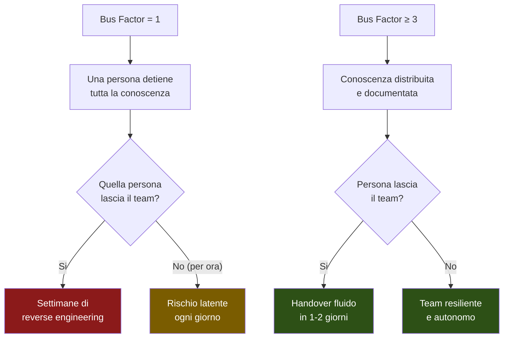
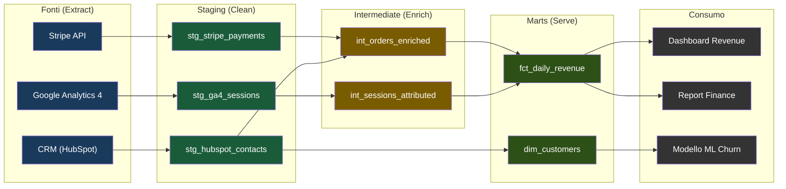
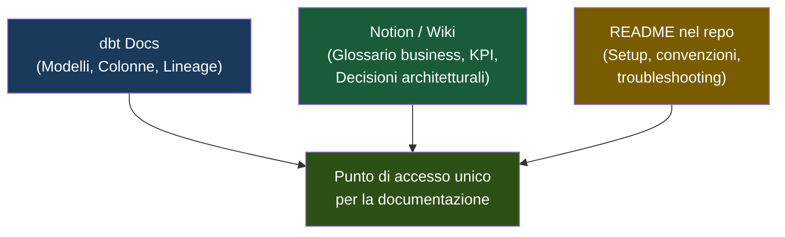
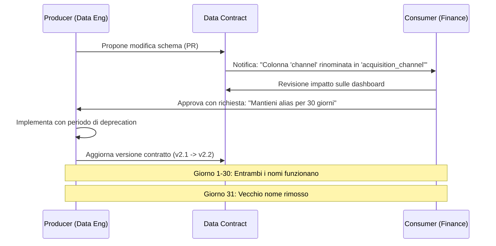

Questa lezione sposta la documentazione fuori dalla categoria del lavoro "secondario" e la tratta come componente critica dell'infrastruttura dati. Senza documentazione chiara, anche pipeline corrette e modelli ben costruiti diventano sistemi fragili, lenti da modificare e dipendenti da poche persone chiave.

L'obiettivo e' capire come rendere il warehouse leggibile e manutenibile nel tempo, collegando metadati, ownership, lineage e definizioni di business dentro un impianto davvero usabile dal team.

## Documentazione per i Dati

La documentazione e il componente più trascurato dell'infrastruttura dati. Ogni team investe energie significative nella costruzione di pipeline, modelli e dashboard, ma raramente dedica lo stesso rigore alla documentazione di cio che ha costruito. Il risultato e un sistema che funziona ma che nessuno, a parte il suo creatore, riesce a comprendere, manutenere o estendere con sicurezza.

Questa lezione affronta la documentazione non come un esercizio burocratico, ma come un investimento strutturale nella longevita e nell'usabilita del data warehouse. Un sistema ben documentato non è solo più facile da usare: e più sicuro, più efficiente e più resistente al turnover del personale.

> **Attenzione:**
> La regola informale e brutale: se la persona che ha costruito un modello dbt lascia l'azienda e nessun altro riesce a capire cosa fa quel modello entro 30 minuti, la documentazione ha fallito.

## 1. Perché la Documentazione e il Debito Tecnico Più Costoso

### Il Costo dell'Assenza di Documentazione

Il costo della documentazione mancante non si manifesta immediatamente. Si accumula nel tempo come un debito tecnico silenzioso, fino a quando un evento critico lo rende visibile:

| Scenario | Tempo Perso (senza docs) | Tempo Perso (con docs) | Moltiplicatore |
|----------|-------------------------|----------------------|----------------|
| Nuovo analista deve capire il modello revenue | 2-3 giorni | 30 minuti | 30x |
| Bug in una metrica: trovare la causa | 4-8 ore | 15 minuti | 20x |
| Stakeholder chiede "da dove viene questo numero?" | 1-2 ore di indagine | Link alla documentazione | 10x |
| Data engineer lascia l'azienda | Settimane di reverse engineering | Handover strutturato | 50x |
| Audit di compliance: provare la provenienza dei dati | Giorni di ricostruzione | Export automatico dal catalogo | 30x |

### Il "Bus Factor" Problem

Il "bus factor" (o "truck factor") e il numero di persone del team che possono essere investite da un autobus prima che il progetto diventi insostenibile. Per molti team dati, questo numero e **1**: una sola persona conosce la logica di business dietro i modelli critici.



> **Consiglio:**
> La documentazione non è solo per gli altri: e anche per te stesso tra 6 mesi. Il "tu futuro" e essenzialmente un'altra persona che non ricordera perché hai scritto quel filtro WHERE o quella logica di deduplicazione.

## 2. Data Dictionary: il Fondamento

### Cos'e un Data Dictionary

Un Data Dictionary e un catalogo strutturato che descrive ogni elemento del data warehouse: database, tabelle, colonne, tipi di dato e, soprattutto, il **significato di business** di ciascuno. Non è un semplice elenco tecnico: e il ponte tra il mondo tecnico e quello di business.

### Struttura di un Data Dictionary

Un Data Dictionary completo contiene queste informazioni per ogni tabella:

| Campo | Descrizione | Esempio |
|-------|-------------|---------|
| **Nome tabella** | Identificativo tecnico | `fct_daily_revenue` |
| **Descrizione** | Cosa rappresenta in termini di business | "Revenue giornaliero per canale di acquisizione, calcolato al netto di rimborsi" |
| **Layer** | Posizione nella pipeline (staging/intermediate/mart) | `mart` |
| **Granularita** | Cosa rappresenta ogni riga | "Una riga per combinazione data + canale" |
| **Frequenza aggiornamento** | Quanto spesso viene ricalcolata | "Giornaliera, ore 06:00 UTC" |
| **Owner** | Chi e responsabile | "Analytics Engineering Team - Mario Rossi" |
| **Consumatori** | Chi usa questa tabella | "Dashboard Revenue (Grafana), Report Finance (Google Sheets)" |
| **SLA** | Garanzia di freshness | "Dati disponibili entro le 07:00 UTC" |

Per ogni **colonna** della tabella:

| Campo | Descrizione | Esempio |
|-------|-------------|---------|
| **Nome colonna** | Identificativo tecnico | `revenue_net_eur` |
| **Tipo dato** | Tipo SQL | `Decimal(12,2)` |
| **Descrizione** | Significato di business | "Revenue netto in EUR, dopo rimborsi e sconti" |
| **Logica di calcolo** | Come viene derivato | `gross_revenue - refunds - discounts` |
| **Valori ammessi** | Range o enum | `≥ 0` |
| **Nullable** | Può essere NULL? | No |
| **PII** | Contiene dati personali? | No |

### Esempio Pratico: Data Dictionary in YAML

```yaml

# data_dictionary/fct_daily_revenue.yml

table:
  name: fct_daily_revenue
  description: >
    Tabella dei fatti che contiene il revenue giornaliero aggregato
    per canale di acquisizione. Include solo ordini completati
    (status = 'completed'). I rimborsi vengono sottratti dal giorno
    in cui sono stati processati, non dal giorno dell'ordine originale.
  layer: mart
  granularity: "Una riga per combinazione (revenue_date, channel)"
  refresh: "Giornaliero, 06:00 UTC via dbt Cloud"
  owner: "analytics-engineering@azienda.com"
  consumers:
    - "Dashboard Revenue Giornaliero (Grafana, ID: 42)"
    - "Report Finance Settimanale (Google Sheets, automatico)"
    - "Modello ML Forecasting Revenue (Python, notebook #12)"
  sla: "Dati del giorno precedente disponibili entro le 07:00 UTC"
  tags: ["finance", "revenue", "daily", "critical"]

columns:
  - name: revenue_date
    type: Date
    description: "Data di riferimento del revenue"
    nullable: false
    pii: false

  - name: channel
    type: LowCardinality(String)
    description: "Canale di acquisizione del cliente"
    nullable: false
    allowed_values:
      - organic
      - paid_search
      - paid_social
      - email
      - direct
      - referral
    pii: false

  - name: orders_count
    type: UInt32
    description: "Numero di ordini completati"
    nullable: false
    logic: "COUNT(DISTINCT order_id) WHERE status = 'completed'"
    pii: false

  - name: revenue_gross_eur
    type: Decimal(12,2)
    description: "Revenue lordo in EUR, prima di rimborsi e sconti"
    nullable: false
    logic: "SUM(order_total) WHERE status = 'completed'"
    pii: false

  - name: revenue_net_eur
    type: Decimal(12,2)
    description: "Revenue netto in EUR, dopo rimborsi e sconti"
    nullable: false
    logic: "revenue_gross_eur - refunds_eur - discounts_eur"
    pii: false

  - name: refunds_eur
    type: Decimal(12,2)
    description: >
      Totale rimborsi in EUR. Attribuiti al giorno in cui il rimborso
      e stato processato, non al giorno dell'ordine originale.
    nullable: false
    pii: false
```

## 3. Data Lineage: Tracciare la Provenienza dei Dati

### Cos'e la Data Lineage

La Data Lineage e la mappa che mostra il percorso dei dati dalla fonte originale fino al punto di consumo. Risponde alla domanda fondamentale: "Da dove viene questo numero?"



### Perché la Lineage e Critica

| Caso d'Uso | Senza Lineage | Con Lineage |
|------------|---------------|-------------|
| **Impact Analysis** | "Se cambio questa tabella staging, cosa si rompe?" -- Nessuno lo sa | Grafo delle dipendenze mostra tutti i modelli impattati |
| **Root Cause Analysis** | "Il revenue di oggi e sbagliato -- dove sta il bug?" -- Indagine manuale | Si risale dalla dashboard alla fonte, livello per livello |
| **Compliance (GDPR)** | "Dove sono i dati personali del cliente X?" -- Ricerca disperata | Lineage mostra ogni tabella che contiene PII |
| **Change Management** | "Posso rinominare questa colonna?" -- Paura di rompere tutto | Lineage mostra tutti i consumatori della colonna |

### Lineage Automatica con dbt

dbt genera automaticamente il grafo di lineage basandosi sulle funzioni `ref()` e `source()` nei modelli SQL:

```sql
-- models/intermediate/int_orders_enriched.sql
-- dbt sa automaticamente che questo modello dipende da
-- stg_stripe_payments e stg_hubspot_contacts

SELECT
    p.payment_id,
    p.order_id,
    p.amount_eur,
    p.payment_date,
    c.customer_segment,
    c.acquisition_channel,
    c.first_order_date
FROM {{ ref('stg_stripe_payments') }} p
LEFT JOIN {{ ref('stg_hubspot_contacts') }} c
    ON p.customer_id = c.customer_id
WHERE p.status = 'succeeded'
```

Per visualizzare la lineage:

```bash

# Genera e serve la documentazione dbt con il grafo interattivo

dbt docs generate
dbt docs serve --port 8080

# Genera la lineage solo per un modello specifico e i suoi antenati

dbt ls --select +fct_daily_revenue --output json
```

## 4. dbt Docs: Documentazione Automatica dai Modelli

### Come Funziona

dbt genera automaticamente un sito di documentazione che include:
- Descrizione di ogni modello, colonna e test
- Grafo interattivo della lineage
- Codice SQL compilato di ogni modello
- Dettagli sulle source definitions

### Documentare i Modelli in YAML

La documentazione in dbt vive nei file `.yml` accanto ai modelli:

```yaml

# models/marts/_marts_schema.yml

version: 2

models:
  - name: fct_daily_revenue
    description: >
      Tabella dei fatti revenue giornaliero. Ogni riga rappresenta
      una combinazione unica di data e canale di acquisizione.
      Include solo ordini con status 'completed'.
      I rimborsi sono attribuiti al giorno di processamento.

      **Granularita:** Una riga per (revenue_date, channel).

      **Aggiornamento:** Giornaliero alle 06:00 UTC.

      **Owner:** Analytics Engineering (mario.rossi@azienda.com).

      **Consumatori principali:**
      - Dashboard Revenue Giornaliero (Grafana)
      - Report Finance Settimanale
      - Modello ML Forecasting

    meta:
      owner: "mario.rossi@azienda.com"
      tier: "critical"
      sla_hours: 1

    columns:
      - name: revenue_date
        description: "Data di riferimento. Formato: YYYY-MM-DD."
        tests:
          - not_null

      - name: channel
        description: >
          Canale di acquisizione del cliente che ha effettuato l'ordine.
          Deriva dalla prima sessione attribuita tramite il modello
          int_sessions_attributed, usando la logica last-touch.
        tests:
          - not_null
          - accepted_values:
              values: ['organic', 'paid_search', 'paid_social',
                       'email', 'direct', 'referral']

      - name: revenue_net_eur
        description: >
          Revenue netto in EUR. Calcolato come:
          revenue_gross_eur - refunds_eur - discounts_eur.
          Non include tasse (IVA esclusa).
        tests:
          - not_null
          - dbt_utils.accepted_range:
              min_value: 0
```

### Documentare le Sources

Le fonti dati sono altrettanto importanti da documentare:

```yaml

# models/staging/_stg_sources.yml

version: 2

sources:
  - name: stripe
    description: >
      Dati provenienti dall'API Stripe, sincronizzati tramite
      Fivetran ogni 15 minuti. Contengono informazioni su
      pagamenti, rimborsi, sottoscrizioni e clienti.
    database: raw
    schema: stripe
    loader: fivetran
    loaded_at_field: _fivetran_synced

    freshness:
      warn_after:
        count: 1
        period: hour
      error_after:
        count: 6
        period: hour

    tables:
      - name: payments
        description: >
          Ogni riga rappresenta un singolo pagamento processato
          da Stripe. Include pagamenti riusciti, falliti e rimborsati.
        columns:
          - name: id
            description: "ID univoco del pagamento in Stripe (es. pi_xxx)"
            tests:
              - unique
              - not_null

          - name: amount
            description: >
              Importo del pagamento in centesimi nella valuta originale.
              Per ottenere EUR: amount / 100.
              Attenzione: per rimborsi parziali, questo campo contiene
              l'importo originale, non quello rimborsato.

          - name: status
            description: "Stato del pagamento"
            tests:
              - accepted_values:
                  values: ['succeeded', 'failed', 'pending', 'canceled']
```

### Generare e Pubblicare la Documentazione

1. **Genera i docs localmente**: Esegui `dbt docs generate` per creare il sito statico nella cartella `target/`
2. **Visualizza in locale**: Esegui `dbt docs serve` per aprire il browser con la documentazione interattiva
3. **Pubblica in CI/CD**: Aggiungi un step nel workflow GitHub Actions che genera i docs e li pubblica su un hosting statico (GitHub Pages, S3, Netlify)
4. **Automatizza l'aggiornamento**: Ogni merge in `main` rigenera e pubblica la documentazione aggiornata
5. **Condividi il link**: Distribuisci il link della documentazione a tutti i consumatori dei dati (analisti, PM, finance)

Esempio di pubblicazione automatica su GitHub Pages:

```yaml

# .github/workflows/dbt-docs.yml

name: Publish dbt Docs

on:
  push:
    branches: [main]
    paths:
      - 'dbt_project/**'

jobs:
  docs:
    runs-on: ubuntu-latest
    steps:
      - uses: actions/checkout@v4

      - name: Setup Python
        uses: actions/setup-python@v5
        with:
          python-version: '3.11'

      - name: Installa dbt
        run: pip install dbt-core==1.8.0 dbt-clickhouse==1.8.0

      - name: Genera documentazione
        working-directory: dbt_project
        run: |
          dbt deps
          dbt docs generate --target production
        env:
          CH_HOST: ${{ secrets.CLICKHOUSE_HOST }}
          CH_USER: ${{ secrets.CLICKHOUSE_USER }}
          CH_PASSWORD: ${{ secrets.CLICKHOUSE_PASSWORD }}

      - name: Pubblica su GitHub Pages
        uses: peaceiris/actions-gh-pages@v4
        with:
          github_token: ${{ secrets.GITHUB_TOKEN }}
          publish_dir: dbt_project/target
          destination_dir: docs
```

## 5. Data Catalog: Oltre dbt Docs

### Quando dbt Docs Non Basta

dbt Docs e eccellente per documentare i modelli dbt, ma presenta limitazioni quando il data warehouse include elementi esterni:

- Tabelle create manualmente (non gestite da dbt)
- Dashboard e report (chi usa cosa?)
- Dati in sistemi esterni (spreadsheet, API, data lake)
- Glossario di business condiviso tra team
- Metriche semantiche e KPI definitions

Per questi casi, serve un **Data Catalog** più completo.

### Panoramica degli Strumenti

| Strumento | Tipo | Costo | Ideale Per |
|-----------|------|-------|-----------|
| **dbt Docs** | Integrato in dbt | Gratuito | Team piccoli, solo modelli dbt |
| **DataHub** | Open source (LinkedIn) | Gratuito (self-hosted) | Team tecnici, integrazioni ricche |
| **Atlan** | SaaS | Da $$$$/mese | Enterprise, governance completa |
| **Amundsen** | Open source (Lyft) | Gratuito (self-hosted) | Discovery e search-focused |
| **OpenMetadata** | Open source | Gratuito (self-hosted) | Standard aperto, community attiva |
| **Wiki interna** | Notion / Confluence | Economico | Team piccoli, approccio manuale |

### Approccio Pragmatico per Team Piccoli

Per team con meno di 5 persone, un Data Catalog completo e spesso eccessivo. Un approccio pragmatico combina:



> **Consiglio:**
> Non lasciare che la ricerca dello strumento perfetto diventi una scusa per non documentare nulla. Un file README ben fatto nel repository dbt e infinitamente meglio di un Data Catalog sofisticato che nessuno mantiene aggiornato.

## 6. Best Practice per la Documentazione a Livello di Colonna

La documentazione a livello di colonna e dove la maggior parte dei team fallisce. Descrivere una tabella e relativamente facile; descrivere ogni singola colonna con il dettaglio necessario richiede disciplina.

### Cosa Documentare per Ogni Colonna

1. **Nome e tipo**: Il nome tecnico e il tipo di dato SQL
2. **Descrizione business**: Cosa rappresenta in termini comprensibili a un non-tecnico
3. **Logica di calcolo**: Se la colonna e derivata, come viene calcolata (formula o riferimento al modello)
4. **Valori ammessi**: Range numerici, enum, o pattern (es. regex per codici)
5. **Handling dei NULL**: La colonna può essere NULL? Se si, cosa significa un NULL?
6. **PII flag**: La colonna contiene dati personali identificabili?
7. **Casi limite**: Comportamenti non intuitivi, eccezioni, edge case noti

### Esempio: Documentazione Eccellente vs Scarsa

**Documentazione SCARSA (troppo comune):**

```yaml
columns:
  - name: ltv
    description: "Lifetime value del cliente"
```

Questo non risponde a nessuna domanda pratica: in quale valuta? Come viene calcolato? Include i rimborsi? Su quale periodo temporale?

**Documentazione ECCELLENTE:**

```yaml
columns:
  - name: customer_ltv_eur
    description: >
      Lifetime Value del cliente in EUR, calcolato come la somma di
      tutti gli ordini completati (status = 'completed') dal primo
      ordine fino alla data di calcolo.

      **Calcolo:** SUM(revenue_net_eur) per customer_id su fct_orders
      WHERE status = 'completed'.

      **Valuta:** EUR. I pagamenti in altre valute vengono convertiti
      usando il tasso di cambio del giorno dell'ordine (fonte: ECB).

      **Include:** Solo ordini completati e consegnati.
      **Esclude:** Ordini rimborsati, annullati, o in stato pending.

      **Aggiornamento:** Ricalcolato giornalmente. Il valore può
      cambiare retroattivamente se un ordine viene rimborsato.

      **Attenzione:** Per clienti con account multipli (non deduplicati),
      l'LTV potrebbe essere sottostimato. La deduplicazione avviene
      nel modello dim_customers tramite email match.
    tests:
      - not_null
      - dbt_utils.accepted_range:
          min_value: 0
```

## 7. Ownership e Accountability

### Il Modello RACI per i Dati

Ogni tabella critica dovrebbe avere ruoli chiaramente assegnati:

| Ruolo | Responsabilita | Esempio |
|-------|----------------|---------|
| **Responsible** | Mantiene il modello, corregge i bug | Data Engineer / Analytics Engineer |
| **Accountable** | Approva le modifiche, garantisce la qualita | Team Lead Data |
| **Consulted** | Fornisce input sulla logica di business | PM, Finance, Marketing |
| **Informed** | Viene notificato dei cambiamenti | Utenti delle dashboard |

### Implementare l'Ownership in dbt

dbt supporta i metadati di ownership tramite il campo `meta`:

```yaml

# models/marts/_marts_schema.yml

models:
  - name: fct_daily_revenue
    meta:
      owner: "mario.rossi@azienda.com"
      team: "analytics-engineering"
      tier: "tier-1"  # Critico: SLA 1 ora, on-call attivo
      slack_channel: "#data-revenue"
    description: "..."

  - name: dim_campaigns
    meta:
      owner: "lucia.bianchi@azienda.com"
      team: "marketing-analytics"
      tier: "tier-2"  # Importante: SLA 4 ore, best-effort
      slack_channel: "#data-marketing"
    description: "..."
```

### Tier di Criticita

Non tutte le tabelle hanno la stessa importanza. Un sistema di tier permette di allocare l'attenzione in modo proporzionale:

| Tier | Descrizione | SLA | Monitoraggio | Esempio |
|------|-------------|-----|--------------|---------|
| **Tier 1 (Critical)** | Alimenta decisioni di business in tempo reale | Freshness < 1 ora | Alerting automatico + on-call | `fct_daily_revenue`, `dim_customers` |
| **Tier 2 (Important)** | Alimenta report regolari e analisi | Freshness < 4 ore | Alerting automatico | `fct_campaign_performance`, `dim_products` |
| **Tier 3 (Standard)** | Analisi ad-hoc e esplorazione | Freshness < 24 ore | Check giornaliero | `stg_*`, tabelle intermedie |
| **Tier 4 (Experimental)** | Prototipi, test, analisi one-off | Nessun SLA | Nessuno | `tmp_*`, `test_*` |

> **Note:**
> Consiglio pratico: inizia assegnando un tier solo alle tabelle del layer `marts`. Le tabelle staging e intermediate ereditano implicitamente il tier più alto dei mart che le consumano.

## 8. Data Contract tra Produttori e Consumatori

### Cos'e un Data Contract

Un Data Contract e un accordo formale tra chi produce i dati (data engineer, source systems) e chi li consuma (analisti, dashboard, modelli ML). Definisce le aspettative reciproche in termini di schema, qualita, freshness e semantica.

### Struttura di un Data Contract

```yaml

# contracts/fct_daily_revenue_contract.yml

contract:
  name: "fct_daily_revenue"
  version: "2.1"
  status: "active"

  producer:
    team: "analytics-engineering"
    owner: "mario.rossi@azienda.com"
    slack: "#data-engineering"

  consumers:
    - team: "finance"
      contact: "anna.verdi@azienda.com"
      usage: "Report revenue settimanale e riconciliazione"
    - team: "marketing"
      contact: "luca.neri@azienda.com"
      usage: "Dashboard ROAS e attribuzione canali"
    - team: "data-science"
      contact: "sarà.blu@azienda.com"
      usage: "Feature per modello forecasting revenue"

  schema:
    type: "object"
    properties:
      revenue_date:
        type: "Date"
        required: true
        description: "Data di riferimento"
      channel:
        type: "String"
        required: true
        enum: ["organic", "paid_search", "paid_social",
               "email", "direct", "referral"]
      revenue_net_eur:
        type: "Decimal(12,2)"
        required: true
        minimum: 0

  quality:
    freshness:
      max_delay_hours: 1
      check_schedule: "every 15 minutes"
    completeness:
      expected_rows_per_day: "≥ 6"  # Almeno 6 canali
      null_threshold: 0.0  # Zero null ammessi
    accuracy:
      cross_reference: "Riconciliazione mensile con Stripe dashboard"

  sla:
    availability: "99.5%"
    incident_response: "1 ora durante orario lavorativo"
    breaking_change_notice: "14 giorni di preavviso"

  change_management:
    process: >
      Ogni modifica allo schema (aggiunta, rimozione o rinominazione
      di colonne) richiede una PR con approvazione di almeno un
      rappresentante per ogni team consumer. Le breaking changes
      richiedono 14 giorni di preavviso e un periodo di deprecation.
```

### Il Flusso delle Breaking Changes



> **Attenzione:**
> Senza Data Contract, le breaking changes vengono scoperte quando una dashboard si rompe in produzione. Con i Data Contract, vengono comunicate, pianificate e testate in anticipo. La differenza e tra un incidente e una migrazione controllata.

## 9. Knowledge Sharing e Cultura della Documentazione

### Come Rendere la Documentazione Sostenibile

Il problema principale della documentazione non è scriverla: e mantenerla aggiornata. Ecco le strategie che funzionano:

**1. Documentation as Code**

La documentazione vive nel repository Git, accanto al codice che descrive. Questo significa che:
- Viene aggiornata nelle stesse PR che modificano il codice
- E versionata e tracciabile
- E revisionata durante il code review

**2. Regola della PR: Nessun Modello Senza Descrizione**

```yaml

# .github/PULL_REQUEST_TEMPLATE/data_model.md

## Checklist Documentazione

- [ ] Ogni nuovo modello ha una descrizione nel file .yml
- [ ] Ogni nuova colonna ha una descrizione
- [ ] Le colonne derivate includono la logica di calcolo
- [ ] L'owner e il tier sono specificati nei meta
- [ ] La lineage e verificata con `dbt docs generate`
```

Per automatizzare questo controllo nella CI:

```bash

# !/bin/bash

# scripts/check_docs_coverage.sh

# Verifica che tutti i modelli abbiano una descrizione

UNDOCUMENTED=$(dbt ls --resource-type model --output json | \
  python3 -c "
import sys, json
for line in sys.stdin:
    model = json.loads(line)
    if not model.get('description'):
        print(model['unique_id'])
")

if [ -n "$UNDOCUMENTED" ]; then
    echo "ERRORE: I seguenti modelli non hanno una descrizione:"
    echo "$UNDOCUMENTED"
    exit 1
fi
echo "Tutti i modelli sono documentati."
```

**3. Doc Days: Dedicare Tempo alla Documentazione**

Organizza un "Doc Day" mensile (mezza giornata) in cui il team:

1. **Revisiona e aggiorna la documentazione** dei modelli critici (Tier 1 e 2)
2. **Documenta i modelli** aggiunti nell'ultimo mese che hanno descrizioni insufficienti
3. **Aggiorna il glossario di business** con nuovi termini o definizioni modificate
4. **Verifica che la lineage sia corretta** e completa
5. **Identifica e risolve le discrepanze** tra documentazione e implementazione

**4. Onboarding Documentation**

Ogni nuovo membro del team dati dovrebbe ricevere:

| Documento | Contenuto | Formato |
|-----------|-----------|---------|
| **Architecture Overview** | Diagramma dello stack, flusso dei dati | Mermaid + testo |
| **Getting Started** | Setup ambiente locale, primi comandi dbt | README.md |
| **Glossario Business** | Definizioni delle metriche chiave | Wiki / Notion |
| **Mappa dei Modelli** | Quali modelli sono critici e perché | dbt Docs |
| **Runbook Operativo** | Cosa fare quando un pipeline fallisce | Wiki / Notion |
| **Contatti e Ownership** | Chi chiedere per cosa | Tabella RACI |

## 10. Template Pratico per un Data Dictionary

### Template Completo per una Tabella

Di seguito un template riutilizzabile per documentare qualsiasi tabella del data warehouse. Copia e adatta questo formato per ogni nuova tabella.

```yaml

# Template: Data Dictionary Entry

# Copia questo file e compilalo per ogni tabella critica

# ============================================

# INFORMAZIONI GENERALI

# ============================================

table:
  name: ""                    # Nome della tabella (es. fct_daily_revenue)
  schema: ""                  # Schema (es. analytics_production)
  description: ""             # Descrizione business (2-4 frasi)
  layer: ""                   # staging | intermediate | mart
  granularity: ""             # Cosa rappresenta ogni riga
  primary_key: []             # Colonne che compongono la chiave primaria
  row_count_estimate: ""      # Ordine di grandezza (es. "~500K righe, +2K/giorno")

# ============================================

# CICLO DI VITA

# ============================================

lifecycle:
  created_date: ""            # Data di creazione (YYYY-MM-DD)
  last_major_change: ""       # Data ultima modifica significativa
  refresh_frequency: ""       # Ogni quanto viene aggiornata
  refresh_time_utc: ""        # Orario di aggiornamento (es. "06:00 UTC")
  materialization: ""         # table | incremental | view | ephemeral
  retention_days: null        # Dopo quanti giorni i dati vengono eliminati (null = mai)

# ============================================

# OWNERSHIP

# ============================================

ownership:
  owner_email: ""             # Email del responsabile
  owner_team: ""              # Team responsabile
  tier: ""                    # tier-1 | tier-2 | tier-3 | tier-4
  slack_channel: ""           # Canale Slack per comunicazioni
  on_call: false              # Questa tabella ha copertura on-call?

# ============================================

# CONSUMATORI

# ============================================

consumers:
  - name: ""                  # Nome del consumatore (dashboard, report, modello)
    team: ""                  # Team che lo usa
    type: ""                  # dashboard | report | ml_model | api | other
    criticality: ""           # high | medium | low

# ============================================

# COLONNE

# ============================================

columns:
  - name: ""
    type: ""                  # Tipo SQL (es. UInt32, String, Date)
    description: ""           # Descrizione business
    logic: ""                 # Formula o logica di calcolo (se derivata)
    nullable: false           # Può essere NULL?
    null_meaning: ""          # Se nullable, cosa significa NULL?
    allowed_values: []        # Enum o range ammessi
    pii: false                # Contiene dati personali?
    sensitive: false          # Contiene dati sensibili (non PII)?
    tests: []                 # Test dbt applicati
    notes: ""                 # Edge case, avvertenze, note per i consumatori

# ============================================

# DIPENDENZE

# ============================================

dependencies:
  upstream:                   # Da quali tabelle/fonti dipende
    - name: ""
      type: ""                # source | ref
  downstream:                 # Chi dipende da questa tabella
    - name: ""
      type: ""                # model | dashboard | report

# ============================================

# QUALITA

# ============================================

quality:
  sla_freshness_hours: null   # Massimo ritardo accettabile
  expected_daily_rows: ""     # Range atteso di nuove righe/giorno
  known_issues: []            # Problemi noti e workaround
  last_audit_date: ""         # Data dell'ultimo audit di qualita
```

## Esercizi

### Esercizio 1: Scrivi un Data Dictionary

1. Scegli una tabella critica del tuo data warehouse (preferibilmente un mart)
2. Usando il template fornito in questa lezione, compila tutte le sezioni
3. Per ogni colonna, scrivi una descrizione che risponda a: cosa rappresenta? Come viene calcolata? Quali sono i valori ammessi? Può essere NULL?
4. Chiedi a un collega non tecnico di leggere la documentazione e di dirti se la capisce
5. Itera sulla base del feedback fino a quando la documentazione e chiara per entrambi

### Esercizio 2: Mappa la Lineage del Tuo Modello Critico

1. Scegli il modello dbt più critico del tuo progetto
2. Usa `dbt docs generate` e il grafo interattivo per esplorare tutte le dipendenze upstream e downstream
3. Disegna un diagramma Mermaid che mostri il flusso completo: dalle source fino ai consumatori (dashboard, report)
4. Identifica almeno un "punto fragile" nella lineage: una dipendenza che, se si rompe, impatta molti consumatori
5. Proponi una strategia per rendere quel punto meno fragile (es. test aggiuntivi, alerting, tabella di fallback)

### Esercizio 3: Implementa un Data Contract

1. Identifica una tabella che viene consumata da almeno due team diversi
2. Scrivi un Data Contract usando il formato YAML presentato in questa lezione
3. Definisci le aspettative di schema, qualita e freshness
4. Condividi il contratto con i team consumer e raccogli feedback
5. Implementa i controlli automatici (test dbt, freshness check) che verificano il rispetto del contratto

### Esercizio 4: Calcola il Bus Factor del Tuo Team

1. Elenca tutti i modelli dbt del layer `marts` del tuo progetto
2. Per ciascuno, indica quante persone del team sanno spiegare la logica di business e modificare il modello con sicurezza
3. Calcola il bus factor medio: quante persone conoscono in media ogni modello critico?
4. Se il bus factor e 1 per qualsiasi modello critico, pianifica una sessione di knowledge sharing e crea la documentazione mancante

## Risorse di Approfondimento

- **dbt Docs Reference**: Guida ufficiale alla documentazione in dbt, inclusi i comandi `docs generate` e `docs serve`
- **DataHub (LinkedIn)**: Data catalog open source con integrazioni per dbt, Airflow, ClickHouse e altri
- **OpenMetadata**: Standard aperto per i metadati, con un'interfaccia utente ricca e API complete
- **Data Mesh Principles**: Il concetto di "Data as a Product" di Zhamak Dehghani, che pone la documentazione al centro
- **dbt meta Configs**: Documentazione ufficiale sull'uso dei metadati per ownership, tier e tag personalizzati

## Riepilogo Operativo

- La documentazione riduce il costo di manutenzione, onboarding e decisioni ambigue sul dato.
- Data dictionary, lineage e ownership devono essere pratici e aggiornabili, non artefatti statici.
- Un modello utile e' quello che un altro membro del team capisce e modifica senza dipendere dall'autore originale.
- Documentare bene significa aumentare bus factor, sicurezza e velocita' del team nel tempo.
