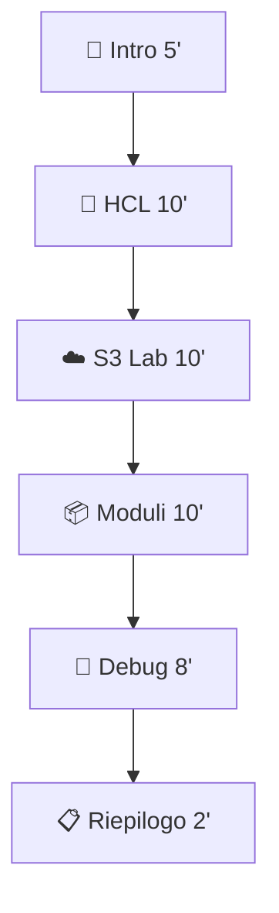

## Infrastructure as Code (IaC) con Terraform — Lezione Completa

Gestire l'infrastruttura dati cliccando pulsanti nella console AWS o Google Cloud è un invito al disastro. "Chi ha aperto quella porta firewall?", "Perché il server di produzione è diverso da quello di staging?". L'Infrastructure as Code (IaC) risolve questo problema trattando l'infrastruttura come software: versionata, testabile e riproducibile. In questa lezione, impareremo a usare Terraform per costruire un Data LakeHouse moderno in minuti, non settimane.

### Obiettivi di Apprendimento

Al termine di questa lezione, lo studente sarà in grado di:
1.  Spiegare i benefici dell'approccio dichiarativo di Terraform ("Voglio questo stato") rispetto a quello imperativo (script Bash).
2.  Scrivere file di configurazione Terraform (`.tf`) per provisionare risorse cloud (Bucket S3, Istanze EC2, Database).
3.  Gestire lo stato dell'infrastruttura (`terraform.tfstate`) in modo sicuro e collaborativo.
4.  Applicare il ciclo di vita `init` -> `plan` -> `apply` per distribuire le modifiche senza paura.
5.  Modularizzare il codice per riutilizzare componenti standard (es. un modulo "Data Warehouse sicuro").

### Timeline della Lezione

| Fase | Argomento | Durata |
|------|-----------|--------|
| 1 | Introduzione: ClickOps vs DevOps | 5 min |
| 2 | Teoria: La sintassi HCL e lo State | 10 min |
| 3 | Pratica: Il primo Bucket S3 | 10 min |
| 4 | Avanzato: Moduli e Variabili | 10 min |
| 5 | Esercizi: Debugging di un `terraform apply` | 8 min |
| 6 | Riepilogo e Domande | 2 min |
| **Totale** | | **45 min** |



### Fase 1 — Introduzione: ClickOps vs DevOps (5 min)

"ClickOps" è il termine dispregiativo per la gestione manuale del cloud.
*   *Problema:* Non c'è storia delle modifiche. Non puoi tornare indietro (Rollback). Se devi rifare l'ambiente in un'altra regione, devi ricliccare tutto a memoria.
*   *Soluzione (IaC):* Scrivi un file di testo. Fai `git commit`. Fai `terraform apply`. Il cloud si configura da solo.

Terraform è lo standard de facto perché è "Cloud Agnostic": con lo stesso strumento gestisci AWS, Google, Azure, Snowflake, Datadog e persino GitHub.

### Fase 2 — Teoria: La sintassi HCL e lo State (10 min)

Terraform usa HCL (HashiCorp Configuration Language). È leggibile come JSON ma più potente.

**Blocchi principali:**
1.  **Provider:** Chi gestiamo? (`provider "aws" { region = "us-east-1" }`).
2.  **Resource:** Cosa creiamo? (`resource "aws_s3_bucket" "data_lake" { ... }`).
3.  **Data Source:** Cosa leggiamo che esiste già? (es. l'ID del tuo account AWS).

**Il file `terraform.tfstate`:**
È il cervello di Terraform. Mappa le tue risorse nel codice agli oggetti reali nel cloud.
*   *Attenzione:* Contiene password in chiaro! Mai committarlo su Git. Usa un backend remoto (es. S3 + DynamoDB per il locking).

### Fase 3 — Pratica: Il primo Bucket S3 (10 min)

Creiamo un Data Lake su AWS.

```hcl

# main.tf

provider "aws" {
  region = "eu-central-1"
}

resource "aws_s3_bucket" "raw_data" {
  bucket = "my-company-raw-data-2024"

  tags = {
    Environment = "Dev"
    Project     = "DataLake"
  }
}

resource "aws_s3_bucket_versioning" "versioning" {
  bucket = aws_s3_bucket.raw_data.id
  versioning_configuration {
    status = "Enabled"
  }
}
```

**Comandi:**
1.  `terraform init`: Scarica il plugin AWS.
2.  `terraform plan`: Ti dice cosa farà ("Creerò 2 risorse"). Leggilo sempre!
3.  `terraform apply`: Lo fa davvero.

### Fase 4 — Avanzato: Moduli e Variabili (10 min)

Non copiare e incollare codice. Usa i Moduli.
Un modulo è come una funzione in Python: prende input (Variabili) e crea risorse.

*Struttura:*
*   `modules/storage/main.tf`: Il codice generico del bucket.
*   `modules/storage/variables.tf`: Gli input (`bucket_name`, `env`).
*   `prod/main.tf`: Chiama il modulo.

```hcl
module "data_lake_prod" {
  source      = "./modules/storage"
  bucket_name = "prod-data-lake"
  env         = "Production"
}
```

Questo garantisce che tutti i bucket in azienda rispettino gli standard (es. crittografia obbligatoria definita nel modulo).

### Fase 5 — Esercizi: Debugging di un `terraform apply` (8 min)

**Scenario:** Esegui `terraform apply` e ricevi un errore: `Error: BucketAlreadyExists`.
*   *Causa:* I nomi dei bucket S3 sono globali (unici in tutto il mondo AWS, non solo nel tuo account). Qualcun altro ha già preso "my-data-lake".
*   *Soluzione:* Aggiungi un suffisso random o il nome dell'azienda (`my-company-data-lake-xc92`).

**Drift Detection:**
Qualcuno ha cancellato il bucket manualmente dalla console AWS.
Esegui `terraform plan`.
Terraform dice: "Ehi, il bucket nel codice dovrebbe esserci, ma nel cloud non c'è. Vuoi che lo ricrei?".
Questa è la potenza della riconciliazione dello stato.

### Fase 6 — Riepilogo e Domande (2 min)

1.  **Dichiarativo.** Dì *cosa* vuoi, non *come*.
2.  **Plan.** Controlla sempre prima di applicare.
3.  **State.** Proteggilo come se fosse oro (usando S3 Backend).
4.  **Immutabilità.** Se un server è rotto, non aggiustarlo. Distruggilo e ricrealo con Terraform.

### Domande di Verifica

1.  Qual è la differenza tra approccio "Imperativo" (es. script AWS CLI) e "Dichiarativo" (Terraform)?
2.  A cosa serve il file `terraform.tfstate` e perché non dovrebbe mai essere salvato nel repository Git?
3.  Cosa succede se modifichi una risorsa manualmente nella console AWS e poi esegui `terraform apply`?
4.  Come si usano le "Output Values" per passare dati (es. l'IP di un database) da un modulo all'altro?
5.  Perché è consigliabile usare un "Remote Backend" (es. S3) quando si lavora in team?

### Riferimenti Bibliografici

-   Yevgeniy Brikman, "Terraform: Up & Running", O'Reilly, 2019.
-   HashiCorp Learn (Tutorial ufficiali interattivi).
-   Gruntwork Blog (Best practices per DevOps).
