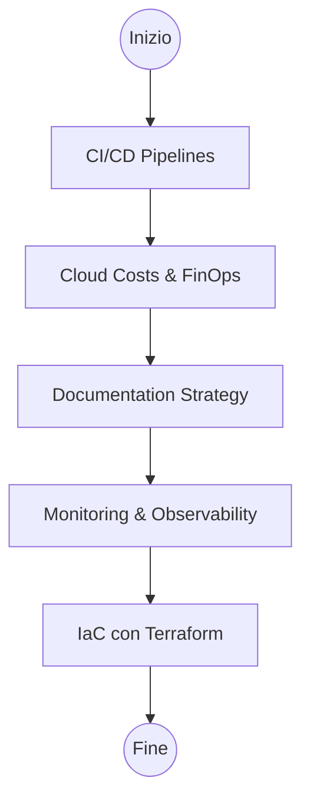

## Panoramica del Modulo

Il modulo **Infrastructure & Data Ops** applica le best practice del DevOps al mondo dei dati. Non basta scrivere codice funzionante: il codice deve essere rilasciato in modo sicuro (CI/CD), monitorato costantemente (Observability) e ottimizzato economicamente (FinOps).
Imparerai a trattare l'infrastruttura come codice (IaC) usando Terraform e a costruire pipeline di rilascio automatizzate.

## Obiettivi di Apprendimento

Al termine di questo modulo sarai in grado di:

- **Automatizzare** il rilascio del codice e dei modelli dati tramite pipeline CI/CD (GitHub Actions).
- **Gestire** i costi del cloud (AWS/GCP) applicando principi FinOps per evitare sorprese in fattura.
- **Documentare** efficacemente l'architettura e i processi (Docs as Code).
- **Monitorare** la salute delle pipeline dati con dashboard di Observability.
- **Provisionare** l'infrastruttura cloud in modo dichiarativo con Terraform (IaC).

## Prerequisiti

- Basi di utilizzo del terminale (Bash/Shell).
- Concetti fondamentali di Cloud Computing (VM, Storage, Serverless).
- Git (commit, push, pull request).

## Percorso delle Lezioni

| N° | Lezione | Argomento Principale | Durata | Difficoltà |
| :-- | :--- | :--- | :--- | :--- |
| 1 | **CI/CD** | Pipeline di Continuous Integration/Deployment | 45 min | ⭐⭐ |
| 2 | **Cloud Costs (FinOps)** | Strategie di ottimizzazione dei costi cloud | 30 min | ⭐ |
| 3 | **Documentation** | Documentazione tecnica scalabile | 30 min | ⭐ |
| 4 | **Monitoring & Observability** | Metriche, log e alerting | 50 min | ⭐⭐ |
| 5 | **IaC con Terraform** | Infrastruttura come Codice | 60 min | ⭐⭐⭐ |

## Competenze Acquisite

**Competenze Tecniche:**
- Configurazione di workflow GitHub Actions.
- Scrittura di file Terraform (.tf) per risorse AWS/GCP.
- Setup di strumenti di monitoring (Prometheus/Grafana o cloud-native).
- Analisi dei costi cloud e tagging delle risorse.

**Competenze Analitiche:**
- Capacità di valutare il TCO (Total Cost of Ownership) di una soluzione dati.
- Progettazione di sistemi resilienti e auto-guarenti.

## Tempo Stimato

- **Durata Totale:** Circa 4-5 ore.
- **Tempo Consigliato:** 2 settimane.

## Come Usare Questo Modulo

L'approccio DataOps è culturale prima che tecnologico. Mentre studi **CI/CD** e **Terraform**, pensa a come questi strumenti riducono il rischio di errore umano.
La lezione sui **Costi (FinOps)** è spesso sottovalutata dai tecnici, ma è quella che ti farà apprezzare di più dal management. Impara a tradurre le risorse tecniche in budget aziendale.
