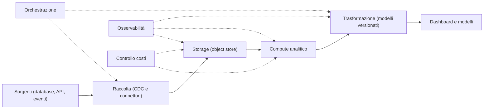

## Il martedì in cui la dashboard della direzione era vuota

Scenario costruito, con numeri di esempio: una scale-up e-commerce di Milano con nove persone in tutto e due nel team dati. In due anni ha accumulato tre database di produzione, un orchestratore che gira su una macchina virtuale dimenticata da chi ha lasciato l'azienda e un data warehouse senza limiti di spesa. Un martedì notte il job di caricamento degli ordini si ferma per un disco pieno. Nessuno riceve un avviso, perché l'avviso era configurato sulla casella di una persona che non lavora più lì. Alle dieci del mattino la direzione apre la dashboard delle vendite e trova la colonna di ieri a zero.

Il guasto in sé vale venti minuti di lavoro. Il danno nasce dal fatto che nessuno sapeva di chi fosse quel pezzo, quanto potesse restare fermo e dove stesse il backup. Una piattaforma dati è l'insieme di componenti, responsabilità e promesse misurabili che permette a quei venti minuti di restare venti minuti.

> **Idea chiave:** un'infrastruttura dati funziona quando ogni pilastro ha un owner nominato, uno SLA misurabile e una procedura di ripristino già provata; il nome dello strumento scelto conta molto meno.

Questo modulo parte da qui perché tutte le lezioni successive (orchestrazione, CI/CD, monitoring, costi) presuppongono che la mappa dei pilastri esista. Se non c'è, ogni alert resta senza destinatario e ogni risparmio senza responsabile.

## I sette pilastri e le loro dipendenze

Una piattaforma sostenibile non richiede decine di strumenti esotici. Richiede confini netti tra sette responsabilità: raccolta, storage su object store, compute analitico, trasformazione, orchestrazione, osservabilità e controllo costi. Lo storage durevole (per esempio Amazon S3 o Google Cloud Storage) conserva i file grezzi e i Parquet; il compute, separato dallo storage, esegue le query; la raccolta e la trasformazione spostano e modellano i dati; orchestrazione, osservabilità e costi tengono insieme il tutto e dicono quando qualcosa si rompe o diventa troppo caro.



Le linee continue sono il percorso del dato, le tratteggiate sono i pilastri trasversali che governano il percorso. Se manca uno dei tre trasversali, il percorso funziona nei giorni buoni e diventa opaco in quelli cattivi. La tabella seguente associa a ogni pilastro la funzione operativa, una scelta gestita tipica e il caso in cui il self-hosted ha senso.

| Pilastro | Funzione operativa | Scelta gestita tipica | Quando valutare self-hosted |
| :--- | :--- | :--- | :--- |
| Storage | Object store durevole per file grezzi e Parquet | Amazon S3 o Google Cloud Storage | Vincoli on-premise o di sovranità del dato |
| Compute | Motore SQL per analisi e dashboard | ClickHouse Cloud o BigQuery | Carichi prevedibili e team infrastruttura presente |
| Raccolta | Replica CDC e connettori SaaS | Fivetran o Airbyte Cloud | Connettori custom che nessun fornitore copre |
| Trasformazione | Modelli SQL versionati e testati | dbt Cloud o GitHub Actions | Runner interni già esistenti e presidiati |
| Orchestrazione | Scheduling di DAG, retry e dipendenze | Astronomer o Prefect Cloud | Cluster Kubernetes già gestito da un team |
| Osservabilità | Freschezza, volumi e schema drift | Controlli SQL con Slack o PagerDuty | Piattaforma APM già in uso in azienda |

La tabella non è una raccomandazione di prodotto, è un modo per rendere esplicita la decisione. Per ogni riga puoi chiederti chi la gestisce oggi, che cosa succede se si ferma per quattro ore e se la risposta sta scritta da qualche parte.

## Gestito o self-hosted: il calcolo che conta è sui dodici mesi

La regola pratica per un team sotto le dieci persone è semplice: servizi gestiti per i componenti con il carico operativo più alto, cioè database transazionali, broker Kafka e warehouse principale, e self-hosted solo dove esiste una competenza interna dedicata o un vincolo normativo. La ragione è quasi sempre il costo del lavoro umano, che nella fattura del fornitore non compare.

Esempio numerico con cifre di esempio, per un broker Kafka con carico modesto. L'offerta gestita costa 1.200 euro al mese. Il self-hosted richiede tre macchine virtuali da 260 euro al mese ciascuna e, secondo il registro dei ticket del team, circa 14 ore al mese di lavoro tra aggiornamenti, rotazione dei certificati, dischi e rebalancing, valorizzate 60 euro all'ora.

1. Costo infrastruttura self-hosted: 3 × 260 euro = 780 euro al mese.
2. Costo del lavoro: 14 ore × 60 euro all'ora = 840 euro al mese.
3. Totale self-hosted: 780 + 840 = 1.620 euro al mese.
4. Differenza rispetto al gestito: 1.620 − 1.200 = 420 euro al mese a favore del gestito.
5. Su dodici mesi: 420 × 12 = 5.040 euro di costo evitabile.

La fattura del self-hosted, letta da sola, sembra più bassa di 420 euro (780 contro 1.200). Il confronto cambia segno solo includendo le 14 ore. Il calcolo va ripetuto con i tuoi dati: se il lavoro reale fosse di 5 ore al mese, il costo del lavoro scenderebbe a 300 euro, il totale a 1.080 euro e il self-hosted risulterebbe più economico di 120 euro al mese. La scelta dipende dalle ore, quindi servono ore misurate sui ticket e non stimate a memoria.

## Registro dei pilastri: owner, SLA e verifica automatica

Per mettere ordine nell'infrastruttura esistente serve un inventario con una riga per pilastro e per ogni flusso critico. Il formato più comodo è un file YAML versionato nello stesso repository del codice, perché ogni modifica passa da una revisione e lascia traccia.

```yaml
# ops/registry.yaml - registro dei flussi critici con owner e SLA
pipelines:
  - name: ordini_raw_to_fact_orders
    pillar: trasformazione
    owner: team-dati            # chi riceve l'alert per primo
    escalation: cto             # chi viene coinvolto dopo 30 minuti
    sla_freshness_minutes: 120  # la tabella non deve avere più di 2 ore di ritardo
    runbook: https://wiki.example.com/runbook/fact-orders
    managed: true
  - name: cdc_postgres_ordini
    pillar: raccolta
    owner: team-dati
    escalation: cto
    sla_freshness_minutes: 15
    runbook: https://wiki.example.com/runbook/cdc-ordini
    managed: true
  - name: export_marketing_giornaliero
    pillar: orchestrazione
    owner: marketing-ops
    escalation: team-dati
    sla_freshness_minutes: 1440  # una volta al giorno è sufficiente
    runbook: https://wiki.example.com/runbook/export-marketing
    managed: false
```

Un registro di questo tipo ha valore solo se qualcosa lo legge. Un piccolo script Python può confrontare l'ultimo successo di ogni flusso con lo SLA dichiarato e produrre l'elenco dei flussi fuori soglia, da inviare al canale giusto.

```python
# ops/check_sla.py - confronta l'ultimo successo di ogni flusso con lo SLA del registro
import datetime as dt
import yaml

def flussi_fuori_sla(registry_path: str, ultimi_successi: dict[str, dt.datetime]) -> list[str]:
    """Restituisce i nomi dei flussi il cui ritardo supera lo SLA dichiarato."""
    with open(registry_path, encoding="utf-8") as f:
        registry = yaml.safe_load(f)
    ora = dt.datetime.now(dt.timezone.utc)
    fuori_soglia = []
    for flusso in registry["pipelines"]:
        ultimo = ultimi_successi.get(flusso["name"])
        if ultimo is None:
            fuori_soglia.append(flusso["name"])  # mai eseguito: trattalo come violazione
            continue
        ritardo_min = (ora - ultimo).total_seconds() / 60
        if ritardo_min > flusso["sla_freshness_minutes"]:
            fuori_soglia.append(flusso["name"])
    return fuori_soglia
```

Le violazioni vanno inviate al canale dell'owner indicato nel registro e non a un canale generico. Come costruire gli alert veri e propri è l'argomento della lezione sul monitoring; qui basta che ogni flusso abbia un destinatario e una soglia scritti.

## La prova di ripristino che cronometra il tempo reale di fermo

Avere i dati su cloud non equivale ad avere un piano di recovery. Una query di cancellazione scritta male o un job che sovrascrive una partizione distruggono una tabella in pochi secondi, e la replica automatica propaga il danno invece di correggerlo. L'unico modo per sapere quanto dura un ripristino è farlo, cronometrando ogni fase, su una tabella di staging e non in produzione.

```bash
#!/usr/bin/env bash
# restore_drill.sh - prova di ripristino di una partizione dal backup su object storage
set -euo pipefail

START=$(date +%s)
# 1. scarica la partizione dal bucket di backup (esempio: partizione del 2026-11-10)
aws s3 sync s3://acme-backup/fact_orders/dt=2026-11-10/ /var/restore/fact_orders/dt=2026-11-10/
T_DOWNLOAD=$(date +%s)
# 2. ricarica nella tabella di staging
./load_partition.sh staging.fact_orders /var/restore/fact_orders/dt=2026-11-10/
T_LOAD=$(date +%s)
# 3. confronta il numero di righe con il valore registrato nel manifest
./verify_rowcount.sh staging.fact_orders 2026-11-10
END=$(date +%s)

echo "download: $((T_DOWNLOAD-START)) s, load: $((T_LOAD-T_DOWNLOAD)) s, verifica: $((END-T_LOAD)) s, totale: $((END-START)) s"
```

Esempio numerico, ancora con valori di esempio. La partizione pesa 120 GB e la banda effettiva verso il server di ripristino è di 200 MB al secondo. Il download richiede 120 × 1.000 / 200 = 600 secondi, cioè 10 minuti. Il caricamento in staging richiede 14 minuti e la verifica del conteggio righe 4 minuti. Il totale è 10 + 14 + 4 = 28 minuti. Se l'obiettivo di ripristino (RTO) dichiarato alla direzione era di 60 minuti, il margine è di 32 minuti, pari a circa il 53% del budget di tempo. Se invece la prova avesse restituito 75 minuti, l'obiettivo sarebbe falso e andrebbe corretto prima che sia un incidente reale a dimostrarlo.

## Tre errori che compaiono quasi sempre nei primi sei mesi

### Scegliere self-hosted senza un team che lo presidi

Sintomo: dopo qualche mese gli analisti e i data engineer passano una parte consistente della settimana ad aggiornare cluster, rinnovare certificati e liberare dischi. Perché succede: il confronto è stato fatto sulla sola licenza, e un'installazione che parte in un pomeriggio dà l'impressione di costare poco da mantenere. Correzione: ripeti il calcolo dei dodici mesi con le ore dei ticket e scegli il gestito per ogni componente la cui manutenzione cade sulle stesse due persone che consegnano i report.

### Considerare il backup come un fatto dimostrato dall'esistenza dei file

Sintomo: durante un incidente si scopre che lo snapshot più recente è di tre settimane fa, o che il ripristino richiede una chiave che nessuno ricorda dove sia. Perché succede: il backup viene verificato quando lo si crea, mai quando serve. Correzione: schedula la prova di ripristino ogni trimestre su una tabella di staging, registra i minuti di ogni fase e confrontali con l'RTO scritto nel registro.

### Far convivere query esplorative e pipeline di produzione sulle stesse risorse

Sintomo: le dashboard del mattino arrivano in ritardo nei giorni in cui un analista lancia un export pesante. Perché succede: compute e quote sono condivisi e nessuno ha dichiarato chi ha la priorità. Correzione: separa i carichi con code, utenti o cluster dedicati, e imposta un limite di durata per le query ad hoc. La lezione sui costi riprende questo punto dal lato della spesa.

## Il caso della PMI con una sola persona nel reparto dati

Quando l'intero reparto è una sola persona, la complessità operativa diventa il rischio principale: ogni componente self-hosted in più è un potenziale blocco durante le ferie o una malattia. La combinazione più robusta riduce al minimo i pezzi mobili: un object store standard, un solo motore analitico gestito, trasformazioni SQL lanciate da una pipeline di CI o da un orchestratore leggero gestito, e notifiche essenziali su un canale che il referente legge davvero.

In questo contesto il registro YAML ha un ruolo particolare. Con una persona sola, l'owner di ogni riga è sempre la stessa, ma il campo escalation è decisivo: indica chi viene chiamato se quella persona non risponde, e senza di esso un guasto di venerdì sera dura fino a lunedì. Ogni scelta tecnologica va valutata sui dodici mesi, includendo il tempo del singolo operatore, che è la risorsa più scarsa e quella che nessun fornitore può sostituire.

## Verifica sulla tua piattaforma

1. In un registro dei pilastri compaiono due flussi con lo stesso owner e nessun campo di escalation: quale rischio concreto introduce e come lo correggi?

<details>
<summary>Mostra risposta</summary>

Se l'unico owner è assente, l'alert non ha un secondo destinatario e il guasto resta senza risposta. Il rischio è un fermo prolungato fuori dall'orario di lavoro. Si corregge aggiungendo il campo di escalation con una persona o un ruolo diverso e un tempo massimo di attesa, per esempio 30 minuti, dopo il quale l'avviso passa al secondo destinatario.

</details>

2. Un broker gestito costa 900 euro al mese. Il self-hosted costa 2 macchine da 210 euro al mese e 6 ore di lavoro al mese a 55 euro all'ora. Quale scelta costa meno su dodici mesi e di quanto?

<details>
<summary>Mostra risposta</summary>

Self-hosted: 2 × 210 = 420 euro di macchine, più 6 × 55 = 330 euro di lavoro, totale 750 euro al mese. Gestito: 900 euro al mese. Il self-hosted costa 150 euro in meno al mese, pari a 1.800 euro in meno su dodici mesi. La conclusione regge solo se le 6 ore sono misurate sui ticket e se nessuno dei costi nascosti (incidenti fuori orario, ferie) è stato escluso.

</details>

3. La prova di ripristino di una partizione da 90 GB con banda effettiva di 150 MB al secondo richiede 6 minuti di caricamento e 3 di verifica. L'RTO dichiarato è 20 minuti: è rispettato?

<details>
<summary>Mostra risposta</summary>

Download: 90 × 1.000 / 150 = 600 secondi, cioè 10 minuti. Totale: 10 + 6 + 3 = 19 minuti. L'RTO di 20 minuti è rispettato con un margine di un solo minuto, cioè il 5%. Il margine è troppo sottile: basta una banda un poco più bassa o una partizione più grande per superarlo, quindi conviene ripetere la prova con una partizione del giorno di massimo carico e rivedere l'obiettivo.

</details>

4. Perché la replica automatica di un database non sostituisce il backup?

<details>
<summary>Mostra risposta</summary>

La replica copia ogni modifica, comprese quelle sbagliate: una cancellazione o una sovrascrittura accidentale si propaga alla copia in pochi secondi. Il backup è invece uno stato passato e separato, da cui si può tornare indietro nel tempo. Per questo vanno tenuti entrambi, e solo il backup va verificato con una prova di ripristino.

</details>
