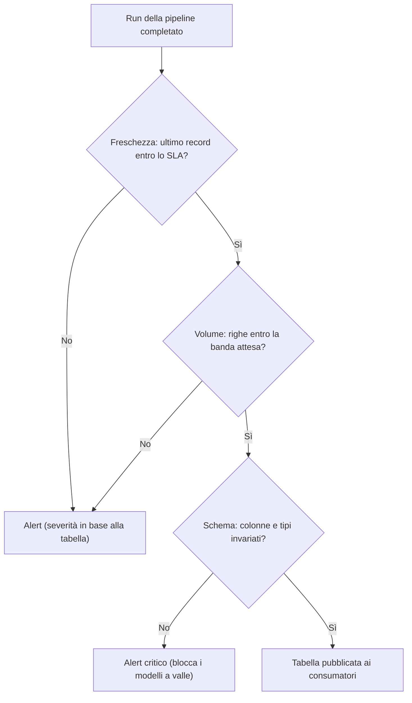

## Cento notifiche al giorno e nessuno che le legge

Caso ricostruito con numeri di esempio, su un'azienda SaaS italiana di dimensioni medie. Il team configura un avviso per ogni ritardo di cinque minuti su tutte le tabelle, comprese quelle secondarie e di test. Nel giro di tre settimane il canale `#data-alerts` accumula più di cento messaggi al giorno e il team smette di aprirlo. Quando la pipeline degli abbonamenti si ferma per 36 ore, l'avviso c'è, ma sta in mezzo a 280 messaggi irrilevanti. Se ne accorge il direttore finanziario, che chiama perché il report degli incassi non torna.

Il monitoring non fallisce per mancanza di avvisi. Fallisce quando gli avvisi non permettono di distinguere un incidente da un rumore, e quindi smettono di essere letti.

> **Idea chiave:** un alert utile ha un owner nominato, una soglia calibrata sul comportamento normale del dato e un'azione scritta da eseguire; senza questi tre elementi produce soltanto rumore.

Qui costruiamo i controlli su tre dimensioni (freschezza, volume, schema), una soglia statistica che tiene conto della stagionalità settimanale e le regole di instradamento e retry che trasformano un controllo in un alert sensato.

## Freschezza, volume e schema: tre domande diverse

Un processo può terminare con codice di uscita zero e aver caricato zero righe, perché la sorgente API ha cambiato formato o ha restituito una pagina vuota. Controllare solo che il job sia finito senza errori tecnici non basta. Per ogni tabella critica servono tre controlli distinti, ciascuno con una domanda precisa: quando è arrivato l'ultimo record valido, quante righe sono entrate rispetto al normale, quali colonne esistono e di che tipo sono.



La tabella riassume che cosa misura ciascun livello, che segnale lo rivela e quale severità conviene assegnare di partenza.

| Livello | Cosa misura | Segnale tipico di anomalia | Severità di partenza |
| :--- | :--- | :--- | :--- |
| Freschezza | Ritardo dall'ultimo aggiornamento valido | Tabella ferma oltre lo SLA (per esempio oltre 2 ore) | Alta sulle tabelle core |
| Volume | Scostamento delle righe dalla media storica | Zero righe o z-score oltre 3 in valore assoluto | Alta se il calo supera il 50% |
| Schema | Colonne aggiunte, rimosse o con tipo cambiato | Colonna chiave mancante o rinominata | Critica, perché rompe i consumatori |
| Qualità dei valori | Null su chiavi, duplicati imprevisti | Tasso di null oltre l'1% su `order_id` | Media o alta, in base all'impatto |

La severità è un punto di partenza da rivedere. Una tabella consultata una volta al mese non merita la stessa severità di quella che alimenta la fatturazione, anche se ha lo stesso tipo di anomalia.

## Perché la soglia fissa sul volume sbaglia due volte

Il controllo più intuitivo sul volume è una soglia fissa: se oggi entrano meno di 8.000 righe, avvisa. Funziona finché il traffico è uniforme, cosa che quasi nessun dato di business rispetta. Nel B2B italiano il sabato e la domenica sono molto più bassi dei giorni feriali: una soglia tarata sul martedì scatta ogni sabato, e una tarata sul sabato non scatta mai di martedì nemmeno se il volume si dimezza.

Per questo si confronta ogni giorno con lo stesso giorno della settimana nelle ultime otto settimane e si misura lo scostamento in deviazioni standard. Lo z-score è la distanza dalla media espressa in unità di deviazione standard: $z = (x - \mu) / \sigma$. Esempio numerico, con numeri di esempio, per le righe caricate ogni martedì nelle ultime otto settimane: 10.200, 9.800, 10.400, 10.000, 9.600, 10.100, 10.300, 9.900.

1. Somma: 10.200 + 9.800 + 10.400 + 10.000 + 9.600 + 10.100 + 10.300 + 9.900 = 80.300 righe.
2. Media: 80.300 / 8 = 10.037,5 righe.
3. Scarti dalla media: 162,5; −237,5; 362,5; −37,5; −437,5; 62,5; 262,5; −137,5.
4. Somma dei quadrati degli scarti: 498.750; varianza della popolazione 498.750 / 8 = 62.343,75.
5. Deviazione standard: radice di 62.343,75, circa 249,7 righe.
6. Soglia inferiore a tre deviazioni: 10.037,5 − 3 × 249,7 = circa 9.288 righe.

Se oggi il martedì mostra 9.300 righe, lo z-score è (9.300 − 10.037,5) / 249,7 = −2,95: sotto soglia, nessun alert. Se mostra 9.000 righe lo z-score è −4,16 e l'alert scatta. Se mostra 4.100 righe, cioè meno della metà del normale, lo z-score è −23,8 e l'anomalia è evidente. Una soglia fissa a 8.000 righe avrebbe lasciato passare 9.000 (che è già un calo anomalo rispetto alla variabilità storica) e avrebbe fatto scattare ogni sabato, dove il volume normale è intorno a 3.000 righe.

```python
# ops/volume_zscore.py - z-score del volume giornaliero sullo stesso giorno della settimana
import statistics

def zscore_volume(oggi: int, storico_stesso_giorno: list[int]) -> float:
    """storico_stesso_giorno: righe caricate negli ultimi 8 giorni uguali (es. gli ultimi 8 martedì)."""
    media = statistics.fmean(storico_stesso_giorno)
    dev_std = statistics.pstdev(storico_stesso_giorno)
    if dev_std == 0:
        return 0.0 if oggi == media else float("inf")  # storico piatto: ogni scostamento è anomalo
    return (oggi - media) / dev_std

martedi = [10200, 9800, 10400, 10000, 9600, 10100, 10300, 9900]
for righe in (9300, 9000, 4100):
    z = zscore_volume(righe, martedi)
    print(righe, round(z, 2), "ALERT" if abs(z) > 3 else "ok")  # 9300 ok, 9000 e 4100 ALERT
```

Il codice calcola la deviazione standard della popolazione perché lo storico di otto valori è l'intero riferimento che si sceglie di confrontare. Il caso con deviazione zero è gestito a parte: uno storico perfettamente piatto non produce uno z-score definito e ogni variazione va trattata come anomala.

## Regole di alert con owner, severità e runbook

Il controllo statistico dice che qualcosa è anomalo. La regola di instradamento dice chi lo deve sapere, quanto è urgente e che cosa fare. Va scritta come configurazione versionata, non come impostazione di una console, così ogni cambio di soglia passa da una revisione.

```yaml
# ops/alert_rules.yaml - regole di alert per le tabelle critiche
alerts:
  - name: fact_subscriptions_freshness
    table: fact_subscriptions
    check: freshness
    threshold_minutes: 120
    severity: high              # high = mention diretta all'owner di turno
    owner: "@team-dati-oncall"
    channel: "#data-incidents"
    runbook: https://wiki.example.com/runbook/subscriptions-freshness
  - name: fact_orders_volume
    table: fact_orders
    check: volume_zscore
    zscore_abs_max: 3
    baseline: same_weekday_8_weeks
    severity: high
    owner: "@team-dati-oncall"
    channel: "#data-incidents"
    runbook: https://wiki.example.com/runbook/orders-volume
  - name: staging_clicks_freshness
    table: staging_clicks
    check: freshness
    threshold_minutes: 360
    severity: low               # low = solo riepilogo giornaliero, nessuna mention
    owner: "@team-dati"
    channel: "#data-digest"
    runbook: https://wiki.example.com/runbook/staging-clicks
```

La separazione dei canali è parte del design. Gli avvisi di severità alta vanno su un canale con pochi messaggi e una mention diretta; quelli di severità bassa finiscono in un riepilogo giornaliero. Con 100 avvisi al giorno e 4 incidenti reali, il rapporto segnale/rumore iniziale era del 4%. Dopo aver rimosso 8 duplicati e spostato 88 avvisi bassi nel riepilogo, in un giorno tipico (100 = 4 + 88 + 8) restano 4 avvisi urgenti nel canale incidenti e 88 nel digest: il canale degli incidenti torna ad avere un tasso di rilevanza del 100% e il team lo legge di nuovo.

Il runbook collegato a ogni regola deve stare in tre righe: come verificare la sorgente, come rilanciare il job e chi avvisare tra gli stakeholder se il ritardo supera lo SLA. Un runbook più lungo non viene letto durante un incidente. Conviene scriverlo subito dopo il primo guasto reale di quella pipeline, quando i passaggi utili sono ancora freschi, e correggerlo ogni volta che un intervento scopre un passaggio mancante. Un alert il cui link porta a una pagina vuota o obsoleta è peggiore di un alert senza link, perché fa perdere minuti a chi è già sotto pressione.

## Sorgenti esterne instabili: persistenza prima dell'escalation

Quando una pipeline dipende da API di fornitori, piattaforme pubblicitarie o gestionali che vanno in manutenzione di notte, un singolo ritardo temporaneo non deve svegliare nessuno alle tre. La regola è di persistenza: il sistema riprova automaticamente con attese crescenti e invia l'alert ad alta severità solo se l'ultimo tentativo fallisce.

Esempio numerico: tre tentativi dopo 5, 10 e 15 minuti di attesa, per un totale di 5 + 10 + 15 = 30 minuti di finestra. Se la manutenzione del fornitore dura in media 20 minuti, il secondo o il terzo tentativo trova la sorgente di nuovo disponibile e nessuno viene svegliato. Se la sorgente resta ferma oltre i 30 minuti, l'alert parte con la mention all'owner.

```bash
#!/usr/bin/env bash
# fetch_with_retry.sh - scarica da un'API esterna con retry a attesa crescente
set -uo pipefail

ATTESE=(5 10 15)   # minuti di attesa prima del 2°, 3° e 4° tentativo
for i in 0 1 2 3; do
  if python3 ingest_ads_api.py --date "$(date -d yesterday +%F)"; then
    exit 0                          # successo: nessun alert
  fi
  if [ "$i" -lt 3 ]; then
    sleep $(( ${ATTESE[$i]} * 60 ))  # attesa crescente prima di riprovare
  fi
done
# tutti i tentativi falliti: invia l'alert ad alta severità con il runbook
curl -s -X POST "$SLACK_WEBHOOK_URL" -H 'Content-Type: application/json' \
  -d '{"text":"ingest_ads_api fallita dopo 4 tentativi in 30 minuti. Runbook: https://wiki.example.com/runbook/ads-api"}'
exit 1
```

Il tentativo iniziale più i tre successivi sono quattro esecuzioni in 30 minuti. Un caso particolare riguarda i dati che arrivano ma sono vuoti: il retry non lo risolve, perché la chiamata ha avuto successo tecnico. Per questo il controllo di volume vive separato dal retry e gira a valle di ogni caricamento.

## Tre errori che trasformano il monitoring in rumore

### Mandare tutto sullo stesso canale con la stessa urgenza

Sintomo: un avviso su una tabella di test e il blocco della fatturazione notturna compaiono nello stesso elenco, con lo stesso aspetto. Perché succede: è il comportamento predefinito di quasi tutti gli strumenti e nessuno ha deciso una gerarchia. Correzione: assegna una severità a ogni regola nel file YAML, instrada la bassa in un riepilogo giornaliero e l'alta con una mention diretta all'owner di turno.

### Usare soglie fisse che ignorano la stagionalità

Sintomo: allarmi puntuali ogni sabato e domenica, silenziati dopo qualche settimana, che nascondono un calo reale di un martedì. Perché succede: la soglia è stata scelta guardando un giorno medio. Correzione: confronta ogni giorno con lo stesso giorno della settimana nelle ultime otto settimane e usa lo z-score; per le festività mobili escludi o contrassegna le date nel calcolo della baseline.

### Controllare solo che il job sia finito senza errori

Sintomo: la dashboard è vuota ma lo scheduler mostra tutti i job in verde. Perché succede: il connettore ha ricevuto una risposta valida con zero risultati, per un filtro sbagliato o un token scaduto che restituisce una pagina vuota. Correzione: aggiungi un controllo esplicito sul volume minimo e uno sullo schema a valle di ogni caricamento, indipendente dall'esito del job.

## Il caso dei volumi bassi in cui lo z-score non basta

Con tabelle che ricevono poche decine di righe al giorno, la deviazione standard è dominata dal rumore casuale e lo z-score produce falsi positivi. Se la media è 12 righe con deviazione standard 4, la soglia inferiore a tre deviazioni è 12 − 3 × 4 = 0 righe: lo z-score scatterebbe solo con un giorno completamente vuoto, il che equivale a controllare che la tabella non sia vuota. In questi casi conviene sostituire la statistica con una regola esplicita (nessuna riga per più di 24 ore) e tenere lo z-score per le tabelle ad alto volume.

## Verifica sul tuo sistema di alert

1. Il volume dei lunedì è stato 5.100, 4.900, 5.050, 4.950 con media 5.000 e deviazione standard circa 79. Oggi arrivano 4.700 righe: l'alert scatta con soglia a 3?

<details>
<summary>Mostra risposta</summary>

z = (4.700 − 5.000) / 79 = circa −3,8. Il valore assoluto supera 3, quindi l'alert scatta. Con uno storico così regolare anche un calo del 6% è anomalo. Conviene però verificare che quattro osservazioni siano sufficienti: con una finestra così corta la deviazione standard è poco affidabile e va allargata alle otto settimane.

</details>

2. Perché una pipeline che termina con successo può comunque aver caricato dati sbagliati, e quale controllo la intercetta?

<details>
<summary>Mostra risposta</summary>

Il job può ricevere una risposta tecnicamente valida ma vuota o con un formato cambiato, e scrivere zero righe o colonne nulle. Si intercetta con un controllo di volume minimo e con un controllo di schema eseguiti dopo il caricamento, indipendenti dal codice di uscita del job.

</details>

3. Quattro tentativi con attese di 5, 10 e 15 minuti: quanto dura la finestra complessiva e quando parte l'alert ad alta severità?

<details>
<summary>Mostra risposta</summary>

La somma delle attese è 5 + 10 + 15 = 30 minuti. L'alert parte dopo il quarto tentativo fallito, cioè circa 30 minuti dopo il primo errore. Una manutenzione del fornitore di 20 minuti si risolve dal secondo o terzo tentativo senza svegliare nessuno.

</details>

4. In un giorno ci sono 90 avvisi di severità bassa e 5 di severità alta. Dopo aver instradato i bassi nel riepilogo, quale percentuale del canale incidenti è rilevante?

<details>
<summary>Mostra risposta</summary>

Il canale incidenti contiene solo i 5 avvisi di severità alta, quindi la percentuale di rilevanza è 5 / 5 = 100%, contro il 5 / 95 = circa 5,3% di prima. Il riepilogo giornaliero tiene i 90 avvisi bassi leggibili in un solo punto, senza interrompere nessuno.

</details>
