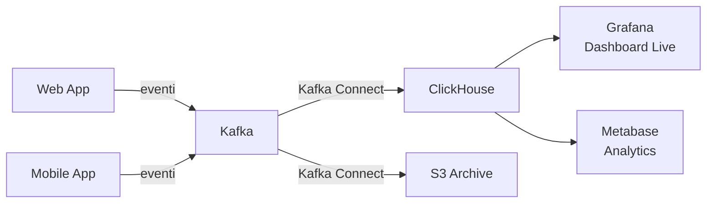

# Caso Studio — Architetture Streaming

> **Scenario:** Un marketplace online deve passare da batch processing (aggiornamento notturno) a streaming real-time per le dashboard marketing.

## 1. Il Problema
| Aspetto | Batch (prima) | Real-Time (dopo) |
|:---|:---|:---|
| Latenza dati | 24 ore | meno di 5 secondi |
| Costo opportunità | Anomalie scoperte il giorno dopo | Alert immediato |
| User experience | Report del giorno prima | Dashboard live |

## 2. Architettura Implementata


## 3. Configurazione Kafka
```properties
# Topic per eventi di tracking
num.partitions=6
replication.factor=3
retention.ms=604800000   # 7 giorni
cleanup.policy=delete
compression.type=lz4
```

```python
from confluent_kafka import Producer
producer = Producer({
    'bootstrap.servers': 'kafka:9092',
    'acks': 'all',
    'enable.idempotence': True,
    'compression.type': 'lz4',
    'batch.size': 16384,
    'linger.ms': 10
})
def send_event(topic, key, value):
    producer.produce(topic, key=key.encode(), value=json.dumps(value).encode())
    producer.flush()
```

## 4. Risultati
| Metrica | Prima | Dopo |
|:---|:---:|:---:|
| Latenza dati | 24h | 3s |
| Anomalie rilevate/giorno | 0.3 | 4.2 |
| Tempo di reazione | Giorno dopo | 10 minuti |
| Revenue salvato (trim.) | - | €85K |

## Lezioni
1. Kafka come buffer assorbe gli spike senza perdere eventi
2. Inizia con pochi topic ben partizionati, non decine
3. Il vero valore non è la velocità ma la capacità di reagire
