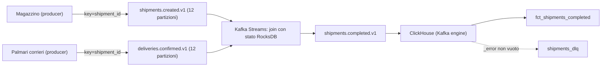

Un operatore logistico B2B italiano vuole unire in tempo reale due flussi: le spedizioni create dal magazzino, su `shipments.created.v1`, e le conferme di consegna trasmesse dai palmari dei corrieri, su `deliveries.confirmed.v1`. L'obiettivo è calcolare i tempi di consegna per corriere e avvisare i clienti dei ritardi. Nel primo prototipo i due topic hanno un numero diverso di partizioni, i palmari rinviano più volte lo stesso pacchetto quando escono da una zona senza campo, e un messaggio con un peso scritto come testo blocca il consumer di ClickHouse per tutta Italia. È un caso ricostruito con numeri di esempio, e la causa non è la rete mobile: è una pipeline progettata senza chiave condivisa, senza tempo di business nel join e senza un posto dove isolare i dati sporchi.

## Partizioni disallineate, palmari senza campo e consumer bloccati

L'azienda del caso gestisce 180.000 spedizioni al giorno affidate a 15 corrieri regionali e vuole monitorare su ClickHouse il rispetto dell'SLA di consegna entro 24 ore per i clienti express. Il primo tentativo fallisce su tre fronti contemporaneamente.

Il primo riguarda le chiavi. `shipments.created.v1` è stato creato con 6 partizioni e chiave `warehouse_id`, mentre `deliveries.confirmed.v1` ha 12 partizioni e chiave `driver_id`. Quando la topologia tenta di unire creazione e consegna sulla stessa spedizione, i due eventi stanno su partizioni, e quindi su task, diversi: la maggior parte delle consegne non trova la spedizione di partenza.

Il secondo riguarda il tempo. I palmari in zone montane accumulano fino a 40 minuti di ritardo prima di trasmettere la firma del destinatario, e spesso inviano due o tre volte lo stesso pacchetto JSON. Una finestra di join stretta, basata sul tempo di arrivo, scarta le consegne montane, mentre i retry duplicano le provvigioni dei corrieri. Il terzo riguarda i dati: un aggiornamento di un magazzino periferico scrive la stringa `'N/A'` nel campo numerico `weight_kg`, e il consumer verso ClickHouse si ferma sul messaggio malformato.

> **Idea chiave:** una pipeline end-to-end regge il collaudo solo se chiave di partizionamento, tempo di business e gestione degli errori sono progettati insieme fin dal producer, perché ciascuno dei tre problemi si ripercuote sugli altri due.

## Architettura in quattro blocchi con contratti espliciti

La pipeline si divide in quattro blocchi, ciascuno con un contratto verificabile.

Il primo è il contratto dei topic. `shipments.created.v1`, `deliveries.confirmed.v1` e `shipments.completed.v1` hanno tutti 12 partizioni, `replication.factor=3`, `min.insync.replicas=2` e retention di 14 giorni, cioè 1.209.600.000 ms. I producer usano la stessa chiave in entrambi i flussi, `shipment_id`.

Il secondo blocco è il join stateful, eseguito in Kafka Streams. La topologia tiene le spedizioni aperte in una tabella di stato su RocksDB, indicizzata per `shipment_id`, con `num.standby.replicas=1` e garanzia `exactly_once_v2` perché lettura e scrittura avvengono entrambe dentro Kafka. Quando arriva `DeliveryConfirmed`, anche 24 o 48 ore dopo la partenza, la topologia recupera `dispatched_at` e `service_level`, calcola `delivery_hours` e pubblica l'evento arricchito su `shipments.completed.v1`.

Il terzo e il quarto blocco sono l'ingestione protetta in ClickHouse e il monitoraggio. ClickHouse legge `shipments.completed.v1` a blocchi di 65.536 righe con `kafka_handle_error_mode = 'stream'`, dirotta i record malformati in una tabella `shipments_dlq` e scrive i validi in una tabella `ReplacingMergeTree`. Un controllo sul lag e sulla coda degli errori chiude il disegno.



## Co-partizionamento: la chiave decide dove vivono gli eventi

Un join tra due topic funziona solo se gli eventi con la stessa chiave stanno sulla stessa partizione di due topic con lo stesso numero di partizioni, perché Kafka Streams assegna a ogni task la partizione numero $n$ di entrambi. Questa condizione si chiama co-partizionamento e ha due parti: stessa chiave di business e stesso numero di partizioni, con lo stesso partizionatore.

Se le due condizioni non valgono, Kafka Streams deve riscrivere uno dei due flussi su un topic interno di ripartizionamento, con chiave corretta, prima del join. Funziona, ma raddoppia il traffico di rete e lo spazio disco di quel flusso. Se lo sviluppatore dimentica il ripartizionamento, il join non trova le chiavi corrispondenti e produce record con `dispatched_at` nullo.

La chiave `shipment_id` va scelta anche per un'altra ragione: la sua cardinalità è altissima (180.000 valori al giorno), quindi distribuisce uniformemente il traffico sulle 12 partizioni. La chiave `warehouse_id`, con pochi magazzini grandi, avrebbe prodotto partizioni calde. Una conferma di consegna e la sua creazione, per `SHP-99412`, finiscono ora nella stessa partizione, per esempio la 7, e vengono lette dallo stesso task.

## Tempo di business e stato: perché la finestra di join non basta

Il secondo errore del prototipo riguarda il confronto temporale. Una finestra di join tra stream (`JoinWindows`) accoppia due eventi se arrivano a distanza di pochi minuti, ed è il disegno giusto per il clickstream, dove impressione e click distano secondi. Una spedizione dura invece 24 o 48 ore tra creazione e consegna, e una finestra di 15 minuti scarta praticamente ogni abbinamento.

Per processi fisici lunghi si usa un join stream-tabella: le spedizioni aperte stanno in una `KTable` persistente, e ogni conferma di consegna la interroga per chiave, qualunque sia la distanza nel tempo. Lo stato è piccolo: con 180.000 spedizioni al giorno e due giorni di spedizioni aperte, la tabella contiene 360.000 record. A 200 byte ciascuno sono 360.000 × 200 byte = 72 MB, abbondantemente gestibili da RocksDB su disco locale.

Per i ritardi dei palmari conta poi quale timestamp si usa. Il tempo di arrivo sul broker è sbagliato per questo scopo, perché una firma trasmessa dopo 40 minuti sembra una consegna avvenuta 40 minuti dopo. Si usa `delivered_at`, generato dal palmare all'origine, e `delivery_hours = delivered_at − dispatched_at` si calcola quindi con i tempi di business.

## Dimensionamento, duplicati e SLA con i numeri del caso

Tre calcoli servono per la revisione del progetto: lo spazio disco dei topic, il costo dei duplicati e il valore dell'SLA di un corriere.

Per il disco, ogni evento pesa circa 500 byte e passa attraverso tre topic. Il volume giornaliero è 3 topic × 180.000 eventi × 500 byte = 270 MB. Con retention di 14 giorni diventa 270 MB × 14 = 3.780 MB, circa 3,8 GB per replica, e con replication factor 3 si arriva a 3,78 GB × 3 = 11,3 GB sul cluster. Sono numeri piccoli, e dicono che la retention lunga costa poco: la ristrettezza di disco non è mai un buon motivo per tagliarla.

Per i duplicati, ipotizziamo che il 6% delle consegne sia inviato tre volte dal palmare. Le consegne ripetute sono 180.000 × 0,06 = 10.800, ciascuna con due copie in più, quindi 10.800 × 2 = 21.600 righe duplicate. Con una provvigione media di 4,20 euro per consegna il sovrapagamento è 21.600 × 4,20 euro = 90.720 euro al giorno, se la tabella non deduplica. Con la chiave `shipment_id` e un motore che tiene una sola riga per chiave il costo scende a 0 euro.

Per l'SLA, un corriere con 12.000 consegne e 11.160 entro 24 ore ha un tasso di puntualità pari a 11.160 ÷ 12.000 = 93,0%. Il calcolo cambia solo se i duplicati entrano nel conteggio: con 12.000 + 800 righe doppie il denominatore sale a 12.800 e il tasso apparente diventa 11.160 ÷ 12.800 = 87,2%, un calo di 5,8 punti percentuali dovuto interamente ai retry.

## Tre errori che compromettono il collaudo

### Topic con chiavi o partizioni diverse

Il sintomo è un numero alto di record con `dispatched_at` nullo dopo il join. Succede perché partizionare per `warehouse_id` e per `driver_id` sembra naturale per chi produce ciascun flusso, ma il join richiede la stessa chiave. Si corregge con `shipment_id` su entrambi i topic e lo stesso numero di partizioni, controllando con `--describe` prima di scrivere la topologia.

### Finestra di join di pochi minuti per processi di giorni

Il sintomo è un abbinamento quasi nullo tra creazione e consegna. La finestra di 15 minuti nasce da esempi didattici sul clickstream, e per la logistica scarta il 99,9% degli abbinamenti. La correzione è una tabella di stato persistente, con retention dello stato adeguata alla durata massima di una spedizione.

### Rilascio senza owner, retention e runbook per la DLQ

Il sintomo si manifesta un sabato mattina, quando un messaggio finisce in `shipments_dlq` e nessuno sa a chi spetti. Un progetto presentato in review solo con codice, senza team responsabile, giorni di retention e procedura di recupero, lascia i pacchi dei record scartati invisibili nei report. Si risolve compilando la scheda di ownership: nome del topic, subject dello schema, team owner, canale di allerta, retention e la query per ispezionare e riprocessare la tabella degli errori.

## Implementazione: topic, producer e ingestione protetta in ClickHouse

I topic si creano con lo stesso comando e gli stessi valori, in un ciclo, per evitare differenze tra uno e l'altro.

```bash
# Tre topic co-partizionati: stesse partizioni, stessa chiave di business, stessa retention
for t in shipments.created.v1 deliveries.confirmed.v1 shipments.completed.v1; do
  kafka-topics.sh --bootstrap-server kafka-1:9092 --create --topic "$t" \
    --partitions 12 --replication-factor 3 \
    --config min.insync.replicas=2 --config retention.ms=1209600000
done

# Controllo: le tre descrizioni devono mostrare PartitionCount: 12
kafka-topics.sh --bootstrap-server kafka-1:9092 --describe --topic deliveries.confirmed.v1
```

Il producer dei palmari usa `shipment_id` come chiave e un'idempotenza attiva, così un retry di rete non duplica il messaggio lato Kafka. I duplicati inviati dal palmare stesso, a livello applicativo, restano e si eliminano più a valle.

```python
# Producer dei palmari: stessa chiave del flusso delle spedizioni create
import json
from confluent_kafka import Producer

producer = Producer({
    "bootstrap.servers": "kafka-1:9092",
    "acks": "all",
    "enable.idempotence": True,
    "compression.type": "zstd",
})

evento = {"shipment_id": "SHP-99412", "carrier_id": "CR-07",
          "delivered_at": "2026-11-10T09:41:12.000Z"}
producer.produce("deliveries.confirmed.v1", key=evento["shipment_id"],
                 value=json.dumps(evento))
producer.flush()
```

In ClickHouse la coda Kafka legge `shipments.completed.v1`, e due Materialized View smistano i record: quelli validi verso la tabella principale, quelli con `_error` non vuoto verso la DLQ.

```sql
-- ClickHouse: coda Kafka con gestione errori in streaming
CREATE TABLE logistics.kafka_shipments_completed_q
(
    shipment_id String,
    carrier_id LowCardinality(String),
    service_level LowCardinality(String),
    dispatched_at DateTime64(3, 'UTC'),
    delivered_at DateTime64(3, 'UTC'),
    weight_kg Float32,
    payout_eur Decimal(10, 2)
)
ENGINE = Kafka
SETTINGS
    kafka_broker_list = 'kafka-1:9092,kafka-2:9092,kafka-3:9092',
    kafka_topic_list = 'shipments.completed.v1',
    kafka_group_name = 'cg-ch-logistics-completed-v1',
    kafka_format = 'JSONEachRow',
    kafka_max_block_size = 65536,
    kafka_handle_error_mode = 'stream';

-- Tabella finale: una riga per shipment_id dopo i merge, con le coordinate Kafka
CREATE TABLE logistics.fct_shipments_completed
(
    carrier_id LowCardinality(String),
    delivered_date Date,
    shipment_id String,
    dispatched_at DateTime64(3, 'UTC'),
    delivered_at DateTime64(3, 'UTC'),
    payout_eur Decimal(10, 2),
    kafka_partition UInt32,
    kafka_offset UInt64,
    ingested_at DateTime64(3, 'UTC') DEFAULT now64(3)
)
ENGINE = ReplacingMergeTree(ingested_at)
PARTITION BY toYYYYMM(delivered_date)
ORDER BY (carrier_id, delivered_date, shipment_id);

CREATE MATERIALIZED VIEW logistics.mv_shipments_valid
TO logistics.fct_shipments_completed AS
SELECT carrier_id, toDate(delivered_at) AS delivered_date, shipment_id,
       dispatched_at, delivered_at, payout_eur,
       _partition AS kafka_partition, _offset AS kafka_offset
FROM logistics.kafka_shipments_completed_q
WHERE length(_error) = 0;

-- Dead Letter Queue: ogni record malformato resta ispezionabile
CREATE TABLE logistics.shipments_dlq
(
    failed_at DateTime DEFAULT now(),
    kafka_partition UInt32,
    kafka_offset UInt64,
    error_reason String,
    raw_json String
)
ENGINE = MergeTree
ORDER BY (failed_at, kafka_partition, kafka_offset);

CREATE MATERIALIZED VIEW logistics.mv_shipments_dlq
TO logistics.shipments_dlq AS
SELECT now() AS failed_at, _partition AS kafka_partition, _offset AS kafka_offset,
       _error AS error_reason, _raw_message AS raw_json
FROM logistics.kafka_shipments_completed_q
WHERE length(_error) > 0;

-- Controllo SLA per corriere, deduplicato per shipment_id con argMax
WITH spedizioni_uniche AS (
    SELECT carrier_id, shipment_id,
           argMax(dispatched_at, ingested_at) AS dispatched_at,
           argMax(delivered_at, ingested_at) AS delivered_at,
           argMax(payout_eur, ingested_at) AS payout_eur
    FROM logistics.fct_shipments_completed
    WHERE delivered_date >= today() - 7
    GROUP BY carrier_id, shipment_id
)
SELECT carrier_id,
       count() AS consegne_uniche,
       round(countIf(dateDiff('minute', dispatched_at, delivered_at) <= 1440) * 100.0 / count(), 2) AS on_time_24h_pct,
       sum(payout_eur) AS provvigioni_dovute_eur
FROM spedizioni_uniche
GROUP BY carrier_id
ORDER BY on_time_24h_pct ASC;
```

Con questo disegno il record con `'N/A'` nel peso finisce in `shipments_dlq` senza fermare il resto, i pacchetti inviati tre volte collassano in un'unica riga per `shipment_id` e ogni consegna è pagata una volta sola.

## Join a monte in Kafka Streams o a valle in ClickHouse

L'architettura lascia una scelta: eseguire il join dentro Kafka Streams, pubblicando il topic unito, oppure ingerire i due topic separati in ClickHouse e unirli lì. Il criterio è chi legge l'evento unito. Se `ShipmentCompleted` serve in tempo reale ad altri servizi sul bus Kafka, per esempio il servizio notifiche che invia un buono di scuse quando `delivery_hours > 24` o il gestionale che sblocca il pagamento al corriere, il join va a monte. Se l'evento unito serve solo a dashboard e reportistica, basta scrivere entrambi gli eventi nella stessa tabella per `shipment_id` e calcolare `min(dispatched_at)` e `max(delivered_at)` in ClickHouse.

Due errori speculari ricorrono. Costruire una topologia Streams quando nessuno oltre a ClickHouse legge l'uscita aggiunge un componente applicativo senza beneficio. Fare il join solo in ClickHouse quando dieci microservizi hanno bisogno dell'evento arricchito li obbliga a interrogare il warehouse, che diventa un message broker improprio.

## Controllo finale del collaudo

1. Tutti i topic che partecipano al join hanno la stessa chiave `shipment_id` e lo stesso numero di partizioni?

<details>
<summary>Mostra risposta</summary>

Sì: tutti e tre i topic sono a 12 partizioni e i producer usano `shipment_id` come chiave. Si verifica con `kafka-topics.sh --describe` su ciascuno prima di avviare la topologia.

</details>

2. Un palmare invia 3 volte la stessa consegna da 4,20 euro. Quanto viene pagato in una tabella senza deduplicazione e in una con `ReplacingMergeTree` su `shipment_id`?

<details>
<summary>Mostra risposta</summary>

Senza deduplicazione 3 × 4,20 euro = 12,60 euro, con 8,40 euro di troppo. Con la tabella che tiene una riga per chiave e la query con `argMax` il totale è 4,20 euro.

</details>

3. Il topic riceve 180.000 eventi al giorno da 500 byte, con retention 14 giorni e RF=3. Quanto disco serve per topic?

<details>
<summary>Mostra risposta</summary>

180.000 × 500 byte = 90 MB al giorno, × 14 = 1.260 MB, × 3 = 3.780 MB, cioè circa 3,8 GB per topic sul cluster.

</details>

4. Come verifichi che la DLQ funzioni davvero?

<details>
<summary>Mostra risposta</summary>

Si pubblica sul topic di test un messaggio con `weight_kg` pari a `"N/A"` e si controlla che compaia in `logistics.shipments_dlq` mentre i messaggi validi successivi continuano a entrare in `fct_shipments_completed` senza ritardo.

</details>

5. Cosa deve contenere il runbook perché un replay di emergenza sia possibile?

<details>
<summary>Mostra risposta</summary>

Team owner, retention di 14 giorni, soglie di allarme sul lag e il comando esatto `kafka-consumer-groups.sh --reset-offsets` per il gruppo coinvolto, insieme alla query per riprocessare le righe della DLQ.

</details>
