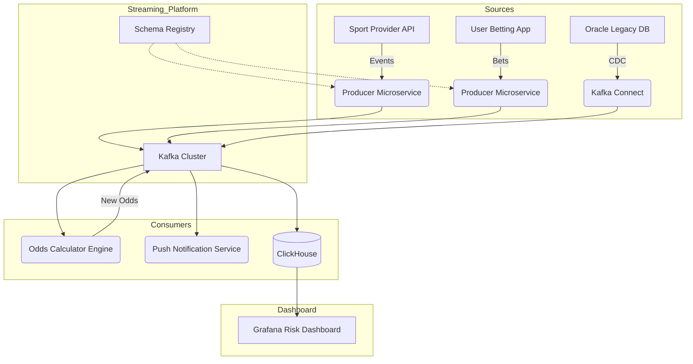
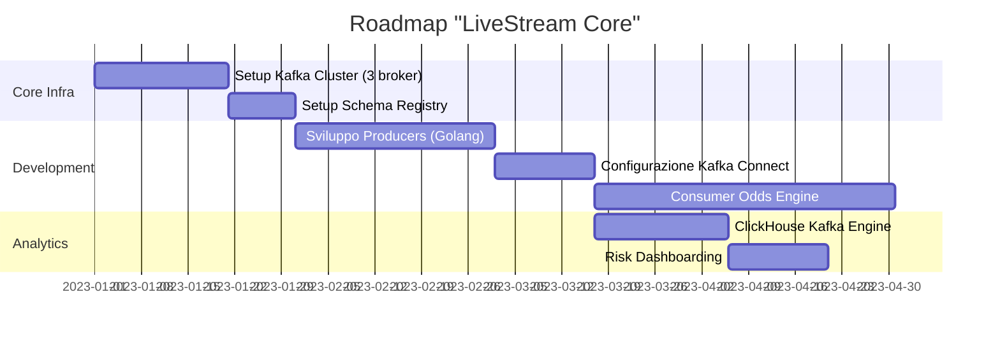
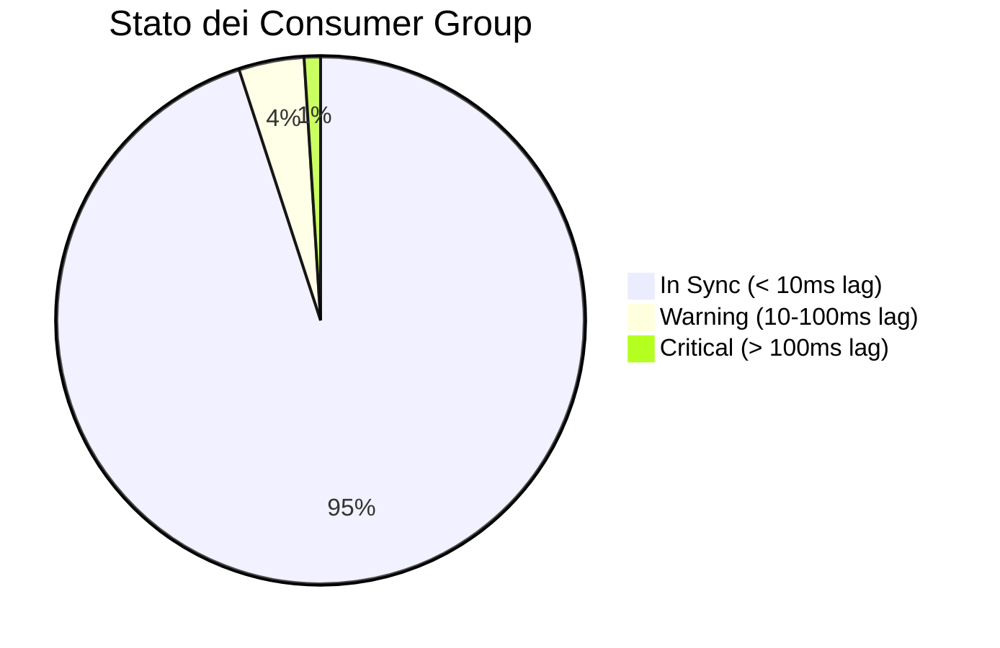

## Contesto Aziendale

**Azienda:** *BetLive S.p.A.* (nome fittizio)
**Settore:** Betting & Gaming Online
**Traffico:** 100k utenti concorrenti durante i big match
**Stack Attuale:** Monolite PHP + MySQL + Job Batch ogni minuto

Nel betting live, il tempo è denaro. Se una squadra segna un gol e le quote non si aggiornano istantaneamente, gli "arbitragisti" (utenti esperti) scommettono sulla vecchia quota vincente sicura, causando perdite enormi al banco.
L'architettura attuale di BetLive ha una latenza di 60-90 secondi. I concorrenti sono sotto i 5 secondi.

### Dati Iniziali

| Metrica | Situazione Attuale | Obiettivo | Note |
| :--- | :--- | :--- | :--- |
| **Latenza Aggiornamento Quote** | 60-90 sec | < 100 ms | Critico per evitare perdite |
| **Throughput Massimo** | 2.000 eventi/sec | 50.000 eventi/sec | Scalabilità per finali di coppa |
| **Data Loss** | Occasionale (sotto carico) | 0% (Transazionale) | Garanzia "Exactly-Once" |
| **Visibilità Risk Manager** | Report ogni 15 min | Real-time Dashboard | Monitoraggio esposizione finanziaria |

**Problema Principale:** Il database relazionale (MySQL) è il collo di bottiglia. Non può gestire scritture massive e letture analitiche contemporaneamente. Serve disaccoppiare ingestione e processamento.

## Obiettivi del Progetto

Il progetto "LiveStream Core" mira a:

1.  **Migrare a un'Architettura Kappa**, dove tutto è uno stream di eventi immutabili.
2.  **Ridurre la latenza end-to-end a < 100ms** per l'aggiornamento delle quote sui frontend client.
3.  **Implementare Kafka Connect** per integrare i sistemi legacy (Anagrafica Utenti su Oracle) senza riscriverli.
4.  **Garantire la qualità del dato** tramite Confluent Schema Registry e Avro, impedendo a bug software di corrompere le transazioni.

## Analisi e Strategia

### 1. Il Cuore Pulsante: Apache Kafka
Kafka non sarà solo un tubo, ma lo "storage centrale" degli eventi.
*   **Topic:** `match-events` (gol, falli), `bets-placed` (scommesse), `odds-updates` (quote calcolate).
*   **Partizionamento:** Chiave per `match_id`. Tutti gli eventi della stessa partita devono essere processati in ordine dallo stesso consumer.

### 2. Integrazione Legacy: Kafka Connect
Non possiamo spegnere il vecchio Oracle domani. Useremo **Kafka Connect (JDBC Source Connector)** per leggere in CDC (Change Data Capture) le modifiche ai profili utente e portarle sul topic `user-updates`.

### 3. Analytics Real-Time: Kafka + ClickHouse
I Risk Manager devono vedere l'esposizione totale in tempo reale.
*   Collegheremo ClickHouse direttamente a Kafka usando il **Kafka Table Engine**.
*   Useremo **Materialized Views** in ClickHouse per aggregare le scommesse per partita e mercato istantaneamente.

### Diagramma dell'Architettura Streaming

**Decisioni Chiave:**
*   **Avro vs JSON:** Scelto Avro per la compattezza (binario) e la gestione rigida dello schema. In finanza, un campo `amount` letto come stringa invece che float è un disastro.
*   **Retention:** I topic delle scommesse hanno retention "Forever" (Compact Topic) per avere un audit log immutabile.

## Implementazione

### Timeline (5 Mesi)

### Dati Intermedi: Gestione del Backpressure

Durante il primo load test (50k eventi/sec), i consumer sono andati in crash per memoria insufficiente.
**Problema:** I consumer non riuscivano a tenere il passo del producer (Consumer Lag crescente).
**Soluzione:**
1. Aumentato le partizioni del topic `bets-placed` da 10 a 50.
2. Scalato orizzontalmente il Consumer Group (da 10 a 50 istanze).
3. Ottimizzato il batch size del consumer.

| Configurazione | Throughput Consumer | Lag Medio | Esito |
| :--- | :--- | :--- | :--- |
| **Batch 500, 10 Partizioni** | 5k msg/sec | 15.000 msg | CRITICAL |
| **Batch 2000, 50 Partizioni** | 60k msg/sec | 50 msg | STABLE |

## Risultati

Il sistema è andato live prima dei Mondiali.

### KPI Prima vs Dopo

| KPI | Prima (T0) | Dopo (T5) | Variazione |
| :--- | :--- | :--- | :--- |
| **Latenza Quote** | 85 sec | 0.08 sec (80ms) | -99.9% |
| **Uptime durante Picchi** | 95% (Down frequenti) | 99.99% | Stabilità Totale |
| **Tempo Rilevamento Frodi** | 24 ore (Batch) | 5 secondi (Stream) | Real-time |
| **Revenue persa per Arbitraggio** | €50k / mese | €0 / mese | Problema Risolto |

### Analisi ROI

L'investimento in Kafka e formazione è stato di €150.000.
Il recupero delle perdite da arbitraggio (€600k/anno) ha ripagato il progetto in 3 mesi.
Inoltre, la dashboard Real-Time ha permesso ai Risk Manager di bloccare puntate anomale live, risparmiando altri €200k.

### Visualizzazione Consumer Lag (Grafana)

## Lezioni Apprese

1.  **Schema Registry è la cintura di sicurezza:** Senza di esso, un producer che cambia formato manda in crash tutti i consumer a valle. Mai andare in produzione senza contratti dati.
2.  **Partizionamento è la chiave della scalabilità:** Bisogna scegliere la chiave di partizione con cura. `User_ID` va bene per le scommesse, ma `Match_ID` è essenziale per l'engine delle quote (ordine garantito per partita).
3.  **Monitorare il Lag, non solo la CPU:** La CPU bassa non significa che va tutto bene. Se il Consumer Lag cresce, stai perdendo il real-time.
4.  **Idempotenza:** In rete i messaggi possono essere duplicati. Configurare il producer `enable.idempotence=true` e gestire la deduplica lato consumer è vitale per le transazioni finanziarie.
5.  **Kafka non è un database (ma quasi):** Con la Log Compaction possiamo tenere lo stato degli utenti in Kafka, ma per le query complesse serve proiettare i dati su ClickHouse.

## Domande di Discussione

1.  Come gestiresti un bug nel codice del "Odds Calculator" che ha generato quote sbagliate per 1 ora? (Hint: Reprocessing e Reset Offset).
2.  Qual è il trade-off tra latenza e throughput nella configurazione `linger.ms` del Producer?
3.  Perché l'uso di Kafka Connect è preferibile allo scrivere un proprio script Python che legge dal database ogni 5 secondi?
4.  In che modo l'architettura Kappa semplifica il disaster recovery rispetto alla Lambda Architecture?
5.  Come garantiresti l'ordine degli eventi se un utente scommette da mobile e poi subito da desktop?

**Cosa faresti diversamente?**
*   *Se fossimo su Cloud:* Userei Confluent Cloud invece di gestire Kafka e Zookeeper/KRaft on-premise, riducendo drasticamente l'overhead operativo (Ops).
*   *Se i volumi fossero bassi:* Redis Streams sarebbe stato più semplice e veloce da implementare per un team piccolo, anche se meno robusto per la persistenza a lungo termine.
