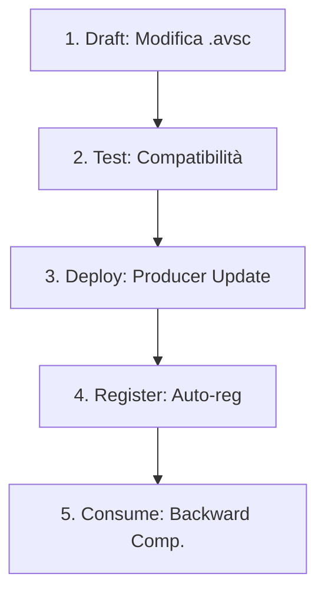

## Concetti Chiave

- **Event Streaming**: Processare i dati mentre accadono (in motion) invece di salvarli per dopo (at rest).
- **Topic**: Il "folder" logico dove finiscono i messaggi. Diviso in *Partitions*.
- **Partition**: L'unità fondamentale di scalabilità. I messaggi dentro una partizione sono ordinati (Offset).
- **Offset**: L'ID sequenziale univoco di un messaggio dentro una partizione.
- **Consumer Group**: Un gruppo di consumer che collaborano per leggere un topic. Ogni partizione è letta da UNO solo consumer del gruppo.
- **Replication Factor**: Quante copie dei dati esistono nel cluster (Solitamente 3 per tolleranza ai guasti).
- **Schema Registry**: Servizio centralizzato che valida la struttura dei messaggi (es. Avro) per evitare "Poison Pills".
- **Log Compaction**: Meccanismo per tenere solo l'ultimo valore per ogni chiave (utile per tabelle di stato K-V).

## Formule e Regole

| Concetto | Regola | Perché |
|----------|--------|--------|
| **Ordinamento** | Garantito solo *per partizione* | Kafka non è totalmente ordinato. Se serve ordine globale, usa 1 sola partizione (ma perdi scalabilità). |
| **Scalabilità** | `Max Consumer attivi = N. Partizioni` | Se hai 10 partizioni, l'11° consumer nel gruppo starà fermo (idle). |
| **Retention** | Temporale (es. 7 giorni) o Dimensione (es. 1GB) | Kafka non è un DB infinito (di default). I dati vecchi vengono cancellati. |
| **Ack** | `acks=all` (o -1) | Il producer aspetta la conferma da *tutte* le repliche ISR (In-Sync Replicas). Massima sicurezza. |
| **Idempotenza** | `enable.idempotence=true` | Garantisce che un messaggio non venga duplicato in caso di retries di rete (Exactly-Once del povero). |

## Framework e Architetture

### Pub/Sub Model
Disaccoppiamento totale tra chi produce dati e chi li usa.

```mermaid
flowchart LR
    P1[Producer A] --> T1[Topic: Clicks]
    P2[Producer B] --> T1
    T1 --> C1[Consumer Group 1<br/>(Data Warehouse)]
    T1 --> C2[Consumer Group 2<br/>(Real-time Dashboard)]
    T1 --> C3[Consumer Group 3<br/>(Fraud Detection)]
```

### Schema Evolution Rules (Avro)
Come cambiare i dati senza rompere tutto.

| Modalità | Regola | Chi deve aggiornarsi prima? |
|----------|--------|-----------------------------|
| **BACKWARD** | Puoi togliere campi o aggiungere campi con default | Consumer (Nuovo schema legge vecchi dati). |
| **FORWARD** | Puoi aggiungere campi o togliere campi con default | Producer (Vecchio schema legge nuovi dati). |
| **FULL** | Massima flessibilità (e complessità) | Ordine indifferente. |

## Processo Step-by-Step: Schema Change Sicuro

1.  **Draft**: Modifica il file `.avsc` (es. aggiungi un campo opzionale con `default: null`).
2.  **Test**: Esegui `compatibility check` contro lo Schema Registry (in CI/CD).
3.  **Deploy**: Se compatibile, rilascia il Producer con il nuovo schema.
4.  **Register**: Al primo messaggio, il Producer registra automaticamente il nuovo ID schema.
5.  **Consume**: I Consumer scaricano il nuovo schema ed essendo BACKWARD compatibile, leggono tutto senza crash.



## Errori da Evitare

-   ❌ **Chiavi ad alta cardinalità** → ✅ Se usi `User_ID` come chiave e un utente fa 1 milione di eventi, sovraccarichi una sola partizione (Hotspot).
-   ❌ **Blocking Consumer** → ✅ Se il consumer ci mette troppo a processare un messaggio, Kafka pensa sia morto e fa **Rebalance** (stop del mondo). Elabora velocemente o usa thread separati.
-   ❌ **Hardcoding Offset** → ✅ Mai gestire gli offset a mano se non sei un esperto. Lascia fare a Kafka (`enable.auto.commit`).
-   ❌ **Poison Pill** → ✅ Un messaggio malformato che fa crashare il consumer. Il consumer riparte, rilegge lo stesso messaggio, e ricrasha (loop infinito). Gestisci le eccezioni e usa una Dead Letter Queue (DLQ).
-   ❌ **Moltiplicare i Topic** → ✅ Creare un topic per ogni utente o cliente è un anti-pattern. Usa un topic unico e filtra.

## Quick Reference

| Strumento | A cosa serve | Quando usarlo |
|-----------|--------------|---------------|
| **Kafka Connect** | Integration | Spostare dati IN (Source) e OUT (Sink) da Kafka senza scrivere codice (es. da Postgres a S3). |
| **KSQL / Kafka Streams** | Stream Processing | Filtrare, aggregare e joinare stream in tempo reale (SQL o Java). |
| **Schema Registry** | Governance | Obbligare i producer a rispettare un contratto dati (Avro/Protobuf). |
| **kcat (kafkacat)** | CLI Debug | Leggere e scrivere messaggi da terminale (come `curl` o `cat` per Kafka). |
| **AKHQ / Kowl** | UI | Interfaccia grafica per vedere messaggi, offset e gruppi. |
