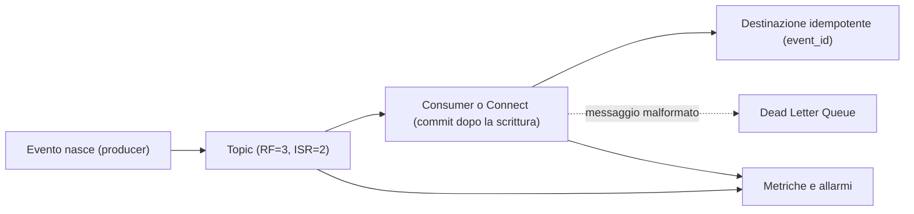

Un team rilascia il venerdì pomeriggio la pipeline degli abbonamenti ricorrenti, `subscriptions.events.v1`, dimenticando tre parametri. Il topic nasce da auto-creazione con una partizione e `replication.factor=1`, il producer non ha l'idempotenza attiva e la tabella di destinazione non ha una coda per i messaggi malformati. Sabato, dopo un breve problema di rete, risultano persi 800 eventi, duplicati 2.300 per effetto dei retry, e un singolo messaggio corrotto blocca il consumer per dodici ore. È uno scenario costruito con numeri di esempio. Nessuno dei tre guasti è sfortuna: sono tre voci di una scheda di controllo che nessuno ha passato.

## Tre parametri dimenticati il venerdì

Il primo errore sta nel broker. Con `auto.create.topics.enable=true` un topic può nascere da un nome sbagliato o da un'applicazione di test, con i valori di sviluppo: una partizione, nessuna replica aggiuntiva e `min.insync.replicas=1`. Quando l'unico broker che lo ospita si riavvia, gli 800 eventi non ancora scritti su disco sono persi.

Il secondo errore sta nel producer. Senza `enable.idempotence=true`, un timeout fa scattare un retry, ma il broker potrebbe aver già scritto il messaggio: nascono così 2.300 duplicati. Il terzo sta nel sink, dove una tabella costruita senza gestione degli errori si ferma sull'offset corrotto e non avanza più.

> **Idea chiave:** una pipeline Kafka è pronta per la produzione quando quattro livelli (broker e topic, producer, consumer o sink, monitoraggio) rispettano insieme una configurazione di riferimento, e basta una voce mancante per trasformare un incidente di rete in una perdita di dati.

Questa lezione è un indice operativo. Raccoglie in un posto solo i parametri e i comandi che le altre lezioni del modulo spiegano per esteso, e dice dove tornare per l'approfondimento di ciascuno.

## Mappa del modulo e lezione da aprire per ogni problema

Il modulo segue il percorso di un evento, dal momento in cui nasce fino a quando una dashboard lo mostra. La tabella associa a ciascun sintomo la lezione che lo spiega.

| Sintomo o domanda | Lezione da aprire | Concetto da recuperare |
|---|---|---|
| Perché non basta una coda? | `introduzione-streaming` | Log append-only, offset, consumer group |
| Messaggi confermati e poi spariti | `kafka-fondamenti` | Triade RF, `min.insync.replicas`, `acks` |
| Duplicati, rebalance, commit | `kafka-producers-consumers` | Idempotenza, commit manuale |
| Schema cambiato e consumer rotti | `kafka-schema-registry` | Compatibilità e versioni di schema |
| Sincronizzare un database | `kafka-connect` | CDC su WAL, SMT, Dead Letter Queue |
| Lag, disco, partizioni sotto-replicate | `kafka-ops` e `kafka-operations` | Metriche e soglie di escalation |
| Costruire tutto insieme | `caso-studio` | Co-partizionamento, join, sink idempotente |



Il diagramma indica anche dove si mettono i controlli. Ogni freccia è un punto in cui un parametro dimenticato può far perdere o duplicare un evento, e per questo la scheda che segue è organizzata per livelli e non per strumento.

## Profilo di configurazione di riferimento

La scheda seguente vale per cluster con almeno tre broker e flussi che alimentano analytics o applicazioni critiche. Ogni riga è un valore da pretendere in code review, e ciascuna ha una lezione che la giustifica.

| Livello | Parametro | Valore di riferimento |
|---|---|---|
| Broker | `auto.create.topics.enable` | `false` |
| Broker | `unclean.leader.election.enable` | `false` |
| Topic | `replication.factor` e `min.insync.replicas` | 3 e 2 |
| Topic | `retention.ms` | almeno 604800000 (7 giorni), oppure `cleanup.policy=compact` per stati |
| Producer | `acks` e `enable.idempotence` | `all` e `true` |
| Producer | `compression.type`, `linger.ms` | `zstd`, 20 |
| Consumer | `enable.auto.commit` | `false`, commit dopo la persistenza |
| Schema | compatibilità | `BACKWARD_TRANSITIVE` con `default` sui nuovi campi |

Il topic si crea con codice o script versionato, mai a mano e mai per auto-creazione. Il comando seguente applica il profilo e poi verifica che ogni partizione abbia davvero tre repliche sincronizzate, perché una creazione riuscita non garantisce che le repliche siano allineate:

```bash
# Topic di produzione con il profilo di riferimento (RF=3, ISR=2, 7 giorni)
kafka-topics.sh --bootstrap-server kafka-1:9092 --create \
  --topic subscriptions.events.v1 --partitions 12 --replication-factor 3 \
  --config min.insync.replicas=2 --config retention.ms=604800000 \
  --config compression.type=producer

# Verifica: ogni partizione deve elencare tre repliche in Isr
kafka-topics.sh --bootstrap-server kafka-1:9092 --describe --topic subscriptions.events.v1
```

Il consumer applicativo applica la stessa disciplina dal lato lettura. Il commit avviene solo dopo che il dato è stato scritto a destinazione, così un crash produce una rielaborazione e non una perdita:

```python
# Consumer con commit manuale dopo la scrittura (at-least-once)
from confluent_kafka import Consumer

consumer = Consumer({
    "bootstrap.servers": "kafka-1:9092",
    "group.id": "cg-subscriptions-sink-prod",
    "enable.auto.commit": False,       # il commit lo decidiamo noi
    "auto.offset.reset": "earliest",
})
consumer.subscribe(["subscriptions.events.v1"])

while True:
    msg = consumer.poll(1.0)
    if msg is None or msg.error():
        continue
    scrivi_su_destinazione(msg.key(), msg.value())   # idempotente su event_id
    consumer.commit(message=msg, asynchronous=False) # solo dopo la scrittura
```

## Diagnosi rapida con i comandi del cluster

Prima di cambiare qualsiasi configurazione conviene guardare lo stato reale del cluster, perché molte segnalazioni di perdita dati sono in realtà un consumer in ritardo o una replica fuori dall'ISR. Quando qualcosa va storto, tre comandi rispondono a quasi tutte le prime domande. Il primo mostra il lag di un gruppo, il secondo le partizioni che hanno perso una replica e il terzo quelle senza leader.

```bash
# Lag per partizione di un gruppo: colonna LAG = LOG-END-OFFSET - CURRENT-OFFSET
kafka-consumer-groups.sh --bootstrap-server kafka-1:9092 \
  --describe --group cg-subscriptions-sink-prod

# Partizioni sotto-replicate: in condizioni sane non stampa nulla
kafka-topics.sh --bootstrap-server kafka-1:9092 --describe --under-replicated-partitions

# Partizioni senza leader: ogni riga è un incidente P1
kafka-topics.sh --bootstrap-server kafka-1:9092 --describe --unavailable-partitions
```

Il lag indica quanto lavoro è accumulato, le partizioni sotto-replicate indicano un rischio di durabilità e quelle senza leader indicano una scrittura impossibile: sono tre problemi diversi con urgenze diverse. Per un replay, il gruppo si ferma e si riporta indietro solo lui, con `--reset-offsets --to-datetime` seguito dall'opzione `--execute`. L'opzione `--dry-run` mostra prima dove arriverebbero gli offset, ed è la buona abitudine prima di ogni reset.

## Dal numero di eventi in coda ai secondi di ritardo

Il lag in eventi dice poco senza la velocità di produzione. Un arretrato di 90.000 eventi è un problema grave su un flusso da 50 eventi al secondo e irrilevante su uno da 5.000. Il ritardo si legge in secondi, e la soglia di allarme si fissa su quel valore.

Il calcolo si fa con numeri di esempio, passo dopo passo.

Numeri di esempio: il topic riceve 1.000 eventi al secondo, il gruppo ha un arretrato di 90.000 eventi e il consumer smaltisce 1.500 eventi al secondo. La soglia di allarme `P2` è 120 secondi.

Il ritardo in secondi è 90.000 eventi ÷ 1.000 eventi/s = 90 secondi, sotto la soglia di 120. La velocità netta di smaltimento è la differenza tra consumo e produzione, 1.500 − 1.000 = 500 eventi/s, quindi il tempo per azzerare l'arretrato è 90.000 ÷ 500 = 180 secondi, cioè 3 minuti. Se il consumer rallentasse a 900 eventi/s, la velocità netta diventerebbe 900 − 1.000 = −100 eventi/s: l'arretrato crescerebbe di 100 eventi al secondo e non si smaltirebbe mai.

Questo ultimo caso è quello da riconoscere: un consumer più lento del producer non recupera, e l'allarme deve scattare sulla tendenza oltre che sul valore. Le soglie di escalation della scheda sono: `OfflinePartitionsCount > 0` come `P1` immediato, `UnderReplicatedPartitions > 0` per oltre 3 minuti come `P1`, ritardo oltre 120 secondi come `P2` e disco oltre il 75% come `P2`. Su un broker da 2 TB il 75% corrisponde a 1,5 TB usati.

Va notato che il ritardo in secondi dipende dal ritmo di produzione e non dalla capacità del consumer: se la produzione raddoppia a 2.000 eventi/s, lo stesso arretrato di 90.000 eventi vale solo 45 secondi di ritardo, mentre lo smaltimento rallenta perché la velocità netta scende a 1.500 − 2.000 = −500 eventi/s. Per questo si monitorano insieme ritardo, tendenza e rapporto tra le due velocità, e non un singolo numero.

## Tre configurazioni da bloccare in review

### Topic con auto-creazione attiva

Il sintomo è un topic con nome quasi uguale a quello giusto (`orders.cretead.v1`), una partizione e nessuna replica. Succede perché un refuso nel codice basta a farlo nascere, e nessuno se ne accorge finché il broker non si riavvia. La correzione è disattivare `auto.create.topics.enable` e creare i topic solo da codice versionato.

### Consumer senza gestione degli errori

Il sintomo è un consumer fermo sullo stesso offset per ore. L'impostazione predefinita lascia due scelte entrambe sbagliate: ripetere all'infinito l'elaborazione del messaggio rotto, oppure scartarlo senza lasciare traccia. La soluzione è una Dead Letter Queue, che nei connettori è `errors.tolerance=all` con topic di quarantena e nel motore Kafka di ClickHouse è `kafka_handle_error_mode = 'stream'` con una tabella per gli errori.

### Destinazione senza chiave di deduplicazione

Il sintomo si vede al primo replay: dopo un `--reset-offsets` di due giorni, i conteggi raddoppiano. La tabella finale non conserva né un `event_id` né le coordinate `_partition` e `_offset`, e quindi non può riconoscere i messaggi già scritti. Si corregge portando l'identificativo dell'evento fino alla destinazione e usando un motore o una query che deduplica su di esso.

## At-least-once con deduplicazione o transazioni exactly-once

Per ottenere conteggi esatti ci sono due strade. La prima è consegna *at-least-once*, con producer idempotente e commit dopo la scrittura, abbinata alla deduplicazione su `event_id` nella destinazione. La seconda sono le transazioni Kafka (`exactly_once_v2` con `isolation.level=read_committed`).

Il criterio è netto. Per le pipeline verso data warehouse e data lake si usa at-least-once con deduplicazione, perché un identificativo univoco nel payload rende un inserimento ripetuto equivalente a uno singolo in lettura. Le transazioni si riservano alle topologie interne a Kafka, dove un'applicazione Kafka Streams o Flink legge da un topic e scrive su un altro. Coordinare una transazione tra Kafka e un sistema esterno come ClickHouse o S3 rallenta i commit e introduce transazioni appese, senza dare ciò che la deduplicazione offre a costo minimo.

In sviluppo locale con un solo broker, ricorda di abbassare `replication.factor`, `min.insync.replicas` e `offsets.topic.replication.factor` a 1, altrimenti la creazione dei topic interni fallisce per mancanza di broker.

## Controllo prima di firmare il rilascio

1. Un topic ha RF=3 e `min.insync.replicas=3` con `acks=all`. Perché è una configurazione da respingere?

<details>
<summary>Mostra risposta</summary>

Un solo broker fermo per manutenzione porta l'ISR a 2 e tutti i producer ricevono `NotEnoughReplicasException`. Il valore corretto è `min.insync.replicas=2`.

</details>

2. Il topic riceve 2.000 messaggi al secondo, il gruppo ha 150.000 messaggi di arretrato e il consumer ne elabora 2.500 al secondo. Quanto ritardo hai in secondi e in quanto tempo si azzera?

<details>
<summary>Mostra risposta</summary>

Ritardo: 150.000 ÷ 2.000 = 75 secondi. Velocità netta: 2.500 − 2.000 = 500 messaggi/s, quindi 150.000 ÷ 500 = 300 secondi, cioè 5 minuti.

</details>

3. Dopo un reset degli offset di sei ore i conteggi risultano gonfiati. Quale pezzo della scheda manca?

<details>
<summary>Mostra risposta</summary>

La deduplicazione nella destinazione: manca un `event_id` (o `_partition` e `_offset`) con un motore o una query che collassi i duplicati. Il consumer at-least-once rilegge per costruzione parte dei messaggi.

</details>

4. Per un job che legge da Kafka e scrive su un altro topic Kafka, usi at-least-once con dedup o transazioni?

<details>
<summary>Mostra risposta</summary>

Transazioni (`exactly_once_v2`), perché lettura e scrittura avvengono entrambe dentro Kafka e il coordinamento è nativo. At-least-once con dedup si usa per le destinazioni esterne.

</details>
