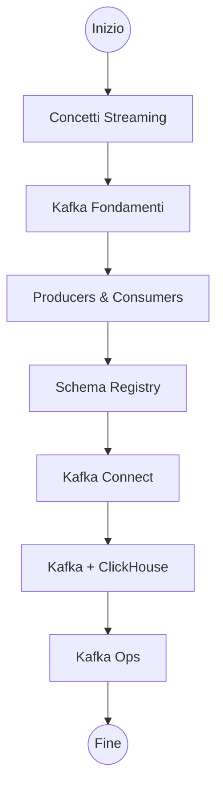

## Panoramica del Modulo

Il **Real-time Streaming** è diventato lo standard per le moderne data platform. Le decisioni non possono più aspettare il report di domani mattina.
In questo modulo, passeremo dalla logica "Batch" (lenta) a quella "Streaming" (immediata) usando **Apache Kafka**, lo standard de facto per l'ingestion dati. Scopriremo come produrre, consumare e trasformare i dati in tempo reale, per poi analizzarli con ClickHouse.

## Obiettivi di Apprendimento

Al termine di questo modulo sarai in grado di:

- **Progettare** architetture event-driven resilienti e scalabili.
- **Configurare** producer e consumer Kafka ottimizzati per throughput e latenza.
- **Utilizzare** lo Schema Registry per garantire la consistenza dei dati (Avro).
- **Integrare** Kafka Connect per spostare dati tra sistemi senza scrivere codice.
- **Analizzare** stream di dati in tempo reale collegando Kafka a ClickHouse.
- **Monitorare** e gestire un cluster Kafka in produzione (Ops).

## Prerequisiti

- Concetti di base di sistemi distribuiti (code, messaggi, latenza).
- Familiarità con un linguaggio di programmazione (Java/Python utile ma non indispensabile).

## Percorso delle Lezioni

| N° | Lezione | Argomento Principale | Durata | Difficoltà |
| :-- | :--- | :--- | :--- | :--- |
| 1 | **Introduzione allo Streaming** | Batch vs Streaming: il cambio di paradigma | 30 min | ⭐ |
| 2 | **Kafka Fondamenti** | Broker, Topic, Partition, Offset | 50 min | ⭐⭐ |
| 3 | **Producers & Consumers** | Scrivere e leggere dati da Kafka | 60 min | ⭐⭐⭐ |
| 4 | **Schema Registry** | Validazione e versioning dei messaggi (Avro) | 45 min | ⭐⭐⭐ |
| 5 | **Kafka Connect** | Integrazione plug-and-play con sorgenti esterne | 40 min | ⭐⭐ |
| 6 | **Kafka & ClickHouse** | Analytics real-time ad alte prestazioni | 50 min | ⭐⭐⭐ |
| 7 | **Kafka Ops** | Gestione, monitoring e scaling del cluster | 45 min | ⭐⭐⭐ |

## Competenze Acquisite

**Competenze Tecniche:**
- Architettura Event-Driven.
- Configurazione avanzata di Kafka (ACKs, Retries, Idempotence).
- Serializzazione dati (Avro, Protobuf).
- Integrazione eterogenea tramite Kafka Connect.

**Competenze Analitiche:**
- Capacità di pensare in "finestre temporali" (Time Windows) per le analisi.
- Gestione della consistenza e dell'ordine degli eventi in sistemi distribuiti.

## Tempo Stimato

- **Durata Totale:** Circa 6-7 ore.
- **Tempo Consigliato:** 2-3 settimane.

## Come Usare Questo Modulo

Kafka è complesso. Non cercare di memorizzare ogni configurazione a memoria. Concentrati sui concetti chiave: **Partitioning**, **Consumer Groups** e **Commit Offset**.
Se possibile, fai girare un cluster Kafka locale (con Docker) e prova a romperlo: spegni un broker, scollega un consumer. È il modo migliore per capire la resilienza del sistema.
