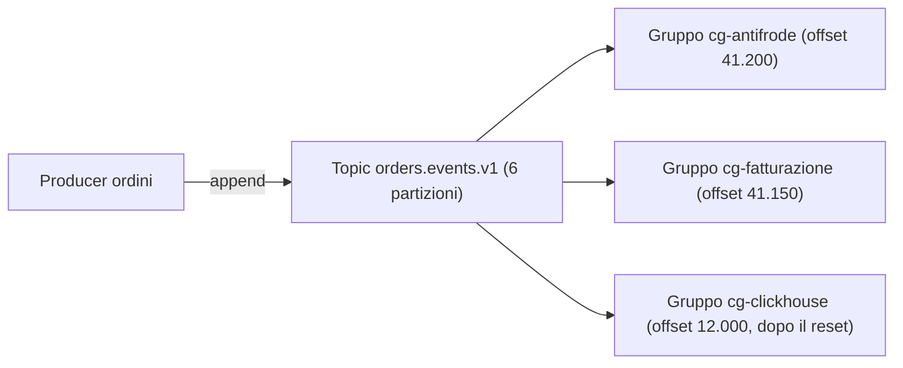

Un'azienda B2B distribuisce gli eventi d'ordine su una coda RabbitMQ, dove il broker cancella il messaggio nel momento in cui il primo worker risponde con `ACK`. Un nuovo sviluppatore collega il servizio di fatturazione alla stessa coda da cui legge il connettore del data warehouse. Da quel giorno ogni sistema riceve solo metà degli ordini e nessun log segnala qualcosa di strano. Tre giorni dopo emerge un bug nel parser, che ha ignorato il campo `vat_amount` da venerdì a domenica, e il team scopre che i messaggi del weekend non esistono più da nessuna parte. È uno scenario costruito con numeri di esempio, ma i meccanismi sono quelli reali: la causa non è un guasto hardware, è l'uso di una coda distruttiva dove serviva un registro di eventi che conserva la storia.

## Tre giorni di ordini cancellati dopo l'ACK

La piattaforma dello scenario genera 80.000 eventi d'ordine al giorno, e quegli eventi devono arrivare a tre sistemi: il motore antifrode, la fatturazione e il data warehouse in ClickHouse. Nel disegno iniziale esiste un'unica coda AMQP, e il broker consegna i messaggi ai consumatori collegati a turno, in *round-robin*. Con due consumatori sulla stessa coda, i messaggi pari vanno alla fatturazione e quelli dispari al warehouse. Entrambi vedono il 50% del traffico, ognuno convinto di vederlo tutto.

Il secondo incidente è più costoso. Il bug sul campo `vat_amount` produce tre giorni di dati sbagliati, pari a 3 giorni × 80.000 eventi = 240.000 ordini da ricalcolare. Il worker ha però confermato ogni lettura con `ACK`, e dopo la conferma il broker libera memoria e disco. Il materiale da rielaborare è sparito.

> **Idea chiave:** una coda custodisce un messaggio finché qualcuno lo consuma, un log lo custodisce finché scade la retention, indipendentemente da quante volte e da chi lo ha letto.

La differenza strutturale è questa, e discende dal progetto originale di Kafka descritto da [Kreps, Narkhede e Rao nel 2011](https://notes.stephenholiday.com/Kafka.pdf): trattare il flusso di eventi come un file in append su disco, dove ogni lettore tiene un proprio segnalibro.

| Aspetto | Coda di lavoro (RabbitMQ, SQS) | Commit log (Kafka) |
|---|---|---|
| Dopo la lettura | Il messaggio viene rimosso | Il messaggio resta fino alla retention |
| Più lettori indipendenti | Si spartiscono i messaggi | Ciascun gruppo li riceve tutti |
| Rilettura del passato | Non possibile | Si sposta l'offset indietro |
| Ordine | Per coda, perso con più worker | Per partizione, quindi per chiave |
| Uso tipico | Job in background (email, PDF) | Flussi di eventi di dominio |

## Il log append-only: perché leggere non consuma

Un *topic* Kafka è un file di log suddiviso in segmenti. I nuovi eventi si aggiungono sempre in coda e ricevono un numero progressivo che non cambia mai, l'**offset** (0, 1, 2, ...). Leggere un messaggio significa leggere il file a partire da un certo offset: l'operazione non modifica nulla, per questo dieci lettori diversi non si ostacolano. Il broker cancella dati solo per scadenza, secondo `retention.ms` oppure `retention.bytes`, e non per effetto delle letture.

Questo cambia anche la responsabilità del consumatore. Nel modello a coda il broker sa cosa è stato consegnato. Nel modello a log il broker conosce solo la posizione di ciascun gruppo, memorizzata nel topic interno `__consumer_offsets`, e il consumatore decide quando avanzarla (il *commit*). Se il consumatore muore a metà lavoro, alla ripartenza riprende dall'ultimo offset confermato, e un messaggio può essere rielaborato. Per questo i consumatori Kafka vanno scritti in modo idempotente, un tema che torna nelle lezioni su producer, consumer e connettori.



Il diagramma mostra tre gruppi con tre offset diversi sullo stesso log. Il gruppo del warehouse è stato riportato indietro per il replay, e gli altri due non se ne sono accorti.

## Partizioni, chiavi e ordine degli eventi

Un singolo file su un singolo disco non scala, quindi il topic viene diviso in $P$ **partizioni** distribuite sui broker. Ogni partizione è un log indipendente con una propria numerazione degli offset. Kafka garantisce l'ordine di arrivo solo dentro la stessa partizione, e nessuna garanzia tra partizioni diverse.

Il producer sceglie la partizione calcolando l'hash della chiave del messaggio, in pratica `murmur2(key) mod P`. Tutti gli eventi con la stessa chiave finiscono nella stessa partizione e vengono letti nell'ordine in cui sono stati scritti. Se la chiave è `order_id`, la sequenza `OrderCreated`, `OrderPaid`, `OrderShipped` di uno stesso ordine resta coerente, mentre eventi di ordini diversi possono mescolarsi senza danno.

Con chiave nulla il producer distribuisce i messaggi a rotazione sulle partizioni. Il throughput è bilanciato, ma l'ordine tra eventi correlati è perso, perché partizioni diverse vengono lette a velocità diverse. La scelta della chiave è quindi una decisione di modellazione: la chiave giusta è l'identificativo dell'entità di cui serve la sequenza causale, con cardinalità alta abbastanza da distribuire il carico in modo uniforme. Una chiave come `country` con il 70% degli ordini in Italia produce una *hot partition* che da sola riceve il 70% del traffico.

C'è un vincolo che conviene conoscere subito. Il numero di partizioni si può aumentare dopo la creazione, ma `murmur2(key) mod P` cambia al variare di $P$. Dopo l'aumento, la stessa chiave può finire su una partizione diversa, e per un periodo gli eventi dello stesso ordine si ritrovano distribuiti su due log. Si sceglie quindi $P$ con un margine di crescita fin dall'inizio.

## Consumer group: fan-out tra sistemi, parallelismo dentro il gruppo

Ogni applicazione che legge un topic dichiara un `group.id`, e Kafka tiene un offset per ogni coppia gruppo-partizione. Gruppi diversi leggono in modo indipendente e ciascuno riceve il 100% dei messaggi: è il *fan-out*. Dentro lo stesso gruppo, invece, ogni partizione è assegnata a un solo consumatore alla volta, e il lavoro si divide senza duplicare le letture.

Ne discende il tetto del parallelismo. Con 6 partizioni un gruppo può usare al massimo 6 consumatori attivi. Se ne avvii 10, quattro restano inattivi in attesa di subentrare ai primi sei in caso di crash. Per aumentare il parallelismo di lettura servono più partizioni, non più istanze.

Nello scenario iniziale l'errore era speculare. Fatturazione e warehouse erano due applicazioni diverse ma, essendo collegate alla stessa coda, ricevevano a turno gli stessi messaggi. In Kafka lo stesso errore si commette assegnando lo stesso `group.id` a due servizi: il broker li tratta come due istanze della stessa applicazione e si divide le partizioni tra loro.

## Dimensionare un topic: partizioni e disco per il flusso degli ordini

Il dimensionamento è un calcolo, e conviene farlo prima di creare il topic. Prendiamo i numeri di esempio dello scenario: picco di 1.200 eventi al secondo, messaggio medio di 600 byte, il consumatore di fatturazione elabora 400 eventi al secondo per istanza (scrive su un database transazionale), retention di 7 giorni e fattore di replica 3.

Partizioni minime per il consumatore più lento:

1. Picco 1.200 eventi/s ÷ 400 eventi/s per istanza = 3 istanze, quindi almeno 3 partizioni.
2. La piattaforma prevede di raddoppiare il traffico entro un anno: 2.400 eventi/s ÷ 400 = 6 istanze.
3. Il vincolo di scrittura per partizione non pesa: 2.400 eventi/s × 600 byte = 1,44 MB/s, ben sotto i 10 MB/s circa che una partizione regge. Risultato: 6 partizioni.

Spazio disco, a regime medio di 80.000 eventi al giorno:

1. Volume giornaliero: 80.000 eventi × 600 byte = 48.000.000 byte = 48 MB.
2. Retention di 7 giorni: 48 MB × 7 = 336 MB per replica.
3. Con fattore di replica 3: 336 MB × 3 = 1.008 MB, circa 1 GB.
4. Con il 30% di margine operativo: 1.008 MB × 1,3 = 1.310 MB.

Sono numeri minuscoli, ed è un'informazione utile: per questo volume il costo della retention lunga è trascurabile, e ridurla a un'ora per risparmiare disco sarebbe un falso risparmio. Il replay del weekend, infine, costa poco anche in tempo: rileggere 240.000 eventi a 50.000 eventi al secondo richiede 240.000 ÷ 50.000 = 4,8 secondi.

## Tre errori del primo flusso su Kafka

I tre errori seguenti sono i più frequenti in un primo progetto, e nascono tutti dal ragionare ancora per code.

```bash
# ERRORE 1: una sola partizione e retention di un'ora, nessun replay possibile
kafka-topics.sh --bootstrap-server kafka-1:9092 --create \
  --topic orders.events.v1 --partitions 1 --replication-factor 1 \
  --config retention.ms=3600000

# ERRORE 2: due applicazioni diverse con lo stesso group.id
kafka-console-consumer.sh --bootstrap-server kafka-1:9092 \
  --topic orders.events.v1 --group app-condivisa
```

### Lo stesso group.id per due servizi con scopi diversi

Il sintomo è che fatturazione e data warehouse ricevono ciascuno una frazione degli ordini, senza errori nei log. Sembra ragionevole perché il `group.id` pare una semplice etichetta. In realtà identifica un'applicazione logica: con 6 partizioni e un'istanza per servizio, 3 partizioni vanno a un servizio e 3 all'altro. La correzione è un `group.id` descrittivo e unico per ogni sistema (`cg-billing-prod`, `cg-clickhouse-sink-prod`), registrato nel catalogo aziendale.

### Chiave nulla su eventi correlati

Il sintomo è un ordine nello stato incoerente, per esempio annullato prima di essere creato. Succede perché con `key = null` gli eventi dello stesso ordine finiscono su partizioni diverse, lette a velocità diverse: `OrderCancelled` sulla partizione 4 può essere elaborato due secondi prima di `OrderCreated` sulla partizione 1. La correzione è pubblicare sempre con `order_id` come chiave.

### Retention di poche ore per risparmiare disco

Il sintomo si vede il lunedì mattina, quando il bug del venerdì sera è stato scoperto ma i dati del weekend sono già stati eliminati dal log cleaner. La tentazione di tagliare la retention nasce dal costo del disco, che per un flusso da 48 MB al giorno è irrisorio. Si evita fissando la retention sul tempo di rilevazione più lungo realistico di un errore, con un minimo di 7 giorni per coprire fine settimana e festività.

## Creare il topic, pubblicare con chiave e rieseguire il replay

Il topic corretto per lo scenario ha 6 partizioni, replica 3 e retention di 7 giorni, cioè 604.800.000 ms. Con `min.insync.replicas=2` e `acks=all` lato producer, la lezione successiva spiega perché la triade protegge dalla perdita di dati.

```bash
# 1. Creazione del topic: 6 partizioni, RF=3, retention 7 giorni (604800000 ms)
kafka-topics.sh --bootstrap-server kafka-1:9092 --create \
  --topic orders.events.v1 --partitions 6 --replication-factor 3 \
  --config min.insync.replicas=2 --config retention.ms=604800000

# 2. Stato del gruppo del warehouse: offset corrente, fine del log e LAG per partizione
kafka-consumer-groups.sh --bootstrap-server kafka-1:9092 \
  --describe --group cg-clickhouse-sink-prod

# 3. Replay: dopo il fix sul calcolo IVA riporta a venerdì 00:00 UTC solo questo gruppo
# (il gruppo deve essere fermo, altrimenti il comando rifiuta l'operazione)
kafka-consumer-groups.sh --bootstrap-server kafka-1:9092 \
  --group cg-clickhouse-sink-prod --topic orders.events.v1 \
  --reset-offsets --to-datetime 2026-11-06T00:00:00.000 --execute
```

Il producer Python che usa `order_id` come chiave garantisce l'ordine degli eventi di ciascun ordine:

```python
# Producer minimale con chiave: eventi dello stesso order_id -> stessa partizione
import json
from confluent_kafka import Producer

producer = Producer({
    "bootstrap.servers": "kafka-1:9092",
    "acks": "all",                 # conferma da tutte le repliche in sync
    "enable.idempotence": True,    # i retry non creano duplicati
})

def pubblica(evento: dict) -> None:
    producer.produce(
        topic="orders.events.v1",
        key=evento["order_id"],
        value=json.dumps(evento),
    )

pubblica({"order_id": "ORD-901", "type": "OrderCreated", "vat_amount": 22.0})
pubblica({"order_id": "ORD-901", "type": "OrderPaid", "vat_amount": 22.0})
producer.flush()  # attende le conferme prima di uscire
```

Dopo il reset, `cg-billing-prod` e `cg-fraud-engine-prod` continuano a lavorare sull'offset più recente. Solo il gruppo del warehouse riavvolge il nastro e ripopola la tabella con i 240.000 ordini del weekend.

## Log distribuito o coda di lavoro: come decidere

Kafka non è la risposta a ogni problema di messaggistica. Il criterio è netto: Kafka ha senso quando lo stesso flusso deve essere letto in modo indipendente da più sistemi, quando serve l'ordine per chiave ad alto throughput oppure quando è necessario rileggere il passato per riparare bug o alimentare nuovi modelli. Una coda tradizionale (RabbitMQ, AWS SQS) è più adatta quando devi solo distribuire lavori a un pool di worker, come l'invio di un'email o la generazione di un PDF, con priorità e cancellazione a lavoro finito.

L'errore opposto si paga in complessità. Montare un cluster Kafka per 500 email di conferma password al giorno aggiunge broker, partizioni e coordinamento a un problema che una coda risolve con un servizio gestito. Alimentare invece il data lake con SQS obbliga a duplicare le code con SNS e non offre comunque un replay di sette giorni.

Questa lezione non entra nel protocollo di consenso del controller (KRaft contro ZooKeeper) né nelle transazioni tra partizioni. Entrambi i temi vengono ripresi nella lezione sull'architettura.

## Controllo prima di introdurre un topic nell'architettura

1. Il flusso richiede davvero più lettori indipendenti, alto throughput o replay, oppure basta una coda di task punto a punto?

<details>
<summary>Mostra risposta</summary>

Se i lettori sono uno solo, i messaggi si cancellano a lavoro finito e il replay non serve, una coda gestita è più semplice. Kafka si giustifica con almeno uno tra fan-out, ordine per chiave ad alto volume e rilettura del passato.

</details>

2. Un topic ha 6 partizioni e un gruppo avvia 10 consumatori. Quanti lavorano e quanti restano fermi?

<details>
<summary>Mostra risposta</summary>

Ne lavorano 6, una partizione per consumatore, e 4 restano inattivi come riserva. Per usare tutte le 10 istanze servono almeno 10 partizioni, ricordando che aumentare $P$ cambia l'assegnazione delle chiavi.

</details>

3. Il flusso ha picco di 900 eventi/s, messaggi da 500 byte, consumer da 300 eventi/s per istanza, retention di 5 giorni e RF=3. Quante partizioni minime servono e quanto disco serve a regime di 60.000 eventi al giorno?

<details>
<summary>Mostra risposta</summary>

Partizioni minime: 900 ÷ 300 = 3. Disco: 60.000 × 500 byte = 30 MB al giorno, × 5 giorni = 150 MB per replica, × 3 = 450 MB, circa 585 MB con il 30% di margine.

</details>

4. Quale metrica osservi fin dal primo giorno su ogni gruppo, e come si calcola?

<details>
<summary>Mostra risposta</summary>

Il consumer lag per partizione, cioè `LOG-END-OFFSET - CURRENT-OFFSET`: misura quanti messaggi sono stati scritti ma non ancora elaborati dal gruppo. Si legge con `kafka-consumer-groups.sh --describe`.

</details>
